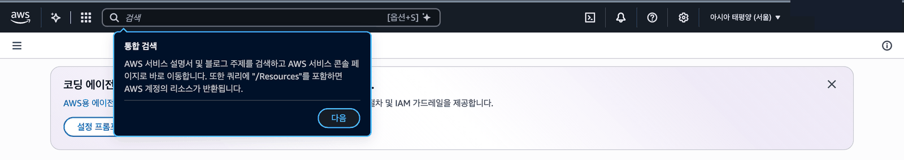
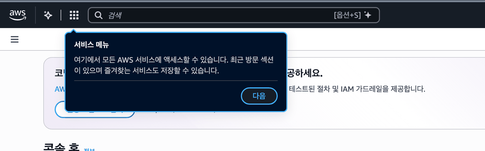
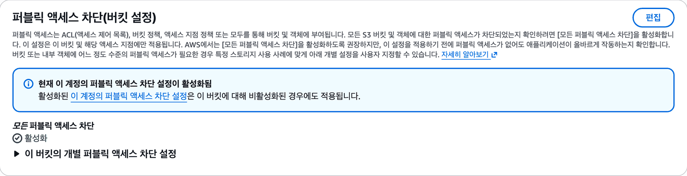
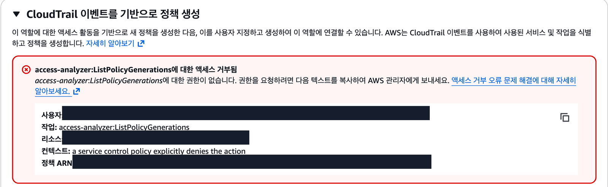
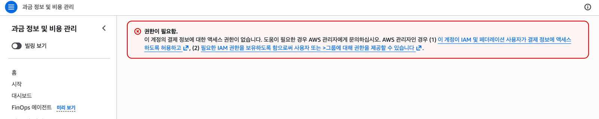

아래 화면은 실습이 틀려서 뜨는 것이 아닙니다. 닫거나 그대로 두고 넘어갑니다.

:::tip[콘솔 첫 화면의 안내 말풍선]{icon="approve-check-circle"}
닫고 시작합니다.

:::

:::tip[왼쪽 위 「서비스 메뉴」 안내 말풍선]{icon="approve-check-circle"}
콘솔을 처음 쓰는 사람에게 뜨는 안내입니다. 「다음」이나 말풍선 바깥을 눌러 닫고 하던 일을 이어 갑니다. 버킷 정책 편집처럼 다른 화면 위에 떠 있어도 실습과 상관없습니다.

:::

:::tip[Session Manager 화면의 Chrome 번역 말풍선]{icon="approve-check-circle"}
닫습니다.
:::

:::tip[S3 권한 탭에 뜨는 계정 차단 안내]{icon="approve-check-circle"}
> 「현재 이 계정의 퍼블릭 액세스 차단 설정이 활성화됨」

계정의 ACL 차단 안내입니다. 버킷 설정만 바꾸면 됩니다([7단원](/guestbook-lab/u7/)).

:::

:::tip[IAM 역할 화면에 뜨는 빨간 거부 상자]{icon="approve-check-circle"}
> 「access-analyzer:ListPolicyGenerations에 대한 액세스 거부됨」

이 수업에서 쓰지 않는 칸이라 그대로 둡니다.

:::

:::tip[요금(결제) 화면이 열리지 않음]{icon="approve-check-circle"}
수업 계정에서는 막혀 있을 수 있습니다.

:::
