쓰는 서비스: S3, IAM 역할

완료 기준: 올린 이미지가 방명록에 보인다

## 바뀌는 구조

방명록 서버가 사진을 자기 디스크가 아니라 S3 버킷에 저장하고, 페이지에는 잠깐만 유효한 주소(미리 서명된 URL)로 보여 줍니다. 버킷은 공개하지 않습니다.

## 만들 것

1. 사진을 담을 버킷을 만듭니다. <a href="https://s3.console.aws.amazon.com/s3/bucket/create?region=ap-northeast-2" target="_blank" rel="noopener">콘솔 열기 ↗</a>
   1. 「버킷 이름」 칸에 `guestbook-img-[좌석 번호]-[숫자]` 를 넣습니다. 예: `guestbook-img-s01-1112`

      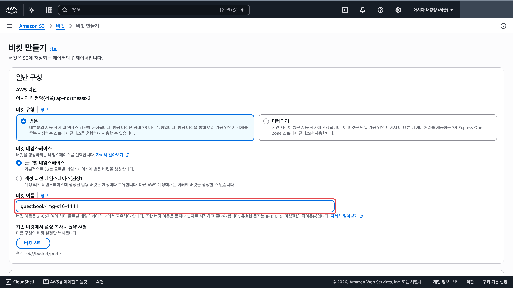

   2. 아래로 내려 「모든 퍼블릭 액세스 차단」이 켜져 있는지 봅니다. 켜진 그대로 두고 맨 아래 「버킷 만들기」를 누릅니다.

      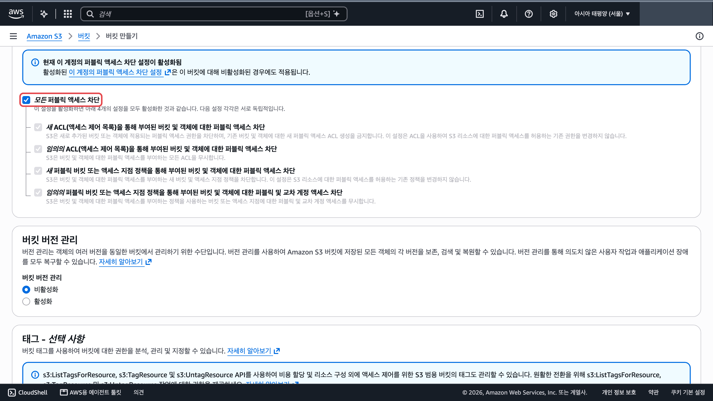

2. 서버 역할에 이 버킷에 사진을 넣고 읽을 권한을 붙입니다. <a href="https://console.aws.amazon.com/iam/home#/roles/details/guestbook-ec2-role?section=permissions" target="_blank" rel="noopener">guestbook-ec2-role 열기 ↗</a>
   1. IAM 역할 목록에서 `guestbook-ec2-role` 을 엽니다. 「권한 정책」 표 오른쪽 위 「권한 추가」(①) → 「인라인 정책 생성」(②)을 누릅니다.

      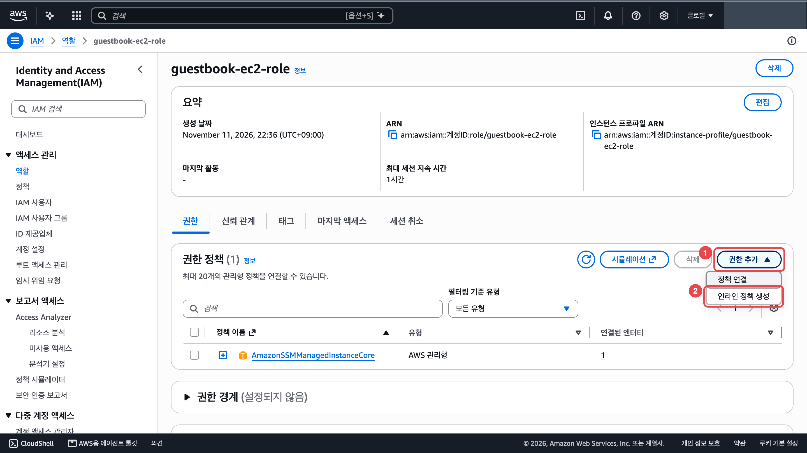

   2. 「정책 편집기」 오른쪽 「JSON」(①)을 누릅니다. 편집기 칸(②)의 내용을 모두 지우고 아래를 붙여 넣습니다. `버킷이름` 자리에는 1번에서 만든 버킷 이름을 넣습니다.

      ```json
      {
        "Version": "2012-10-17",
        "Statement": [{
          "Effect": "Allow",
          "Action": ["s3:PutObject", "s3:GetObject"],
          "Resource": "arn:aws:s3:::버킷이름/images/*"
        }]
      }
      ```

      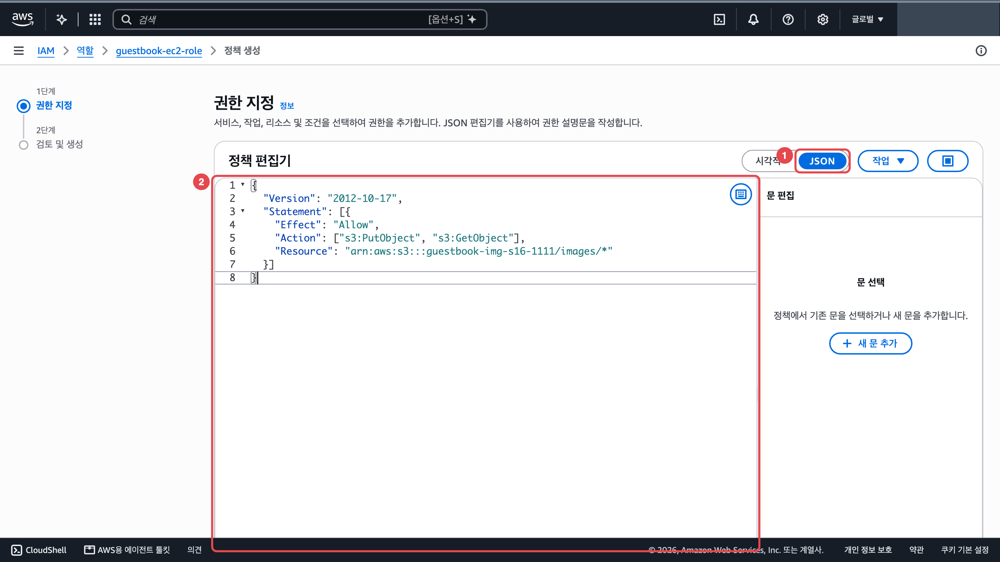

   3. 맨 아래 「다음」을 누릅니다. 「정책 이름」에 `guestbook-image` 를 넣습니다.

      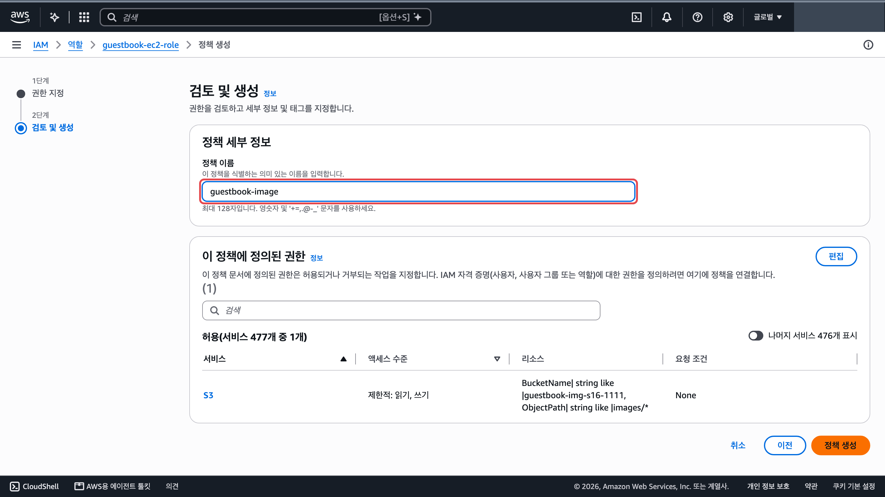

   4. 맨 아래 「정책 생성」을 누릅니다.

      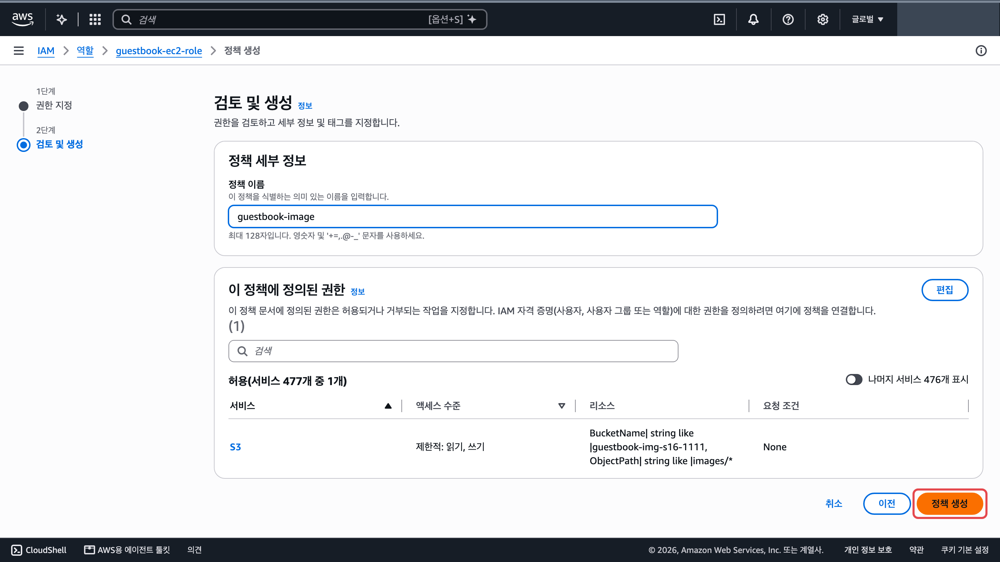

3. 로드 밸런서 뒤 서버 두 대를 찾습니다. 오토 스케일링이 만든 서버는 「Name」 칸이 비어 있어서 대상 그룹에서 인스턴스 ID 로 찾습니다. <a href="https://ap-northeast-2.console.aws.amazon.com/ec2/home?region=ap-northeast-2#TargetGroups:" target="_blank" rel="noopener">대상 그룹 ↗</a>
   1. 대상 그룹 목록에서 `guestbook-tg` 이름을 누릅니다.

      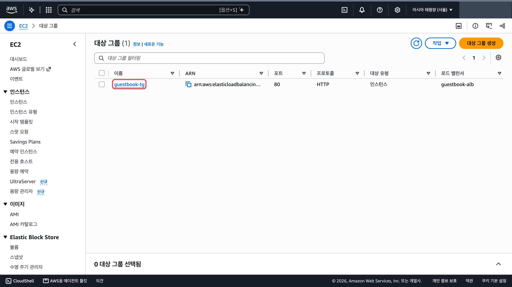

   2. 아래 「대상」 탭(①)에 인스턴스 ID 두 개(②)가 보입니다. 두 ID 의 끝 네 글자를 적어 둡니다.

      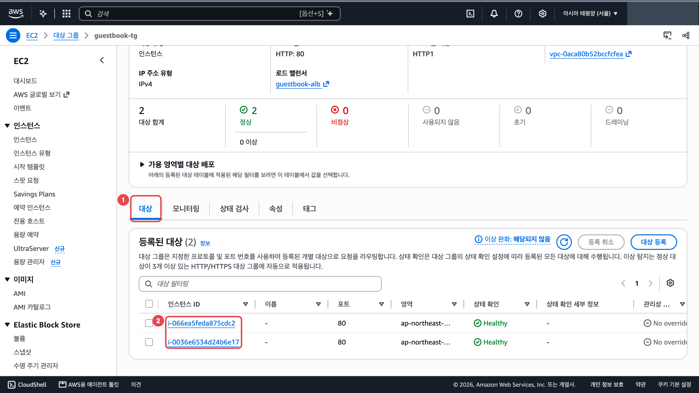

   3. 인스턴스 목록에서 첫 번째 ID 의 행을 체크(①)합니다. 「인스턴스 ID」(②)가 적어 둔 것과 같은지 보고 「연결」(③)을 누릅니다. 연결 화면에서 「SSM Session Manager」 카드 → 「연결」은 [9단원](/guestbook-lab/u9/) 4번과 같습니다. <a href="https://ap-northeast-2.console.aws.amazon.com/ec2/home?region=ap-northeast-2#Instances:" target="_blank" rel="noopener">인스턴스 ↗</a>

      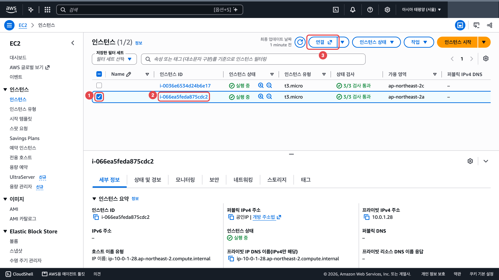

4. 첫 번째 서버에서 설정 파일을 고칩니다. 설정 파일에는 메뉴마다 쓸 줄이 미리 비어 있습니다. 새 줄을 더하면 같은 이름이 두 줄이 되고 아래쪽 줄 값이 쓰여서 헷갈리니 이미 있는 줄에 이어 씁니다.
   1. 설정 파일을 엽니다. 빈 `IMAGE_BUCKET=` 줄이 보입니다.

      ```bash
      # 앱 설정 파일을 nano 편집기로 엽니다
      sudo nano /opt/guestbook/config.env
      ```

      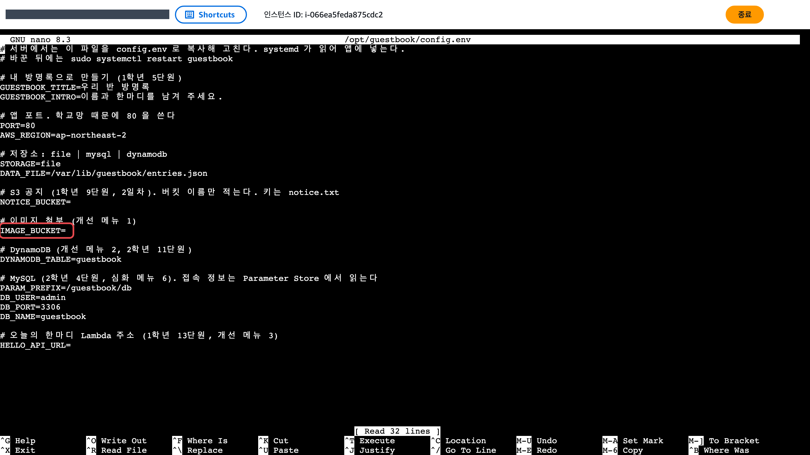

   2. 화살표 키로 `IMAGE_BUCKET=` 줄 끝까지 가서 `=` 바로 뒤에 버킷 이름을 적습니다(①). Ctrl+O(②)를 누르고 Enter 로 저장한 뒤 Ctrl+X(③)로 나옵니다.

      ```text
      IMAGE_BUCKET=버킷이름
      ```

      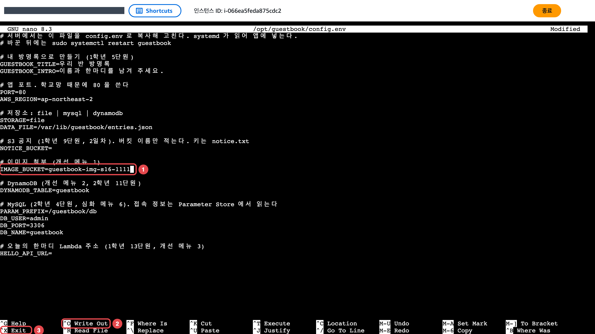

   3. 적은 줄을 다시 확인합니다.

      ```bash
      # 설정 파일 내용을 화면에 출력해 고친 줄을 확인합니다
      cat /opt/guestbook/config.env
      ```

      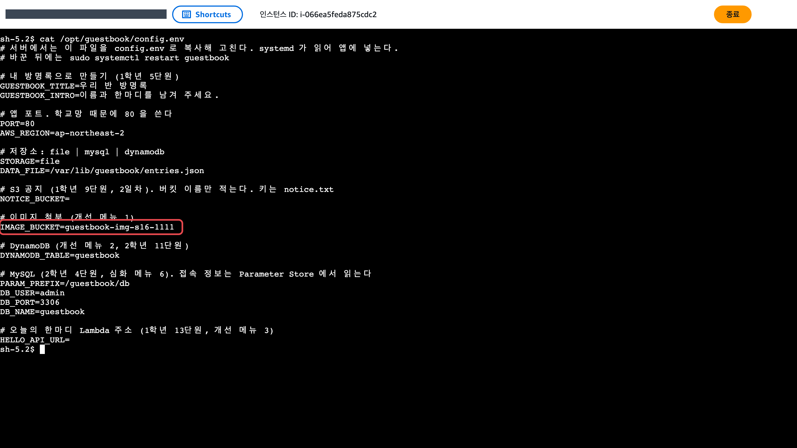

   4. 앱을 다시 켭니다.

      ```bash
      # 앱을 다시 켜서 바뀐 설정을 읽게 합니다
      sudo systemctl restart guestbook
      ```

5. 두 번째 서버에서도 똑같이 합니다. 3번의 3단계에서 두 번째 ID 의 행만 체크해 연결하고 4번을 그대로 합니다. 한 대만 바꾸면 새로고침할 때마다 파일 선택 칸이 보였다 안 보였다 합니다.

## 확인

1. 새 탭에 `http://로드 밸런서 DNS 이름` 을 엽니다([12단원](/guestbook-lab/u12/) 5번). 글 쓰는 칸 아래에 파일 선택 칸(①)이 생깁니다. 사진을 고르고 「남기기」(②)를 누릅니다. <a href="https://ap-northeast-2.console.aws.amazon.com/ec2/home?region=ap-northeast-2#LoadBalancers:" target="_blank" rel="noopener">로드 밸런서 ↗</a>

   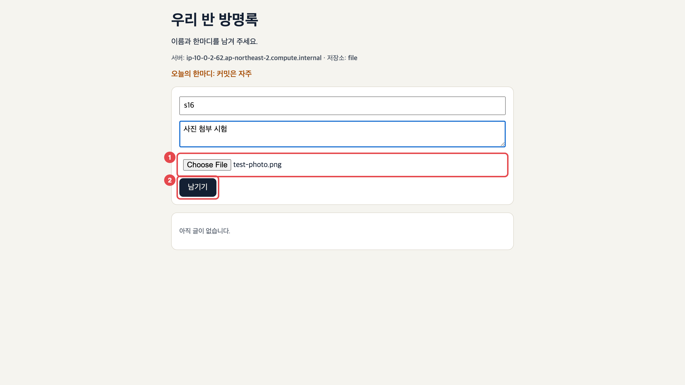

2. 글 아래에 올린 사진이 보입니다.

   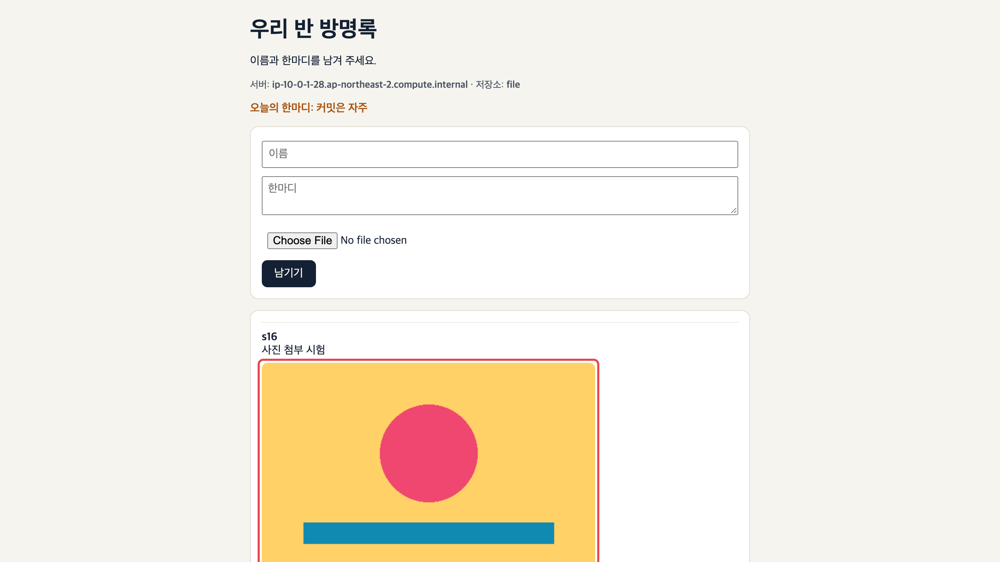

3. 사진 버킷의 「객체」 탭에 `images/` 폴더가 생겼는지 봅니다. <a href="https://s3.console.aws.amazon.com/s3/buckets?region=ap-northeast-2" target="_blank" rel="noopener">버킷 목록 ↗</a>

   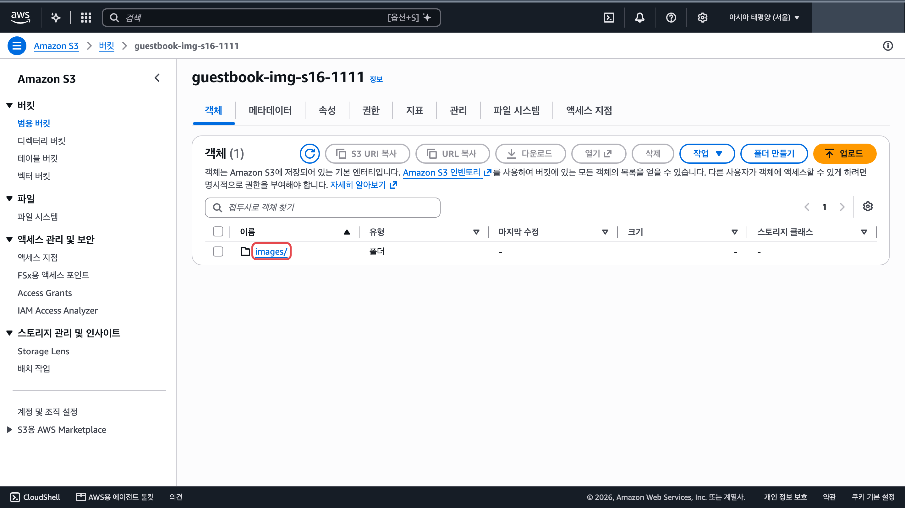

## 막히면

- 새로고침하면 사진 붙은 글이 보였다 안 보였다 합니다: 글은 아직 서버마다 자기 디스크에 저장됩니다(`저장소: file`). 사진은 S3 에 있지만 글은 올린 서버에만 남습니다. [메뉴 2](/guestbook-lab/menu/2-dynamodb/)까지 하면 두 서버가 같은 글과 사진을 보여 줍니다.
- 새로고침마다 파일 선택 칸이 보였다 사라집니다: 4번을 한 서버에만 했습니다. 두 번째 서버도 고칩니다.
- 업로드할 때 `AccessDenied` 또는 화면 오류: 정책의 버킷 이름과 `images/*` 경로를 봅니다.
- `IMAGE_BUCKET=` 줄을 못 찾겠습니다: nano 에서 Ctrl+W 를 누르고 `IMAGE_BUCKET` 을 쳐서 Enter 를 누르면 그 줄로 갑니다.
- 오토 스케일링이 서버를 새로 만들면(교체, 늘리기) 새 서버의 설정 파일은 처음 상태입니다. 새 서버도 3번과 4번 순서로 고칩니다.
