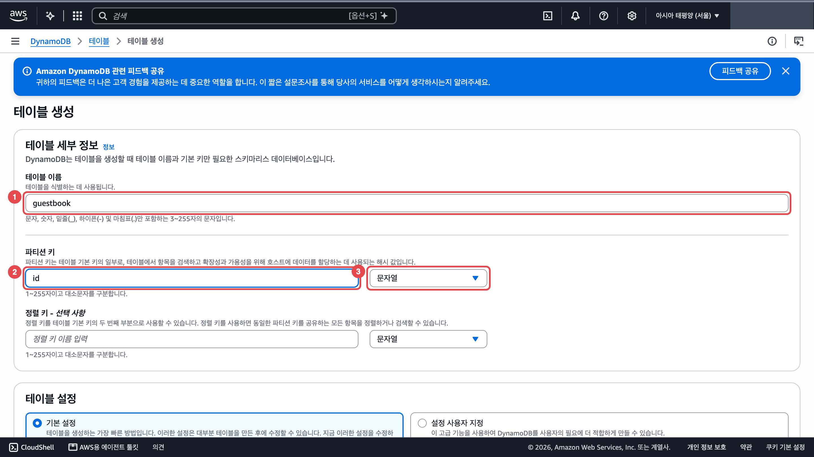
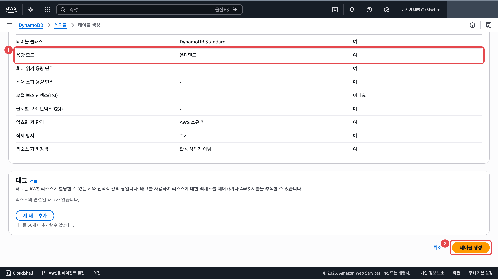
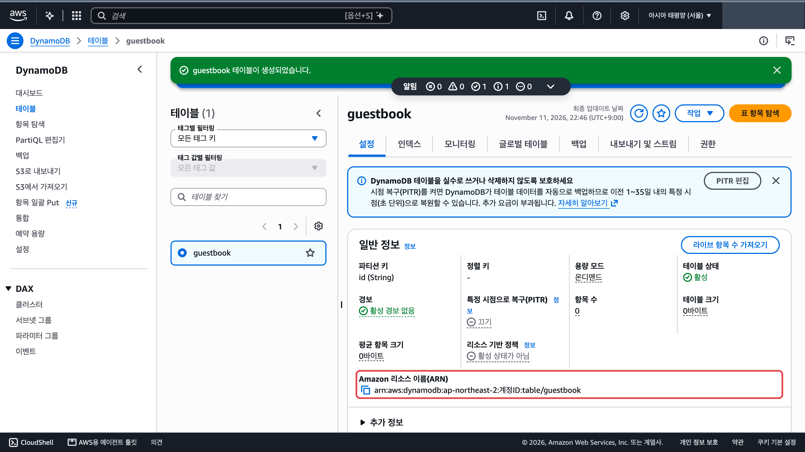
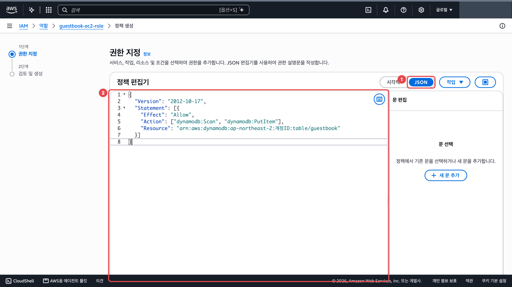
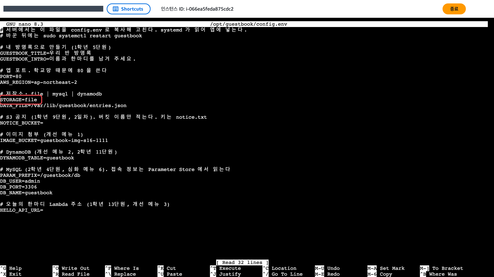
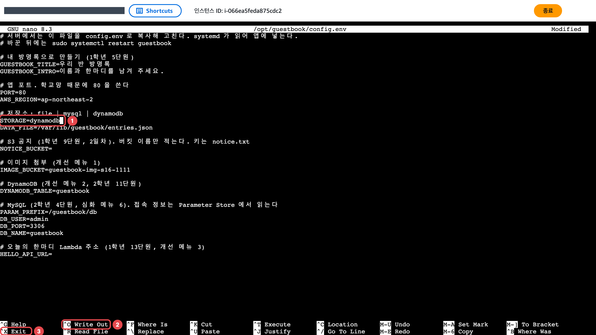
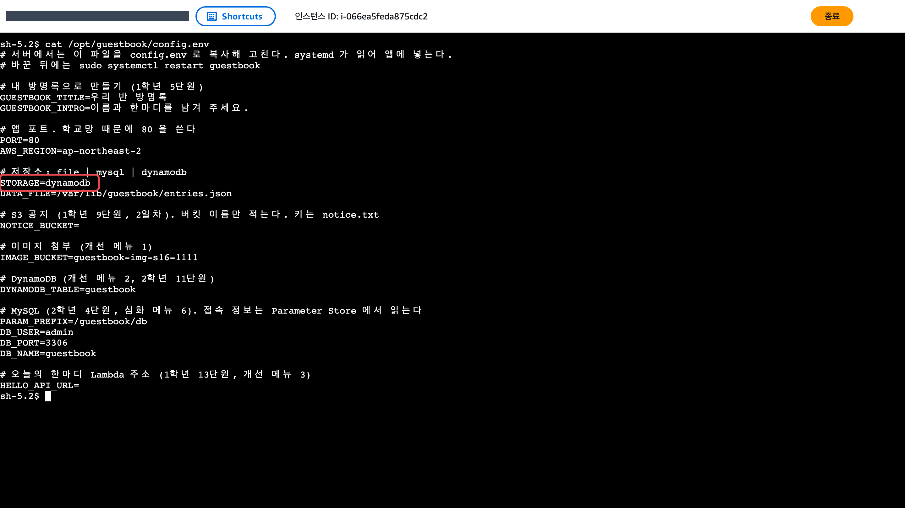
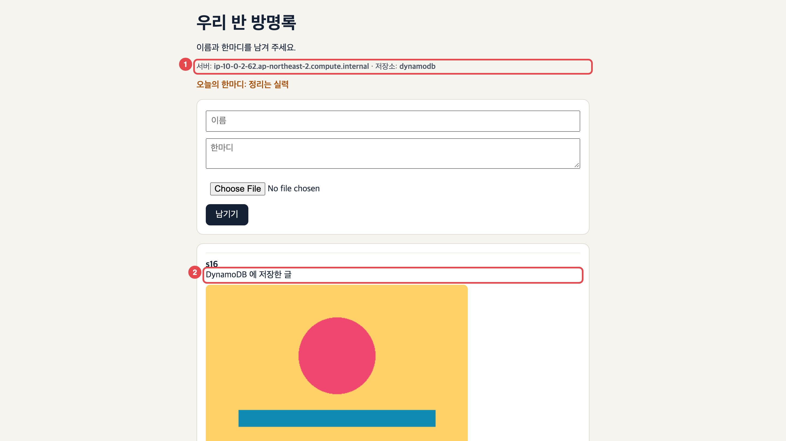
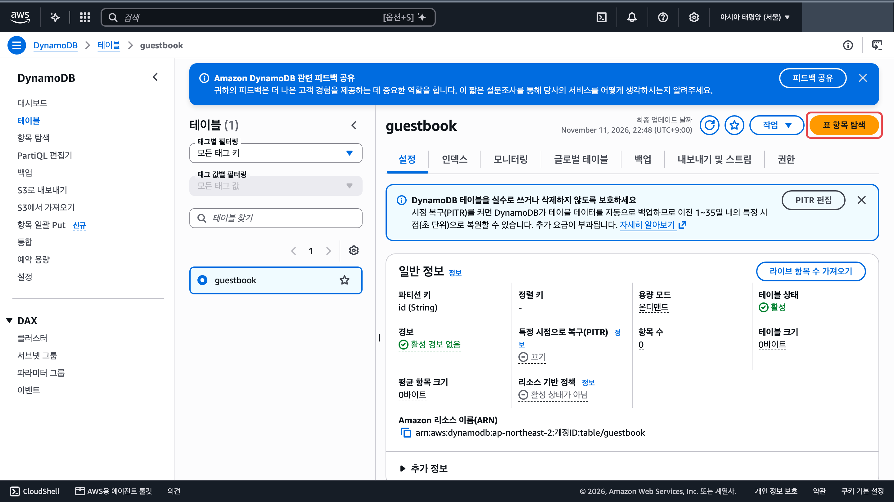
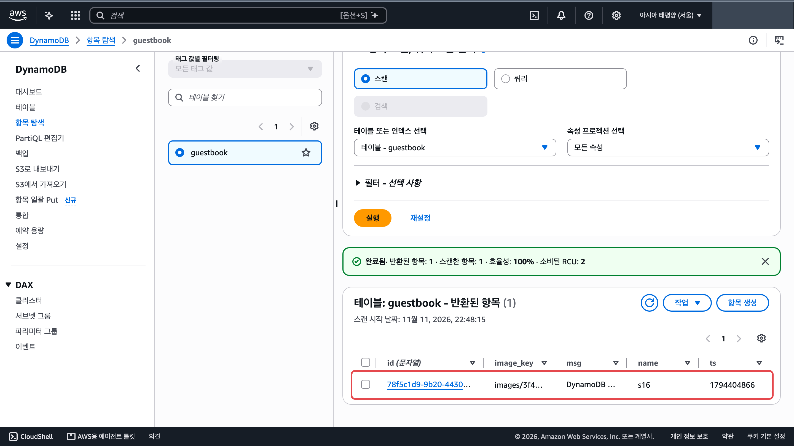

쓰는 서비스: DynamoDB

완료 기준: 글이 테이블에 쌓이고, 서버 두 대가 같은 글을 보여 준다

## 바뀌는 구조

지금 글은 서버 디스크의 파일에 저장돼서 서버가 바뀌면 사라집니다(11단원에서 새 서버로 옮길 때 본 그 문제). 저장소를 DynamoDB 테이블로 옮기면 서버가 몇 대든, 바뀌든 같은 글을 봅니다.

## 만들 것

1. DynamoDB 테이블을 만듭니다. <a href="https://ap-northeast-2.console.aws.amazon.com/dynamodbv2/home?region=ap-northeast-2#create-table" target="_blank" rel="noopener">콘솔 열기 ↗</a>
   1. 「테이블 이름」(①)에 `guestbook`, 「파티션 키」(②)에 `id` 를 넣고 오른쪽 형식(③)은 「문자열」 그대로 둡니다.

      

   2. 「테이블 설정」은 「기본 설정」 그대로 둡니다. 아래 표의 「용량 모드」가 「온디맨드」(①)인지 보고 맨 아래 「테이블 생성」(②)을 누릅니다. 「활성」이 될 때까지 1분쯤 걸립니다.

      

2. 테이블 주소(ARN)를 복사합니다. 테이블 목록에서 `guestbook` 을 눌러 「설정」 탭 「일반 정보」의 「Amazon 리소스 이름(ARN)」 옆 복사 아이콘을 누릅니다. 사진의 계정 번호는 가렸습니다. <a href="https://ap-northeast-2.console.aws.amazon.com/dynamodbv2/home?region=ap-northeast-2#tables" target="_blank" rel="noopener">테이블 목록 ↗</a>

   

3. 서버 역할에 테이블을 읽고 쓸 권한을 붙입니다. 순서는 [메뉴 1](/guestbook-lab/menu/1-image/) 2번과 같습니다. <a href="https://console.aws.amazon.com/iam/home#/roles/details/guestbook-ec2-role?section=permissions" target="_blank" rel="noopener">guestbook-ec2-role 열기 ↗</a>
   1. `guestbook-ec2-role` 의 「권한 추가」 → 「인라인 정책 생성」을 누릅니다.
   2. 「JSON」(①)을 누르고 편집기 칸(②)의 내용을 모두 지운 뒤 아래를 붙여 넣습니다. `테이블ARN` 자리에 2번에서 복사한 주소를 붙여 넣습니다.

      ```json
      {
        "Version": "2012-10-17",
        "Statement": [{
          "Effect": "Allow",
          "Action": ["dynamodb:Scan", "dynamodb:PutItem"],
          "Resource": "테이블ARN"
        }]
      }
      ```

      

   3. 맨 아래 「다음」 → 「정책 이름」에 `guestbook-dynamodb` → 「정책 생성」을 누릅니다.

4. 서버 두 대를 찾아 첫 번째 서버에 접속합니다. 순서는 [메뉴 1](/guestbook-lab/menu/1-image/) 3번과 같습니다(대상 그룹 `guestbook-tg` → 「대상」 탭의 인스턴스 ID 두 개 → 인스턴스 목록에서 한 행만 체크 → 「연결」).

5. 첫 번째 서버에서 설정 파일을 고칩니다. 설정 파일에는 메뉴마다 쓸 줄이 미리 있습니다. 새 줄을 더하면 같은 이름이 두 줄이 되고 아래쪽 줄 값이 쓰여서 헷갈리니 이미 있는 줄을 고칩니다.
   1. 설정 파일을 엽니다. `STORAGE=file` 줄이 보입니다.

      ```bash
      # 앱 설정 파일을 nano 편집기로 엽니다
      sudo nano /opt/guestbook/config.env
      ```

      

   2. 화살표 키로 `STORAGE=file` 줄 끝까지 가서 `file` 을 지우고 `dynamodb` 를 적습니다(①). Ctrl+O(②)를 누르고 Enter 로 저장한 뒤 Ctrl+X(③)로 나옵니다.

      ```text
      STORAGE=dynamodb
      ```

      

   3. 고친 줄을 다시 확인합니다.

      ```bash
      # 설정 파일 내용을 화면에 출력해 고친 줄을 확인합니다
      cat /opt/guestbook/config.env
      ```

      

   4. 앱을 다시 켭니다.

      ```bash
      # 앱을 다시 켜서 바뀐 설정을 읽게 합니다
      sudo systemctl restart guestbook
      ```

6. 두 번째 서버에서도 4번과 5번을 똑같이 합니다. 한 대만 바꾸면 새로고침할 때마다 `저장소: file` 과 `저장소: dynamodb` 가 번갈아 나오고, 쓴 글이 보였다 안 보였다 합니다.

## 확인

1. 새 탭에 `http://로드 밸런서 DNS 이름` 을 열어 글을 하나 씁니다. 새로고침하며 「서버:」 줄(①)이 바뀌어도 같은 글(②)이 보이는지 봅니다. 두 서버 모두 `저장소: dynamodb` 여야 합니다. <a href="https://ap-northeast-2.console.aws.amazon.com/ec2/home?region=ap-northeast-2#LoadBalancers:" target="_blank" rel="noopener">로드 밸런서 ↗</a>

   

   

2. 테이블 화면 오른쪽 위 「표 항목 탐색」을 누릅니다. 아래 「반환된 항목」 표에 쓴 글이 한 줄씩 쌓여 있는지 봅니다. <a href="https://ap-northeast-2.console.aws.amazon.com/dynamodbv2/home?region=ap-northeast-2#tables" target="_blank" rel="noopener">테이블 목록 ↗</a>

   

   

## 막히면

- 새로고침마다 저장소가 `file` 과 `dynamodb` 로 바뀝니다: 5번을 한 서버에만 했습니다. 두 번째 서버도 고칩니다.
- 전에 쓴 글이 사라졌습니다: 정상입니다. 전 글은 서버 디스크 파일에 있고 이제 앱은 테이블을 읽습니다.
- 역할 화면의 `access-analyzer:ListPolicyGenerations에 대한 액세스 거부됨` 빨간 상자: 이 메뉴에서 쓰지 않는 「정책 생성」 기능의 권한 오류라 무시해도 됩니다.
- 페이지가 `500 Internal Server Error`: 서버에서 아래 명령으로 앱 기록을 봅니다. `AccessDeniedException` 이면 정책의 ARN, `ResourceNotFoundException` 이면 테이블 이름을 봅니다.

  ```bash
  # 앱이 남긴 최근 기록 30줄을 봅니다
  sudo journalctl -u guestbook -n 30
  ```

- 오토 스케일링이 서버를 새로 만들면(교체, 늘리기) 새 서버는 다시 `저장소: file` 로 뜹니다. 새 서버도 4번과 5번 순서로 고칩니다.
