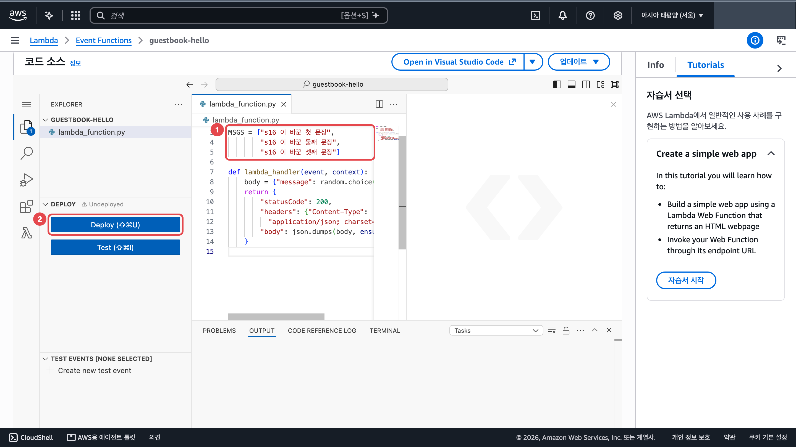
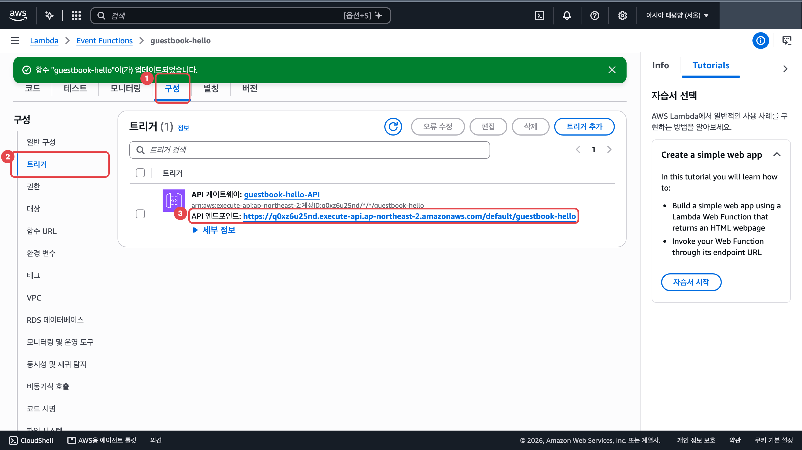
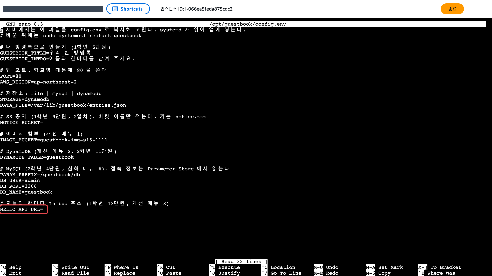
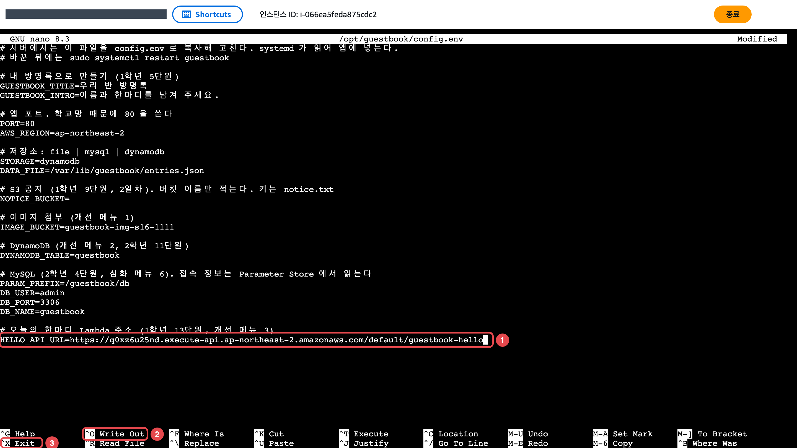
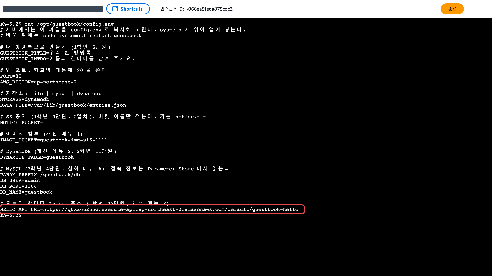
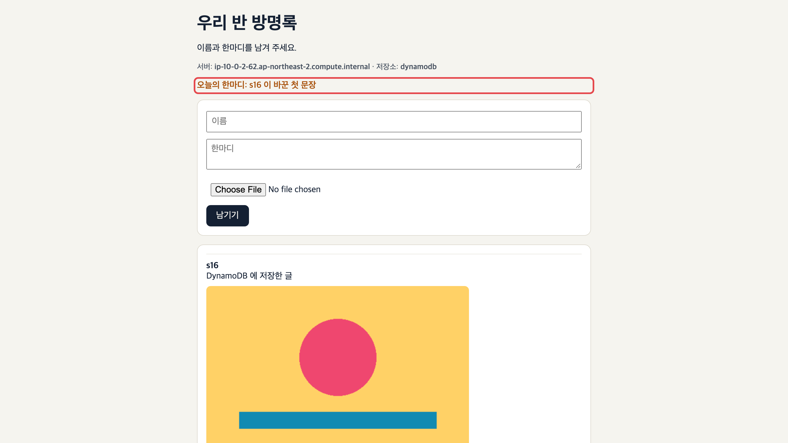
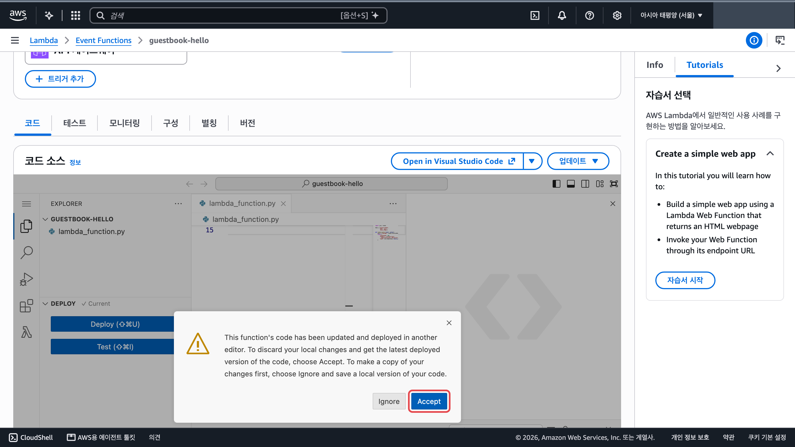

쓰는 서비스: Lambda, API Gateway

완료 기준: 내가 바꾼 문장이 방명록 「오늘의 한마디」에 나온다

## 바뀌는 구조

「오늘의 한마디」를 서버 안에서 고르지 않고 Lambda 함수가 골라 줍니다. 방명록 서버는 함수의 주소만 부릅니다.

## 만들 것

1. [13단원](/guestbook-lab/u13/)에서 만든 `guestbook-hello` 함수를 엽니다. 없으면 13단원대로 만들고 API 게이트웨이 트리거를 붙입니다. <a href="https://ap-northeast-2.console.aws.amazon.com/lambda/home?region=ap-northeast-2#/functions" target="_blank" rel="noopener">콘솔 열기 ↗</a>

2. 함수의 문장을 내 문장으로 바꿉니다. 아래 「코드」 탭 편집기에서 `MSGS` 의 따옴표 안 문장 세 개(①)를 내 문장으로 고치고 왼쪽 「DEPLOY」 구역의 「Deploy」(②)를 누릅니다. 위쪽에 초록 「업데이트되었습니다」가 보이면 됩니다.

   

3. 함수 주소를 복사합니다. 「구성」 탭(①) → 왼쪽 「트리거」(②)를 누르면 「API 엔드포인트:」 줄(③)에 주소가 있습니다. 주소 전체를 복사합니다.

   

4. 서버 두 대를 찾아 첫 번째 서버에 접속합니다. 순서는 [메뉴 1](/guestbook-lab/menu/1-image/) 3번과 같습니다(대상 그룹 `guestbook-tg` → 「대상」 탭의 인스턴스 ID 두 개 → 인스턴스 목록에서 한 행만 체크 → 「연결」).

5. 첫 번째 서버에서 설정 파일을 고칩니다. 설정 파일에는 메뉴마다 쓸 줄이 미리 비어 있습니다. 새 줄을 더하면 같은 이름이 두 줄이 되고 아래쪽 줄 값이 쓰여서 헷갈리니 이미 있는 줄에 이어 씁니다.
   1. 설정 파일을 엽니다. 맨 아래 빈 `HELLO_API_URL=` 줄이 보입니다.

      ```bash
      # 앱 설정 파일을 nano 편집기로 엽니다
      sudo nano /opt/guestbook/config.env
      ```

      

   2. 화살표 키로 `HELLO_API_URL=` 줄 끝까지 가서 `=` 바로 뒤에 3번에서 복사한 주소를 붙여 넣습니다(①). 붙여 넣기가 안 되면 주소를 보고 그대로 칩니다. Ctrl+O(②)를 누르고 Enter 로 저장한 뒤 Ctrl+X(③)로 나옵니다.

      ```text
      HELLO_API_URL=https://(API 주소).execute-api.ap-northeast-2.amazonaws.com/default/guestbook-hello
      ```

      

   3. 적은 줄을 다시 확인합니다. 주소 끝이 `/default/guestbook-hello` 인지 봅니다.

      ```bash
      # 설정 파일 내용을 화면에 출력해 고친 줄을 확인합니다
      cat /opt/guestbook/config.env
      ```

      

   4. 앱을 다시 켭니다.

      ```bash
      # 앱을 다시 켜서 바뀐 설정을 읽게 합니다
      sudo systemctl restart guestbook
      ```

6. 두 번째 서버에서도 4번과 5번을 똑같이 합니다. 한 대만 바꾸면 새로고침할 때마다 내 문장과 원래 문장이 번갈아 나옵니다.

## 확인

새 탭에 `http://로드 밸런서 DNS 이름` 을 엽니다. 「오늘의 한마디」에 내가 넣은 문장이 나옵니다. 새로고침하며 서버가 바뀌어도 내 문장만 나와야 합니다. 브라우저로 함수 주소를 직접 열어도 `{"message": "내 문장"}` 이 옵니다. <a href="https://ap-northeast-2.console.aws.amazon.com/ec2/home?region=ap-northeast-2#LoadBalancers:" target="_blank" rel="noopener">로드 밸런서 ↗</a>



## 막히면

- 한마디 자리에 `(한마디 API 오류: ...)`: 주소 끝의 `/default/guestbook-hello` 까지 정확히 넣었는지, 브라우저로 그 주소를 열었을 때 응답이 오는지 봅니다.
- 새로고침마다 내 문장과 원래 문장이 번갈아 나옵니다: 5번을 한 서버에만 했습니다. 두 번째 서버도 고칩니다.
- 함수 화면에 Accept 와 Ignore 가 있는 창이 뜹니다: 「Accept」를 누르고 문장을 다시 고친 뒤 「Deploy」 합니다. 다른 창에서 코드가 바뀌어 배포됐다는 안내입니다.

  

- Deploy 했는데 문장이 그대로입니다: 함수 주소를 브라우저로 열어 새 문장이 나오는지 먼저 봅니다. 나오면 서버 설정, 안 나오면 Deploy 를 다시 봅니다.
- 오토 스케일링이 서버를 새로 만들면(교체, 늘리기) 새 서버의 설정 파일은 처음 상태입니다. 새 서버도 4번과 5번 순서로 고칩니다.
