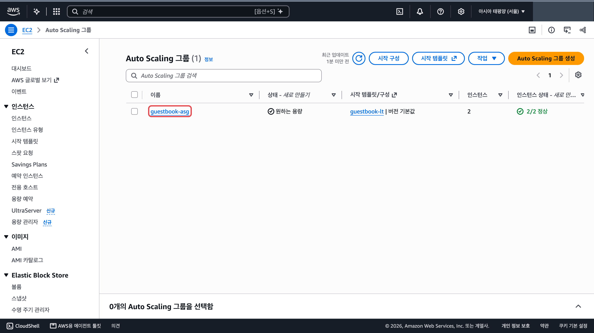
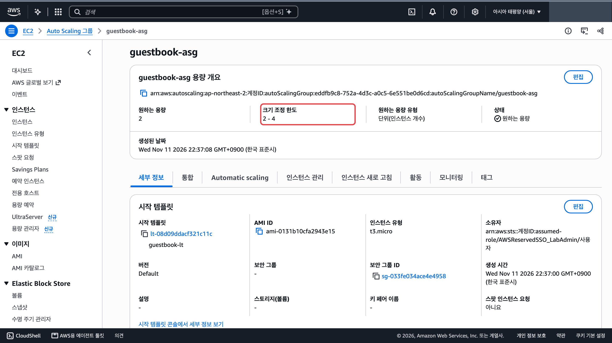
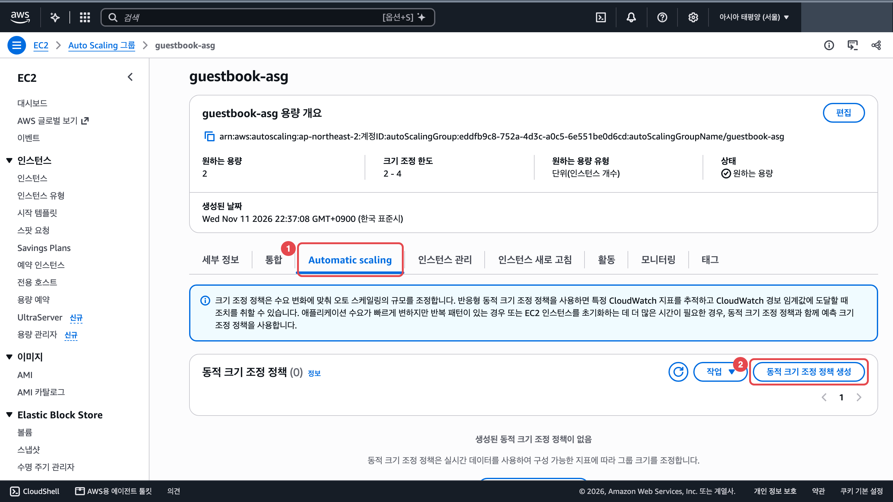
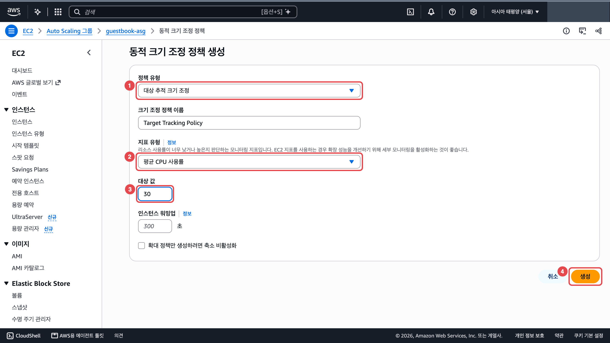
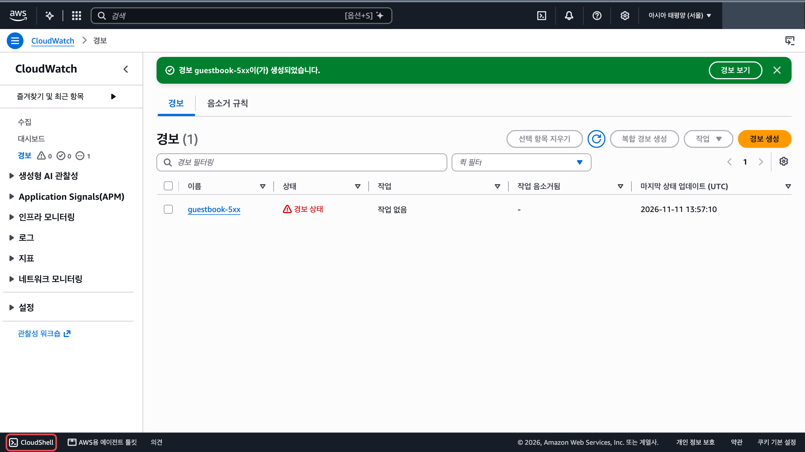
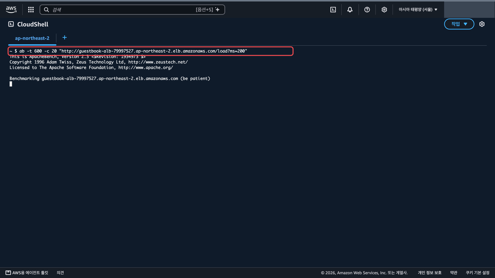
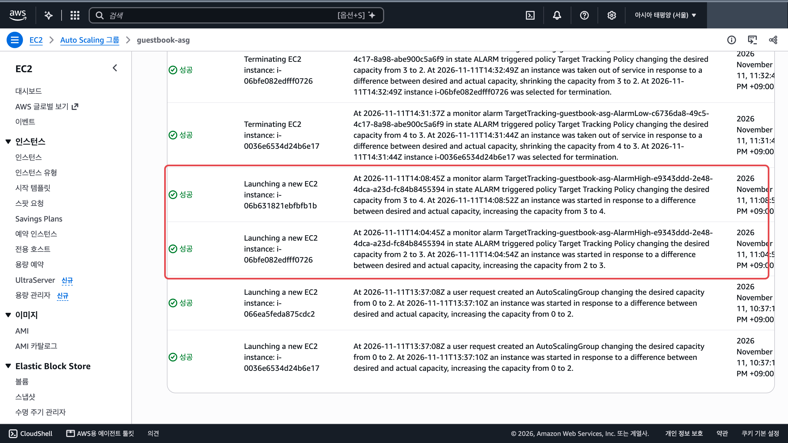

쓰는 서비스: 오토 스케일링, CloudShell

완료 기준: 부하를 걸면 서버 수가 늘어난다

## 바뀌는 구조

오토 스케일링 그룹에 「평균 CPU 사용률을 30%로 유지」 목표를 줍니다. 바빠지면 AWS가 서버를 늘리고, 한가해지면 줄입니다. 방명록 앱은 서버의 CPU 두 개 중 하나만 쓰기 때문에 아무리 바빠도 평균 CPU 가 50% 근처에서 멈춥니다. 그래서 목표를 50 보다 낮은 30 으로 둡니다.

다른 메뉴(1, 2, 3)를 했다면 이 메뉴를 **맨 마지막에** 합니다. 부하가 끝나고 서버를 줄일 때 오토 스케일링이 손으로 설정을 고친 서버를 지울 수 있습니다(아래 「막히면」).

## 만들 것

1. 오토 스케일링 그룹 목록에서 `guestbook-asg` 이름을 누릅니다. <a href="https://ap-northeast-2.console.aws.amazon.com/ec2/home?region=ap-northeast-2#AutoScalingGroups:" target="_blank" rel="noopener">콘솔 열기 ↗</a>

   

2. 위 「용량 개요」의 「크기 조정 한도」가 `2 - 4` 인지 봅니다(12단원에서 최대 4로 만들었습니다).

   

3. 「Automatic scaling」 탭(①)을 누르고 「동적 크기 조정 정책 생성」(②)을 누릅니다.

   

4. 「정책 유형」은 「대상 추적 크기 조정」(①), 「지표 유형」은 「평균 CPU 사용률」(②) 그대로 두고 「대상 값」(③)을 `30` 으로 바꿉니다. 오른쪽 아래 「생성」(④)을 누릅니다.

   

5. CloudShell 에서 부하를 겁니다. 콘솔 왼쪽 아래 「CloudShell」을 눌러 엽니다. 처음 열면 소개 창이 뜨니 「닫기」를 누릅니다. `로드밸런서주소` 자리에는 내 로드 밸런서 DNS 이름을 넣습니다. 부하는 15분 동안 걸리니 그동안 CloudShell 창을 닫지 않습니다. CloudShell 을 다시 연결했으면 `which ab` 로 ab 가 남아 있는지 먼저 봅니다. 아무것도 나오지 않으면 설치 줄부터 다시 칩니다. <a href="https://ap-northeast-2.console.aws.amazon.com/cloudshell/home?region=ap-northeast-2" target="_blank" rel="noopener">CloudShell ↗</a>

   

   `ab` 는 웹사이트에 요청을 쏟아부어 보는 시험 도구입니다. 아래 명령에서 `-t 900` 은 900초(15분) 동안, `-c 20` 은 요청을 동시에 20개씩 보낸다는 뜻입니다. `/load?ms=200` 은 요청 하나마다 서버 CPU 를 0.2초 바쁘게 만드는 방명록 앱 주소입니다.

   ```bash
   # 부하를 거는 도구 ab 를 설치합니다
   sudo dnf install -y httpd-tools
   # ab 가 설치됐는지 봅니다. /usr/bin/ab 가 나오면 됩니다
   which ab
   # 로드 밸런서에 15분 동안 요청 20개씩을 쉬지 않고 보내 서버를 바쁘게 만듭니다
   ab -t 900 -c 20 "http://로드밸런서주소/load?ms=200"
   ```

   

## 확인

부하를 건 뒤 4~8분 사이에 서버가 늘어납니다. `guestbook-asg` 의 「활동」 탭을 새로 고침하면 「Launching a new EC2 instance」 줄이 생기고 설명에 `AlarmHigh` 와 `increasing the capacity from 2 to 3` 이 보입니다. 방명록을 새로고침하면 처음 보는 서버 이름이 섞여 나옵니다. 늘어나는 데 몇 분 걸렸는지 적어 두고 발표에서 말합니다. <a href="https://ap-northeast-2.console.aws.amazon.com/ec2/home?region=ap-northeast-2#AutoScalingGroups:" target="_blank" rel="noopener">콘솔 열기 ↗</a>



부하가 끝나면 약 15분 뒤부터 서버가 한 대씩 줄어 2대로 돌아갑니다(「Terminating EC2 instance」 줄).

## 막히면

- 15분이 지나도 서버가 안 늘어납니다: CloudShell 에 `ab: command not found` 가 떠 있지 않은지 봅니다. CloudShell 은 한동안 손대지 않으면 연결이 끊기고, 다시 연결하면 설치한 `ab` 가 사라집니다. 설치 명령부터 다시 칩니다.
- 대상 값을 50 으로 두었습니다: 이 앱은 평균 CPU 가 50% 를 넘기 어렵습니다. 정책을 체크하고 「작업」 → 「편집」에서 30 으로 바꿉니다.
- 부하가 끝난 뒤 메뉴 1, 2, 3 설정이 사라졌습니다: 서버를 줄일 때 오토 스케일링이 손으로 고친 서버를 지웠습니다. 남은 서버와 새 서버는 설정 파일이 처음 상태일 수 있습니다. [메뉴 1](/guestbook-lab/menu/1-image/) 3번 순서로 서버를 찾아 설정을 다시 고칩니다.
- 부하를 멈추면 줄어드는 데는 늘어날 때보다 더 오래 걸립니다. 정상입니다.
