쓰는 서비스: CloudWatch 경보(알람)

완료 기준: 오류를 일으키면 경보 상태가 「경보 상태」(ALARM)로 바뀐다

## 바뀌는 구조

사람이 화면을 계속 보지 않아도, 서비스가 실패하기 시작하면 CloudWatch가 먼저 알아챕니다. 로드 밸런서가 서버에서 받은 5XX 오류 수를 1분마다 세어 5번을 넘으면 경보 상태가 됩니다.

## 만들 것

1. 경보를 걸 지표가 생기도록 오류를 먼저 몇 번 일으킵니다. 지표는 오류가 한 번이라도 난 뒤에 목록에 나옵니다. 콘솔 왼쪽 아래 「CloudShell」을 눌러 엽니다. 처음 열면 소개 창이 뜨니 「닫기」를 누릅니다. <a href="https://ap-northeast-2.console.aws.amazon.com/cloudshell/home?region=ap-northeast-2" target="_blank" rel="noopener">CloudShell ↗</a>

   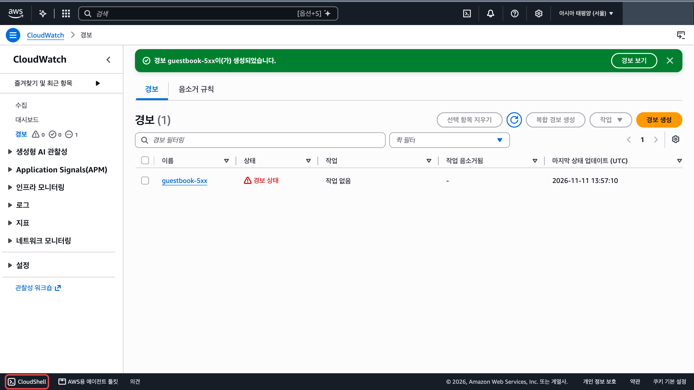

   `로드밸런서주소` 자리에 내 로드 밸런서 DNS 이름을 넣어 칩니다.

   ```bash
   # 오류를 내는 주소를 50번 불러 5XX 오류를 일으킵니다
   for i in $(seq 50); do curl -s -o /dev/null http://로드밸런서주소/error; done
   ```

   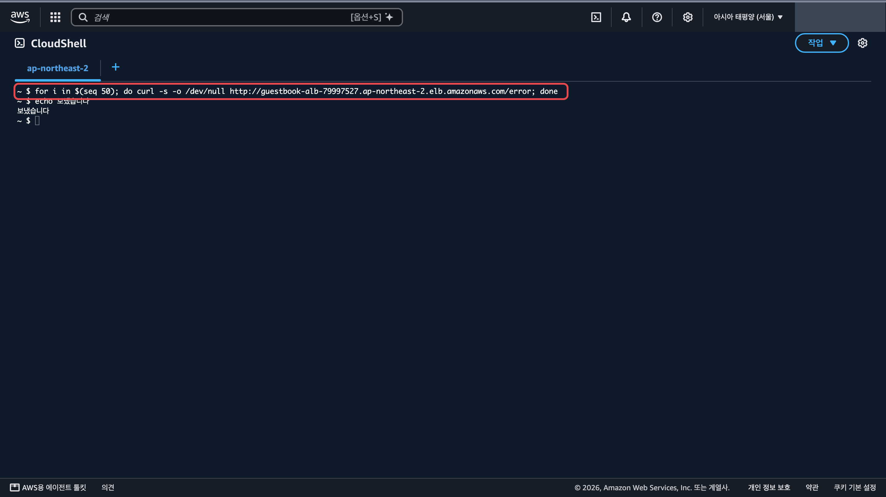

2. 경보 생성 화면을 엽니다. 「지표」 칸의 주황 「지표 선택」을 누릅니다. <a href="https://ap-northeast-2.console.aws.amazon.com/cloudwatch/home?region=ap-northeast-2#alarmsV2:create" target="_blank" rel="noopener">경보 생성 ↗</a>

3. 「지표 선택」 창에서 지표를 고릅니다.
   1. 「ApplicationELB」를 누릅니다.

      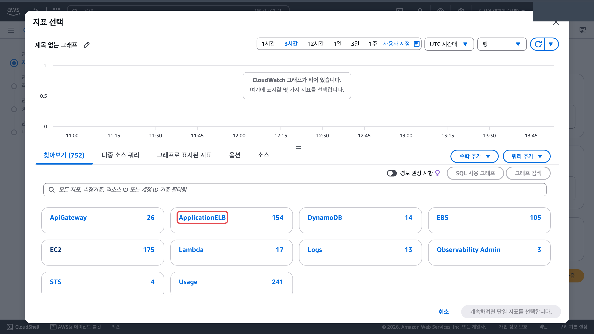

   2. 「AppELB별 지표」를 누릅니다.

      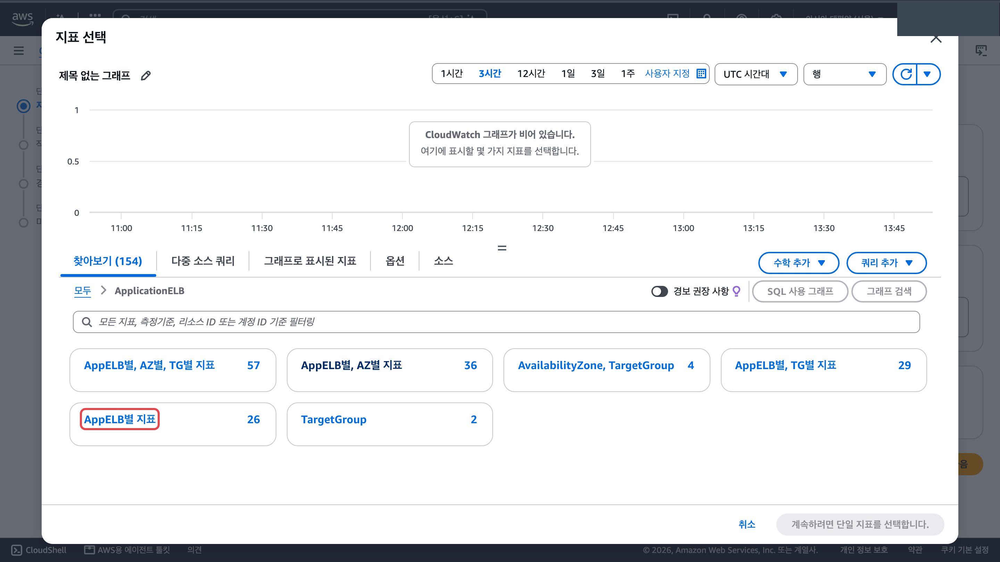

   3. 검색칸(①)에 `HTTPCode_Target_5XX_Count` 를 넣고 Enter 를 누릅니다. `app/guestbook-alb/...` 행을 체크(②)하고 오른쪽 아래 「지표 선택」(③)을 누릅니다.

      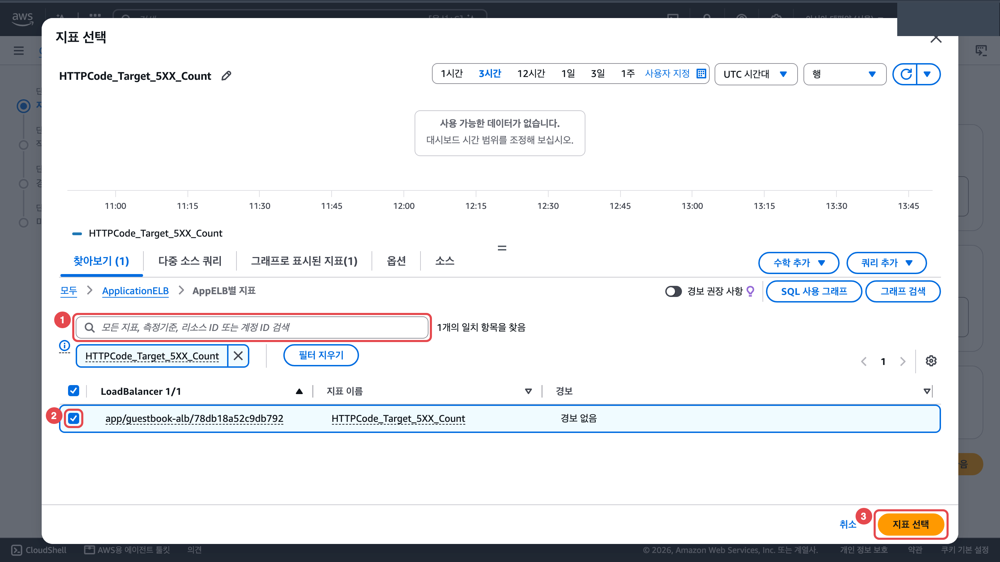

4. 1단계 「지표 및 조건 지정」에서 값을 넣습니다.
   1. 「통계」(①)를 「합계」로, 「기간」(②)을 「1분」으로 바꿉니다.

      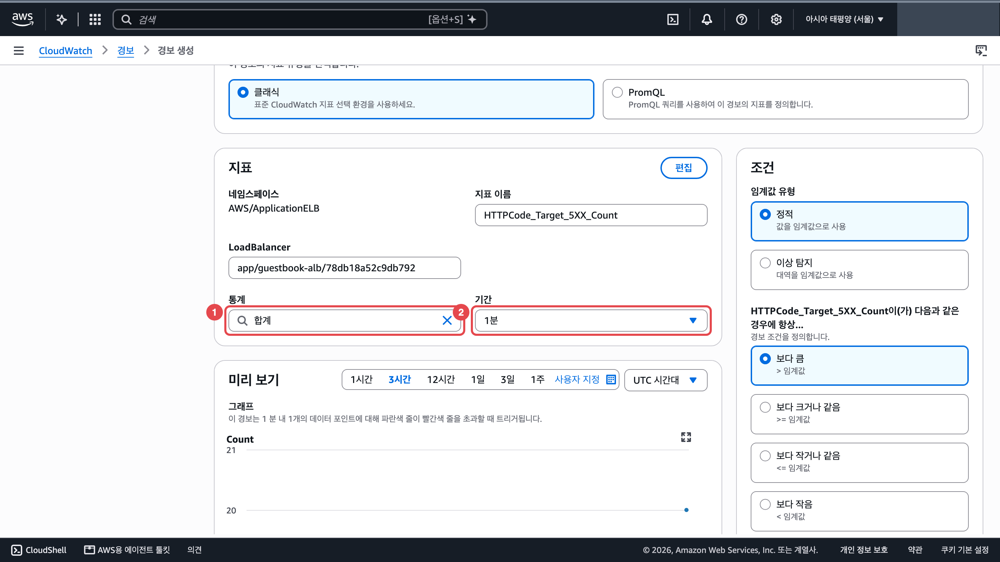

   2. 아래 「조건」에서 「보다 큼」(①)을 그대로 두고 「...보다」 칸(②)에 `5` 를 넣습니다.

      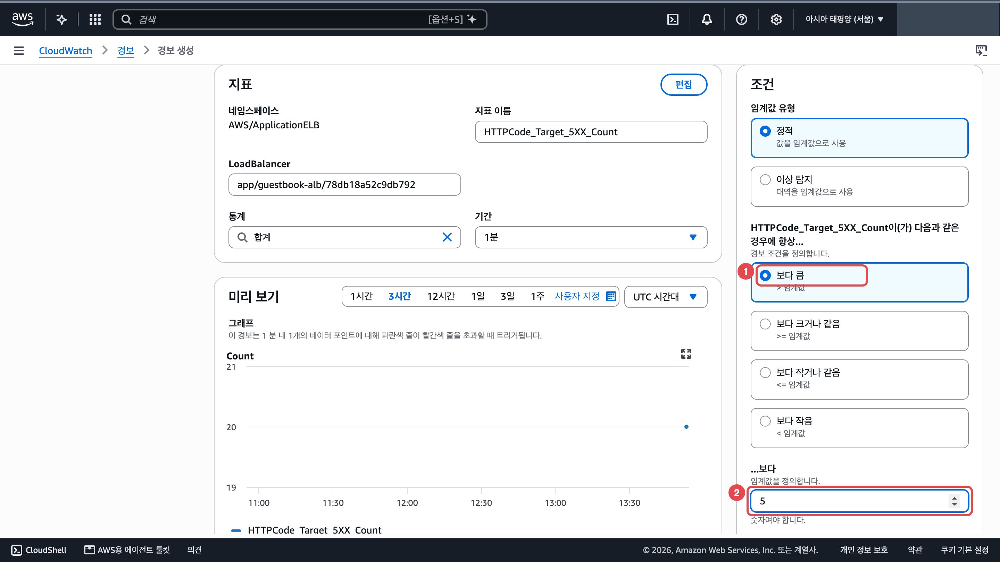

   3. 맨 아래 「다음」을 누릅니다.

5. 2단계 「작업 구성」에서는 알림을 보내지 않습니다(학생 연락처를 쓰지 않습니다).
   1. 「알림」 칸 오른쪽 「제거」를 누릅니다.

      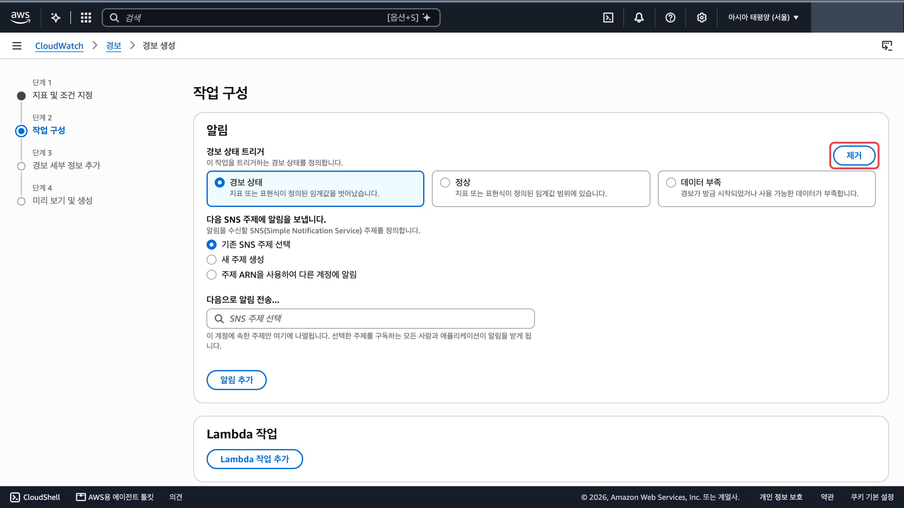

   2. 맨 아래 「다음」을 누르면 「구성된 작업 없음」 창이 뜹니다. 「작업 없이 계속 진행」을 누릅니다.

      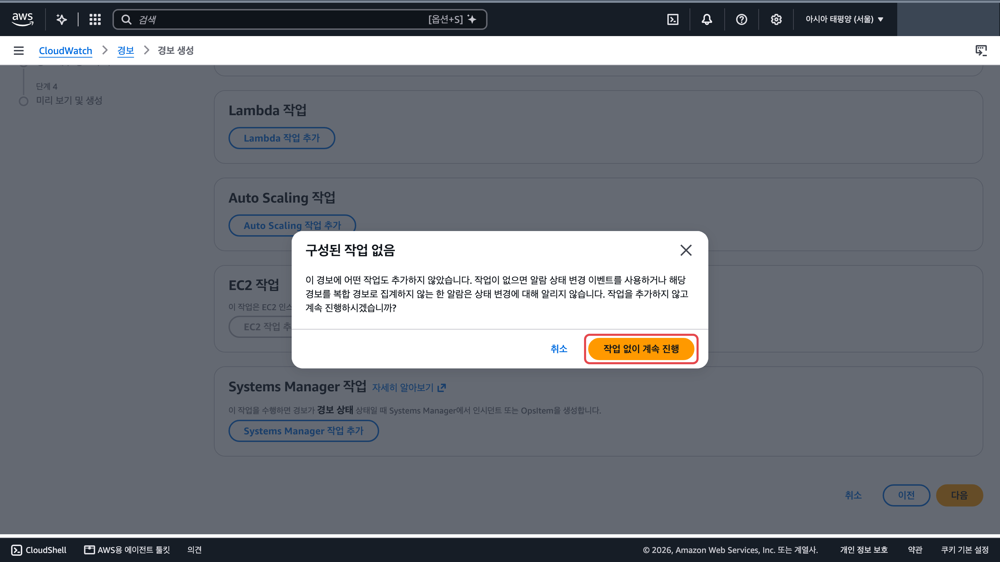

6. 3단계 「경보 세부 정보 추가」의 「경보 이름」에 `guestbook-5xx` 를 넣고 「다음」을 누릅니다.

   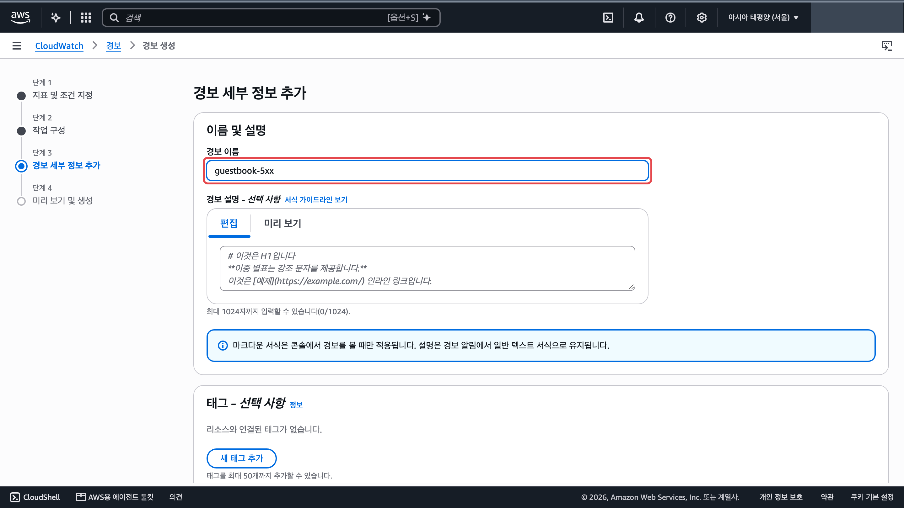

7. 4단계 「미리 보기 및 생성」 맨 아래 주황 「경보 생성」을 누릅니다. 처음 상태는 「데이터 부족」입니다.

   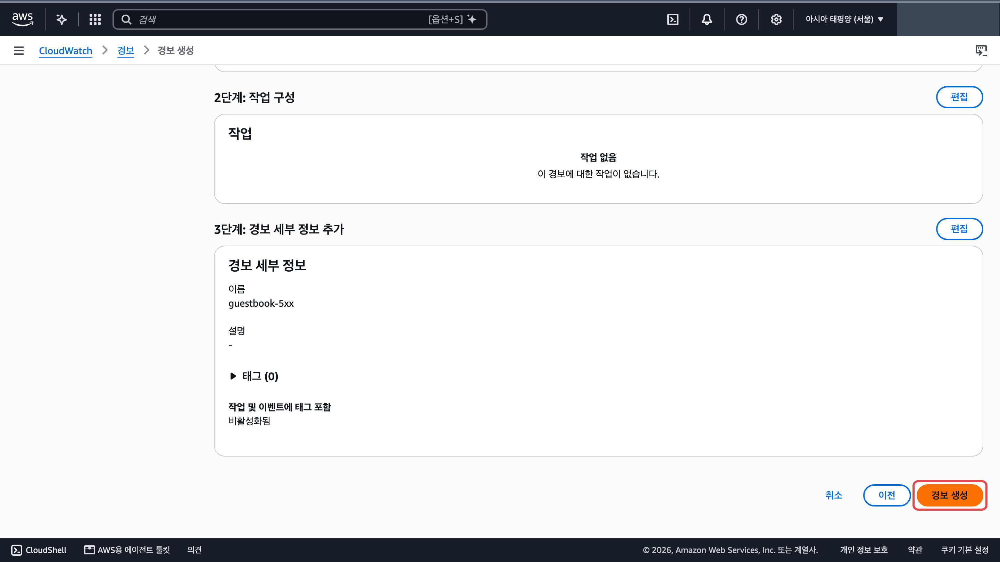

## 확인

CloudShell 에서 1번 명령을 한 번 더 칩니다. 1~2분 뒤 경보 목록을 새로 고침하면 `guestbook-5xx` 의 상태가 「경보 상태」로 바뀝니다. 오류를 멈추면 몇 분 뒤 「정상」으로 돌아옵니다. <a href="https://ap-northeast-2.console.aws.amazon.com/cloudwatch/home?region=ap-northeast-2#alarmsV2:" target="_blank" rel="noopener">경보 목록 ↗</a>

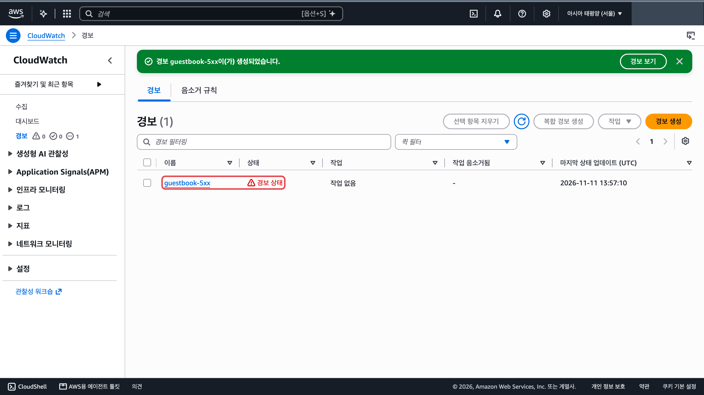

## 막히면

- 지표 목록에 `HTTPCode_Target_5XX_Count` 가 없습니다: 오류가 아직 한 번도 안 났습니다. 1번 명령을 치고 1~2분 뒤 「지표 선택」 창을 다시 엽니다.
- 계속 「데이터 부족」입니다: 경보를 만든 뒤 오류를 일으키지 않았습니다. 1번 명령을 다시 치고 1~2분 기다립니다.
