쓰는 서비스: RDS, Parameter Store, 보안 그룹

완료 기준: 페이지에 `저장소: mysql` 이 보이고, 글을 쓴 뒤 앱을 다시 켜도 글이 남아 있다

2학년과 빨리 끝낸 학생용입니다. DB 만들기에 약 5분 걸리니 **1번부터 바로 시작**하고 기다리는 동안 2~4번을 합니다.

## 바뀌는 구조

글을 서버 디스크 대신 RDS MySQL 에 저장합니다. DB 는 인터넷에 열지 않고, 방명록 서버의 보안 그룹에서 오는 연결만 받습니다. DB 주소와 비밀번호는 코드나 설정 파일이 아니라 Parameter Store 에 두고 앱이 실행될 때 읽어 갑니다.

## 만들 것

1. DB 를 만듭니다. 화면이 길어서 위에서부터 차례로 내려가며 고칩니다. <a href="https://ap-northeast-2.console.aws.amazon.com/rds/home?region=ap-northeast-2#launch-dbinstance:" target="_blank" rel="noopener">콘솔 열기 ↗</a>
   1. 「엔진 옵션」에서 「MySQL」(①)을 누릅니다. 처음에는 Aurora PostgreSQL 이 골라져 있습니다. 「데이터베이스 생성 방식」은 「전체 구성」(②), 「템플릿」은 「프리 티어」(③)를 고릅니다.

      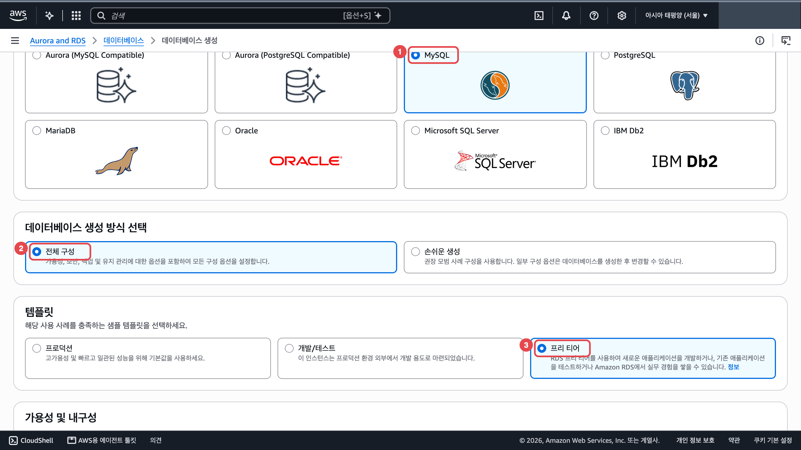

   2. 「DB 인스턴스 식별자」(①)를 `guestbook-db` 로 바꿉니다. 「마스터 사용자 이름」(②)은 `admin` 그대로, 「자격 증명 관리」는 「자체 관리」(③)인지 봅니다. 「마스터 암호」와 「마스터 암호 확인」(④)에 같은 비밀번호를 넣고 메모해 둡니다(8자 이상, `/ ' " @` 는 쓸 수 없습니다).

      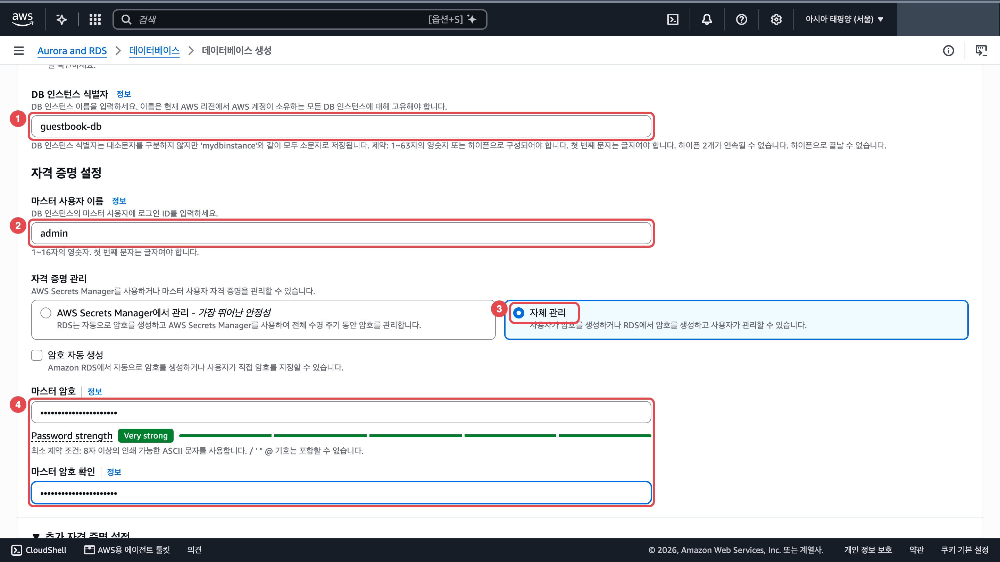

   3. 「인스턴스 구성」의 인스턴스 유형(①)이 `db.t4g.micro`, 「할당된 스토리지」(②)가 `20` 인지 봅니다. 「추가 스토리지 구성」(③)을 눌러 펼치고 「스토리지 자동 조정 활성화」(④) 체크를 끕니다.

      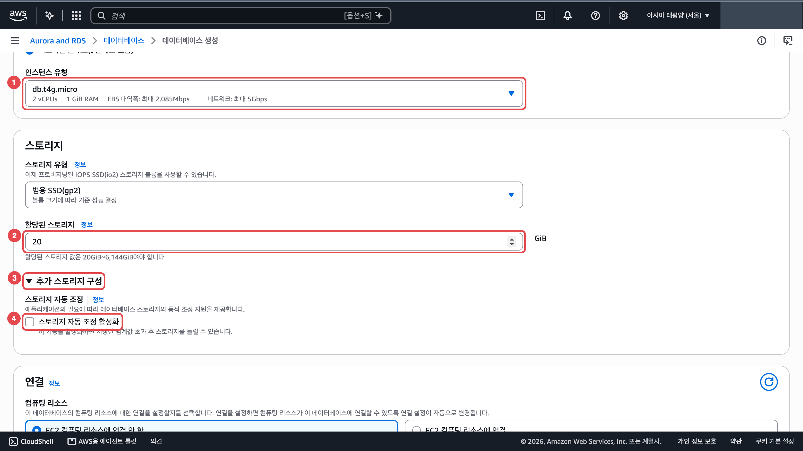

   4. 「연결」에서 「Virtual Private Cloud(VPC)」(①)를 `guestbook-vpc` 로 바꿉니다(처음 값은 Default VPC). 「퍼블릭 액세스」는 「아니요」(②) 그대로 둡니다. 「VPC 보안 그룹(방화벽)」은 「새로 생성」(③)을 고르고 「새 VPC 보안 그룹 이름」(④)에 `guestbook-db` 를 넣습니다.

      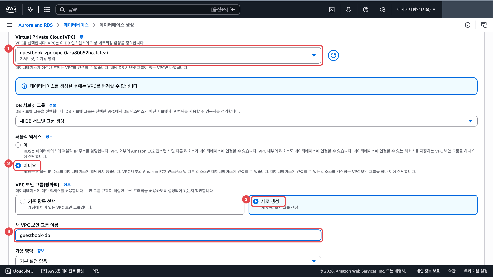

   5. 맨 아래쪽 「추가 구성」을 눌러 펼칩니다.

      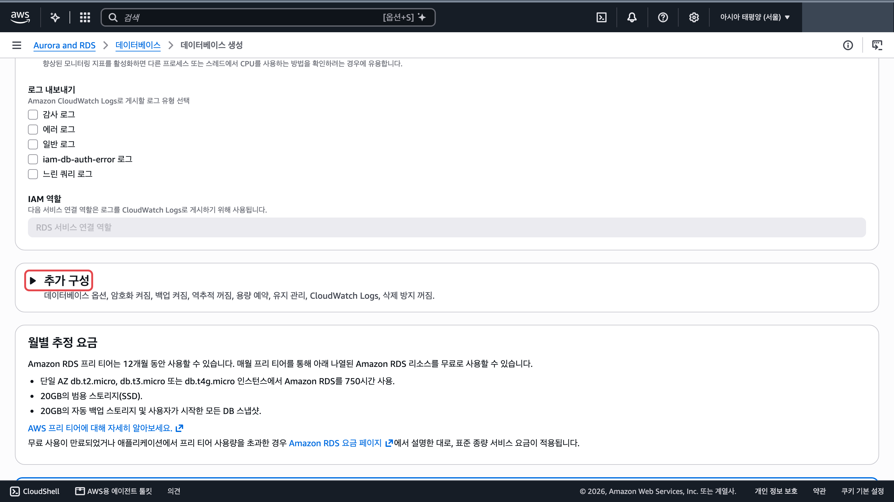

   6. 「초기 데이터베이스 이름」(①)에 `guestbook` 을 넣고 「자동 백업 활성화」(②) 체크를 끕니다.

      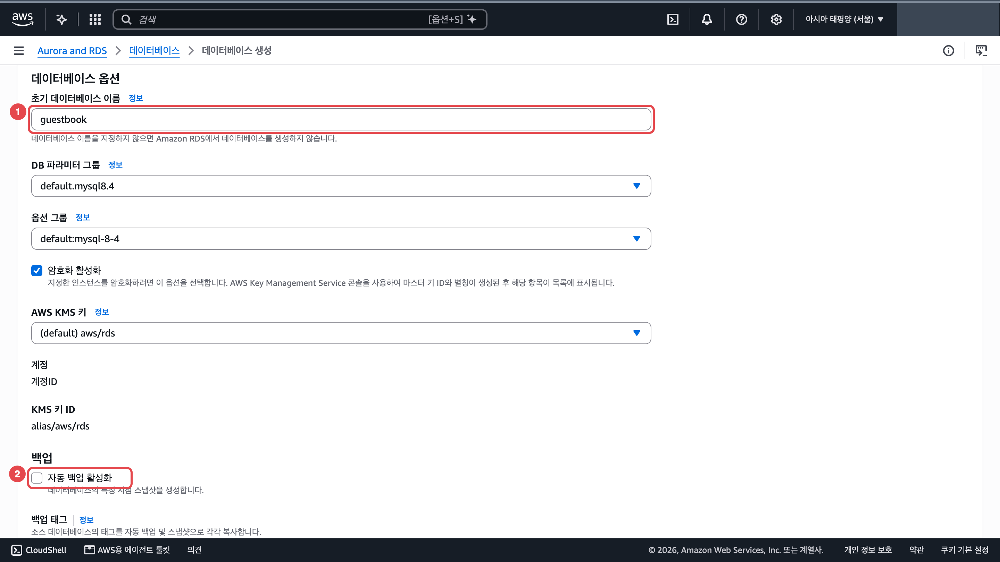

   7. 맨 아래 「데이터베이스 생성」을 누릅니다. Chrome 이 비밀번호를 저장할지 물으면 저장하지 않습니다(「사용 안함」). 공용 PC 에 DB 비밀번호가 남습니다. 목록의 상태가 「생성 중」에서 「사용 가능」이 될 때까지 약 5분 걸립니다.

      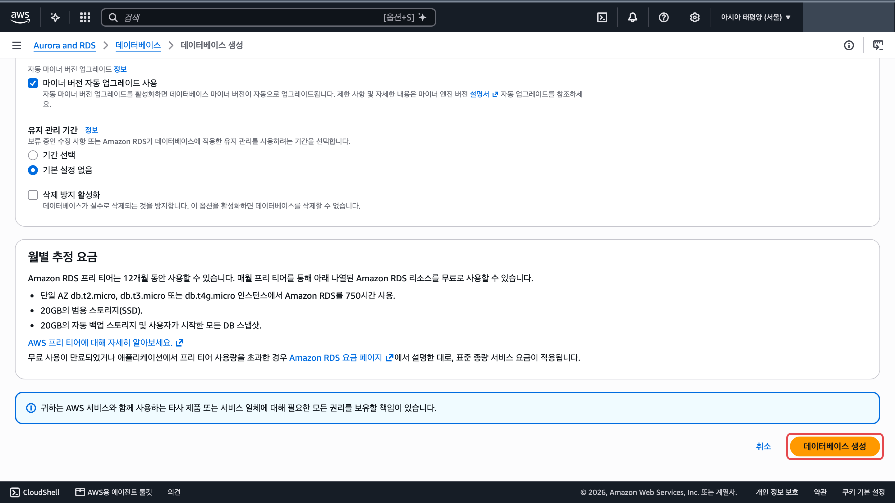

2. DB 보안 그룹이 방명록 서버만 받게 고칩니다. <a href="https://ap-northeast-2.console.aws.amazon.com/ec2/home?region=ap-northeast-2#SecurityGroups:" target="_blank" rel="noopener">보안 그룹 ↗</a>
   1. 보안 그룹 목록에서 `guestbook-db` 행을 체크(①)하고 「작업」(②) → 「인바운드 규칙 편집」(③)을 누릅니다.

      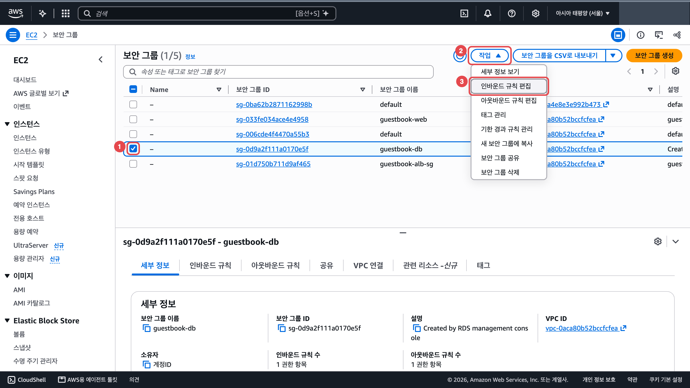

   2. 처음 있는 규칙은 내 PC 의 IP 를 받는 규칙입니다. 그 줄 오른쪽 「삭제」(①)를 누르고 「규칙 추가」(②)를 누릅니다. 있는 규칙의 소스만 바꾸면 저장이 거부됩니다.

      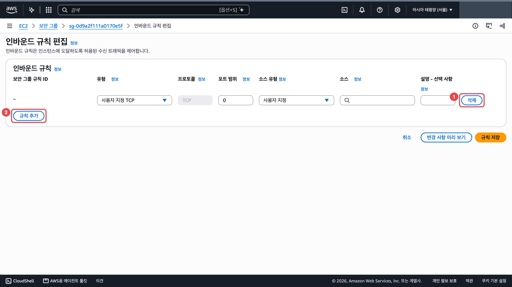

   3. 새 줄의 「유형」(①)을 「MYSQL/Aurora」로 고릅니다. 「소스」 칸에 `guestbook-web` 을 쳐서 목록에 나온 보안 그룹(②)을 고릅니다(11단원 시작 템플릿에서 만든 방명록 서버의 보안 그룹). 「규칙 저장」(③)을 누릅니다.

      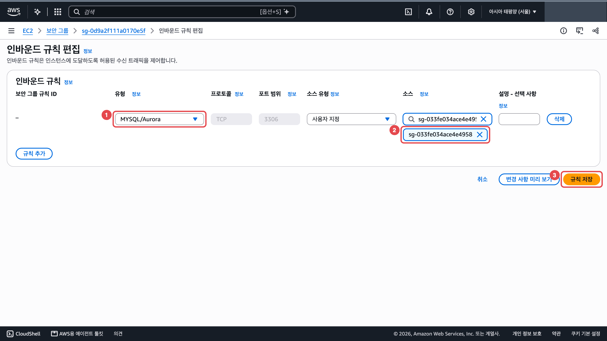

3. DB 주소를 복사합니다. DB 목록에서 `guestbook-db` 를 눌러 「연결 및 보안」 탭에서 「엔드포인트」 카드(①)를 고르면 아래에 엔드포인트 주소와 복사 아이콘(②)이 나옵니다. 상태가 「사용 가능」이 된 뒤에 보입니다. <a href="https://ap-northeast-2.console.aws.amazon.com/rds/home?region=ap-northeast-2#databases:" target="_blank" rel="noopener">DB 목록 ↗</a>

   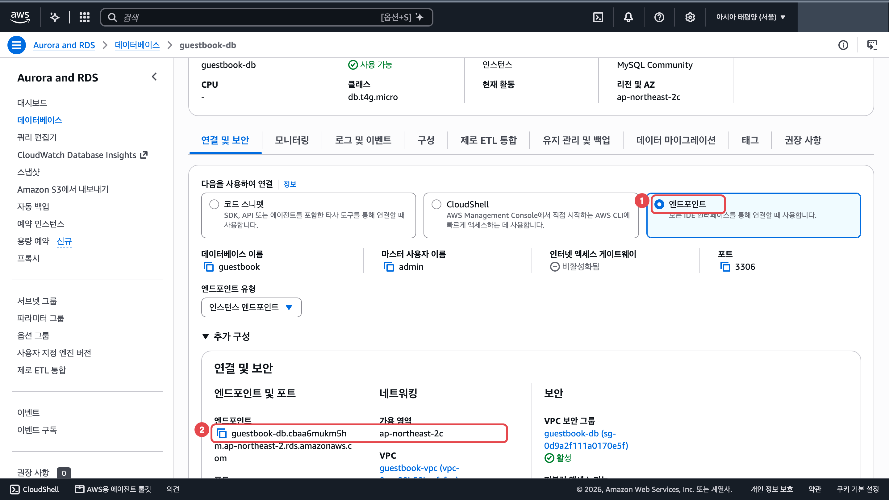

4. Parameter Store 에 DB 주소와 비밀번호를 넣습니다. <a href="https://ap-northeast-2.console.aws.amazon.com/systems-manager/parameters/?region=ap-northeast-2" target="_blank" rel="noopener">Parameter Store ↗</a>
   1. 「파라미터 생성」을 누릅니다.

      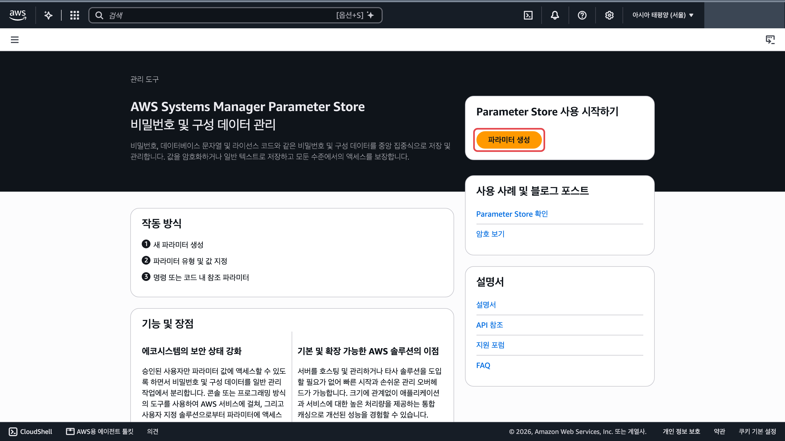

   2. 첫 번째: 「이름」에 `/guestbook/db/host` 를 넣습니다. 앞의 `/` 까지 그대로 넣습니다.

      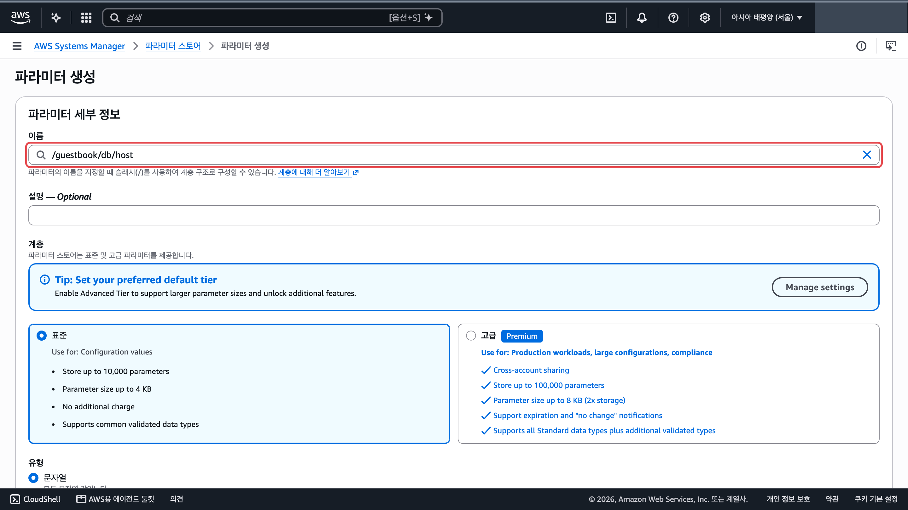

   3. 「유형」은 「문자열」(①) 그대로 두고 「값」(②)에 3번에서 복사한 엔드포인트를 붙여 넣습니다. 「Suggested data type: hostname」 안내가 떠도 그대로 두고 맨 아래 「파라미터 생성」을 누릅니다.

      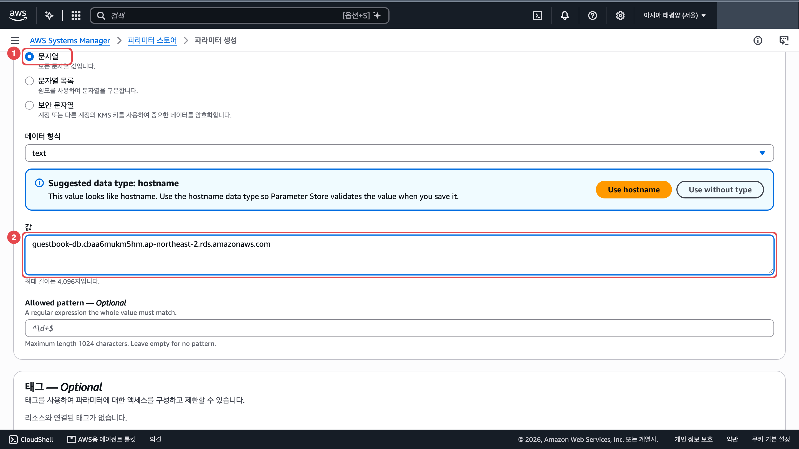

   4. 두 번째: 다시 「파라미터 생성」을 눌러 「이름」에 `/guestbook/db/password` 를 넣습니다.

      

   5. 「유형」을 「보안 문자열」로 고르고 「값」에 1번에서 정한 비밀번호를 넣은 뒤 「파라미터 생성」을 누릅니다. 값 칸에는 비밀번호가 그대로 보이니 옆 사람이 보지 않게 합니다.

      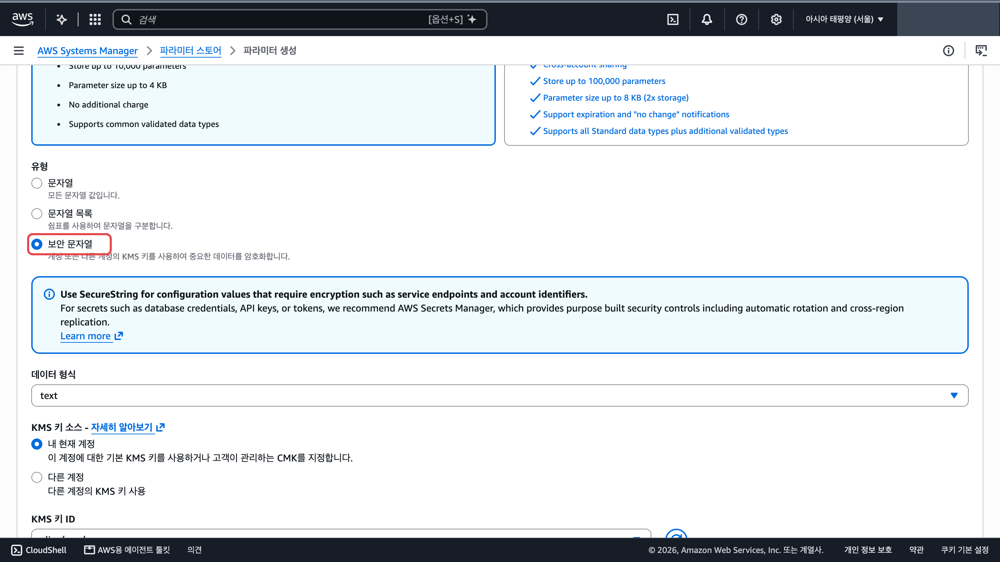

   6. 목록에 두 파라미터가 보이면 됩니다. 비밀번호 쪽 유형은 `SecureString` 으로 보입니다.

      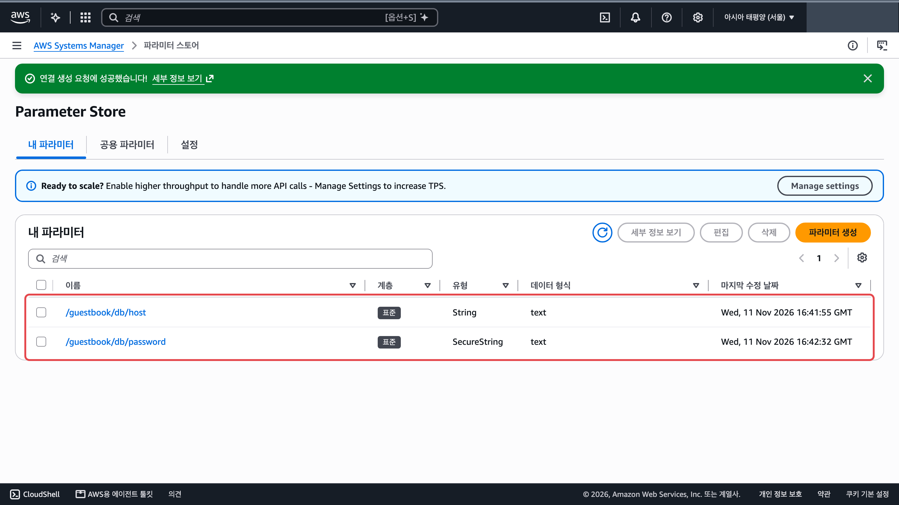

5. 서버 역할에 파라미터를 읽을 권한을 붙입니다. 순서는 [메뉴 1](/guestbook-lab/menu/1-image/) 2번과 같습니다(`guestbook-ec2-role` → 「권한 추가」 → 「인라인 정책 생성」 → 「JSON」). 인라인 정책은 이 역할에만 붙는 권한 쪽지, JSON 은 권한을 적는 정해진 글 형식, `Resource` 줄의 ARN 은 AWS 자원의 전체 주소입니다. 아래를 그대로 붙여 넣고 정책 이름은 `guestbook-ssm-db` 로 합니다. 계정 번호 자리의 `*` 는 「내 계정」이라는 뜻으로 그대로 둡니다. <a href="https://console.aws.amazon.com/iam/home#/roles/details/guestbook-ec2-role?section=permissions" target="_blank" rel="noopener">guestbook-ec2-role 열기 ↗</a>

   ```json
   {
     "Version": "2012-10-17",
     "Statement": [{
       "Effect": "Allow",
       "Action": "ssm:GetParameter",
       "Resource": "arn:aws:ssm:ap-northeast-2:*:parameter/guestbook/db/*"
     }]
   }
   ```

   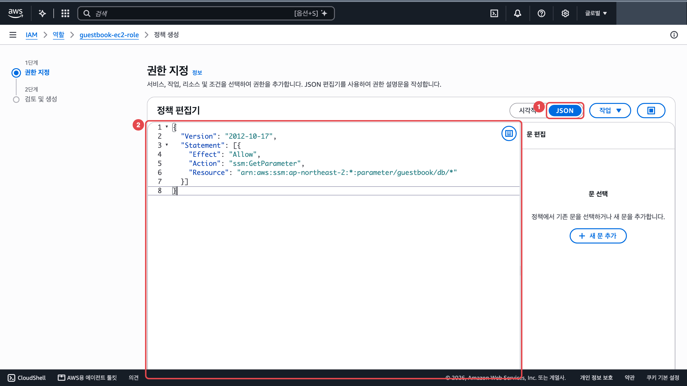

6. 서버 한 대에 접속합니다. 순서는 [메뉴 1](/guestbook-lab/menu/1-image/) 3번과 같습니다(대상 그룹 `guestbook-tg` → 「대상」 탭의 인스턴스 ID → 인스턴스 목록에서 한 행만 체크 → 「연결」).

7. 그 서버에서 설정 파일을 고칩니다. 설정 파일에는 메뉴마다 쓸 줄이 미리 있습니다. 새 줄을 더하면 같은 이름이 두 줄이 되고 아래쪽 줄 값이 쓰여서 헷갈리니 이미 있는 `STORAGE=` 줄을 고칩니다.
   1. 설정 파일을 엽니다.

      ```bash
      # 앱 설정 파일을 nano 편집기로 엽니다
      sudo nano /opt/guestbook/config.env
      ```

      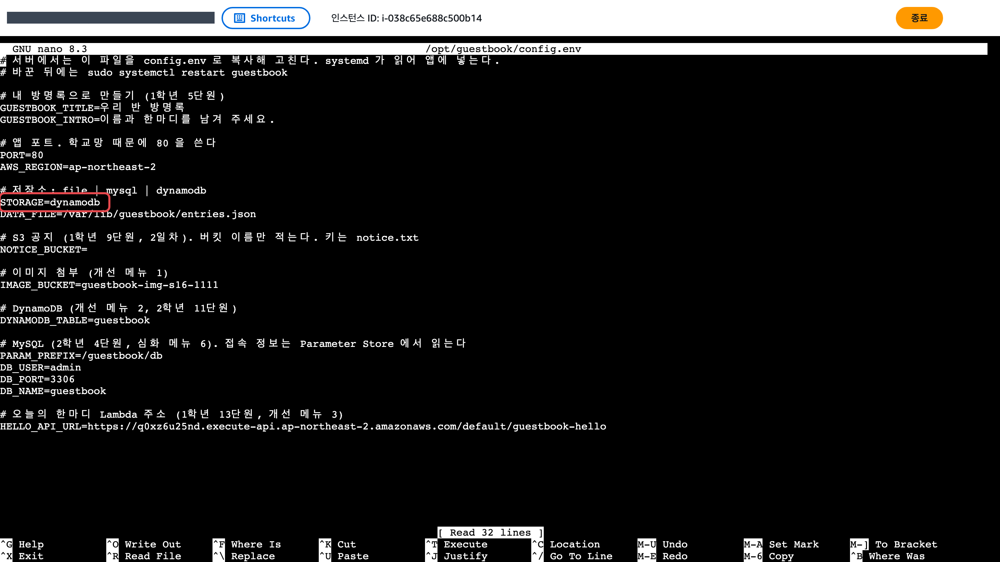

   2. `STORAGE=` 줄 끝까지 가서 `=` 뒤의 값을 지우고 `mysql` 을 적습니다(①). Ctrl+O(②)를 누르고 Enter 로 저장한 뒤 Ctrl+X(③)로 나옵니다.

      ```text
      STORAGE=mysql
      ```

      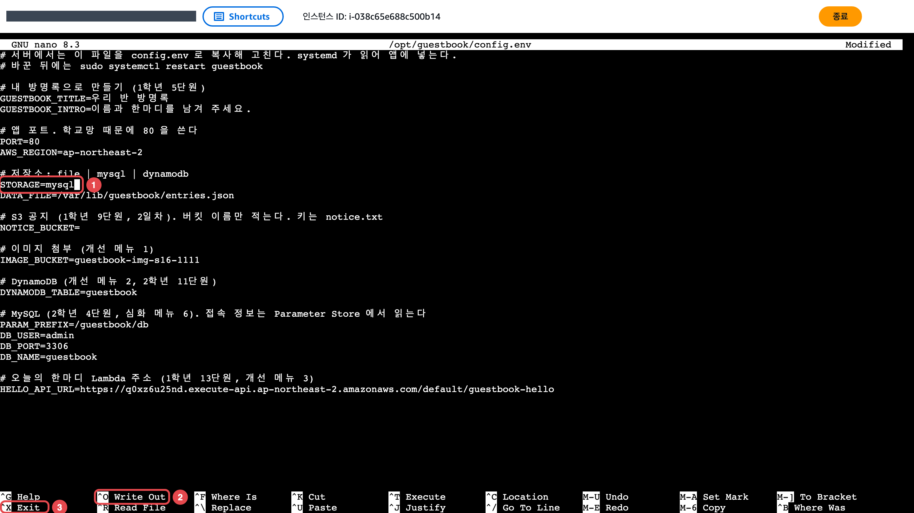

   3. 고친 줄을 다시 확인합니다.

      ```bash
      # 설정 파일 내용을 화면에 출력해 고친 줄을 확인합니다
      cat /opt/guestbook/config.env
      ```

      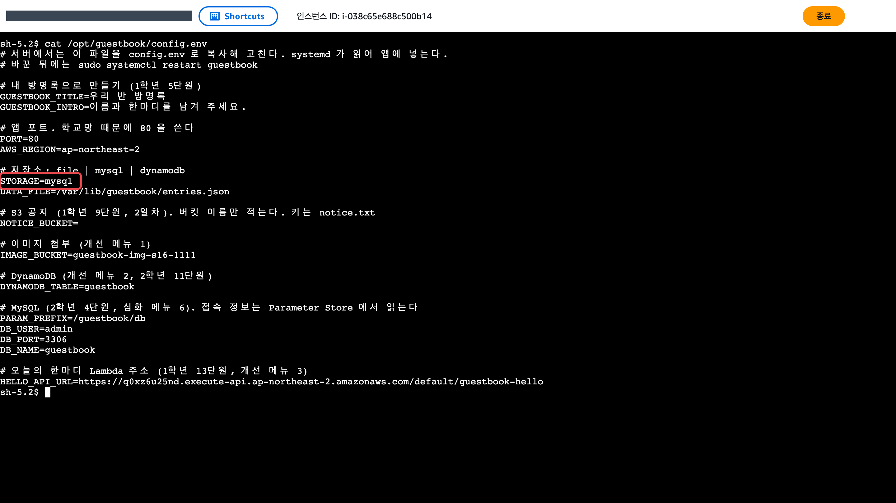

   4. 앱을 다시 켭니다.

      ```bash
      # 앱을 다시 켜서 바뀐 설정을 읽게 합니다
      sudo systemctl restart guestbook
      ```

## 확인

로드 밸런서 주소는 두 서버를 번갈아 보여 주니 고친 서버의 공인 IP 로 엽니다. 인스턴스 목록에서 그 서버 행을 체크하고 「퍼블릭 IPv4 주소」를 새 탭에 `http://공인IP` 로 엽니다([9단원](/guestbook-lab/u9/) 9번과 같은 자리). 「서버:」 줄(①)에 `저장소: mysql` 이 보이면 글을 하나 씁니다. 앱을 다시 켜고(`sudo systemctl restart guestbook`) 새로고침해도 그 글(②)이 남아 있으면 완료입니다.

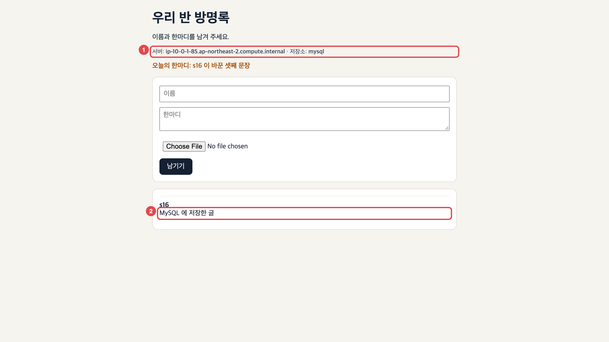

## 막히면

- 페이지가 열리지 않거나 `500`: 서버에서 아래 명령으로 앱 기록을 봅니다. 앱은 실행하며 일어난 일을 일기장처럼 기록해 두고, `journalctl` 은 그 일기장을 보는 명령입니다. 끝부분의 오류 이름으로 원인을 찾습니다.

  ```bash
  # 앱이 남긴 일기장(기록)의 마지막 30줄을 봅니다
  sudo journalctl -u guestbook -n 30
  ```

  - `ParameterNotFound`(그런 파라미터가 없음): 파라미터 이름 오타. `/guestbook/db/host` 처럼 앞에 `/` 가 있어야 합니다
  - `AccessDeniedException`(권한 없음): 5번 정책의 경로
  - `Can't connect to MySQL server`(DB 에 닿지 못함) 또는 시간 초과: 2번 보안 그룹 규칙의 소스가 `guestbook-web` 인지
  - `Access denied for user 'admin'`(DB 가 비밀번호를 거절함): 4번 비밀번호 값. Parameter Store 에서 `/guestbook/db/password` 를 눌러 「편집」으로 값 칸을 모두 지우고 다시 넣습니다
- 앱이 멈춘 채 몇 분이 지나면 로드 밸런서 상태 검사가 실패해 오토 스케일링이 그 서버를 새 서버로 바꿀 수 있습니다. 새 서버는 설정 파일이 처음 상태이니 6번부터 다시 합니다.
- 「규칙 저장」을 누르자 「기존 IPv4 CIDR 규칙에 a 참조된 그룹 ID을(를) 지정할 수 없습니다」가 뜹니다: 처음 규칙의 소스만 바꿨습니다. 그 줄을 「삭제」하고 「규칙 추가」로 새 줄을 만듭니다.

  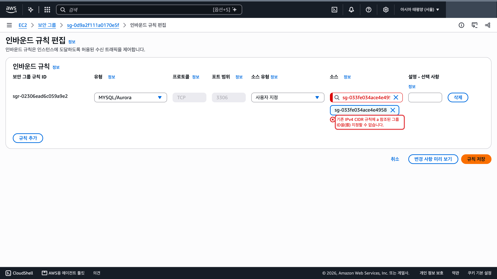

- 파라미터를 만들자 「연결 생성 요청에 성공했습니다!」가 뜹니다: 번역이 어색한 안내일 뿐 파라미터는 만들어졌습니다. 목록에서 이름을 확인합니다.

  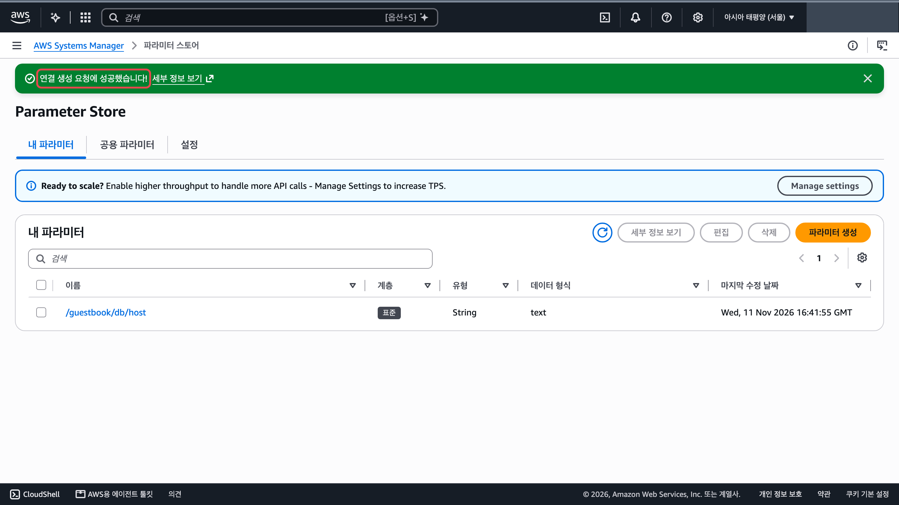

- 템플릿에 「샌드박스」가 없습니다: 지금 콘솔에서는 「프리 티어」가 같은 값(`db.t4g.micro`, 20 GiB, 단일 AZ)을 채워 줍니다.
- DB 생성이 거부됩니다: 클래스나 스토리지 크기가 수업 계정에서 허용한 값(`db.t3.micro`, `db.t4g.micro`, 20 GiB)을 넘었는지 봅니다.

## 끝나면 지웁니다

DB 는 켜져 있는 동안 시간당 요금이 붙습니다. 확인이 끝나면 바로 지웁니다. <a href="https://ap-northeast-2.console.aws.amazon.com/rds/home?region=ap-northeast-2#databases:" target="_blank" rel="noopener">DB 목록 ↗</a>

1. 고친 서버의 설정 파일을 7번 순서로 열어 `STORAGE=` 값을 원래 값(`file` 또는 메뉴 2 를 했다면 `dynamodb`)으로 되돌리고 앱을 다시 켭니다. DB 를 지운 뒤에도 `mysql` 로 두면 앱이 멈춥니다.
2. DB 목록에서 `guestbook-db` 를 고르고(①) 「작업」(②) → 「삭제」(③)를 누릅니다.

   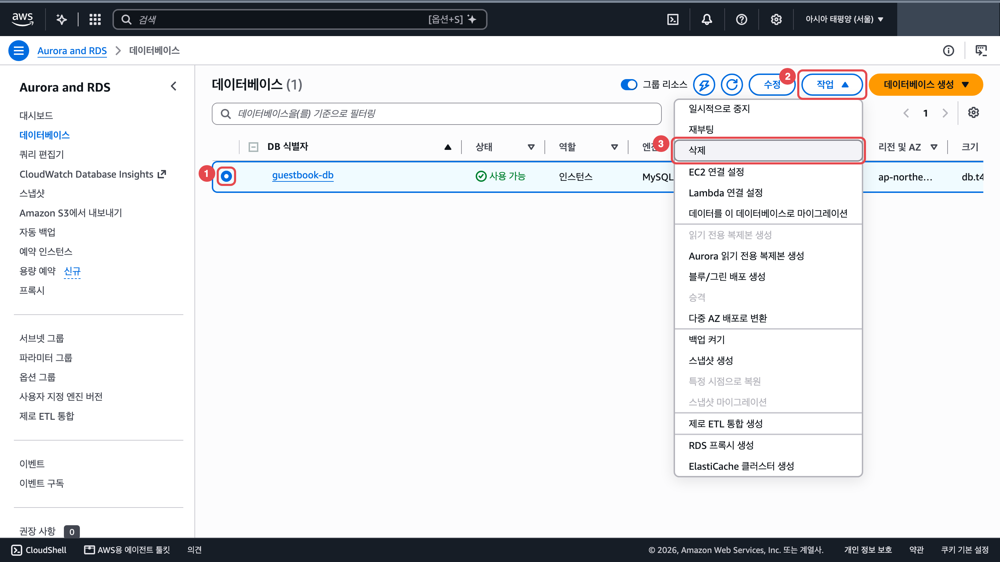

3. 「최종 스냅샷 생성」(①) 체크를 끄고, 새로 나오는 인정 문장(②)을 체크합니다. 입력란(③)에 `delete me` 를 넣고 「삭제」(④)를 누릅니다. 스냅샷을 남기면 그것도 요금이 붙습니다.

   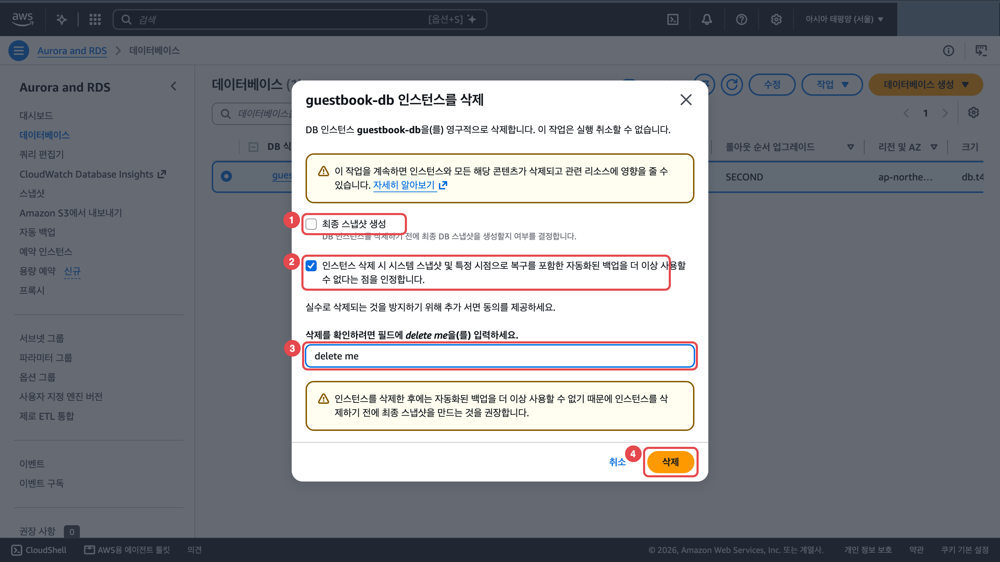
