---
# 생성물. lms build 가 courses/aws-intro/units/u14/menus/terraform.md 에서 만든다. 손으로 고치지 않는다. 원본 해시 91de2cc9c53f
title: "과제 6(심화). 2일차 구조를 코드로 다시 만들기"
sidebar:
  label: "6. Terraform (심화)"
  order: 6
---

쓰는 서비스: CloudShell, Terraform

완료 기준: 1, 2단계는 `terraform apply` 로 손으로 만든 것과 같은 구조(서브넷 2개, 라우팅 테이블, 인터넷 게이트웨이)가 생기고, `terraform destroy` 로 한 번에 지워진다. 3단계는 `terraform apply` 한 번으로 10~13단원 구조가 생겨 로드 밸런서 주소에서 급식 앱과 Lambda 한마디가 보이고, `terraform destroy` 한 번으로 모두 지워진다

2학년과 빨리 끝낸 학생용입니다. 10단원에서 손으로 만든 VPC 를 코드로 다시 만들고, 한 번에 지워 봅니다. 3단계에서는 2일차에 손으로 만든 네 단원(10~13단원) 전부를 코드 한 벌로 만들고 지웁니다.

## 바뀌는 구조

콘솔에서 클릭하던 것을 파일에 적어 두면, 같은 구조를 몇 번이든 똑같이 만들고 지울 수 있습니다. 대역은 손으로 만든 `guestbook-vpc`(10.0.0.0/16)와 겹치지 않게 10.1.0.0/16 을 씁니다. 만들어지는 VPC 이름은 `tf-lab` 입니다.

## 만들 것

1. 콘솔 왼쪽 아래 「CloudShell」을 눌러 엽니다. 위쪽 탭 이름이 `ap-northeast-2` 인지 봅니다. 처음 열면 소개 창이 뜨니 「닫기」를 누릅니다. <a href="https://ap-northeast-2.console.aws.amazon.com/cloudshell/home?region=ap-northeast-2" target="_blank" rel="noopener">CloudShell ↗</a>

   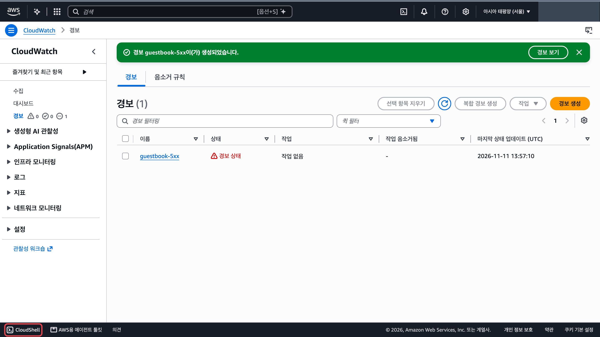

2. 저장소를 받고 Terraform 을 설치합니다. 마지막 줄까지 치면 `Terraform v1.14.7` 이 보입니다. 「out of date」 안내는 무시해도 됩니다. <a href="https://github.com/pghoya2956/guestbook-lab" target="_blank" rel="noopener">저장소 열기 ↗</a>

   ```bash
   # 실습 저장소를 CloudShell 로 받습니다
   git clone https://github.com/pghoya2956/guestbook-lab.git
   # Terraform 을 설치하는 대본을 실행합니다
   bash guestbook-lab/terraform/setup-terraform.sh
   # 지금 창에서 terraform 명령을 바로 쓰게 설정을 다시 읽습니다
   source ~/.bashrc
   ```

   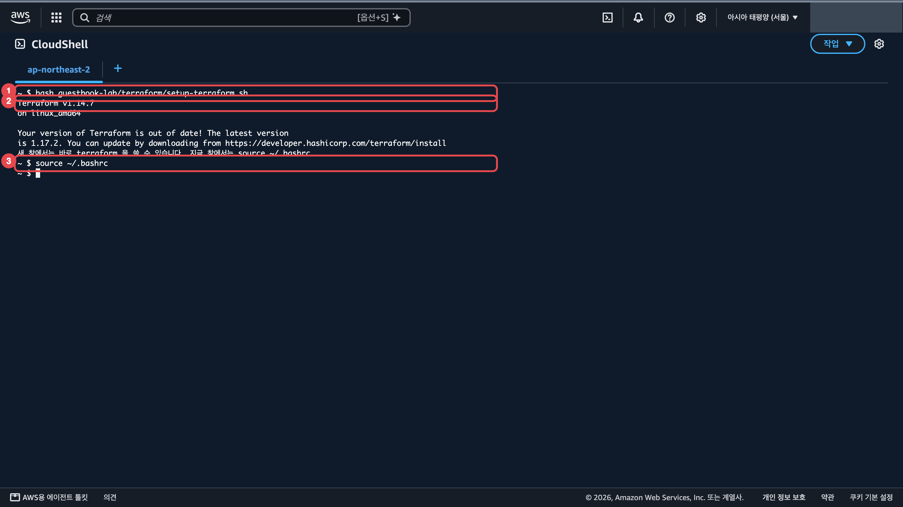

3. 1단계: VPC 하나만 만듭니다. Terraform 이 받는 AWS 연결 도구가 약 770MB 라서 1GB 인 CloudShell 홈 폴더에 넣으면 자리가 모자랍니다. 그래서 `init` 전에 그 도구를 넣을 곳을 `/tmp` 로 정합니다.

   ```bash
   # 첫 단계 Terraform 코드가 있는 폴더로 들어갑니다
   cd guestbook-lab/terraform/step1
   # Terraform 이 받는 큰 파일을 홈 폴더 대신 /tmp 에 두게 합니다
   export TF_DATA_DIR=/tmp/terraform-data
   # 이 코드에 필요한 AWS 연결 도구를 받습니다
   terraform init
   ```

   `Terraform has been successfully initialized!` 가 보이면 됩니다.

   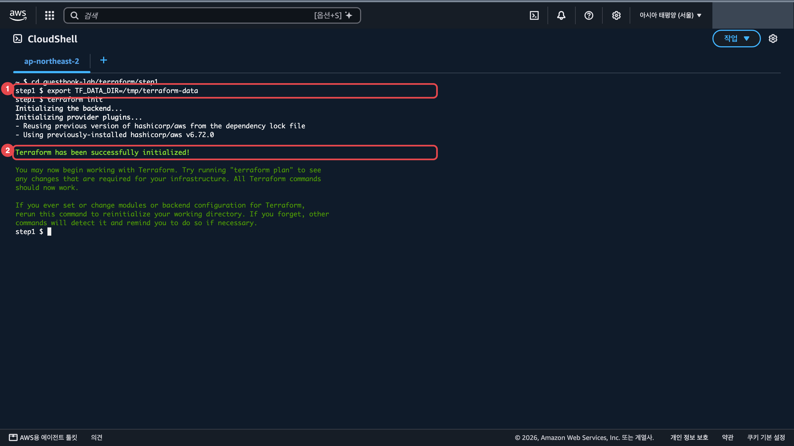

   ```bash
   # 무엇이 생길지 먼저 읽습니다
   terraform plan
   ```

   `# aws_vpc.main will be created`(①)와 `Plan: 1 to add`(②)가 보입니다.

   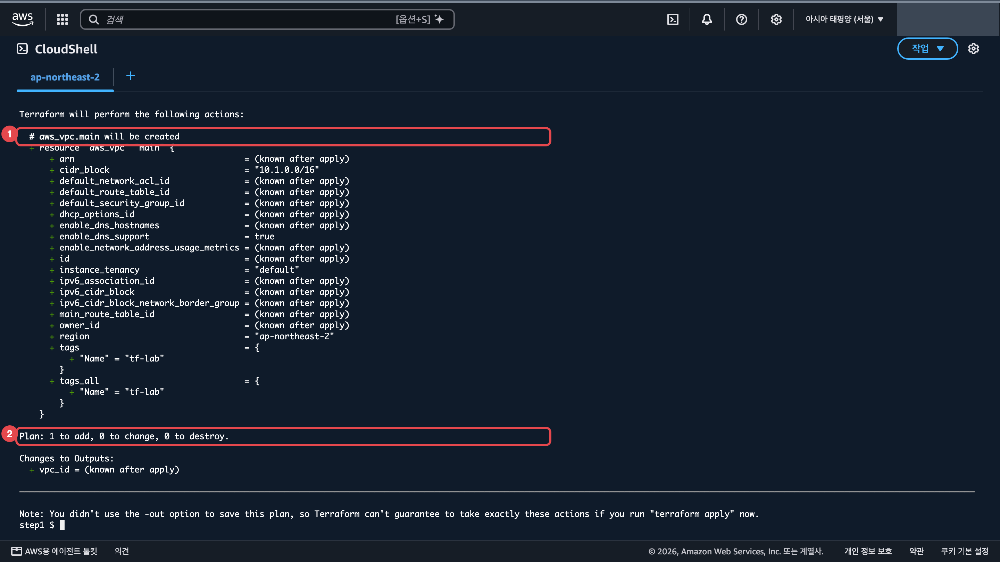

   ```bash
   # 실제로 만듭니다. 계속할지 물으면 yes 를 칩니다
   terraform apply
   ```

   `Enter a value:` 에 `yes` 를 치고 Enter 를 누릅니다. `Apply complete! Resources: 1 added` 가 보이면 됩니다.

   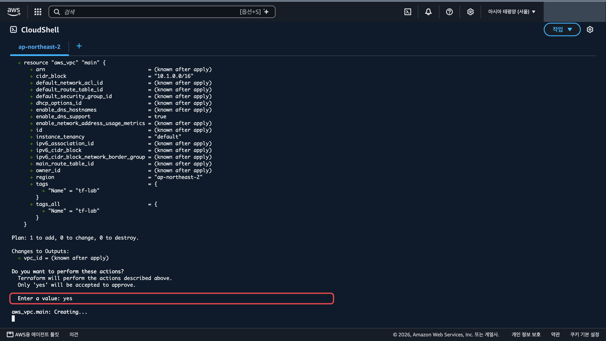

   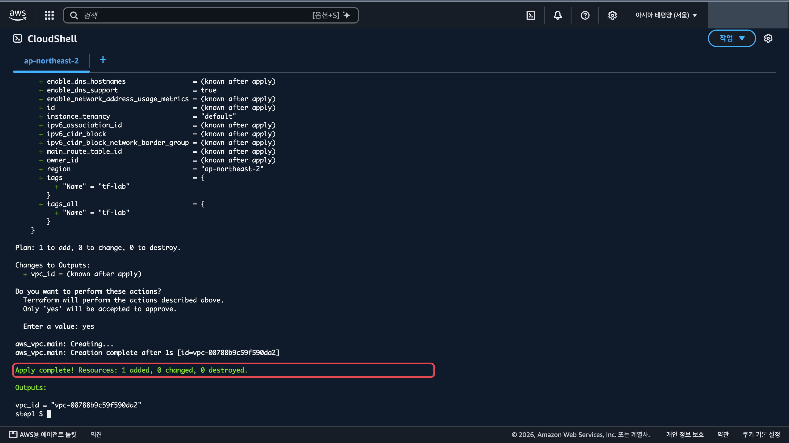

4. 2단계: `step1/main.tf` 에 퍼블릭 서브넷 2개, 인터넷 게이트웨이, 라우팅 테이블을 직접 더해 봅니다. CloudShell 에서 `nano main.tf` 로 엽니다. 막히면 정답 `../step2/main.tf` 를 봅니다(<a href="https://github.com/pghoya2956/guestbook-lab/blob/main/terraform/step2/main.tf" target="_blank" rel="noopener">정답 보기 ↗</a>). 정답을 그대로 쓰려면 아래 명령으로 덮어씁니다.

   ```bash
   # 정답 파일을 지금 폴더의 main.tf 로 덮어씁니다
   cp ../step2/main.tf main.tf
   # 무엇이 생길지 먼저 읽습니다
   terraform plan
   ```

   맨 아래 `Plan: 6 to add, 0 to change, 0 to destroy.` 가 보입니다. VPC 는 이미 있으니 서브넷 2개, 인터넷 게이트웨이, 라우팅 테이블, 서브넷 연결 2개만 더 생깁니다.

   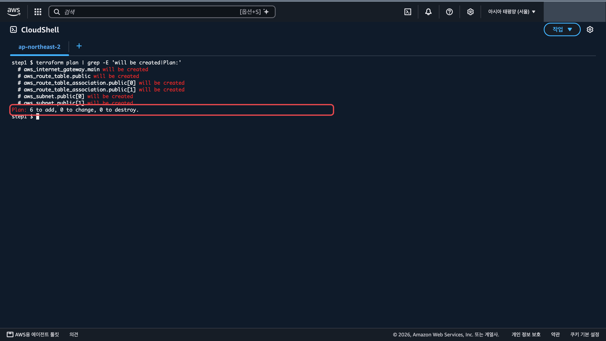

   ```bash
   # 실제로 만듭니다. 계속할지 물으면 yes 를 칩니다
   terraform apply
   ```

   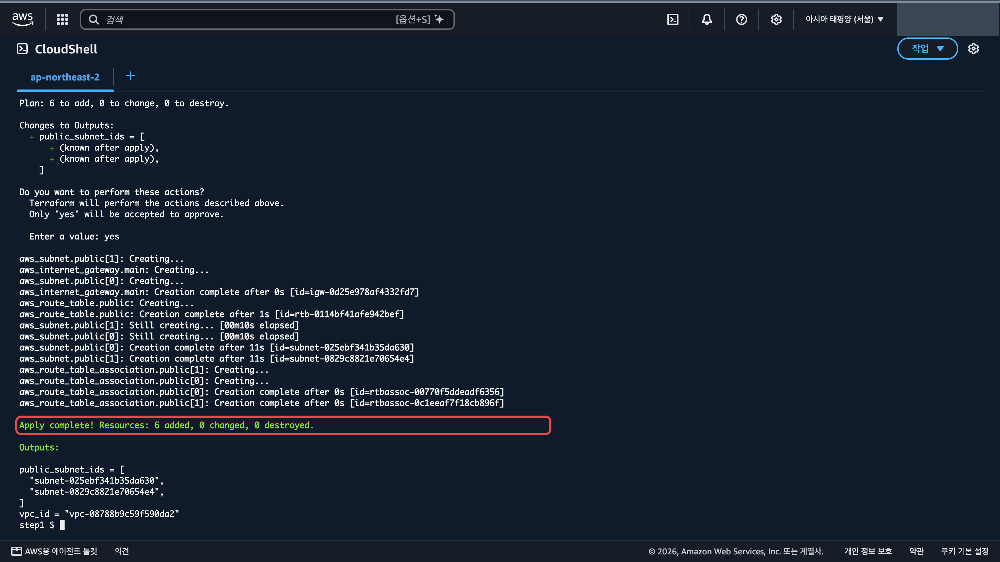

## 확인

VPC 목록에서 이름이 `tf-lab` 인 VPC 의 VPC ID 를 누르고 아래 「리소스 맵」 탭(①)을 봅니다. 서브넷 2개 → `tf-lab-public` 라우팅 테이블 → `tf-lab` 인터넷 게이트웨이로 선이 이어졌는지(②), 10단원에서 손으로 만든 `guestbook-vpc` 와 같은 모양인지 비교합니다. <a href="https://ap-northeast-2.console.aws.amazon.com/vpcconsole/home?region=ap-northeast-2#vpcs:" target="_blank" rel="noopener">VPC 목록 ↗</a>

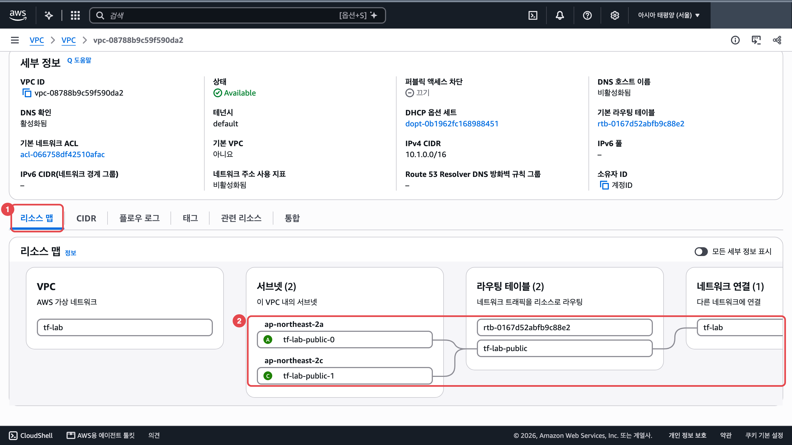

마지막에 한 번에 지웁니다. 손으로 지울 때와 비교해 봅니다.

```bash
# 이 코드로 만든 것을 모두 지웁니다. 계속할지 물으면 yes 를 칩니다
terraform destroy
```

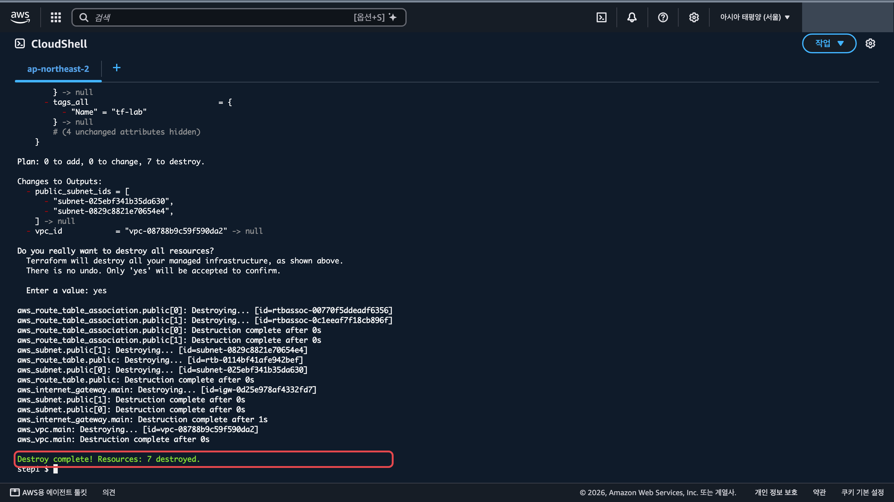

## 3단계: 2일차 구조를 한 번에

10단원 VPC, 11단원 시작 템플릿, 12단원 로드 밸런서와 오토 스케일링, 13단원 Lambda 와 API 게이트웨이를 `terraform apply` 한 번으로 만들고, 로드 밸런서 주소로 급식 앱을 연 뒤 `terraform destroy` 한 번으로 지웁니다. 코드는 `terraform/step3/main.tf` 한 파일이고 서버 사용자 데이터는 옆의 `user-data.sh.tftpl` 입니다(<a href="https://github.com/pghoya2956/guestbook-lab/tree/main/terraform/step3" target="_blank" rel="noopener">코드 보기 ↗</a>).

만들어지는 이름은 모두 `tf-day2` 로 시작합니다. 손으로 만든 `guestbook-` 자원은 건드리지 않으니 그대로 둬도 됩니다. 대역은 `guestbook-vpc`(10.0.0.0/16), 1, 2단계 `tf-lab`(10.1.0.0/16)과 겹치지 않게 10.2.0.0/16 을 씁니다. 손으로 만든 것 가운데 두 가지만 가져다 씁니다. 4단원에서 만든 서버 역할 `guestbook-ec2-role` 은 이름으로 가리키고, 9단원에서 만든 내 공지 버킷 이름은 실행할 때 알려 줍니다.

### 단원과 코드 덩어리

`main.tf` 는 단원마다 덩어리로 나뉘어 있고, 덩어리 머리 주석에 어느 단원에서 손으로 만든 것인지 적혀 있습니다.

| 단원 | 손으로 만든 것 | `main.tf` 의 덩어리 | 만들어지는 이름 |
|---|---|---|---|
| 10단원 | VPC, 서브넷 2개, 인터넷 게이트웨이, 라우팅 테이블, 서브넷 연결 | `aws_vpc`, `aws_subnet`, `aws_internet_gateway`, `aws_route_table`, `aws_route_table_association` | `tf-day2`, `tf-day2-public-a`, `tf-day2-public-c`, `tf-day2-igw`, `tf-day2-public-rt` |
| 11단원 | 시작 템플릿, 서버 보안 그룹, 사용자 데이터 | `aws_launch_template`, `aws_security_group.web`, `user-data.sh.tftpl` | `tf-day2-lt`, `tf-day2-web` |
| 12단원 | 대상 그룹, 로드 밸런서, 로드 밸런서 보안 그룹, 리스너, 오토 스케일링 그룹 | `aws_lb_target_group`, `aws_lb`, `aws_security_group.alb`, `aws_lb_listener`, `aws_autoscaling_group` | `tf-day2-tg`, `tf-day2-alb`, `tf-day2-alb-sg`, `tf-day2-asg`, 서버 `tf-day2-server` |
| 13단원 | 함수, 실행 역할, API 게이트웨이 트리거 | `aws_lambda_function`, `aws_iam_role`, `aws_apigatewayv2_api`, `aws_lambda_permission` | `tf-day2-hello`, `tf-day2-hello-role`, `tf-day2-hello-api` |

손으로 할 때와 두 군데가 다릅니다. 서버 보안 그룹 `tf-day2-web` 은 80 포트를 로드 밸런서 보안 그룹에서 오는 것만 받아서, 서버 공인 IP 로 바로 열면 열리지 않습니다. 13단원에서 nano 로 서버마다 고치던 `HELLO_API_URL=` 줄은 사용자 데이터가 처음부터 채웁니다.

### 만들 것

1. 3단계 폴더로 옮겨 내 공지 버킷 이름을 알려 줍니다. 1, 2단계를 아직 지우지 않았다면 위 「확인」의 `terraform destroy` 를 `step1` 폴더에서 먼저 합니다.

   ```bash
   # 3단계 Terraform 코드가 있는 폴더로 들어갑니다
   cd ~/guestbook-lab/terraform/step3
   # Terraform 이 받는 큰 파일을 홈 폴더 대신 /tmp 에 두게 합니다
   export TF_DATA_DIR=/tmp/terraform-data
   # 9단원에서 만든 내 공지 버킷 이름을 찾습니다
   aws s3 ls | grep guestbook-notice-
   ```

   마지막 줄 출력의 날짜 뒤 `guestbook-notice-` 로 시작하는 이름이 내 공지 버킷입니다. 아래 줄의 `공지버킷` 자리를 그 이름으로 바꿔 칩니다.

   ```bash
   # 내 공지 버킷 이름을 Terraform 에 알려 줍니다. 공지버킷 자리를 내 버킷 이름으로 바꿉니다
   export TF_VAR_notice_bucket=공지버킷
   ```

2. 연결 도구를 받고 무엇이 생길지 읽습니다. 3단계는 Lambda 코드를 zip 으로 묶는 도구(archive)를 하나 더 받습니다.

   ```bash
   # 이 코드에 필요한 AWS 연결 도구와 zip 도구를 받습니다
   terraform init
   # 무엇이 생길지 먼저 읽습니다
   terraform plan
   ```

   맨 아래 `Plan: 25 to add, 0 to change, 0 to destroy.` 가 보이면 됩니다. 출력이 길어서 위로 올려 단원표의 이름이 하나씩 `will be created` 로 나오는지 훑어봅니다.

3. 실제로 만듭니다. `Enter a value:` 에 `yes` 를 치고 Enter 를 누릅니다.

   ```bash
   # 2일차 구조 전부를 만듭니다. 계속할지 물으면 yes 를 칩니다
   terraform apply
   ```

   약 4~5분 걸립니다. 로드 밸런서를 만들고, 서버 두 대가 앱을 설치해 대상 그룹에서 Healthy 가 될 때까지 기다리는 시간입니다. 그동안 `aws_autoscaling_group.web: Still creating... [3m0s elapsed]` 같은 줄이 이어지는 것은 정상입니다. 오토 스케일링 그룹은 서버 두 대가 Healthy 가 될 때까지 기다렸다가 끝나므로, apply 가 끝나면 주소가 바로 열립니다. 끝에 `Apply complete! Resources: 25 added` 와 그 아래 `Outputs:` 에 주소 두 줄이 보입니다.

   ```text
   app_url = "http://tf-day2-alb-(숫자).ap-northeast-2.elb.amazonaws.com"
   hello_api_url = "https://(API 주소).execute-api.ap-northeast-2.amazonaws.com"
   ```

### 확인

먼저 CloudShell 에서 두 주소가 답하는지 봅니다.

```bash
# 로드 밸런서 뒤 서버의 상태 검사 주소를 부릅니다
curl -s "$(terraform output -raw app_url)/health"
# 급식실 한마디 API 를 바로 부릅니다
curl -s "$(terraform output -raw hello_api_url)"
```

첫 줄은 `"status":"ok"` 와 `"notice":"ok"` 가 든 한 줄을, 둘째 줄은 `{"message": "오늘도 화이팅"}` 처럼 한마디 하나를 돌려줍니다. `"notice"` 가 `ok` 가 아니면 아래 「3단계에서 막히면」의 공지 버킷 항목을 봅니다.

다음으로 `app_url` 주소 전체를 복사해 새 탭에서 엽니다.

- 맨 위 검은 띠의 「이 화면을 보낸 서버:」가 `ip-10-2-` 로 시작합니다. 손으로 만든 서버(`ip-10-0-`)가 아니라 코드로 만든 VPC 의 서버라는 뜻입니다. 몇 번 새로고침하면 `ip-10-2-1-` 과 `ip-10-2-2-` 가 번갈아 나옵니다.
- 식판이 9단원 공지 버킷의 오늘 메뉴로 채워져 있습니다.
- 초록 「급식실 한마디」 상자 오른쪽 위에 「Lambda 가 몇 ms 에 답함」이 보입니다. 「Lambda 를 부르지 못함」이 보이고 한마디 자리에 `(한마디 API 오류: …)` 가 나오면 서버가 Lambda 주소를 부르지 못한 것입니다. 1~2분 뒤 새로고침해도 같으면 강사에게 알립니다.

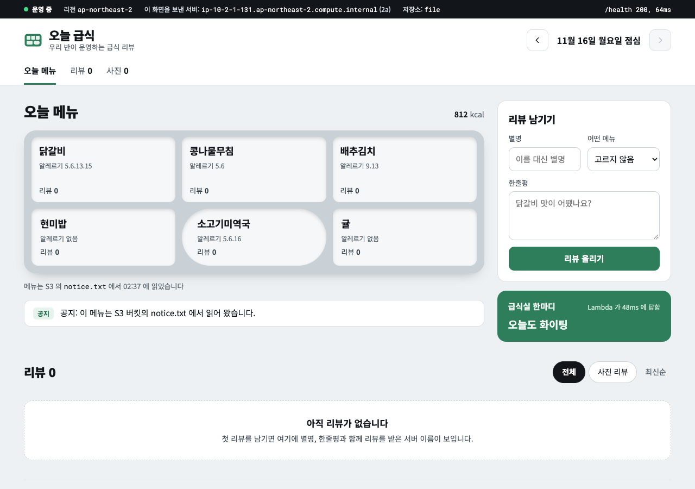

EC2 콘솔에서도 봅니다. 인스턴스 목록에 `tf-day2-server` 두 대가 실행 중이고, 대상 그룹 `tf-day2-tg` 의 「대상」 탭에 두 대가 Healthy 로 보입니다. 손으로 만든 12단원 서버와 달리 「Name」 칸이 채워져 있습니다. <a href="https://ap-northeast-2.console.aws.amazon.com/ec2/home?region=ap-northeast-2#TargetGroups:" target="_blank" rel="noopener">대상 그룹 ↗</a>

### 지우기

로드 밸런서는 켜 둔 시간만큼 요금이 붙으니 확인을 마치면 바로 지웁니다. 같은 `step3` 폴더에서 칩니다.

```bash
# 3단계로 만든 것을 모두 지웁니다. 계속할지 물으면 yes 를 칩니다
terraform destroy
```

약 2~3분 걸리고 `Destroy complete! Resources: 25 destroyed.` 가 보이면 됩니다. 인스턴스 목록의 `tf-day2-server` 두 대는 「종료됨」으로 바뀌고 한 시간쯤 뒤 목록에서 사라집니다. 손으로 만든 `guestbook-` 자원은 그대로 남아 있어야 합니다. 10~13단원에서 손으로 몇 번을 눌러 만들었는지 떠올려 비교해 봅니다.

### 3단계에서 막히면

- `Invalid value for variable` 와 「버킷 이름은 영어 소문자, 숫자, 점, 하이픈만 씁니다」: `export TF_VAR_notice_bucket=` 뒤에 `공지버킷` 이 그대로 있거나 빈칸, 따옴표가 들어갔습니다. 「만들 것」 1번의 `aws s3 ls` 출력에서 이름만 복사해 다시 칩니다.
- plan 이나 apply 가 `var.notice_bucket` 과 `Enter a value:` 를 묻습니다: CloudShell 을 다시 열어 `export` 한 값이 사라졌습니다. 그 자리에 내 공지 버킷 이름을 치고 Enter 를 누르거나, 「만들 것」 1번의 `export` 두 줄을 다시 치고 `terraform init` 부터 합니다. destroy 할 때도 같습니다.
- 식판 자리에 「메뉴 오류」가 보이거나 `/health` 의 `"notice"` 가 `ok` 가 아닙니다: 버킷 이름이 틀렸습니다. 올바른 이름으로 `export TF_VAR_notice_bucket=` 을 다시 치고 `terraform apply` 를 한 번 더 합니다. 시작 템플릿이 새 판으로 바뀌고, 오토 스케일링이 서버를 한 대씩 새 서버로 바꿉니다. 다 바뀌는 데 10분쯤 걸립니다.
- apply 가 10분 넘게 기다리다 `capacity satisfied` 와 `timeout` 이 든 오류로 끝납니다(apply 를 시작하고 13분쯤): 서버가 앱을 띄우지 못해 Healthy 가 되지 않았습니다. 인스턴스 목록에서 `tf-day2-server` 한 대에 Session Manager 로 접속해 `sudo tail -n 30 /var/log/cloud-init-output.log` 로 사용자 데이터가 어디서 멈췄는지 봅니다. 원인을 고친 뒤 `terraform apply` 를 다시 하면 오토 스케일링 그룹을 지우고 새로 만듭니다. 그래서 plan 에 `1 to destroy` 가 보여도 정상입니다.
- `cd: .../terraform/step3: No such file or directory`: CloudShell 에 받아 둔 저장소가 3단계가 생기기 전 판입니다. `git -C ~/guestbook-lab pull` 로 새로 받은 뒤 `cd` 부터 다시 칩니다.
- 오류에 `Invalid IAM Instance Profile` 이 보입니다: 4단원 역할 `guestbook-ec2-role` 이 없거나 이름이 다릅니다. IAM 역할 목록에서 그 이름을 찾습니다. 지웠다면 강사에게 알립니다.
- `already exists` 가 든 오류(`tf-day2-hello-role`, `/aws/lambda/tf-day2-hello` 같은 이름): 같은 계정에 3단계로 만든 것이 이미 남아 있습니다. 처음 apply 한 `step3` 폴더에서 `terraform destroy` 로 지우고 다시 합니다. 그 폴더가 없으면 강사에게 알립니다.
- destroy 가 `DependencyViolation` 으로 멈춥니다: 로드 밸런서가 쓰던 네트워크 연결이 아직 정리되는 중입니다. 2~3분 기다렸다가 `terraform destroy` 를 한 번 더 칩니다.
- `no space left on device` 나 `terraform: command not found` 는 아래 「막히면」의 1, 2단계 항목과 같습니다.

## 막히면

- `no space left on device`: 3번의 `export TF_DATA_DIR=/tmp/terraform-data` 를 빼먹었습니다. 반쯤 받은 파일을 지우고 다시 합니다.

  ```bash
  # 홈 폴더에 반쯤 받은 Terraform 파일을 지웁니다
  rm -rf .terraform
  # Terraform 이 받는 큰 파일을 홈 폴더 대신 /tmp 에 두게 합니다
  export TF_DATA_DIR=/tmp/terraform-data
  # 이 코드에 필요한 AWS 연결 도구를 받습니다
  terraform init
  ```

- CloudShell 을 닫았다 열었거나 「다시 연결」을 눌렀습니다: `/tmp` 는 비워지고 홈 폴더는 남습니다. 아래 세 줄을 다시 치면 이어서 할 수 있습니다. 상태 파일(`terraform.tfstate`)은 `step1` 폴더에 그대로 있어 Terraform 이 만든 것을 기억합니다.

  ```bash
  # 첫 단계 Terraform 코드가 있는 폴더로 들어갑니다
  cd guestbook-lab/terraform/step1
  # Terraform 이 받는 큰 파일을 홈 폴더 대신 /tmp 에 두게 합니다
  export TF_DATA_DIR=/tmp/terraform-data
  # 이 코드에 필요한 AWS 연결 도구를 받습니다
  terraform init
  ```

- `terraform: command not found`: 2번의 `source ~/.bashrc` 를 칩니다.
- `UnauthorizedOperation` 이나 `AccessDenied`: CloudShell 탭 이름이 `ap-northeast-2` 인지 봅니다. 수업 계정은 서울만 씁니다.
- `InvalidSubnet.Conflict`: 서브넷 대역이 겹칩니다. `cidrsubnet()` 으로 나눈 값을 확인합니다.
