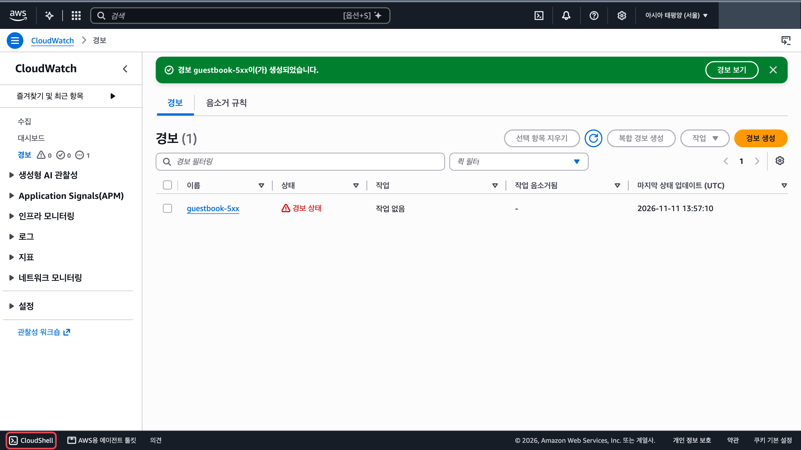
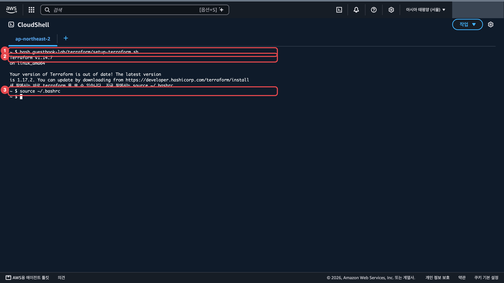
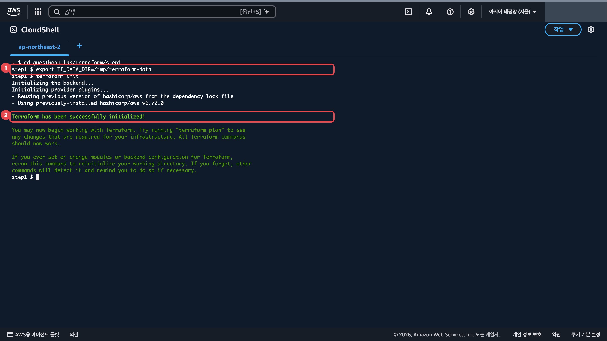
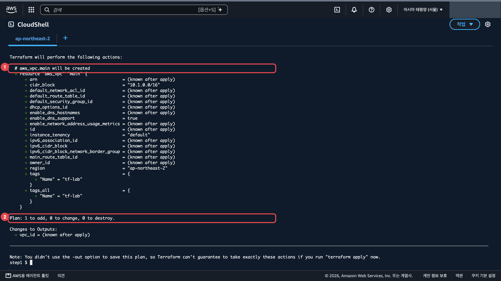
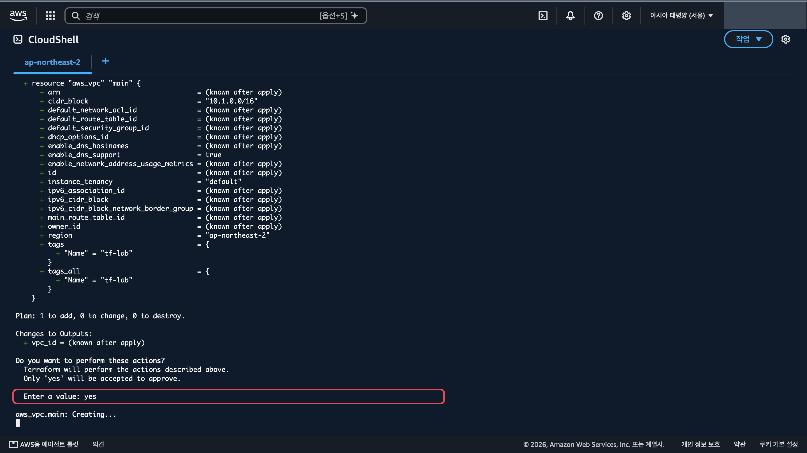
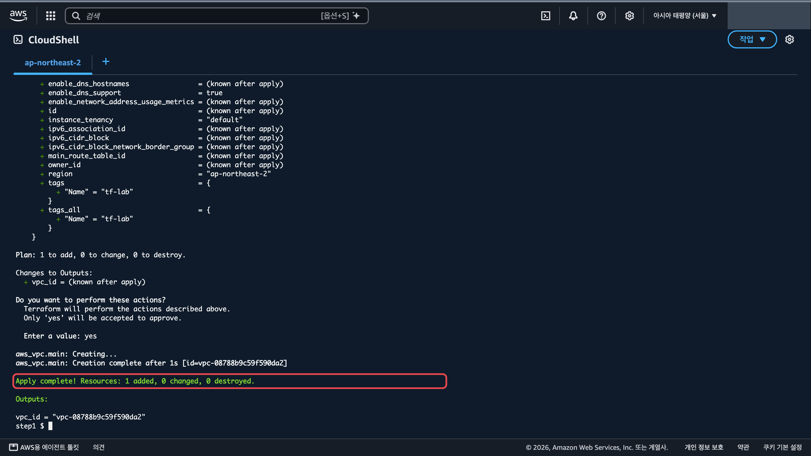
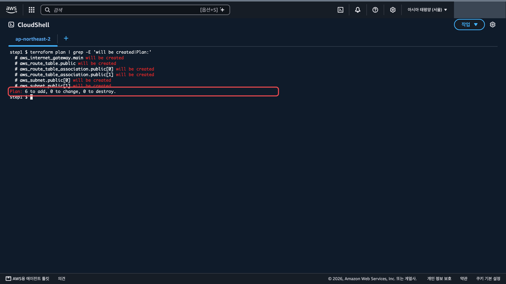
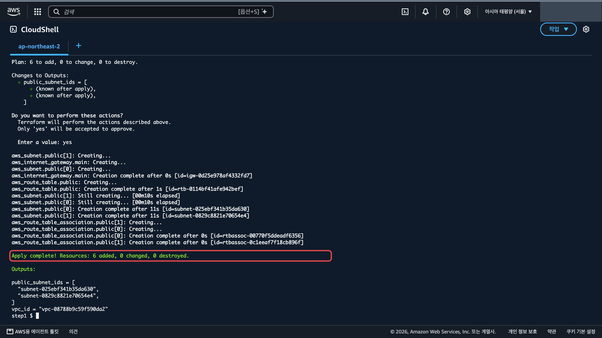
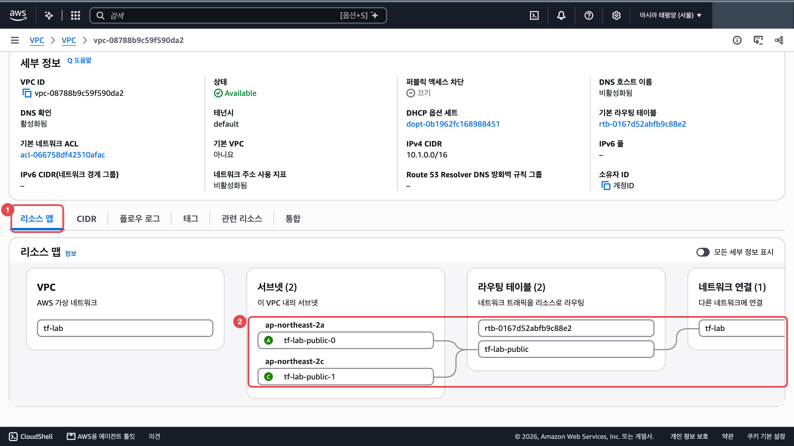
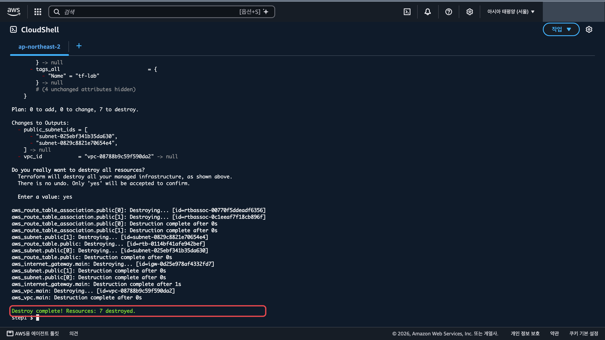

쓰는 서비스: CloudShell, Terraform

완료 기준: `terraform apply` 로 손으로 만든 것과 같은 구조(서브넷 2개, 라우팅 테이블, 인터넷 게이트웨이)가 생기고, `terraform destroy` 로 한 번에 지워진다

2학년과 빨리 끝낸 학생용입니다. 10단원에서 손으로 만든 VPC 를 코드로 다시 만들고, 한 번에 지워 봅니다.

## 바뀌는 구조

콘솔에서 클릭하던 것을 파일에 적어 두면, 같은 구조를 몇 번이든 똑같이 만들고 지울 수 있습니다. 대역은 손으로 만든 `guestbook-vpc`(10.0.0.0/16)와 겹치지 않게 10.1.0.0/16 을 씁니다. 만들어지는 VPC 이름은 `tf-lab` 입니다.

## 만들 것

1. 콘솔 왼쪽 아래 「CloudShell」을 눌러 엽니다. 위쪽 탭 이름이 `ap-northeast-2` 인지 봅니다. 처음 열면 소개 창이 뜨니 「닫기」를 누릅니다. <a href="https://ap-northeast-2.console.aws.amazon.com/cloudshell/home?region=ap-northeast-2" target="_blank" rel="noopener">CloudShell ↗</a>

   

2. 저장소를 받고 Terraform 을 설치합니다. 마지막 줄까지 치면 `Terraform v1.14.7` 이 보입니다. 「out of date」 안내는 무시해도 됩니다. <a href="https://github.com/pghoya2956/guestbook-lab" target="_blank" rel="noopener">저장소 열기 ↗</a>

   ```bash
   # 실습 저장소를 CloudShell 로 받습니다
   git clone https://github.com/pghoya2956/guestbook-lab.git
   # Terraform 을 설치하는 대본을 실행합니다
   bash guestbook-lab/terraform/setup-terraform.sh
   # 지금 창에서 terraform 명령을 바로 쓰게 설정을 다시 읽습니다
   source ~/.bashrc
   ```

   

3. 1단계: VPC 하나만 만듭니다. Terraform 이 받는 AWS 연결 도구가 약 770MB 라서 1GB 인 CloudShell 홈 폴더에 넣으면 자리가 모자랍니다. 그래서 `init` 전에 그 도구를 넣을 곳을 `/tmp` 로 정합니다.

   ```bash
   # 첫 단계 Terraform 코드가 있는 폴더로 들어갑니다
   cd guestbook-lab/terraform/step1
   # Terraform 이 받는 큰 파일을 홈 폴더 대신 /tmp 에 두게 합니다
   export TF_DATA_DIR=/tmp/terraform-data
   # 이 코드에 필요한 AWS 연결 도구를 받습니다
   terraform init
   ```

   `Terraform has been successfully initialized!` 가 보이면 됩니다.

   

   ```bash
   # 무엇이 생길지 먼저 읽습니다
   terraform plan
   ```

   `# aws_vpc.main will be created`(①)와 `Plan: 1 to add`(②)가 보입니다.

   

   ```bash
   # 실제로 만듭니다. 계속할지 물으면 yes 를 칩니다
   terraform apply
   ```

   `Enter a value:` 에 `yes` 를 치고 Enter 를 누릅니다. `Apply complete! Resources: 1 added` 가 보이면 됩니다.

   

   

4. 2단계: `step1/main.tf` 에 퍼블릭 서브넷 2개, 인터넷 게이트웨이, 라우팅 테이블을 직접 더해 봅니다. CloudShell 에서 `nano main.tf` 로 엽니다. 막히면 정답 `../step2/main.tf` 를 봅니다(<a href="https://github.com/pghoya2956/guestbook-lab/blob/main/terraform/step2/main.tf" target="_blank" rel="noopener">정답 보기 ↗</a>). 정답을 그대로 쓰려면 아래 명령으로 덮어씁니다.

   ```bash
   # 정답 파일을 지금 폴더의 main.tf 로 덮어씁니다
   cp ../step2/main.tf main.tf
   # 무엇이 생길지 먼저 읽습니다
   terraform plan
   ```

   맨 아래 `Plan: 6 to add, 0 to change, 0 to destroy.` 가 보입니다. VPC 는 이미 있으니 서브넷 2개, 인터넷 게이트웨이, 라우팅 테이블, 서브넷 연결 2개만 더 생깁니다.

   

   ```bash
   # 실제로 만듭니다. 계속할지 물으면 yes 를 칩니다
   terraform apply
   ```

   

## 확인

VPC 목록에서 이름이 `tf-lab` 인 VPC 의 VPC ID 를 누르고 아래 「리소스 맵」 탭(①)을 봅니다. 서브넷 2개 → `tf-lab-public` 라우팅 테이블 → `tf-lab` 인터넷 게이트웨이로 선이 이어졌는지(②), 10단원에서 손으로 만든 `guestbook-vpc` 와 같은 모양인지 비교합니다. <a href="https://ap-northeast-2.console.aws.amazon.com/vpcconsole/home?region=ap-northeast-2#vpcs:" target="_blank" rel="noopener">VPC 목록 ↗</a>



마지막에 한 번에 지웁니다. 손으로 지울 때와 비교해 봅니다.

```bash
# 이 코드로 만든 것을 모두 지웁니다. 계속할지 물으면 yes 를 칩니다
terraform destroy
```



## 막히면

- `no space left on device`: 3번의 `export TF_DATA_DIR=/tmp/terraform-data` 를 빼먹었습니다. 반쯤 받은 파일을 지우고 다시 합니다.

  ```bash
  # 홈 폴더에 반쯤 받은 Terraform 파일을 지웁니다
  rm -rf .terraform
  # Terraform 이 받는 큰 파일을 홈 폴더 대신 /tmp 에 두게 합니다
  export TF_DATA_DIR=/tmp/terraform-data
  # 이 코드에 필요한 AWS 연결 도구를 받습니다
  terraform init
  ```

- CloudShell 을 닫았다 열었거나 「다시 연결」을 눌렀습니다: `/tmp` 는 비워지고 홈 폴더는 남습니다. 아래 세 줄을 다시 치면 이어서 할 수 있습니다. 상태 파일(`terraform.tfstate`)은 `step1` 폴더에 그대로 있어 Terraform 이 만든 것을 기억합니다.

  ```bash
  # 첫 단계 Terraform 코드가 있는 폴더로 들어갑니다
  cd guestbook-lab/terraform/step1
  # Terraform 이 받는 큰 파일을 홈 폴더 대신 /tmp 에 두게 합니다
  export TF_DATA_DIR=/tmp/terraform-data
  # 이 코드에 필요한 AWS 연결 도구를 받습니다
  terraform init
  ```

- `terraform: command not found`: 2번의 `source ~/.bashrc` 를 칩니다.
- `UnauthorizedOperation` 이나 `AccessDenied`: CloudShell 탭 이름이 `ap-northeast-2` 인지 봅니다. 수업 계정은 서울만 씁니다.
- `InvalidSubnet.Conflict`: 서브넷 대역이 겹칩니다. `cidrsubnet()` 으로 나눈 값을 확인합니다.
