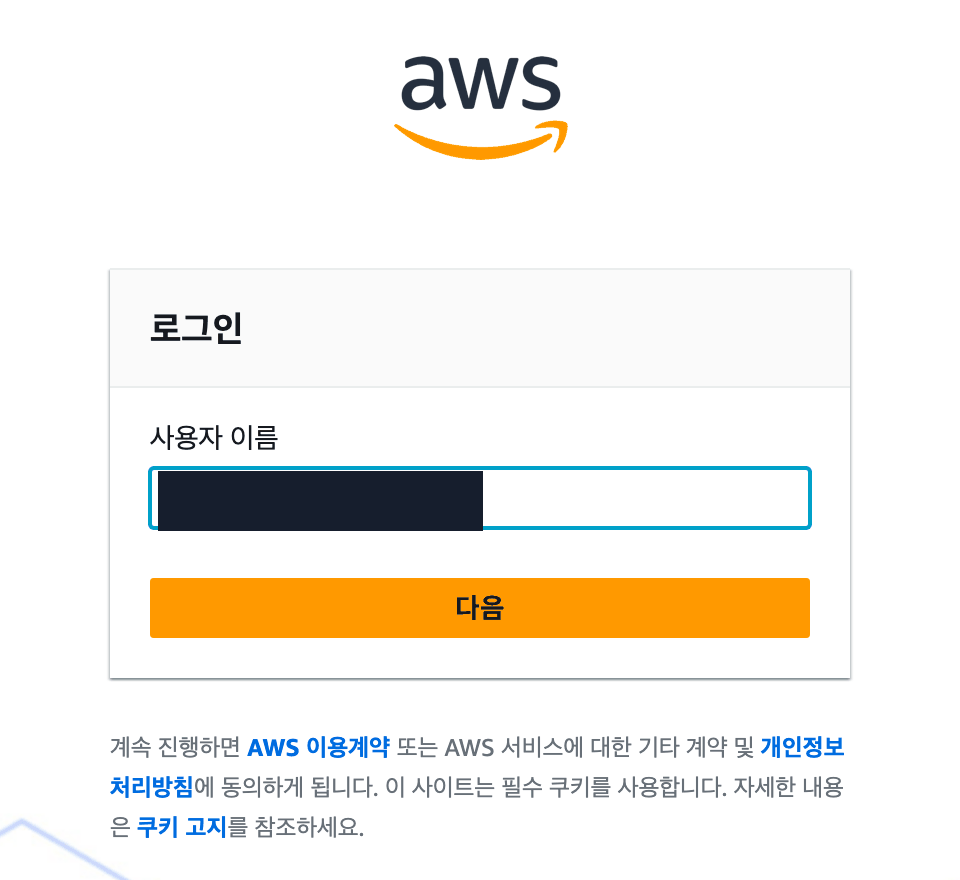
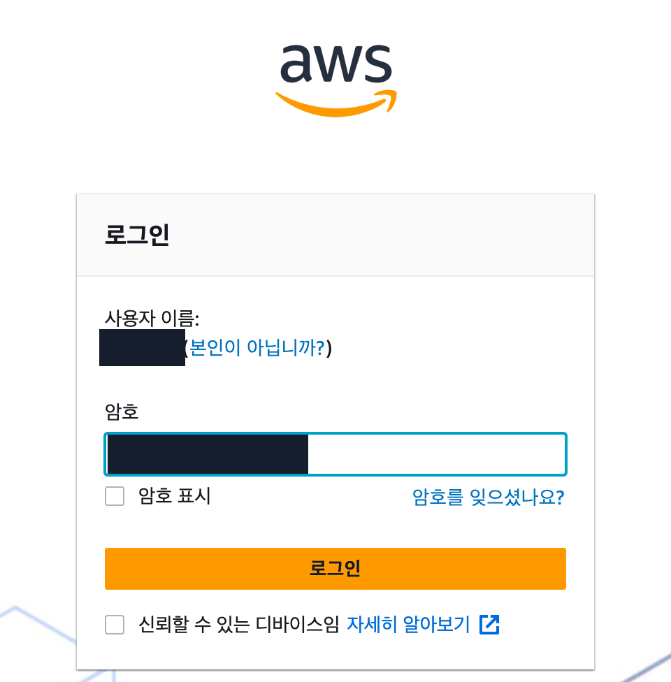
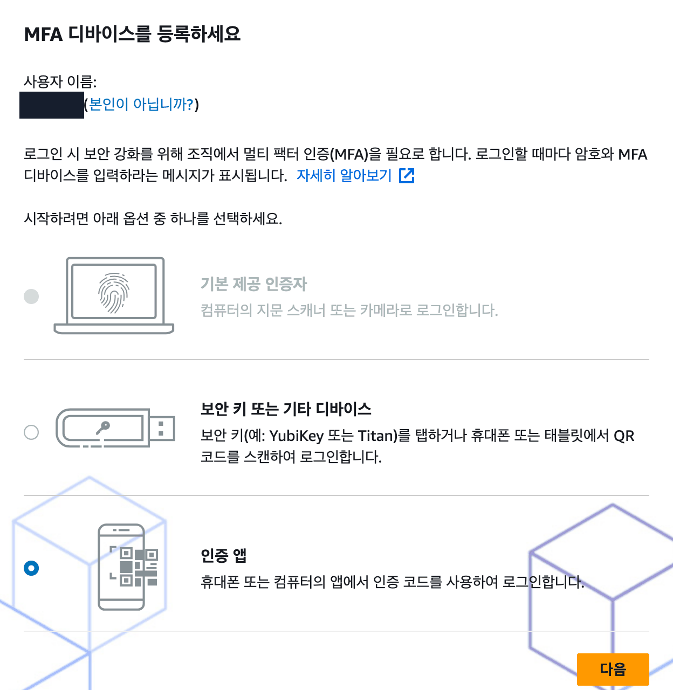
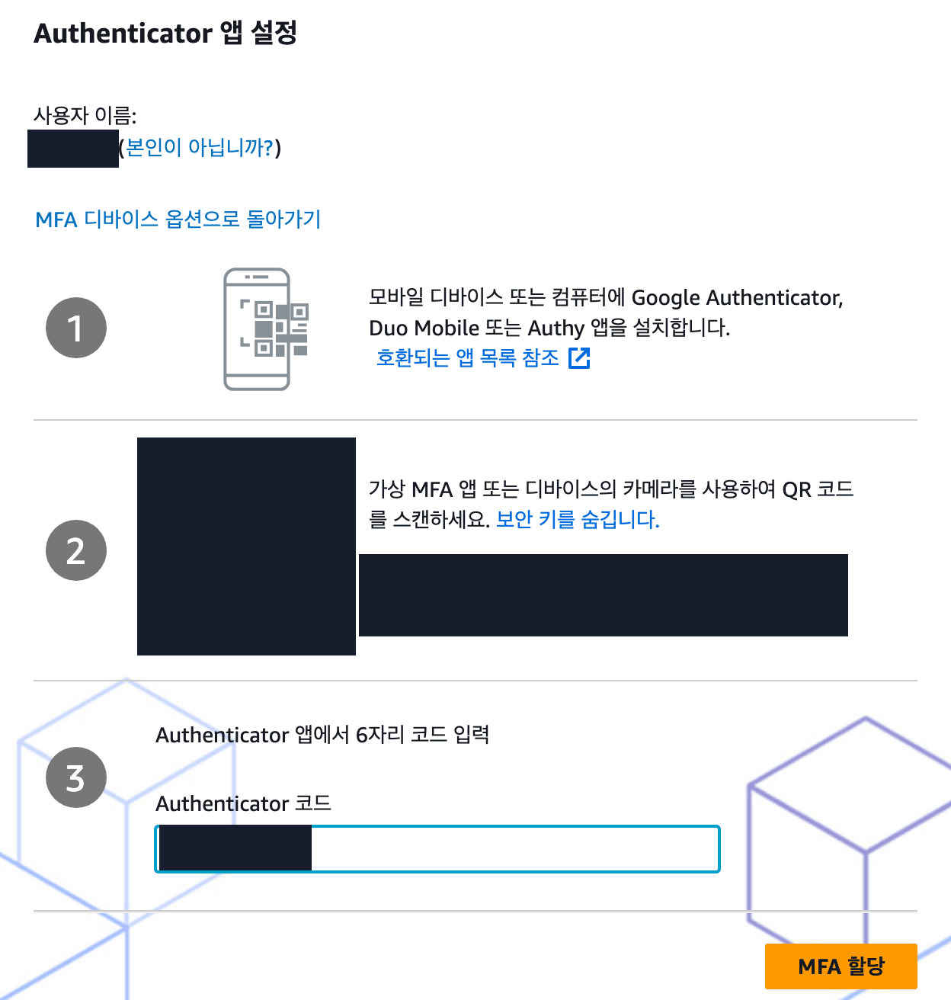
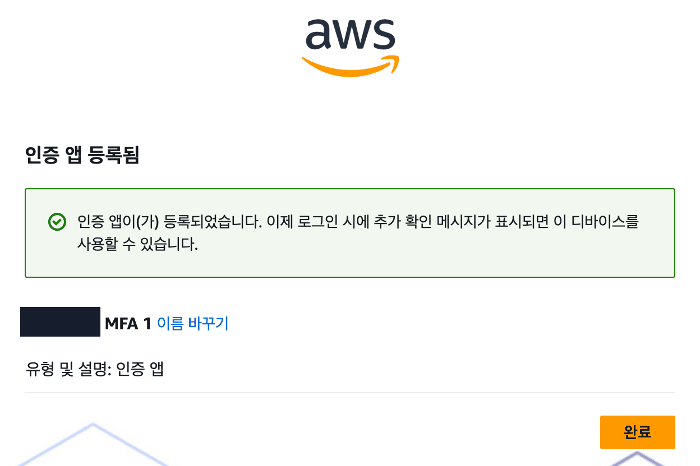
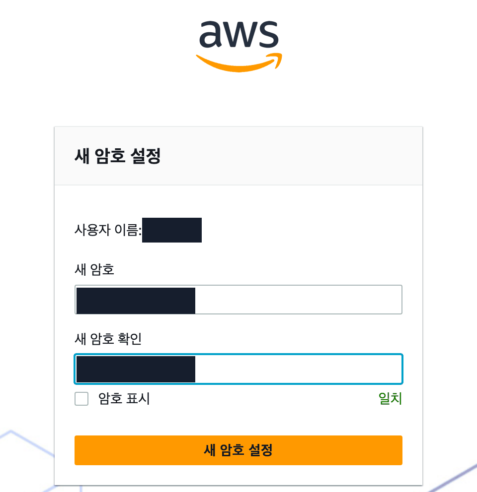
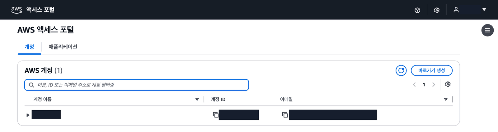

## 따라 하기

### 쪽지로 처음 로그인하기

그림에서 까맣게 가린 칸은 좌석마다 다른 값입니다. 내 쪽지와 내 화면의 값을 씁니다.

1. 쪽지의 포털 주소를 Chrome 에 입력하고, 사용자 이름 칸에 쪽지의 사용자 이름을 넣은 뒤 「다음」

   

2. 암호 칸에 쪽지의 일회용 비밀번호를 그대로 넣고 「로그인」

   

3. MFA 디바이스 화면에서 맨 끝 **인증 앱**을 고르고 「다음」

   

4. 「Show QR code」를 누르고 휴대폰 인증 앱으로 QR 을 찍은 뒤, 앱에 나온 6자리 숫자를 「Authenticator 코드」 칸에 넣고 「MFA 할당」

   

5. 「인증 앱 등록됨」이 보이면 「완료」

   

6. 새 암호와 새 암호 확인에 같은 비밀번호를 넣고(오른쪽 아래 「일치」 확인) 「새 암호 설정」. 새 비밀번호는 내일도 씁니다. 잊지 않게 따로 적어 둡니다.

   

**확인** AWS 액세스 포털에 내 좌석 계정이 한 줄 보이면 성공

## MFA 유형 화면에서 「다음」이 눌리지 않습니다

:::caution[고칠 것]
MFA 유형 화면에는 기본 제공 인증자, 보안 키, 인증 앱 세 가지가 이 순서로 있고 처음에는 아무것도 골라져 있지 않습니다.

맨 끝 <strong>「인증 앱」</strong>을 고르고 「다음」을 누릅니다. 휴대폰 인증 앱으로 화면의 QR 을 찍어 6자리 숫자를 만드는 방식입니다.
:::

## 「기본 제공 인증자」로 등록했습니다

:::caution[고칠 것]
이 방식은 지금 쓰는 PC 에 묶여서 다음 날 다른 PC 에서 들어오지 못합니다.

손을 드세요. 강사가 등록을 지우면 다음 로그인에서 「인증 앱」으로 다시 등록합니다.
:::

## 6자리 숫자를 넣어도 계속 틀립니다

:::caution[고칠 것]
휴대폰 시계가 어긋나면 숫자가 맞지 않습니다.

아래 순서로 고칩니다.

1. 휴대폰 설정에서 날짜와 시간 **자동 설정**을 켭니다.
2. 인증 앱에 새로 나온 숫자를 넣습니다.
:::

## 인증 앱을 설치할 수 없습니다

:::caution[고칠 것]
보호자 승인을 기다리거나 스토어 비밀번호를 모르거나 학교 와이파이가 내려받기를 막는 경우입니다.

아래 순서로 고칩니다.

1. 6자리 숫자를 만드는 인증 앱(<a href="https://support.google.com/accounts/answer/1066447?hl=ko" target="_blank" rel="noopener">Google Authenticator ↗</a>, <a href="https://www.microsoft.com/ko-kr/security/mobile-authenticator-app" target="_blank" rel="noopener">Microsoft Authenticator ↗</a> 등)이 이미 있으면 그 앱을 씁니다.
2. 없으면 모바일 데이터로 내려받습니다.
3. 그래도 안 되거나 휴대폰이 없으면 손을 드세요. 강사 예비 기기로 등록하고 수업을 이어 갑니다.
:::

## Chrome 이 비밀번호를 저장할지 묻습니다

:::caution[고칠 것]
> 「비밀번호를 저장하시겠습니까?」

수업 PC 는 다른 반 학생도 같이 쓰는 PC 입니다.

「안함」을 누릅니다.
:::

:::note[그래도 안 되면]
화면을 그대로 두고 손을 드세요. 좌석 번호, 단원 번호, 화면의 오류 문구를 말해 주세요.
:::
