:::note[이 단원에서 방명록이 얻는 것]
- **전:** 방명록이 AWS 가 미리 만들어 둔 기본 네트워크에 있어서, 왜 인터넷에서 보이는지 알 수 없습니다.
- **후:** 인터넷으로 나가는 문(인터넷 게이트웨이)과 길(라우팅 테이블)을 내 손으로 놓은 네트워크에 둡니다.
- **그래서:** 보안 그룹은 서버 문 앞에서 누구를 들일지 정하고, VPC 와 라우팅은 서버까지 가는 길이 있는지를 정합니다. 길이 없는 곳(프라이빗 서브넷)에 둔 서버는 보안 그룹을 잘못 열어도 인터넷에서 닿지 않습니다. 오늘은 길이 있는 서브넷 두 개를 만들어 12단원 로드 밸런서 자리로 씁니다.
:::

막혔을 때: 이 단원 전체 흐름 영상 (2분 35초)

화면 위 띠의 번호가 아래 「따라 하기」 단계 번호와 같습니다. 누를 곳은 빨간 테두리로 보입니다. 막힌 단계 번호를 찾아 그 부분만 확인하는 용도입니다.

<video controls preload="none" width="100%" src="/guestbook-lab/video/u10.mp4"></video>

## 따라 하기

### VPC를 하나씩 손으로 만들기

1. VPC 를 만듭니다. VPC 생성 화면에서 「생성할 리소스」를 「VPC만」(①)으로 두고 「이름 태그」(②)에 `guestbook-vpc`, 「IPv4 CIDR」(③)에 `10.0.0.0/16` 을 넣습니다. 맨 아래 「VPC 생성」을 누릅니다. <a href="https://ap-northeast-2.console.aws.amazon.com/vpcconsole/home?region=ap-northeast-2#CreateVpc:" target="_blank" rel="noopener">콘솔 열기 ↗</a>

   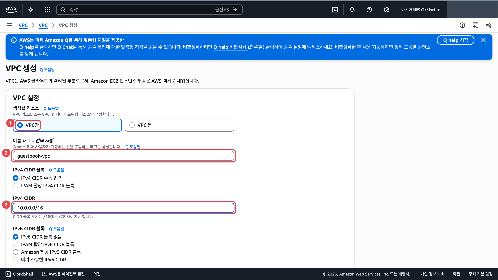

2. 서브넷 두 개를 한 화면에서 만듭니다. <a href="https://ap-northeast-2.console.aws.amazon.com/vpcconsole/home?region=ap-northeast-2#CreateSubnet:" target="_blank" rel="noopener">콘솔 열기 ↗</a>
   1. 서브넷 생성 화면 맨 위 「VPC ID」 칸(①)을 눌러 `guestbook-vpc`(②)를 고릅니다. VPC 를 고르기 전에는 아래 서브넷 칸이 나오지 않습니다.

      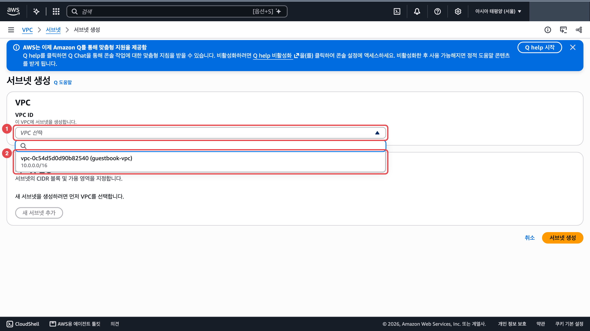

   2. 첫 서브넷: 「서브넷 이름」(①) `public-a`, 「가용 영역」(②) `ap-northeast-2a` 가 들어간 항목, 「IPv4 서브넷 CIDR 블록」(③) `10.0.1.0/24`

      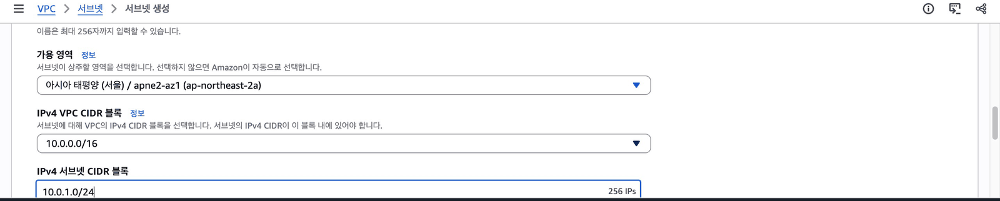

   3. 같은 화면 아래 「새 서브넷 추가」를 누릅니다.

      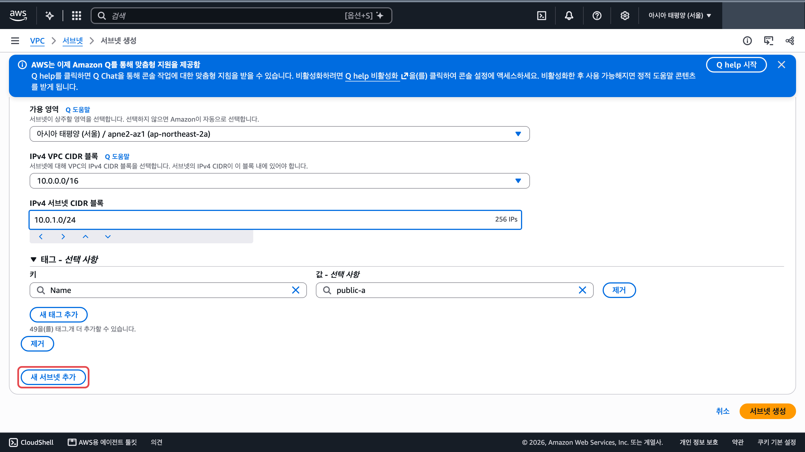

   4. 「2/2개 서브넷」(①) 칸에 두 번째 서브넷: 「서브넷 이름」(②) `public-c`, 「가용 영역」(③) `ap-northeast-2c` 가 들어간 항목, 「IPv4 서브넷 CIDR 블록」(④) `10.0.2.0/24`. 맨 아래 「서브넷 생성」을 누릅니다.

      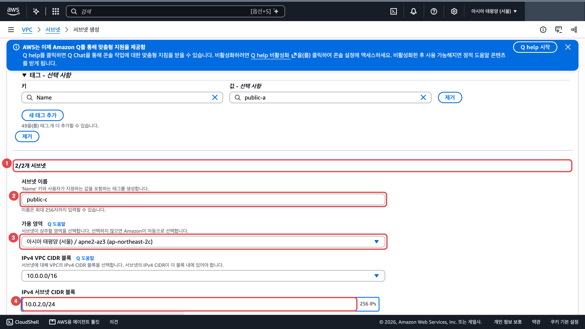

3. 인터넷 게이트웨이를 만들어 VPC 에 연결합니다. <a href="https://ap-northeast-2.console.aws.amazon.com/vpcconsole/home?region=ap-northeast-2#CreateInternetGateway:" target="_blank" rel="noopener">콘솔 열기 ↗</a>
   1. 「이름 태그」(①)에 `guestbook-igw` 를 넣고 「인터넷 게이트웨이 생성」(②)을 누릅니다.

      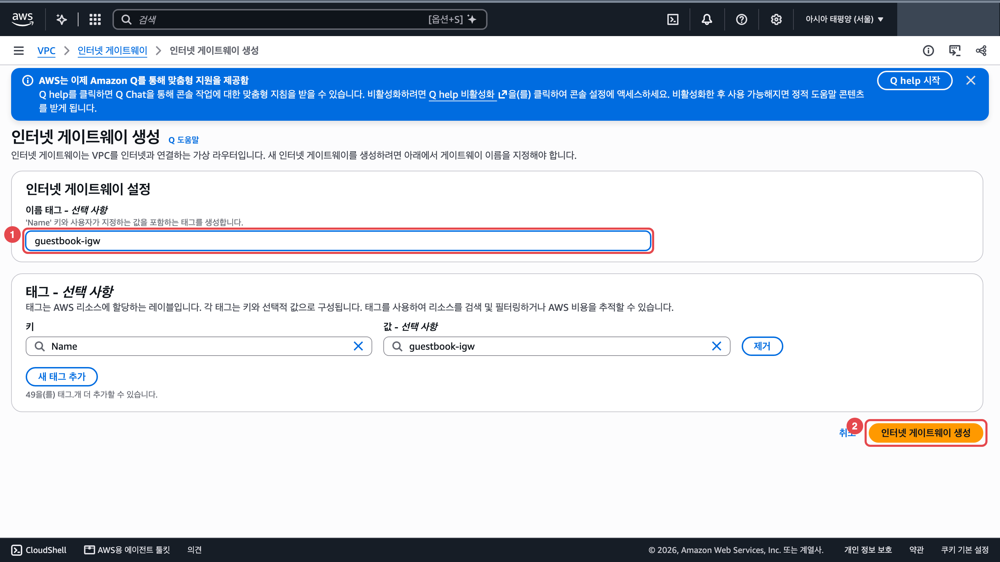

   2. 만든 직후 초록 알림 오른쪽 「VPC에 연결」을 누릅니다. 알림을 닫았으면 위쪽 「작업」 → 「VPC에 연결」입니다.

      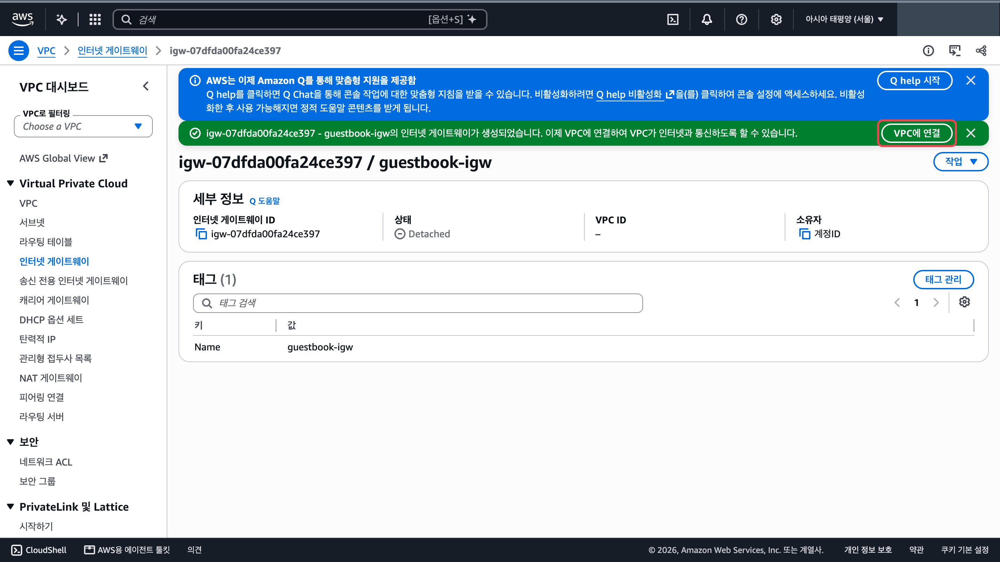

   3. 「사용 가능한 VPC」(①)에서 `guestbook-vpc` 를 고르고 「인터넷 게이트웨이 연결」(②)을 누릅니다.

      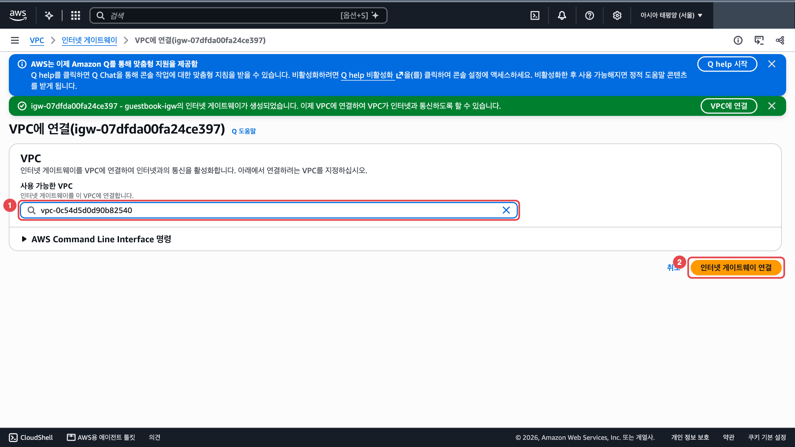

4. 라우팅 테이블을 만들고 바깥으로 나가는 길을 더합니다. <a href="https://ap-northeast-2.console.aws.amazon.com/vpcconsole/home?region=ap-northeast-2#CreateRouteTable:" target="_blank" rel="noopener">콘솔 열기 ↗</a>
   1. 「이름」(①) `guestbook-public-rt`, 「VPC」(②) `guestbook-vpc` 를 고르고 「라우팅 테이블 생성」(③)을 누릅니다.

      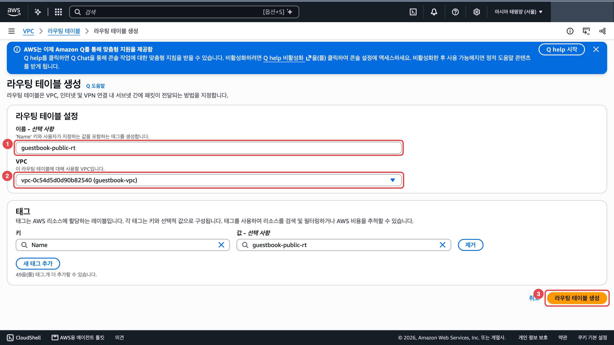

   2. 만든 라우팅 테이블 화면이 열립니다. 아래 탭 줄의 「라우팅」 탭(①)에서 「라우팅 편집」(②)을 누릅니다.

      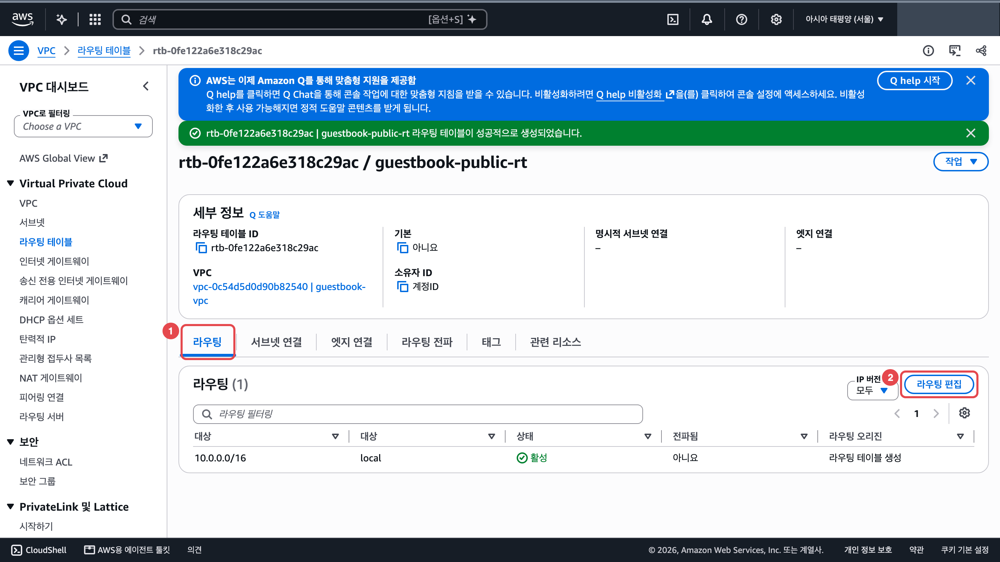

   3. 「라우팅 추가」(①)를 누르면 새 줄이 생깁니다. 왼쪽 칸(②)에 `0.0.0.0/0`, 오른쪽 칸(③)에서 「인터넷 게이트웨이」를 고르고(바로 위 「외부 전용 인터넷 게이트웨이」는 다른 것입니다) 그 아래 칸(④)에서 `guestbook-igw` 가 붙은 `igw-` 항목을 고릅니다. 「변경 사항 저장」(⑤)을 누릅니다.

      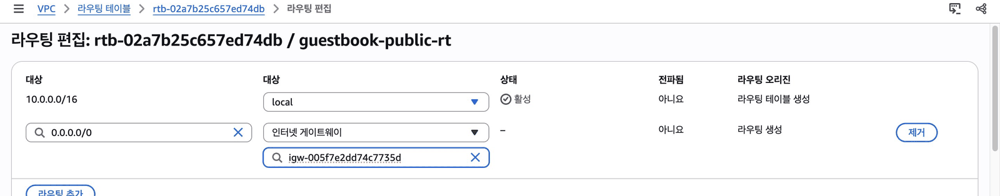

5. 그 라우팅 테이블에 두 서브넷을 연결합니다.
   1. 같은 라우팅 테이블 화면의 「서브넷 연결」 탭(①)에서 「명시적 서브넷 연결」 표 오른쪽 위 「서브넷 연결 편집」(②)을 누릅니다.

      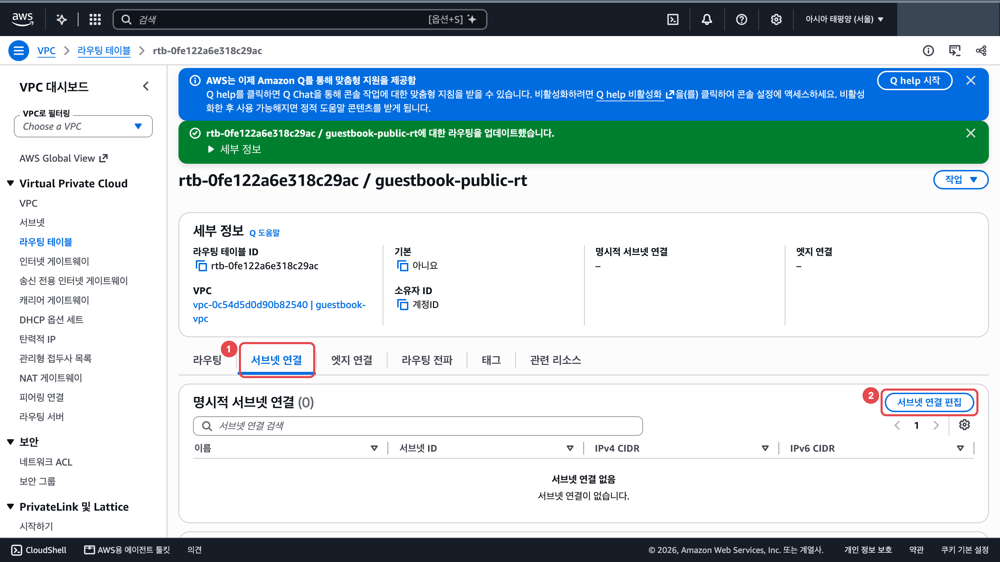

   2. `public-a`, `public-c` 두 행을 모두 체크(①②)하고 「연결 저장」(③)을 누릅니다.

      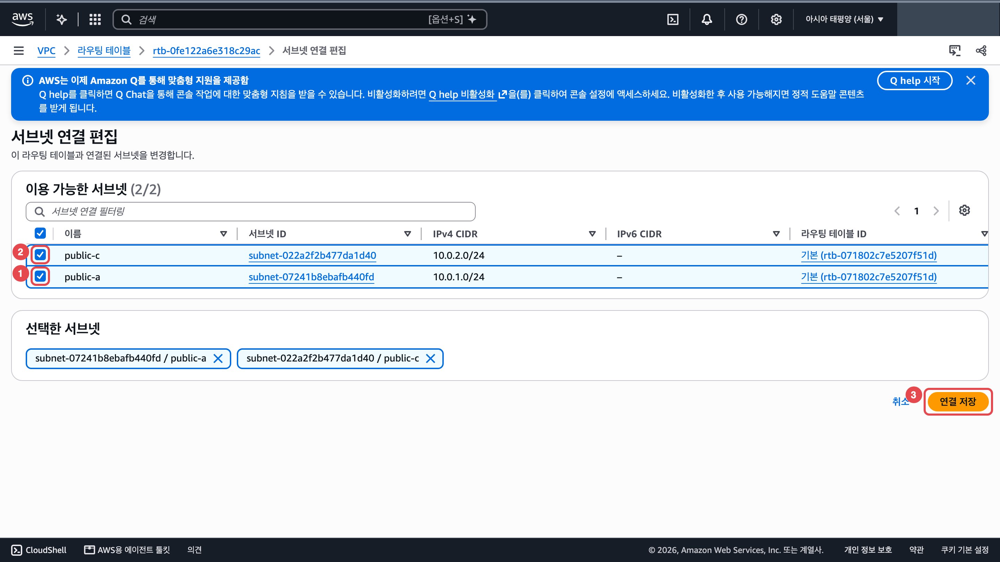

6. 서브넷마다 공인 IP 자동 할당을 켭니다. 서브넷 목록에서 한 번에 한 행만 체크합니다. <a href="https://ap-northeast-2.console.aws.amazon.com/vpcconsole/home?region=ap-northeast-2#subnets:" target="_blank" rel="noopener">콘솔 열기 ↗</a>
   1. `public-a` 행만 체크(①)하고 「작업」(②) → 「서브넷 설정 편집」(③)을 누릅니다.

      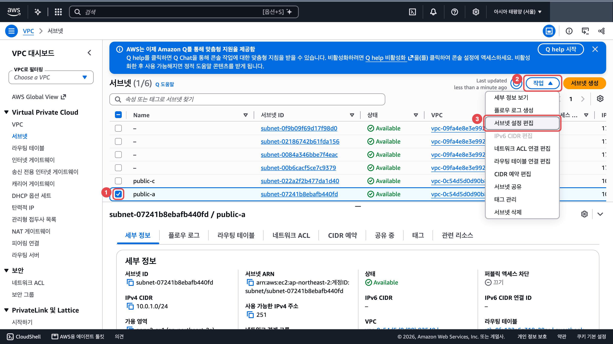

   2. 「퍼블릭 IPv4 주소 자동 할당 활성화」(①)를 체크하고 「저장」(②)을 누릅니다.

      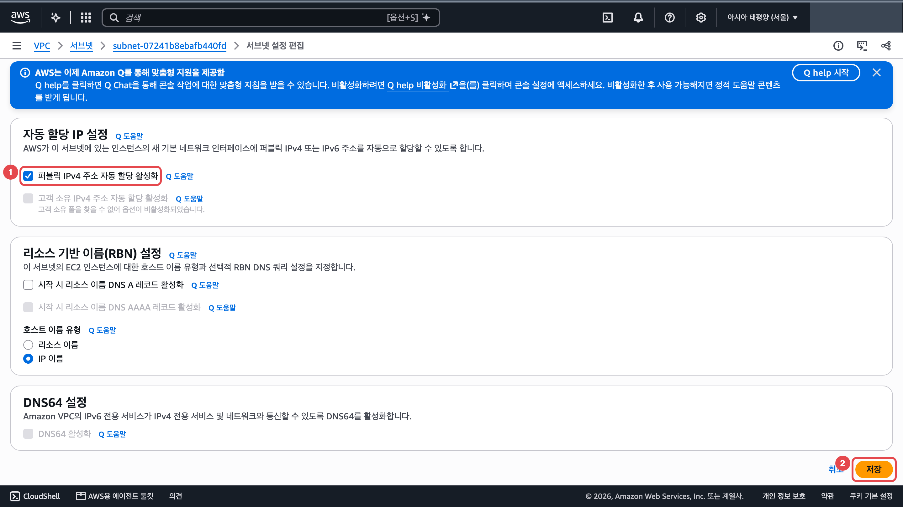

   3. 목록으로 돌아오면 `public-a` 체크가 남아 있습니다. `public-a` 체크를 끄고 `public-c` 행만 체크해 1~2를 한 번 더 합니다.

**확인** VPC 목록에서 `guestbook-vpc` 의 VPC ID 를 누릅니다. 아래 「리소스 맵」 탭(①)에서 서브넷 두 개가 `guestbook-public-rt` 로, `guestbook-public-rt` 가 `guestbook-igw` 로 선이 이어졌는지(②) 봅니다. 오른쪽 끝 「네트워크 연결」 열이 잘려 보이면 왼쪽 탐색 창을 접거나 리소스 맵을 옆으로 밉니다. <a href="https://ap-northeast-2.console.aws.amazon.com/vpcconsole/home?region=ap-northeast-2#vpcs:" target="_blank" rel="noopener">콘솔 열기 ↗</a>

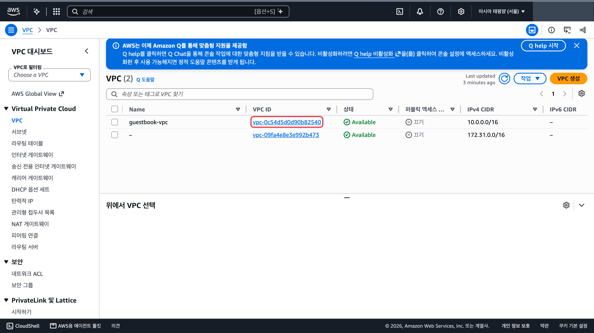

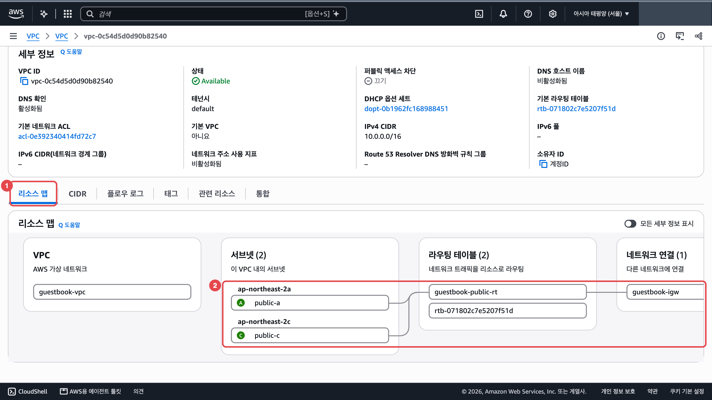

**흔한 실수** 4번을 하고 5번을 빼먹으면 서브넷이 여전히 바깥으로 못 나갑니다.

## 막혔을 때

### CIDR 칸에 흐린 `10.0.0.0/24` 가 보입니다

:::caution[고칠 것]
흐린 글씨는 예시이고 칸은 비어 있습니다.

아래 값을 직접 입력합니다.

| 칸 | 값 |
|---|---|
| VPC `guestbook-vpc` | `10.0.0.0/16` |
| 서브넷 `public-a`(2a) | `10.0.1.0/24` |
| 서브넷 `public-c`(2c) | `10.0.2.0/24` |
:::

### 리소스 맵에서 선이 이어지지 않습니다

:::caution[고칠 것]
연결 단계 하나가 빠졌습니다.

아래 넷을 차례로 봅니다.

1. 인터넷 게이트웨이 `guestbook-igw` 가 `guestbook-vpc` 에 연결됐는지 <a href="https://ap-northeast-2.console.aws.amazon.com/vpcconsole/home?region=ap-northeast-2#igws:" target="_blank" rel="noopener">콘솔 열기 ↗</a>
2. `guestbook-public-rt` 라우팅에 `0.0.0.0/0` → 인터넷 게이트웨이가 있는지 <a href="https://ap-northeast-2.console.aws.amazon.com/vpcconsole/home?region=ap-northeast-2#RouteTables:" target="_blank" rel="noopener">콘솔 열기 ↗</a>
3. 그 라우팅 테이블에 두 서브넷이 연결됐는지
4. 두 서브넷 모두 「퍼블릭 IPv4 주소 자동 할당」이 켜졌는지(서브넷마다 따로 켭니다) <a href="https://ap-northeast-2.console.aws.amazon.com/vpcconsole/home?region=ap-northeast-2#subnets:" target="_blank" rel="noopener">콘솔 열기 ↗</a>
:::

### 라우팅 편집의 두 칸 이름이 모두 「대상」입니다

:::tip[정상입니다]{icon="approve-check-circle"}
왼쪽 칸에 `0.0.0.0/0` 을 넣습니다. 오른쪽 칸에서 「인터넷 게이트웨이」를 고른 뒤 `igw-` 목록에서 `guestbook-igw` 를 고릅니다.
:::

### 「VPC 등」 마법사가 NAT 게이트웨이에서 실패합니다

:::caution[고칠 것]
수업 계정은 시간당 요금이 붙는 NAT 게이트웨이를 막아 둡니다.

「VPC만」을 골라 하나씩 만듭니다. 마법사가 반쯤 만든 자원은 15단원에서 같이 지웁니다.
:::

### 서브넷 목록에 서브넷이 6개 보입니다

:::tip[정상입니다]{icon="approve-check-circle"}
기본 VPC 의 서브넷 4개가 같이 보입니다. 「퍼블릭 IPv4 주소 자동 할당」을 켤 때는 이름이 `public-a` 인 행 하나만 체크하고, 저장한 뒤 `public-c` 행 하나만 체크해 한 번 더 합니다.
:::

### 「작업」 메뉴의 「서브넷 설정 편집」이 회색입니다

:::caution[고칠 것]
서브넷이 두 개 이상 체크되어 있습니다. 앞 서브넷을 저장하고 목록으로 돌아오면 그 체크가 그대로 남아 있습니다.

아래 순서로 고칩니다.

1. 서브넷 목록에서 체크된 행을 모두 끕니다.
2. 바꿀 서브넷 한 행만 체크합니다.
3. 「작업」 → 「서브넷 설정 편집」을 다시 누릅니다.
:::

### 서브넷 생성 화면에 서브넷 이름 칸이 없습니다

:::caution[고칠 것]
> 「새 서브넷을 생성하려면 먼저 VPC를 선택합니다.」

맨 위 「VPC ID」 칸이 비어 있습니다. 「VPC ID」 칸을 눌러 `guestbook-vpc` 를 고르면 서브넷 칸이 나옵니다.
:::

:::note[그래도 안 되면]
화면을 그대로 두고 손을 드세요. 좌석 번호, 단원 번호, 화면의 오류 문구를 말해 주세요.
:::
