:::note[이 단원에서 방명록이 얻는 것]
- **전:** 서버 한 대마다 5단원 명령을 손으로 칩니다.
- **후:** 서버가 켜지는 순간 앱이 스스로 설치됩니다.
- **그래서:** 똑같은 서버를 몇 대든 몇 분 만에 만들고, 사람이 빠뜨리는 단계가 없어집니다. 12단원 오토 스케일링이 서버를 대신 만들 수 있는 전제가 됩니다.
:::

<details class="walkthrough">
<summary>막혔을 때: 이 단원 전체 흐름 영상 (1분 55초)</summary>

화면 위 띠의 번호가 아래 「따라 하기」 단계 번호와 같습니다. 누를 곳은 빨간 테두리로 보입니다. 막힌 단계 번호를 찾아 그 부분만 확인하는 용도입니다.

<video controls preload="none" width="100%" src="/guestbook-lab/video/u11.mp4"></video>

</details>

## 따라 하기

### 켜지자마자 앱이 뜨는 서버

사용자 데이터 (서버가 처음 켜질 때 한 번 실행). 5단원에서 손으로 친 명령과 같습니다. systemd 는 서버가 켜질 때 앱을 자동으로 켜 주는 관리자입니다.

```bash
#!/bin/bash
# git, 파이썬 3.11, nano 편집기를 설치합니다
dnf install -y git python3.11 nano
# 방명록 앱 저장소를 /opt/guestbook 폴더로 받습니다
git clone https://github.com/pghoya2956/guestbook-lab.git /opt/guestbook
# 앱 폴더로 들어갑니다
cd /opt/guestbook
# 이 앱 전용 파이썬 도구 상자(.venv)를 만듭니다
python3.11 -m venv .venv
# 도구 상자(.venv)에 앱에 필요한 라이브러리를 넣습니다
.venv/bin/pip install -r requirements.txt
# 설정 파일 견본을 config.env 로 복사합니다
cp config.env.example config.env
# 글을 저장할 폴더를 만듭니다
mkdir -p /var/lib/guestbook
# 관리자(systemd)에게 앱 등록 파일을 넘깁니다
cp guestbook.service /etc/systemd/system/
# 관리자(systemd)가 새 등록 파일을 읽게 합니다
systemctl daemon-reload
# 관리자(systemd)가 앱을 지금 켜고, 서버가 켜질 때마다 저절로 켜게 합니다
systemctl enable --now guestbook
```

:::caution[첫 줄 `#!/bin/bash` 를 지우지 않습니다]
첫 줄 `#!/bin/bash` 는 「이 글은 bash 로 실행할 대본입니다」라는 표시입니다. 이 줄이 없으면 서버는 사용자 데이터를 대본으로 알아보지 못해 한 줄도 실행하지 않고, 새 서버에 앱이 뜨지 않습니다. 오른쪽 위 복사 단추로 통째로 복사해 붙여 넣고, 붙여 넣은 칸의 맨 첫 줄이 `#!/bin/bash` 인지 봅니다.
:::

1. 시작 템플릿 생성 화면의 「시작 템플릿 이름 - 필수」 칸에 `guestbook-lt` 를 넣습니다. <a href="https://ap-northeast-2.console.aws.amazon.com/ec2/home?region=ap-northeast-2#CreateTemplate:" target="_blank" rel="noopener">콘솔 열기 ↗</a>

   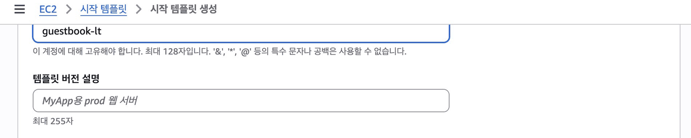

2. 서버 이미지와 크기를 고릅니다.
   1. 「애플리케이션 및 OS 이미지」는 「최근 사용」 탭으로 열립니다. 「Quick Start」 탭(①)을 누르고 「Amazon Linux」(②)를 누릅니다. 아래 칸(③)에 `Amazon Linux 2023` 으로 시작하는 AMI 가 들어가면 됩니다.

      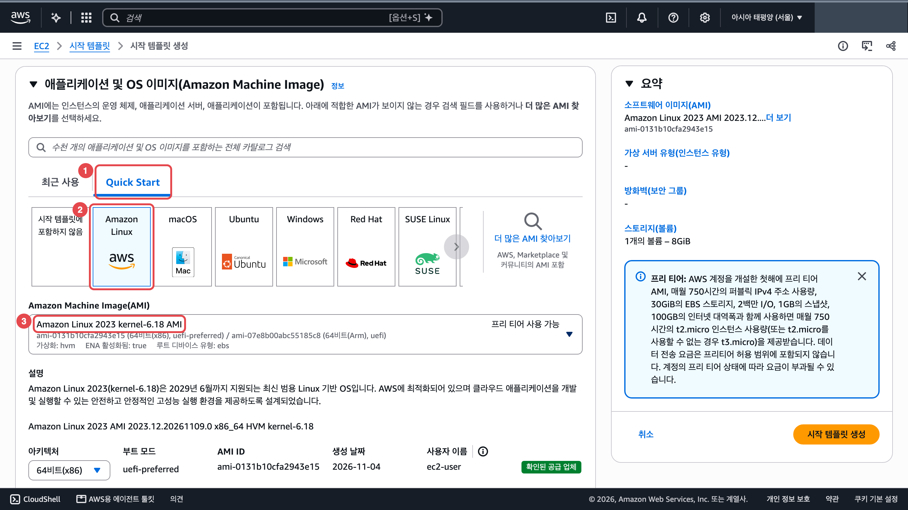

   2. 「인스턴스 유형」 칸을 눌러 `t3.micro` 를 고릅니다.

      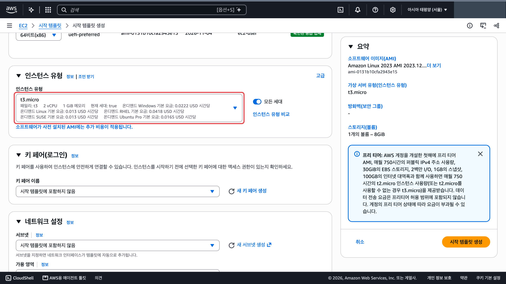

3. 「키 페어」와 「네트워크 설정」의 「서브넷」은 「시작 템플릿에 포함하지 않음」 그대로 둡니다. 「방화벽(보안 그룹)」에서 새 보안 그룹을 만듭니다.
   1. 「보안 그룹 생성」(①)을 고릅니다.
   2. 「보안 그룹 이름 - 필수」(②)에 `guestbook-web`, 「설명 - 필수」(③)에 `guestbook web` 처럼 영어로 씁니다.
   3. 「VPC」(④)를 **guestbook-vpc** 로 바꿉니다. 처음 값은 기본 VPC 입니다.
   4. 「보안 그룹 규칙 추가」를 누르면 규칙 칸이 생깁니다. 「유형」(⑤)을 `HTTP`, 「소스 유형」(⑥)을 「위치 무관」으로 고릅니다.

   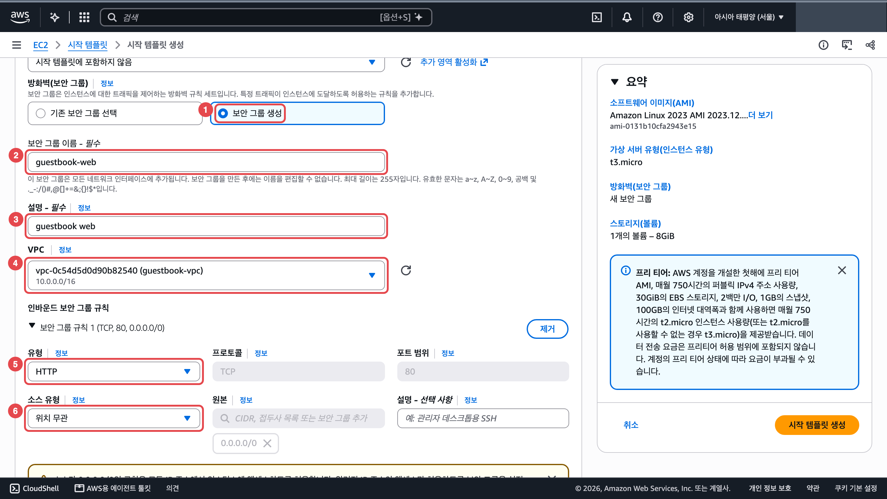

4. 서버 역할과 처음 켜질 때 실행할 대본을 넣습니다.
   1. 아래로 내려 접혀 있는 「고급 세부 정보」를 눌러 펼칩니다.

      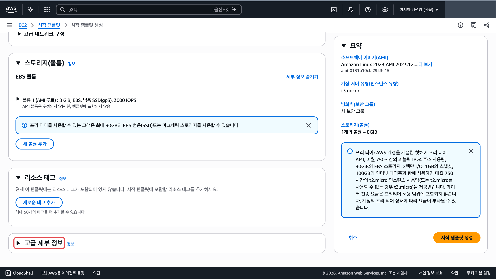

   2. 펼친 「고급 세부 정보」(①) 맨 위 「IAM 인스턴스 프로파일」(②)에서 `guestbook-ec2-role` 을 고릅니다. 「IAM 인스턴스 프로파일」은 EC2 가 역할을 담는 상자 이름입니다. 여기서 고르는 것은 4단원에서 만든 역할 `guestbook-ec2-role` 입니다.

      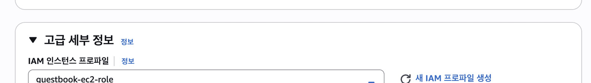

   3. 맨 아래 「사용자 데이터 - 선택 사항」 칸(①)에 위 대본을 붙여 넣고 오른쪽 「요약」 아래 「시작 템플릿 생성」(②)을 누릅니다.

      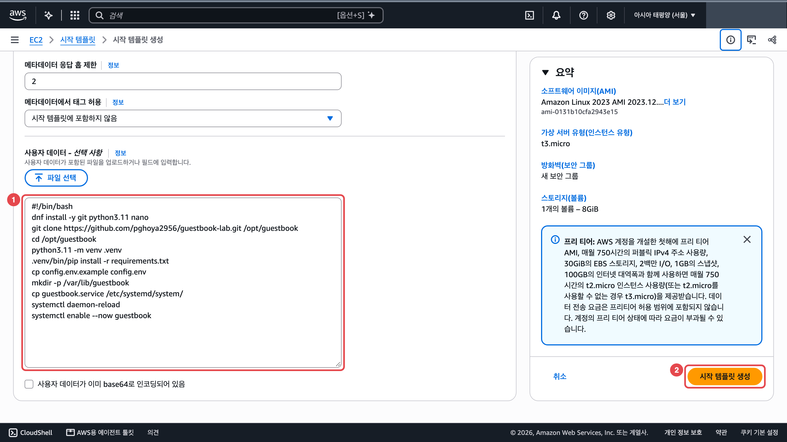

5. 템플릿으로 새 서버를 켭니다. <a href="https://ap-northeast-2.console.aws.amazon.com/ec2/home?region=ap-northeast-2#LaunchTemplates:" target="_blank" rel="noopener">콘솔 열기 ↗</a>
   1. 시작 템플릿 목록에서 `guestbook-lt` 행을 체크(①)하고 「작업」(②) → 「템플릿으로 인스턴스 시작」(③)을 누릅니다.

      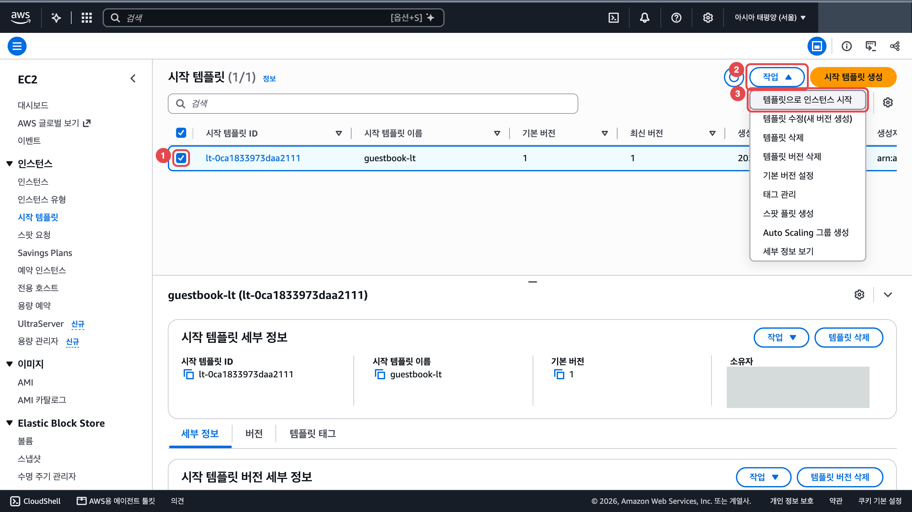

   2. 「키 페어 이름」(①)을 「키 페어 없이 계속 진행」으로, 「네트워크 설정」의 「서브넷」(②)을 `public-a` 가 붙은 서브넷으로 고릅니다.

      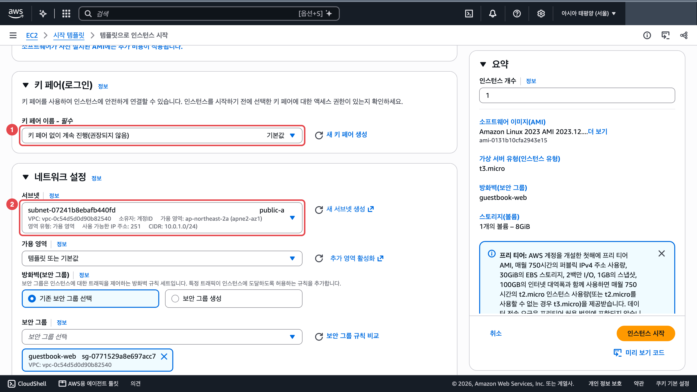

   3. 아래 「리소스 태그」에서 「새로운 태그 추가」를 누릅니다. 「키」(①)에 `Name`, 「값」(②)에 `guestbook-2` 를 넣고 오른쪽 「인스턴스 시작」(③)을 누릅니다. 이 화면에는 이름 칸이 따로 없어서 이 태그가 서버 이름이 됩니다.

      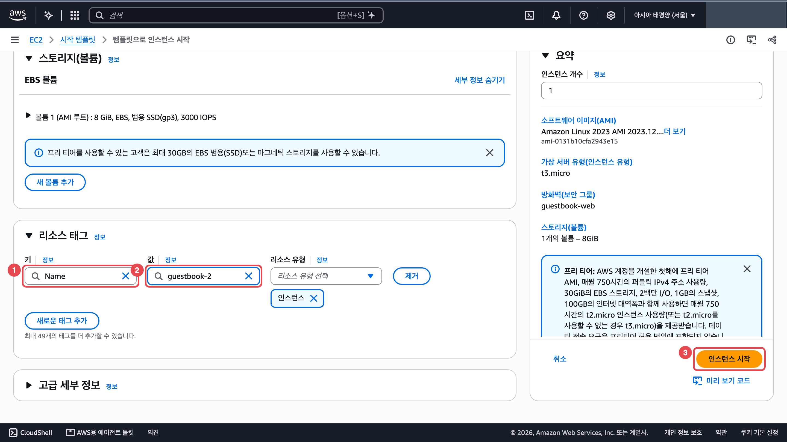

6. 접속하지 말고 방명록을 엽니다. 인스턴스 목록에서 `guestbook-2` 행만 체크(①)하면 아래 「세부 정보」 탭에 「퍼블릭 IPv4 주소」(②)가 보입니다. 1~2분 기다린 뒤 새 탭에 `http://공인IP` 로 엽니다. 사진의 실제 주소는 가렸습니다. <a href="https://ap-northeast-2.console.aws.amazon.com/ec2/home?region=ap-northeast-2#Instances:" target="_blank" rel="noopener">콘솔 열기 ↗</a>

   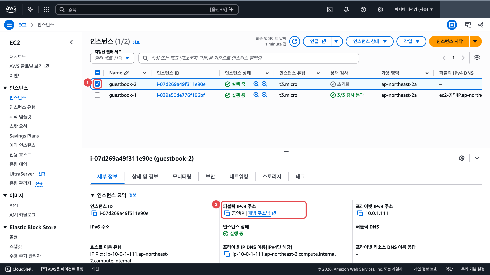

   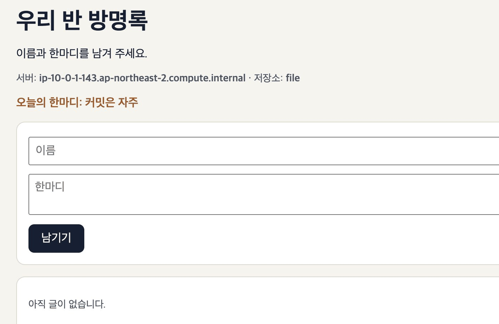

## 막혔을 때

### 템플릿 칸이 「시작 템플릿에 포함하지 않음」입니다

:::caution[고칠 것]
AMI, 인스턴스 유형, IAM 인스턴스 프로파일 같은 칸이 「시작 템플릿에 포함하지 않음」으로 시작합니다. 그대로 두면 빈 템플릿이 됩니다. 서브넷과 키 페어는 템플릿에 넣지 않습니다.

아래 순서로 고칩니다.

1. AMI: 「최근 사용」 탭 옆 「Quick Start」 탭을 누르고 「Amazon Linux」를 누릅니다.
2. 인스턴스 유형: `t3.micro`
3. 고급 세부 정보 → IAM 인스턴스 프로파일(EC2 가 역할을 담는 상자): 4단원에서 만든 역할 `guestbook-ec2-role`
4. 사용자 데이터 칸에 위 대본을 붙여 넣습니다.
:::

### `public-a` 서브넷에 시작되지 않습니다

:::caution[고칠 것]
템플릿의 「보안 그룹 생성」 VPC 칸 기본값이 기본 VPC 입니다.

보안 그룹의 VPC 칸을 `guestbook-vpc` 로 바꿔 템플릿을 다시 만듭니다. <a href="https://ap-northeast-2.console.aws.amazon.com/ec2/home?region=ap-northeast-2#LaunchTemplates:" target="_blank" rel="noopener">콘솔 열기 ↗</a>
:::

### 키 페어 대화 상자가 다시 뜹니다

:::tip[정상입니다]{icon="approve-check-circle"}
「키 페어 없이 계속 진행」을 고르고 대화 상자 안의 「인스턴스 시작」을 한 번 더 누릅니다.
:::

### 새 서버의 방명록이 안 열립니다

:::caution[고칠 것]
앱을 설치하는 데 1~2분 걸립니다. 그보다 오래 걸리면 사용자 데이터 대본이 중간에 멈췄을 수 있습니다.

아래 순서로 고칩니다.

1. 1~2분 기다린 뒤 새 탭에 `http://공인IP` 로 엽니다([http 주소가 안 열릴 때](/guestbook-lab/basics/errors/)).
2. 몇 분이 지나도 안 열리면 그 서버에 Session Manager 로 접속해 대본이 어디서 멈췄는지 봅니다. `/var/log/cloud-init-output.log` 는 사용자 데이터가 실행될 때 화면에 찍힌 내용을 저장한 파일입니다. <a href="https://ap-northeast-2.console.aws.amazon.com/ec2/home?region=ap-northeast-2#Instances:" target="_blank" rel="noopener">콘솔 열기 ↗</a>

```bash
# 사용자 데이터가 실행될 때 화면에 찍힌 내용을 저장한 파일의 마지막 30줄을 봅니다
sudo tail -n 30 /var/log/cloud-init-output.log
```
:::

### 사용자 데이터 첫 줄 `#!/bin/bash` 를 지웠습니다

:::caution[고칠 것]
첫 줄이 없으면 대본이 실행되지 않아 새 서버에 앱이 설치되지 않습니다. 서버에 접속해 `sudo tail -n 30 /var/log/cloud-init-output.log` 를 쳐도 `dnf install` 이나 `git clone` 이 실행된 흔적이 없습니다. 이미 켠 서버는 사용자 데이터를 다시 실행하지 않으니 템플릿을 고친 뒤 서버를 새로 켭니다.

아래 순서로 고칩니다.

1. 시작 템플릿 목록에서 `guestbook-lt` 행을 체크하고 「작업」 → 「템플릿 수정(새 버전 생성)」을 누릅니다. <a href="https://ap-northeast-2.console.aws.amazon.com/ec2/home?region=ap-northeast-2#LaunchTemplates:" target="_blank" rel="noopener">콘솔 열기 ↗</a>
2. 「고급 세부 정보」의 「사용자 데이터」 칸을 모두 지우고 위 대본을 처음부터 다시 붙여 넣은 뒤 「시작 템플릿 생성」을 누릅니다.
3. 템플릿 목록에서 `guestbook-lt` 행을 체크하고 「작업」 → 「기본 버전 설정」에서 방금 만든 가장 큰 버전 번호를 골라 저장합니다. 12단원 오토 스케일링도 이 기본 버전을 씁니다.
4. 앱이 뜨지 않은 `guestbook-2` 를 종료하고 5번부터 다시 합니다.
:::

### 새 서버 방명록에 「아직 글이 없습니다」가 보입니다

:::tip[정상입니다]{icon="approve-check-circle"}
어제 쓴 글은 어제 서버의 디스크 파일에 있습니다. 미니 프로젝트의 [DynamoDB 메뉴](/guestbook-lab/menu/2-dynamodb/)가 이 문제를 풉니다.
:::

### 새 서버에서 9단원 공지가 사라졌습니다

:::tip[정상입니다]{icon="approve-check-circle"}
사용자 데이터가 `config.env.example` 을 그대로 복사해서 새 서버의 `NOTICE_BUCKET` 이 비어 있습니다. 어제 글이 새 서버에 없던 것과 같은 이유입니다.

공지를 다시 보이게 하려면 새 서버에서 설정 파일을 고칩니다. 순서는 [9단원](/guestbook-lab/u9/) 8번과 같습니다.

1. 인스턴스 목록에서 `guestbook-2` 행만 체크하고 「연결」 → 「SSM Session Manager」 → 「연결」을 누릅니다. <a href="https://ap-northeast-2.console.aws.amazon.com/ec2/home?region=ap-northeast-2#Instances:" target="_blank" rel="noopener">콘솔 열기 ↗</a>
2. 설정 파일을 엽니다.

   ```bash
   # 앱 설정 파일을 nano 편집기로 엽니다
   sudo nano /opt/guestbook/config.env
   ```

3. 이미 있는 빈 `NOTICE_BUCKET=` 줄(①)의 `=` 바로 뒤에 내 공지 버킷 이름을 적습니다. 새 줄을 더하지 않습니다. Ctrl+O(②)를 누르고 Enter 로 저장한 뒤 Ctrl+X(③)로 나옵니다.

   ```text
   NOTICE_BUCKET=공지버킷
   ```

   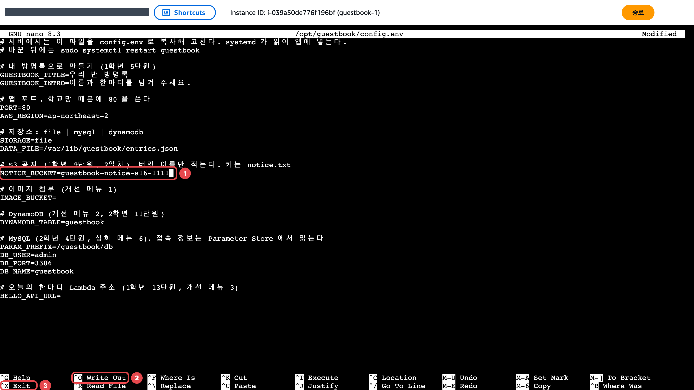

4. 적은 줄을 확인하고 앱을 다시 켭니다.

   ```bash
   # 설정 파일 내용을 화면에 출력해 고친 줄을 확인합니다
   cat /opt/guestbook/config.env
   # 앱을 다시 켜서 바뀐 설정을 읽게 합니다
   sudo systemctl restart guestbook
   ```
:::

### 보안 그룹 규칙 칸이 보이지 않습니다

:::caution[고칠 것]
> 「현재 이 템플릿에는 어떤 보안 그룹 규칙도 포함되어 있지 않습니다.」

규칙 칸은 「보안 그룹 규칙 추가」를 눌러야 생깁니다. 「인바운드 보안 그룹 규칙」 아래 「보안 그룹 규칙 추가」를 누르고 「유형」 `HTTP`, 「소스 유형」 「위치 무관」을 고릅니다.
:::

### 아래 세부 정보 대신 「2개 인스턴스 선택됨」이 보입니다

:::caution[고칠 것]
목록에 앞에서 체크한 `guestbook-1` 체크가 남아 있습니다. 두 대가 함께 체크되면 아래에 공인 IP 가 나오지 않습니다.

`guestbook-1` 체크를 끄고 `guestbook-2` 행만 체크합니다.
:::

:::note[그래도 안 되면]
화면을 그대로 두고 손을 드세요. 좌석 번호, 단원 번호, 화면의 오류 문구를 말해 주세요.
:::
