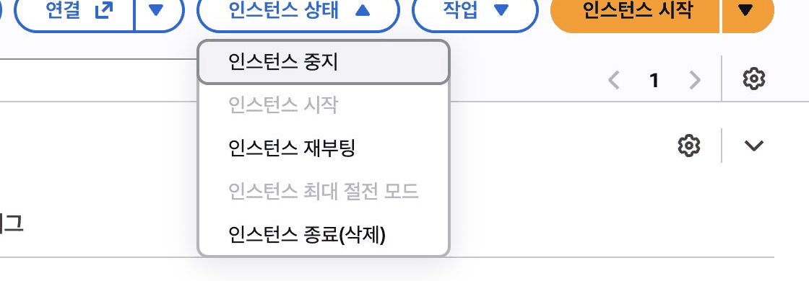

## 따라 하기

### 서버를 일부러 죽여 보기

1. 대상 그룹 생성: 인스턴스, 포트 80, **VPC guestbook-vpc**, 상태 검사 `/health` <a href="https://ap-northeast-2.console.aws.amazon.com/ec2/home?region=ap-northeast-2#CreateTargetGroup:" target="_blank" rel="noopener">콘솔 열기 ↗</a>

   

2. Application Load Balancer 생성: 인터넷 경계, **VPC guestbook-vpc**, 서브넷 2a와 2c <a href="https://ap-northeast-2.console.aws.amazon.com/ec2/home?region=ap-northeast-2#SelectCreateELBWizard:" target="_blank" rel="noopener">콘솔 열기 ↗</a>

   

3. 로드 밸런서 보안 그룹: 「보안 그룹 생성」 → 새 탭에서 **VPC guestbook-vpc**, HTTP 위치 무관 → 돌아와 보안 그룹 칸 옆 새로 고침을 눌러 고르고 default 는 지우기. 리스너 80 → 대상 그룹

   

4. 오토 스케일링 그룹 생성: 템플릿 `guestbook-lt`, **VPC guestbook-vpc**, 서브넷 2개, 기존 대상 그룹 연결, ELB 상태 검사 켜기, 최소 2, 원하는 2, 최대 4 <a href="https://ap-northeast-2.console.aws.amazon.com/ec2/home?region=ap-northeast-2#CreateAutoScalingGroup:" target="_blank" rel="noopener">콘솔 열기 ↗</a>

   

   

5. 새 탭에 `http://로드 밸런서 DNS 이름`, 새로고침하며 서버 이름 보기

   

   

6. 인스턴스 하나를 체크하고 인스턴스 상태 → **인스턴스 중지**, 몇 분 뒤 다시 보기 <a href="https://ap-northeast-2.console.aws.amazon.com/ec2/home?region=ap-northeast-2#Instances:" target="_blank" rel="noopener">콘솔 열기 ↗</a>

   

   종료까지 하지 않아도 됩니다. 오토 스케일링은 중지한 서버도 비정상으로 보고 새 서버로 바꿉니다. 중지한 서버는 이 과정에서 종료되니 다시 켜서 쓰지 않습니다.

**관찰할 것** 대상 그룹에서 중지한 서버는 빠지고 오토 스케일링이 새 서버로 바꿉니다. 새 서버가 Initial → Unhealthy(설치 중) → Healthy 로 바뀌는 과정. 약 5분 걸립니다

**계속 unhealthy면** 서버 보안 그룹이 로드 밸런서에서 오는 80 포트를 막고 있는지 확인

## 막혔을 때

### 앞에서 만든 자원이 다음 화면 목록에 안 보입니다

:::caution[고칠 것]
아래 네 화면의 VPC 칸 기본값이 모두 기본 VPC 입니다.

- 대상 그룹
- 로드 밸런서
- 보안 그룹 생성
- 오토 스케일링 그룹

화면마다 VPC 칸을 `guestbook-vpc` 로 바꿨는지 봅니다.
:::

### 새로 만든 보안 그룹이 로드 밸런서 화면에 안 보입니다

:::caution[고칠 것]
「보안 그룹 생성」은 새 탭으로 열리고 VPC 칸이 기본 VPC 로 채워져 옵니다.

아래 순서로 고칩니다.

1. 새 탭에서 VPC 를 `guestbook-vpc` 로 바꿉니다.
2. HTTP 위치 무관 규칙으로 만듭니다.
3. 로드 밸런서 탭으로 돌아와 보안 그룹 새로 고침을 누른 뒤 고릅니다.
:::

### 로드 밸런서 주소가 계속 안 열립니다

:::caution[고칠 것]
처음 골라진 `default` 보안 그룹은 같은 그룹끼리만 허용해서 인터넷에서 들어오지 못합니다.

아래 순서로 고칩니다.

1. 로드 밸런서 보안 그룹에서 `default` 를 지우고 HTTP 를 연 보안 그룹만 남깁니다.
2. 주소는 새 탭에 `http://` 를 붙여 엽니다.
:::

### 만든 직후 `502 Bad Gateway` 나 `Unhealthy` 가 보입니다

:::tip[정상입니다]{icon="approve-check-circle"}
서버가 사용자 데이터로 앱을 설치하는 중입니다. 기다리면 됩니다.

- 로드 밸런서가 활성이 되기까지: 2분쯤
- 새 서버가 `Healthy` 가 되기까지: 2분 30초쯤
- 서버 하나를 중지한 뒤 새 서버가 `Healthy` 가 되기까지: 5분쯤
:::

### 몇 분이 지나도 계속 `Unhealthy` 입니다

:::caution[고칠 것]
서버 보안 그룹이 로드 밸런서에서 오는 80 포트를 막고 있거나 상태 검사 경로가 틀렸습니다.

아래 순서로 고칩니다.

1. 서버 보안 그룹(11단원 `guestbook-web`)에 HTTP 80 이 열려 있는지 봅니다.
2. 대상 그룹 상태 검사 경로가 `/health` 인지 봅니다.
:::

### 로드 밸런서 화면에서 VPC 가 기본 VPC 로 돌아갔습니다

:::caution[고칠 것]
로드 밸런서 화면에는 새로 고침 단추가 셋(VPC, 보안 그룹, 대상 그룹)입니다. VPC 칸 옆 단추를 누르면 VPC 가 기본 VPC 로 돌아가고 영역 선택이 풀립니다.

VPC 를 `guestbook-vpc` 로, 영역을 2a 와 2c 로 다시 고르고, 새 보안 그룹은 **보안 그룹 칸 옆** 새로 고침을 눌러 고릅니다.
:::

### 대상 그룹의 대상 탭이 비어 있습니다

:::tip[정상입니다]{icon="approve-check-circle"}
> 「등록된 대상 없음」

처음 열 때 비어 보일 수 있습니다. 표 위 새로 고침을 누르면 서버가 보입니다.
:::

:::note[그래도 안 되면]
화면을 그대로 두고 손을 드세요. 좌석 번호, 단원 번호, 화면의 오류 문구를 말해 주세요.
:::
