

막혔을 때: 이 단원 전체 흐름 영상 (3분 43초)

화면 위 띠의 번호가 아래 「따라 하기」 단계 번호와 같습니다. 누를 곳은 빨간 테두리로 보입니다. 막힌 단계 번호를 찾아 그 부분만 확인하는 용도입니다.

<video controls preload="none" width="100%" src="/guestbook-lab/video/u12.mp4"></video>

영상은 로드 밸런서 보안 그룹에 HTTPS 규칙을 더하기 전에 찍었습니다. 규칙은 이 문서 3-2 단계대로 HTTP, HTTPS 두 개를 만듭니다.

## 따라 하기

### 서버를 일부러 죽여 보기

1. 대상 그룹 `guestbook-tg` 를 만듭니다. <a href="https://ap-northeast-2.console.aws.amazon.com/ec2/home?region=ap-northeast-2#CreateTargetGroup:" target="_blank" rel="noopener">콘솔 열기 ↗</a>
   1. 「대상 유형」은 「인스턴스」(①) 그대로 둡니다. 「대상 그룹 이름」(②)에 `guestbook-tg` 를 넣고 「프로토콜」 `HTTP`, 「포트」 `80`(③)을 확인합니다.

      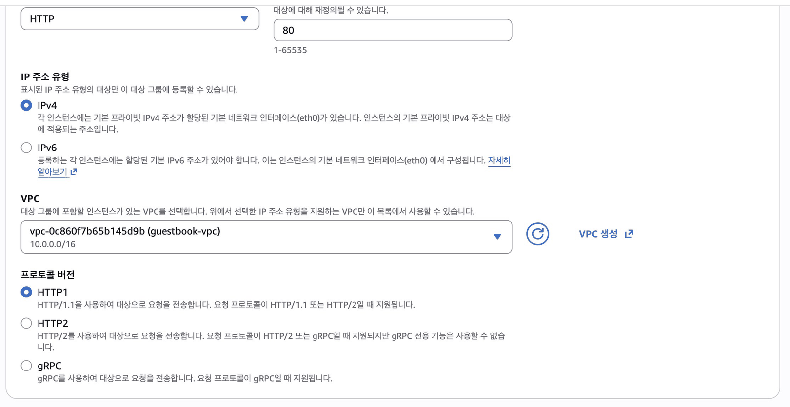

   2. 아래로 내려 「VPC」(①)를 **guestbook-vpc** 로 바꾸고 「상태 검사 경로」(②)를 `/health` 로 바꿉니다. 맨 아래 「다음」을 누릅니다.

      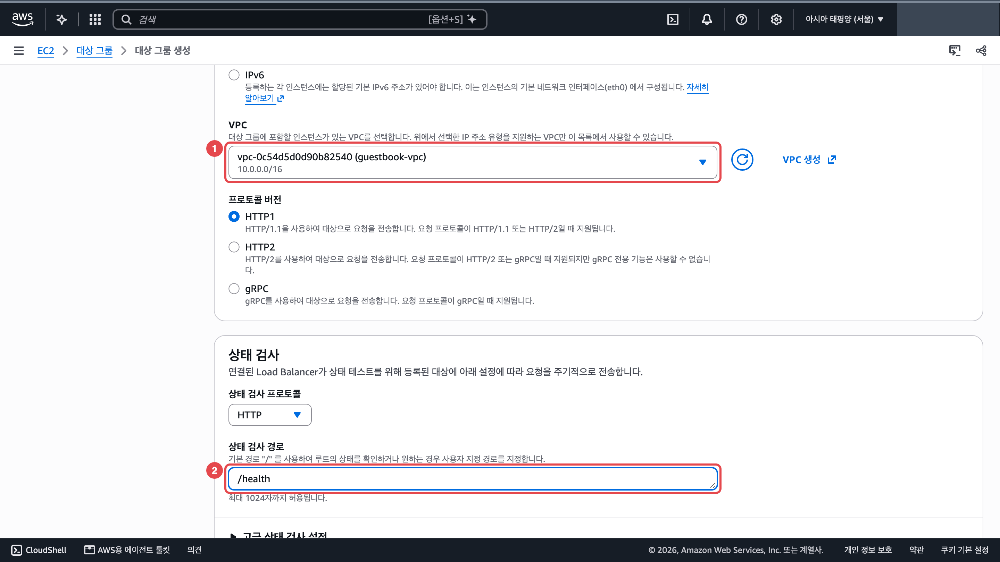

   3. 「대상 등록」 단계에서는 아무 서버도 체크하지 않습니다. 「대상」 표에 「아직 추가된 인스턴스 없음」(①)이 보이면 맨 아래 「다음」(②)을 누릅니다. 서버는 4번에서 오토 스케일링이 넣습니다.

      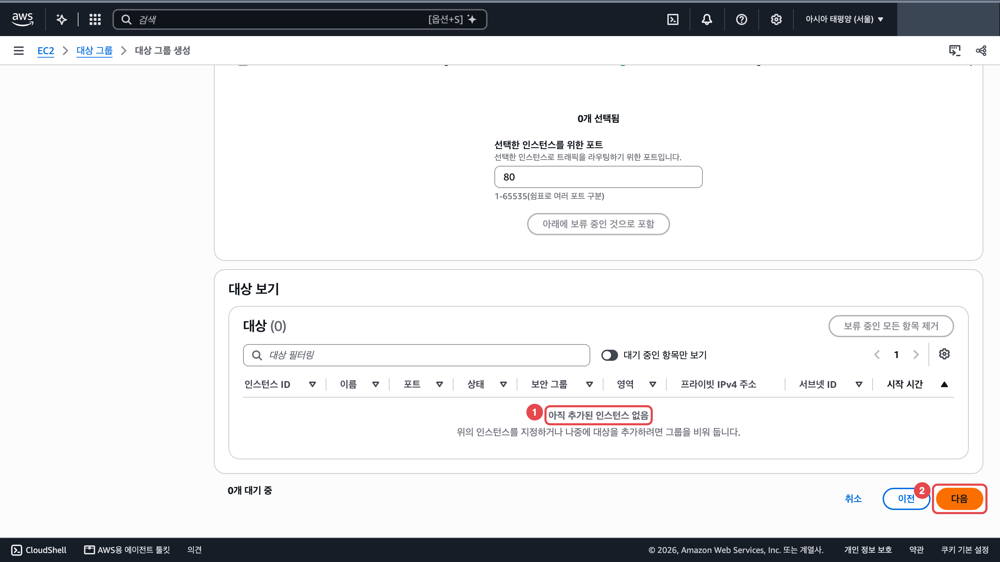

   4. 「검토 및 생성」 단계 맨 아래 「대상 그룹 생성」을 누릅니다.

      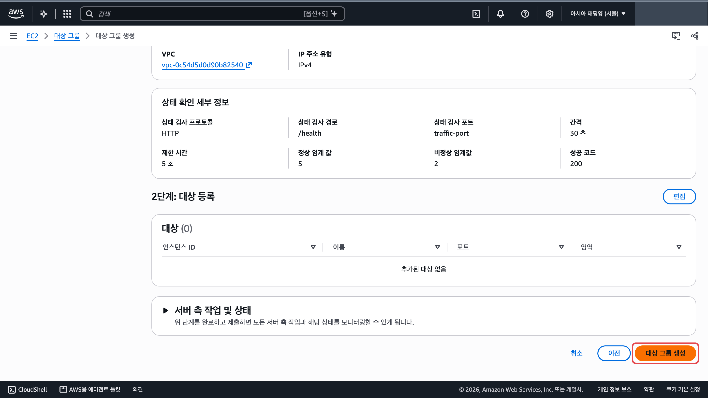

2. 로드 밸런서 `guestbook-alb` 를 만듭니다. <a href="https://ap-northeast-2.console.aws.amazon.com/ec2/home?region=ap-northeast-2#SelectCreateELBWizard:" target="_blank" rel="noopener">콘솔 열기 ↗</a>
   1. 카드 세 개 가운데 「Application Load Balancer」 카드 아래 「생성」을 누릅니다.

      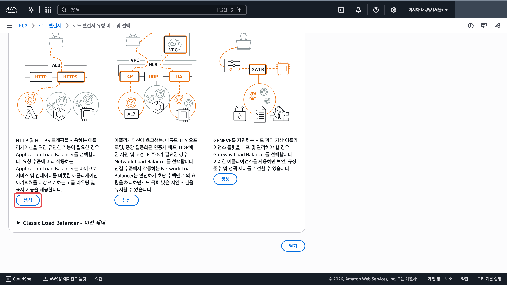

   2. 「로드 밸런서 이름」(①)에 `guestbook-alb` 를 넣습니다. 「체계」는 「인터넷 경계」(②) 그대로 둡니다.

      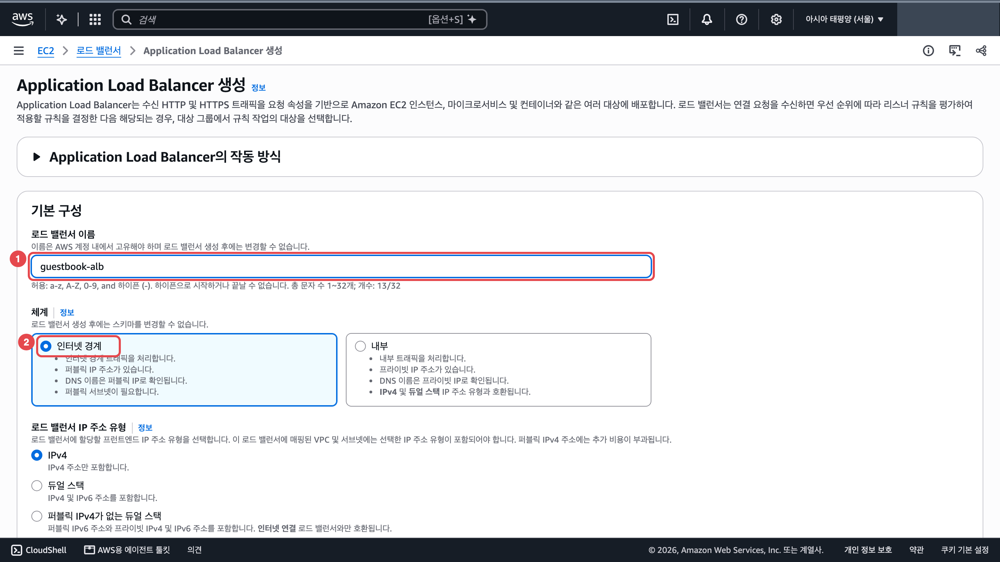

   3. 「네트워크 매핑」에서 「VPC」(①)를 **guestbook-vpc** 로 바꿉니다. 「ap-northeast-2a」(②)와 「ap-northeast-2c」(④)를 체크하면 그 아래 서브넷 칸에 `public-a`(③), `public-c`(⑤)가 들어갑니다.

      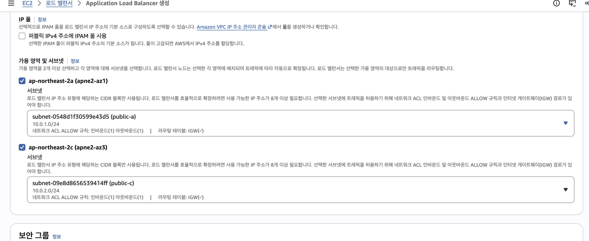

3. 로드 밸런서 보안 그룹 `guestbook-alb-sg` 를 만들어 붙입니다.
   1. 「보안 그룹」 칸 오른쪽 「보안 그룹 생성」을 누릅니다. 보안 그룹 생성 화면이 새 탭으로 열립니다.

      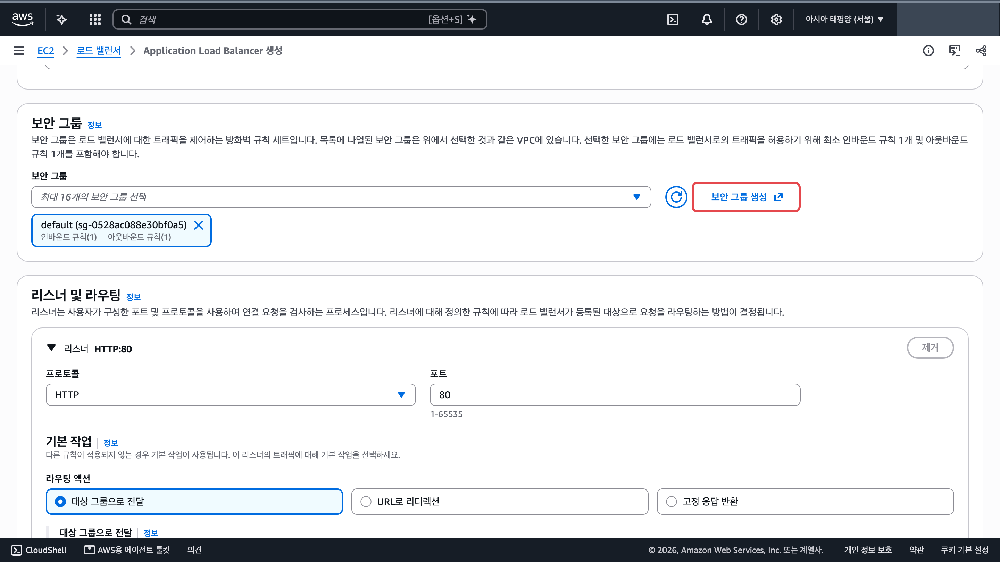

   2. 새 탭에서 「보안 그룹 이름」(①) `guestbook-alb-sg`, 「설명」(②) `guestbook alb` 를 넣습니다. 「VPC」(③)는 기본 VPC 로 채워져 오니 **guestbook-vpc** 로 바꿉니다. 「인바운드 규칙」에서 「규칙 추가」(⑧)를 누를 때마다 줄이 하나 생깁니다. 두 번 눌러 두 줄을 만듭니다.
      - 첫 줄: 「유형」(④) `HTTP`, 「소스 유형」(⑤) `Anywhere-IPv4`
      - 둘째 줄: 「유형」(⑥) `HTTPS`, 「소스 유형」(⑦) `Anywhere-IPv4`

      HTTPS 줄은 브라우저가 주소를 https 로 먼저 열어 볼 때 바로 거절되게 해서 http 로 돌아오게 하려고 엽니다. 로드 밸런서는 https 를 받지 않습니다. 이 줄이 없으면 브라우저가 응답을 기다리다 시간 초과(`ERR_TIMED_OUT`)로 끝날 수 있습니다.

      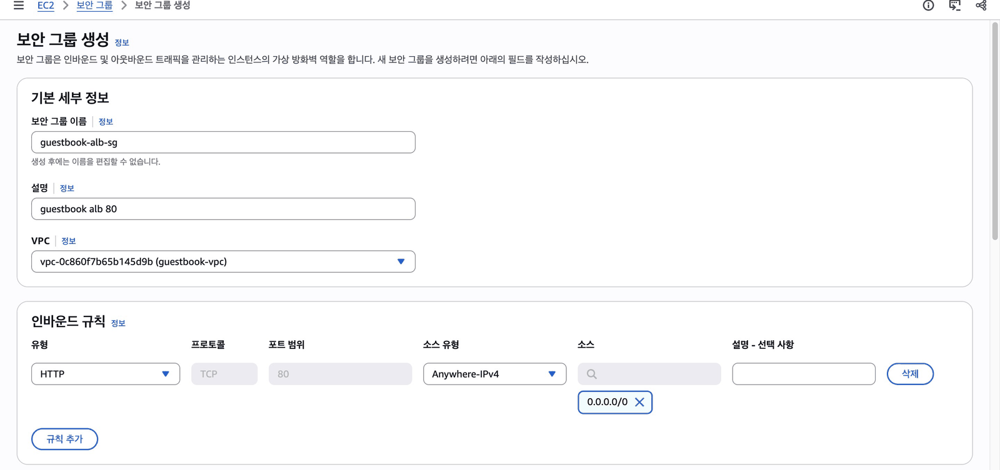

   3. 맨 아래 「보안 그룹 생성」을 누릅니다. 만들어지면 그 탭을 닫고 로드 밸런서 탭으로 돌아갑니다.

      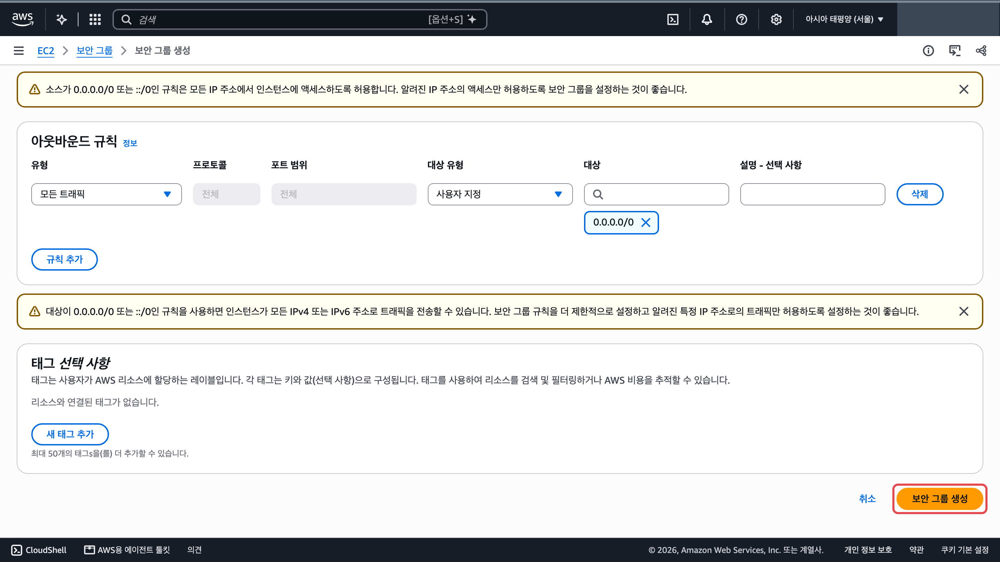

   4. 「보안 그룹」 칸 바로 옆 새로 고침(①)을 누르고 칸(②)을 펼쳐 `guestbook-alb-sg` 를 고릅니다. 처음부터 들어 있던 `default` 는 오른쪽 X(③)를 눌러 뺍니다.

      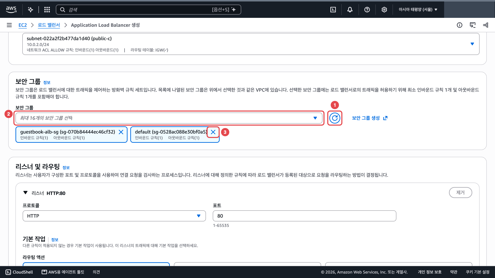

   5. 「리스너 및 라우팅」에서 「프로토콜」 `HTTP`, 「포트」 `80`(①)을 확인하고 「대상 그룹」(②)에서 `guestbook-tg` 를 고릅니다.

      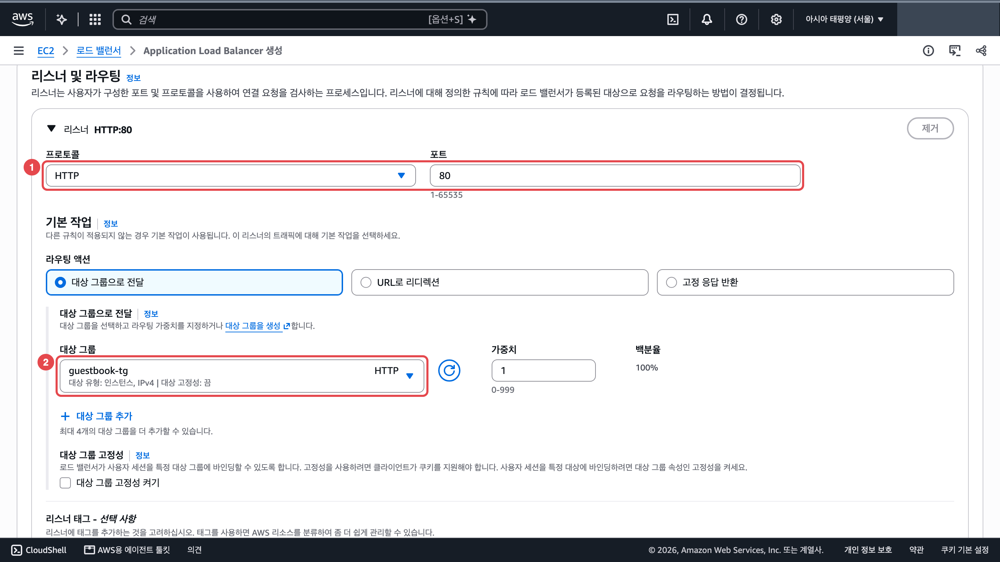

   6. 맨 아래 「로드 밸런서 생성」을 누릅니다.

      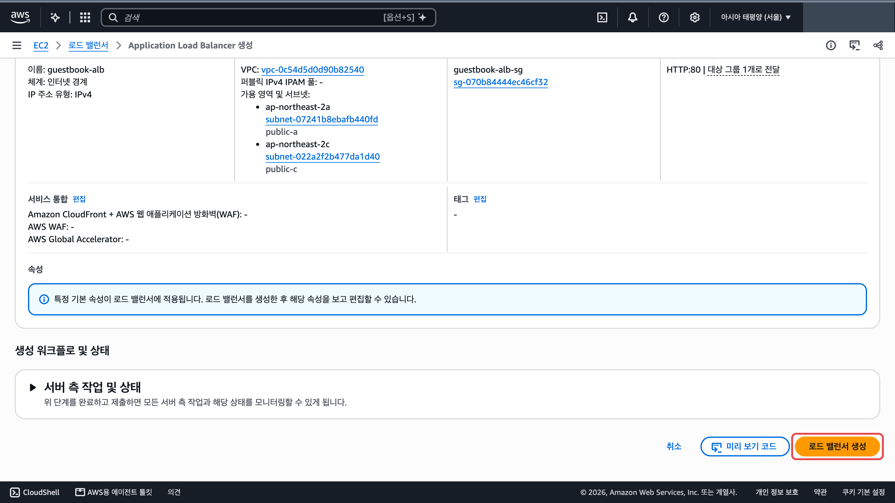

4. 오토 스케일링 그룹 `guestbook-asg` 를 만듭니다. 마법사는 7단계이고 왼쪽에 지금 단계가 보입니다. <a href="https://ap-northeast-2.console.aws.amazon.com/ec2/home?region=ap-northeast-2#CreateAutoScalingGroup:" target="_blank" rel="noopener">콘솔 열기 ↗</a>
   1. 1단계: 「Auto Scaling 그룹 이름」(①)에 `guestbook-asg`, 「시작 템플릿」(②)에서 `guestbook-lt` 를 고르고 「다음」을 누릅니다.

      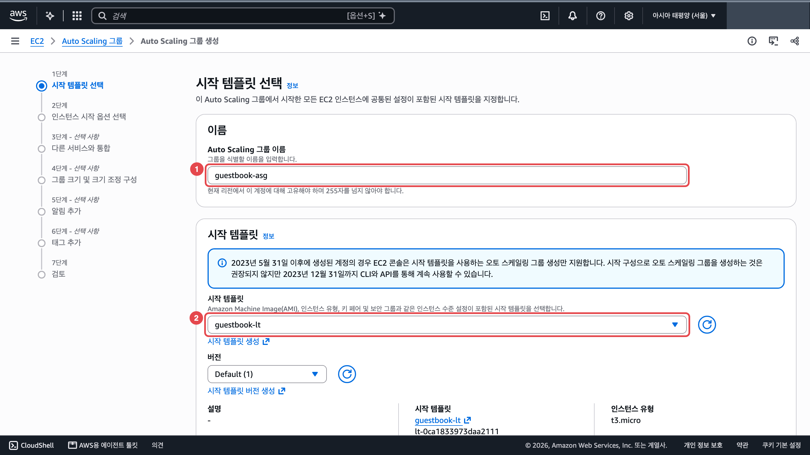

   2. 2단계: 「VPC」(①)를 **guestbook-vpc** 로 바꿉니다. 「가용 영역 및 서브넷」(②)을 펼쳐 `public-a`, `public-c` 를 하나씩 눌러 두 개(③)를 넣고 「다음」을 누릅니다.

      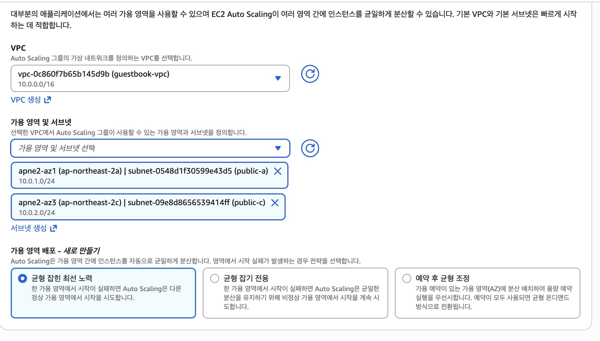

   3. 3단계: 「기존 로드 밸런서에 연결」(①)을 고르고 「기존 로드 밸런서 대상 그룹」(②)에서 `guestbook-tg` 를 고릅니다.

      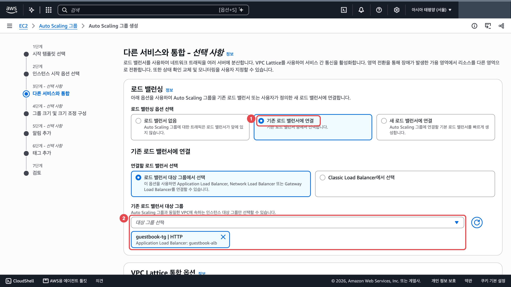

   4. 같은 화면 아래 「상태 확인」에서 「Elastic Load Balancer 상태 확인 켜기」를 체크하고 「다음」을 누릅니다.

      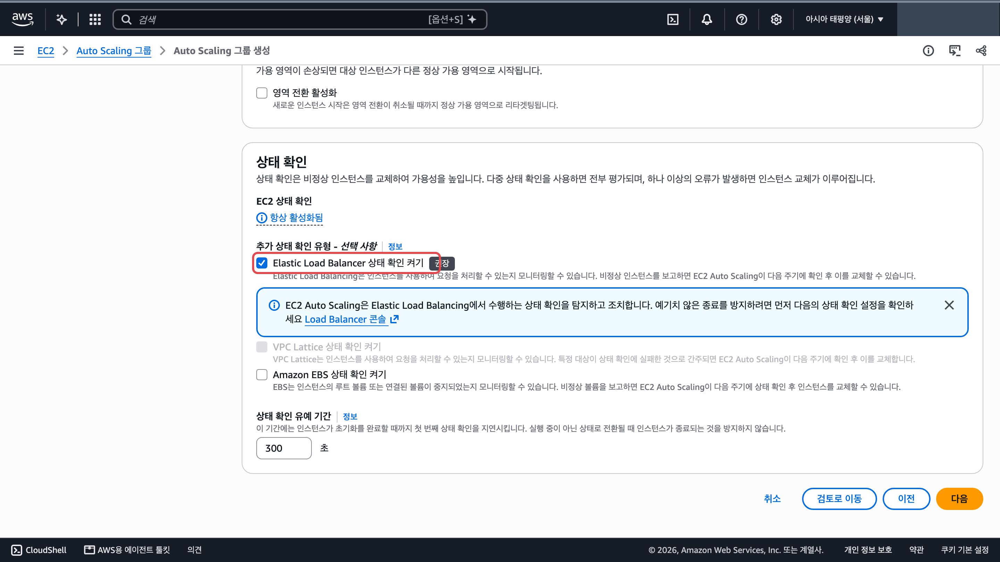

   5. 4단계: 「원하는 용량」(①) `2`, 「원하는 최소 용량」(②) `2`, 「원하는 최대 용량」(③) `4` 를 넣습니다.

      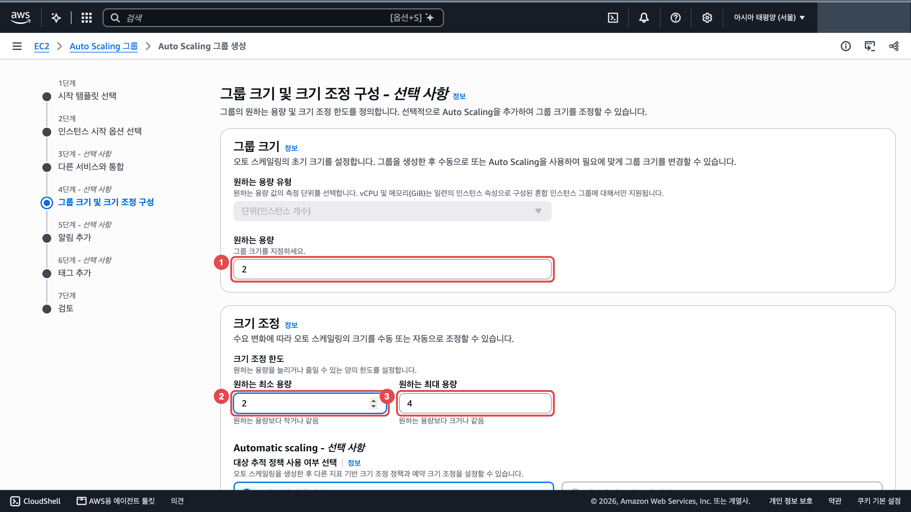

   6. 맨 아래 「검토로 이동」을 누릅니다. 5~6단계는 건너뜁니다.

      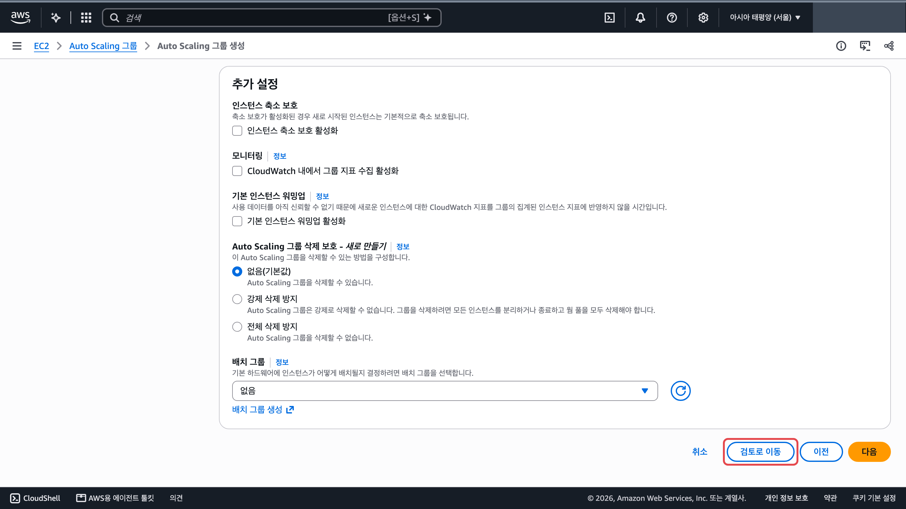

   7. 7단계 「검토」 맨 아래 「Auto Scaling 그룹 생성」을 누릅니다.

      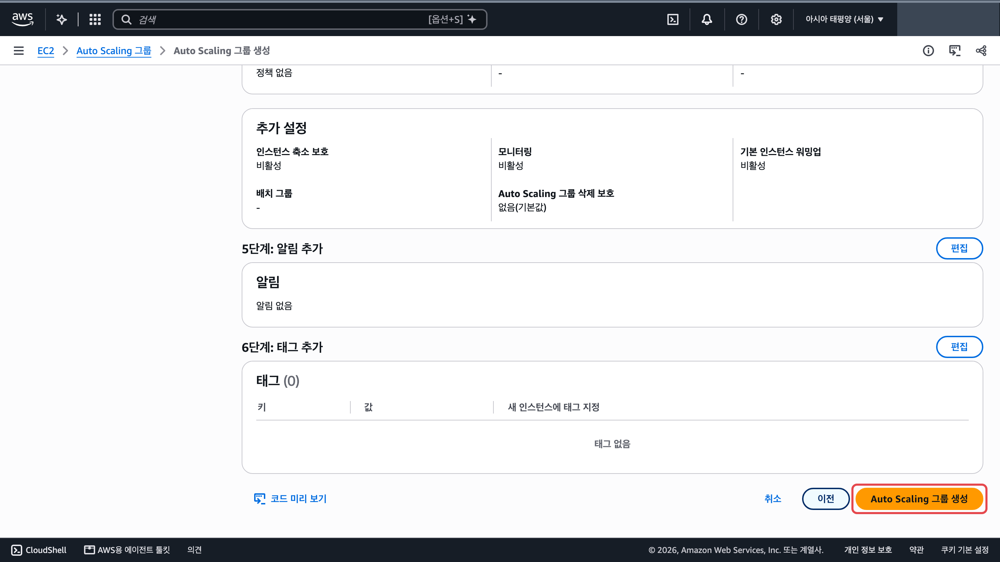

5. 로드 밸런서 목록에서 `guestbook-alb` 행을 체크(①)하면 아래 「세부 정보」에 「DNS 이름」(②)이 보입니다. 그 주소를 복사해 새 탭에 `http://DNS 이름` 으로 열고 새로고침하며 서버 이름을 봅니다. 만든 뒤 2~3분 걸립니다. <a href="https://ap-northeast-2.console.aws.amazon.com/ec2/home?region=ap-northeast-2#LoadBalancers:" target="_blank" rel="noopener">콘솔 열기 ↗</a>

   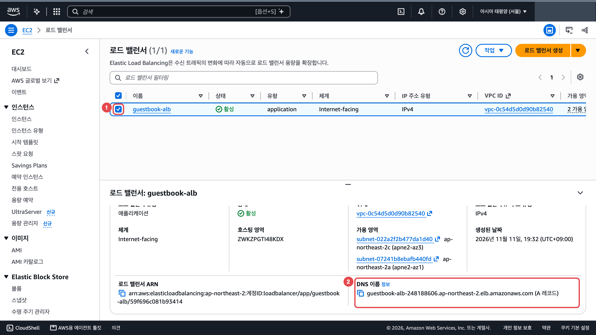

   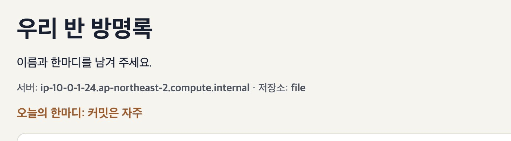

   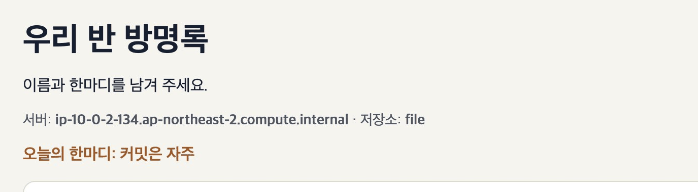

6. 서버 하나를 일부러 중지합니다. 인스턴스 목록 위 새로 고침을 누르면 오토 스케일링이 만든 서버 두 대가 보입니다. 이 서버들은 「Name」 칸이 비어 있습니다(–). 그 가운데 한 행만 체크(①)하고 「인스턴스 상태」(②) → 「인스턴스 중지」(③)를 누른 뒤 창에서 「중지」를 누릅니다. <a href="https://ap-northeast-2.console.aws.amazon.com/ec2/home?region=ap-northeast-2#Instances:" target="_blank" rel="noopener">콘솔 열기 ↗</a>

   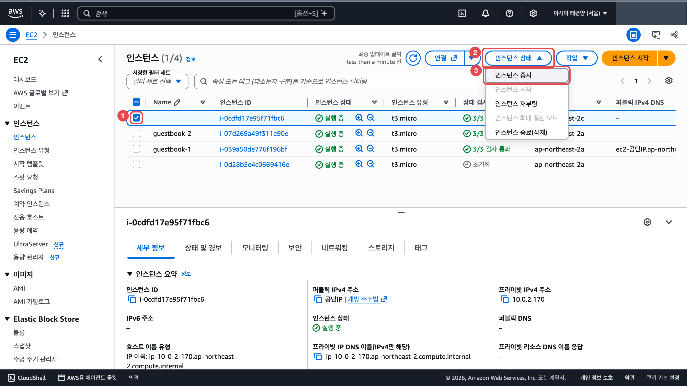

   종료까지 하지 않아도 됩니다. 오토 스케일링은 중지한 서버도 비정상으로 보고 새 서버로 바꿉니다. 중지한 서버는 이 과정에서 종료되니 다시 켜서 쓰지 않습니다.

**관찰할 것** 대상 그룹 목록에서 `guestbook-tg` 이름을 누릅니다. 중지한 서버는 빠지고 오토 스케일링이 새 서버로 바꿉니다. 새 서버가 Initial → Unhealthy(설치 중) → Healthy 로 바뀌는 과정을 봅니다. 약 5분 걸립니다. 위 요약(①)과 「대상」 탭(②)의 표(③)에서 봅니다. <a href="https://ap-northeast-2.console.aws.amazon.com/ec2/home?region=ap-northeast-2#TargetGroups:" target="_blank" rel="noopener">콘솔 열기 ↗</a>

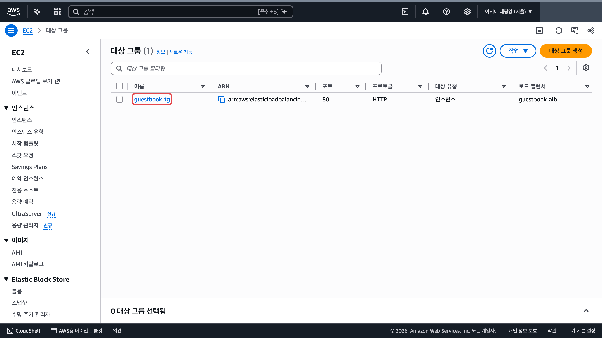

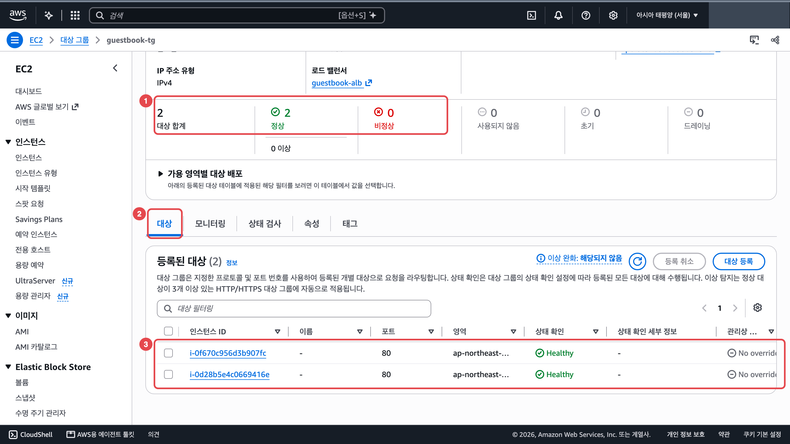

**계속 unhealthy면** 서버 보안 그룹이 로드 밸런서에서 오는 80 포트를 막고 있는지 확인 <a href="https://ap-northeast-2.console.aws.amazon.com/ec2/home?region=ap-northeast-2#SecurityGroups:" target="_blank" rel="noopener">콘솔 열기 ↗</a>

## 막혔을 때

### 앞에서 만든 자원이 다음 화면 목록에 안 보입니다

:::caution[고칠 것]
아래 네 화면의 VPC 칸 기본값이 모두 기본 VPC 입니다.

- 대상 그룹
- 로드 밸런서
- 보안 그룹 생성
- 오토 스케일링 그룹

화면마다 VPC 칸을 `guestbook-vpc` 로 바꿨는지 봅니다.
:::

### 새로 만든 보안 그룹이 로드 밸런서 화면에 안 보입니다

:::caution[고칠 것]
「보안 그룹 생성」은 새 탭으로 열리고 VPC 칸이 기본 VPC 로 채워져 옵니다.

아래 순서로 고칩니다.

1. 새 탭에서 VPC 를 `guestbook-vpc` 로 바꿉니다.
2. HTTP 와 HTTPS 를 `Anywhere-IPv4` 로 연 규칙 두 개로 만듭니다.
3. 로드 밸런서 탭으로 돌아와 보안 그룹 새로 고침을 누른 뒤 고릅니다.
:::

### 로드 밸런서 주소가 계속 안 열립니다

:::caution[고칠 것]
처음 골라진 `default` 보안 그룹은 같은 그룹끼리만 허용해서 인터넷에서 들어오지 못합니다.

아래 순서로 고칩니다.

1. 로드 밸런서 보안 그룹에서 `default` 를 지우고 HTTP 와 HTTPS 를 연 `guestbook-alb-sg` 만 남깁니다. <a href="https://ap-northeast-2.console.aws.amazon.com/ec2/home?region=ap-northeast-2#LoadBalancers:" target="_blank" rel="noopener">콘솔 열기 ↗</a>
2. 주소는 새 탭에 `http://` 를 붙여 엽니다.
:::

### 로드 밸런서 주소가 시간 초과(`ERR_TIMED_OUT`)로 안 열립니다

:::caution[고칠 것]
> 「사이트에 연결할 수 없음」, `ERR_TIMED_OUT`

브라우저가 주소를 https 로 먼저 열어 보는데 로드 밸런서 보안 그룹이 443 을 막고 있으면 응답 없이 기다리다 끝납니다. 443 을 열어 두면 바로 거절되고 브라우저가 http 로 돌아와 열립니다.

아래 순서로 고칩니다.

1. 주소창의 주소가 `http://` 로 시작하는지 봅니다. `https://` 로 바뀌어 있으면 `http://` 로 고쳐 다시 엽니다.
2. 보안 그룹 목록에서 `guestbook-alb-sg` 행을 체크(①)하고 「작업」(②) → 「인바운드 규칙 편집」(③)을 누릅니다. <a href="https://ap-northeast-2.console.aws.amazon.com/ec2/home?region=ap-northeast-2#SecurityGroups:" target="_blank" rel="noopener">보안 그룹 ↗</a>

   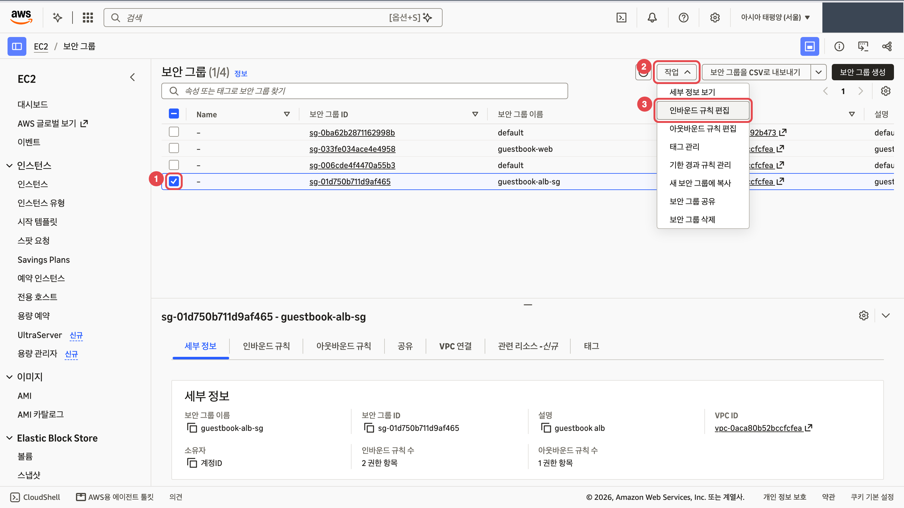

3. 규칙에 `HTTPS` 줄이 없으면 「규칙 추가」(①)를 누르고 새 줄의 「유형」(②)을 `HTTPS`, 「소스 유형」(③)을 `Anywhere-IPv4` 로 고른 뒤 「규칙 저장」(④)을 누릅니다.

   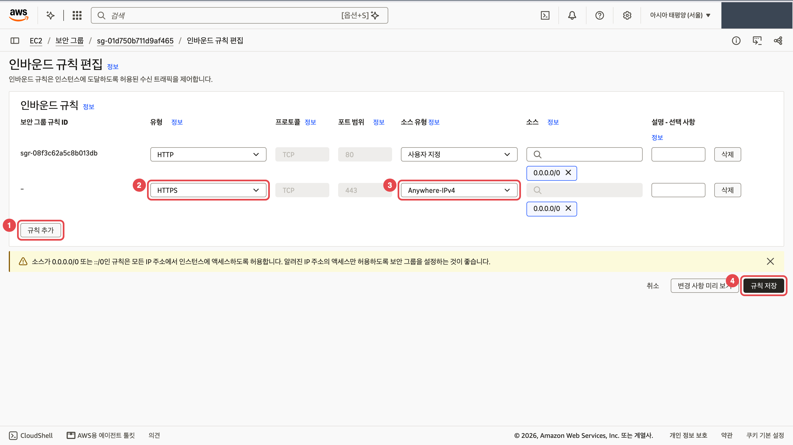

4. 새 탭에 `http://로드 밸런서 DNS 이름` 으로 다시 엽니다.
:::

### 만든 직후 `502 Bad Gateway` 나 `Unhealthy` 가 보입니다

:::tip[정상입니다]{icon="approve-check-circle"}
서버가 사용자 데이터로 앱을 설치하는 중입니다. 기다리면 됩니다.

- 로드 밸런서가 활성이 되기까지: 2분쯤
- 새 서버가 `Healthy` 가 되기까지: 2분 30초쯤
- 서버 하나를 중지한 뒤 새 서버가 `Healthy` 가 되기까지: 5분쯤
:::

### 몇 분이 지나도 계속 `Unhealthy` 입니다

:::caution[고칠 것]
서버 보안 그룹이 로드 밸런서에서 오는 80 포트를 막고 있거나 상태 검사 경로가 틀렸습니다.

아래 순서로 고칩니다.

1. 서버 보안 그룹(11단원 `guestbook-web`)에 HTTP 80 이 열려 있는지 봅니다. <a href="https://ap-northeast-2.console.aws.amazon.com/ec2/home?region=ap-northeast-2#SecurityGroups:" target="_blank" rel="noopener">콘솔 열기 ↗</a>
2. 대상 그룹 상태 검사 경로가 `/health` 인지 봅니다. <a href="https://ap-northeast-2.console.aws.amazon.com/ec2/home?region=ap-northeast-2#TargetGroups:" target="_blank" rel="noopener">콘솔 열기 ↗</a>
:::

### 로드 밸런서 화면에서 VPC 가 기본 VPC 로 돌아갔습니다

:::caution[고칠 것]
로드 밸런서 화면에는 새로 고침 단추가 셋(VPC, 보안 그룹, 대상 그룹)입니다. VPC 칸 옆 단추를 누르면 VPC 가 기본 VPC 로 돌아가고 영역 선택이 풀립니다.

VPC 를 `guestbook-vpc` 로, 영역을 2a 와 2c 로 다시 고르고, 새 보안 그룹은 **보안 그룹 칸 옆** 새로 고침을 눌러 고릅니다.
:::

### 대상 그룹의 대상 탭이 비어 있습니다

:::tip[정상입니다]{icon="approve-check-circle"}
> 「등록된 대상 없음」

처음 열 때 비어 보일 수 있습니다. 표 위 새로 고침을 누르면 서버가 보입니다.
:::

### 오토 스케일링이 만든 서버의 이름이 비어 있습니다

:::tip[정상입니다]{icon="approve-check-circle"}
시작 템플릿에 이름 태그를 넣지 않아서 「Name」 칸이 `–` 로 보입니다. 이름이 `guestbook-1`, `guestbook-2` 가 아닌 서버가 오토 스케일링이 만든 서버입니다.
:::

### 인스턴스 목록에 새 서버가 보이지 않습니다

:::tip[정상입니다]{icon="approve-check-circle"}
목록은 저절로 갱신되지 않습니다. 목록 위 둥근 화살표(새로 고침)를 누르면 오토 스케일링이 만든 서버가 보입니다.
:::

:::note[그래도 안 되면]
화면을 그대로 두고 손을 드세요. 좌석 번호, 단원 번호, 화면의 오류 문구를 말해 주세요.
:::
