:::note[이 단원에서 방명록이 얻는 것]
- **전:** 「오늘의 한마디」를 바꾸려면 앱 전체를 다시 배포합니다.
- **후:** 한마디만 서버 밖 함수(Lambda)로 떼어 내고, 방명록 서버는 그 함수의 주소를 부릅니다.
- **그래서:** 그 기능만 따로 고치고 내보냅니다. 함수 문장을 바꿔 Deploy 하면 서버를 건드리지 않아도 방명록 한마디가 바뀝니다. 서버를 관리할 필요가 없고 불린 만큼만 비용이 듭니다.
:::

<details class="walkthrough">
<summary>막혔을 때: 이 단원 전체 흐름 영상 (2분 29초)</summary>

화면 위 띠의 번호가 아래 「따라 하기」 단계 번호와 같습니다. 누를 곳은 빨간 테두리로 보입니다. 막힌 단계 번호를 찾아 그 부분만 확인하는 용도입니다.

<video controls preload="none" width="100%" src="/guestbook-lab/video/u13.mp4"></video>

</details>

## 따라 하기

### 「오늘의 한마디」를 함수로 만들기

lambda_function.py

```python
import json, random

MSGS = ["오늘도 화이팅",
        "커밋은 자주",
        "정리는 실력"]

def lambda_handler(event, context):
    body = {"message": random.choice(MSGS)}
    return {
        "statusCode": 200,
        "headers": {"Content-Type":
          "application/json; charset=utf-8"},
        "body": json.dumps(body, ensure_ascii=False)
    }
```

1. 함수 생성 화면에서 「새로 작성」(①)을 그대로 두고 「함수 이름」(②)에 `guestbook-hello` 를 넣습니다. 「런타임」(③)을 **Python 3.13** 으로 바꿉니다. 런타임은 내 코드를 실행할 언어와 그 판입니다. <a href="https://ap-northeast-2.console.aws.amazon.com/lambda/home?region=ap-northeast-2#/create/function" target="_blank" rel="noopener">콘솔 열기 ↗</a>

   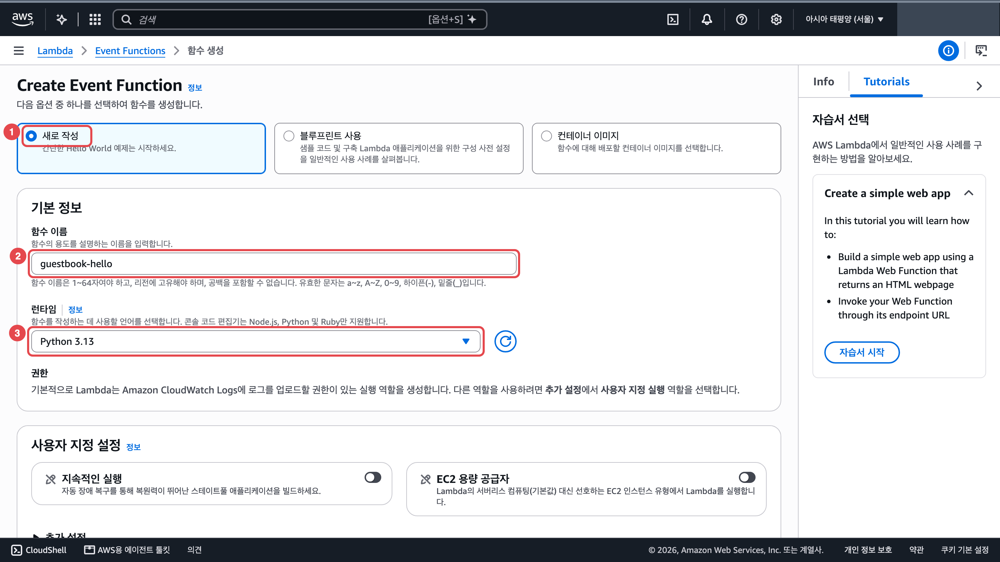

   런타임 칸(①)을 누르면 긴 목록이 펼쳐집니다. 처음 값은 Node.js 이고 목록 순서가 뒤섞여 있으니 `Python 3.13`(②)을 찾아 누릅니다.

   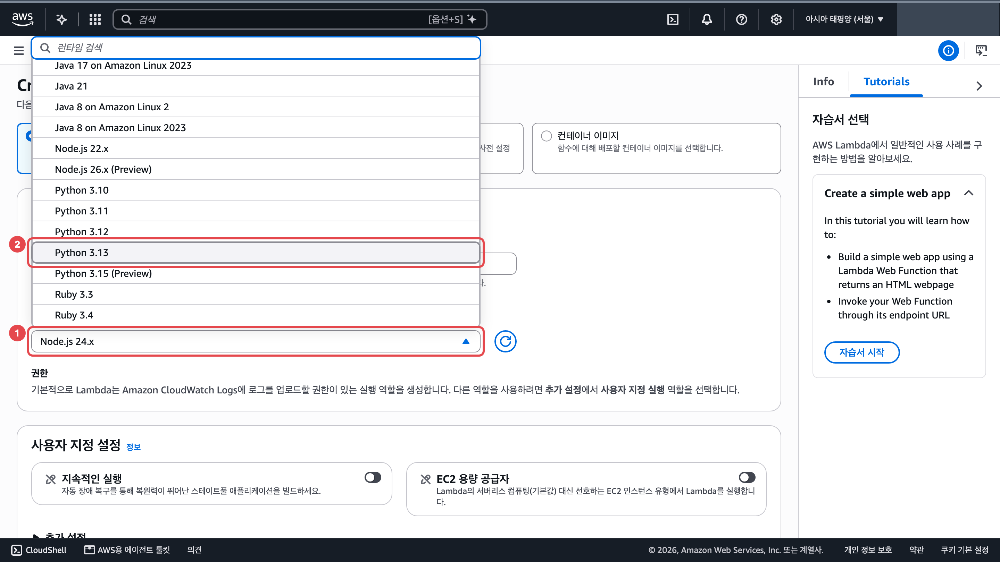

2. 실행 역할은 기본값 그대로 두고 맨 아래 **Create Event Function** 을 누릅니다.

   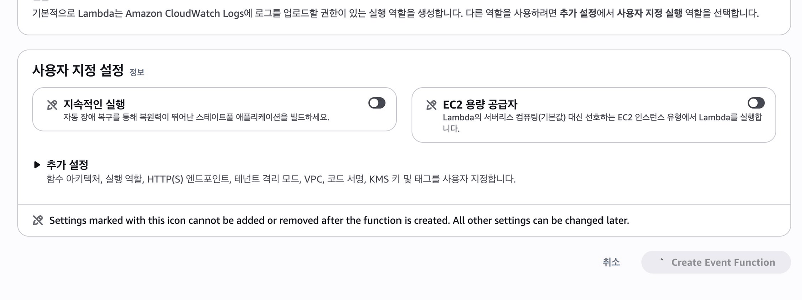

3. 함수가 만들어지면 「Getting started」 창이 덮습니다. 오른쪽 아래 「Dismiss」를 누릅니다.

   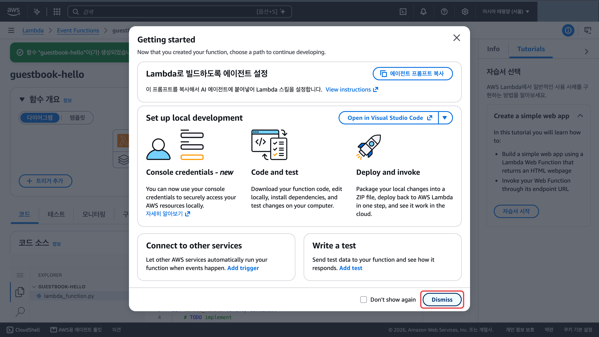

4. 코드를 바꾸고 배포합니다. 화면을 아래로 내리면 「코드」 탭의 편집기가 있습니다.
   1. 편집기의 `lambda_function.py` 내용(①)을 클릭하고 Ctrl+A 로 모두 고른 뒤 Ctrl+V 로 위 코드를 붙여 넣습니다. 클립보드를 묻는 창이 뜨면 **허용** 을 누릅니다.
   2. 편집기 왼쪽 「DEPLOY」 구역의 「Deploy」(②)를 누릅니다.

   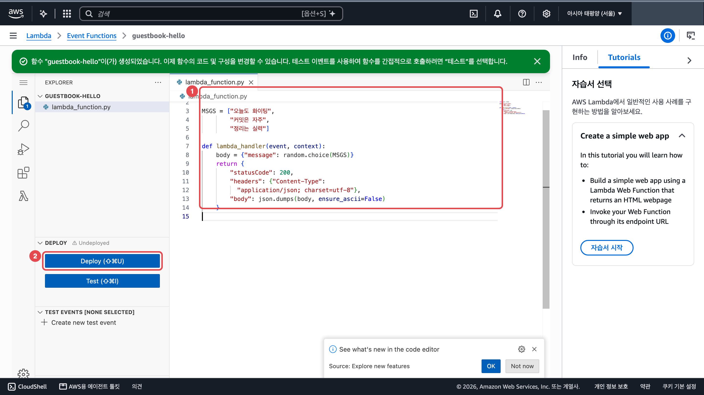

   위쪽에 초록 「함수 "guestbook-hello"이(가) 업데이트되었습니다.」가 보이면 됩니다.

   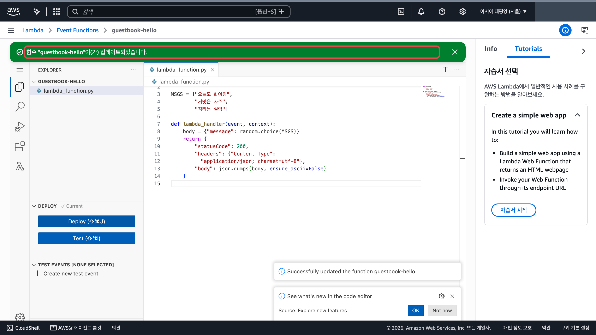

5. 함수를 시험합니다.
   1. 「DEPLOY」 구역의 「Test」(①)를 누르면 편집기 위에 고르기 창이 뜹니다. 테스트 이벤트는 함수를 시험 삼아 한 번 부를 때 넘겨 줄 값입니다. JSON 이라는 정해진 글 형식으로 적고, 이번 함수는 값을 쓰지 않으니 처음 채워진 그대로 둡니다. 「Create new test event」(②)를 누릅니다.

      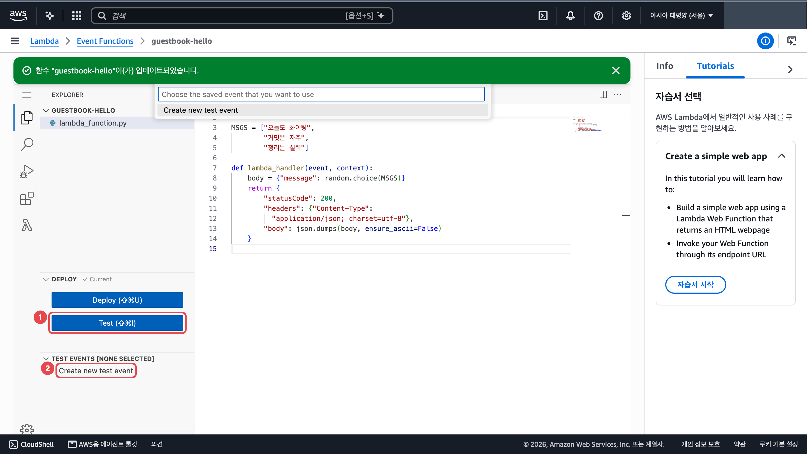

   2. 편집기 오른쪽에 열린 「Event name」 칸(①)에 `test1` 처럼 영어와 숫자로 이름을 넣고 「Test」(②)를 누릅니다.

      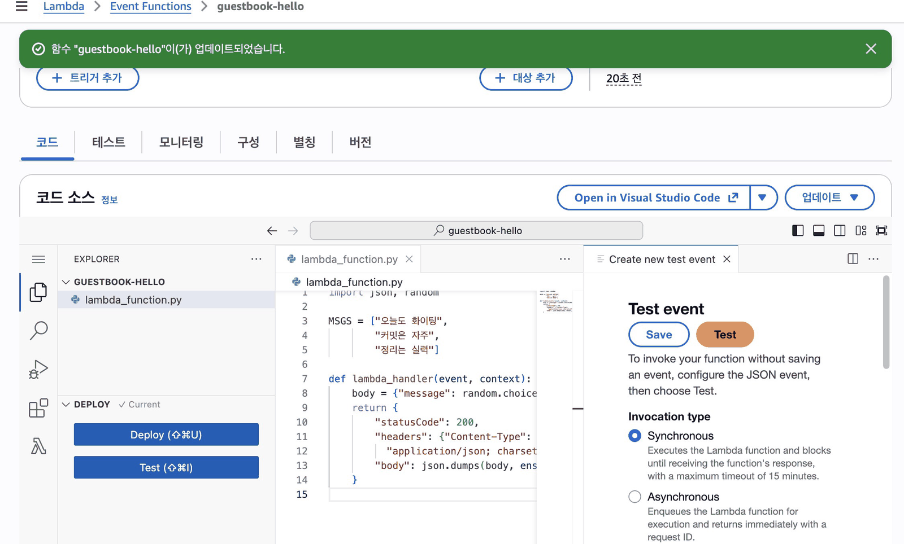

   3. 아래 「OUTPUT」 창에 `Status: Succeeded` 와 `"statusCode": 200` 이 보이면 됩니다.

      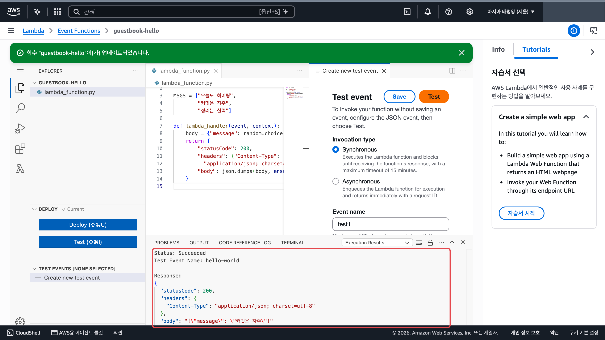

6. 주소로 부를 수 있게 트리거를 붙입니다. 트리거는 함수를 깨우는 방아쇠입니다. API 게이트웨이를 트리거로 붙이면 인터넷 주소로 들어온 요청이 함수를 부릅니다.
   1. 화면 맨 위로 올라가 「함수 개요」 그림 왼쪽 아래 「+ 트리거 추가」를 누릅니다.

      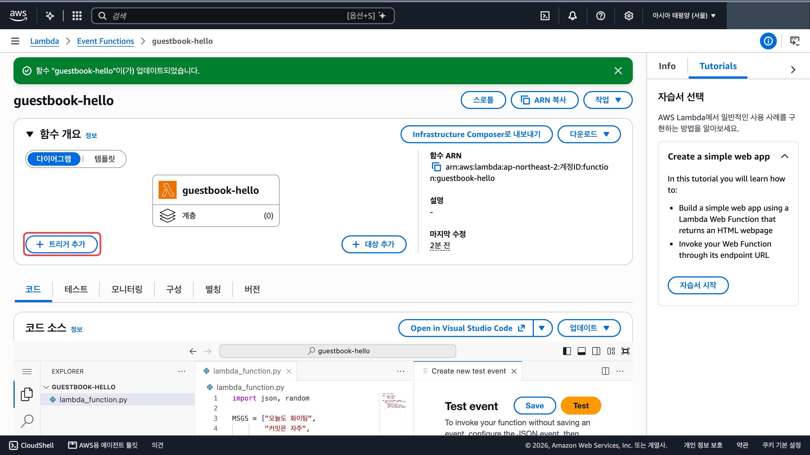

   2. 「소스 선택」 칸(①)을 눌러 목록에서 「API 게이트웨이」(②)를 고릅니다.

      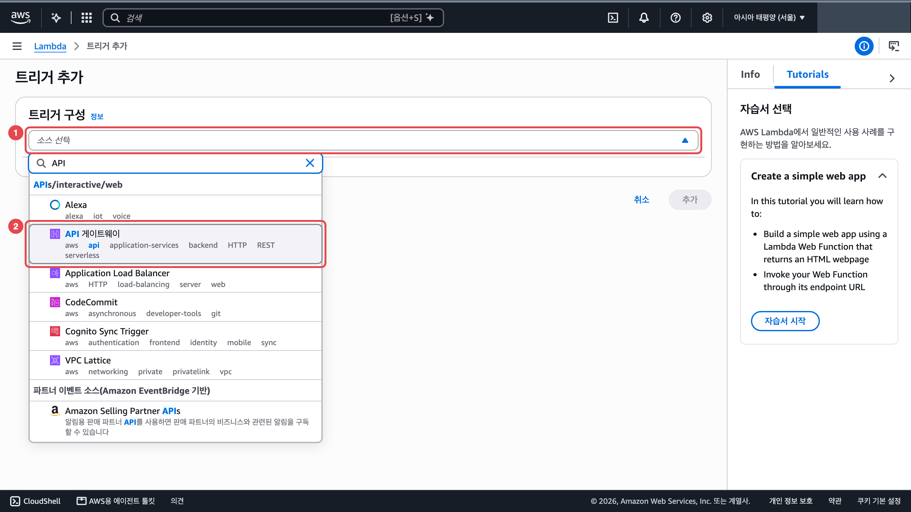

   3. 「새 API 생성」(①), 「HTTP API」(②)를 고르고 「보안」(③)을 「열기」로 바꿉니다. 오른쪽 아래 「추가」(④)를 누릅니다.

      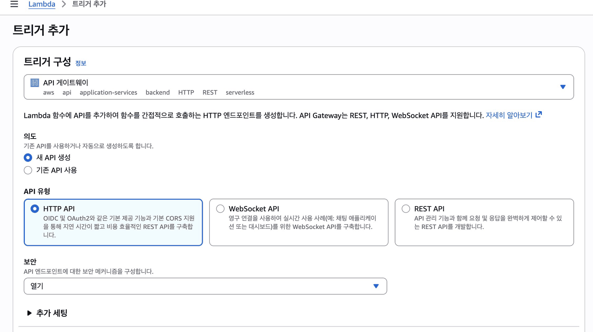

7. 주소를 엽니다. 트리거를 추가하면 「구성」 탭(①)의 「트리거」(②) 화면이 열립니다. 표의 「API 엔드포인트:」 줄(③)에 나온 주소 전체를 새 탭에서 엽니다. API 엔드포인트는 이 함수를 부르는 인터넷 주소입니다.

   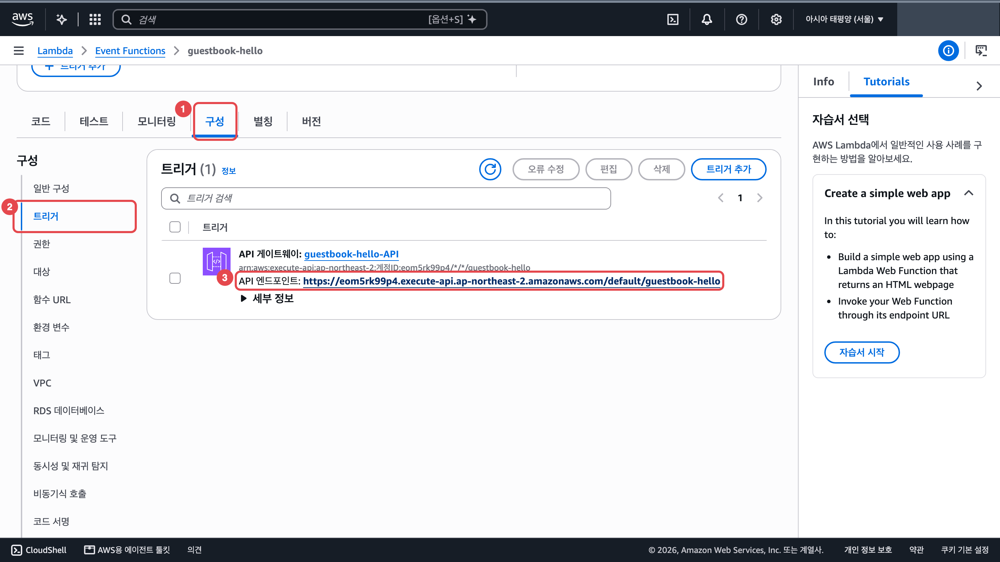

   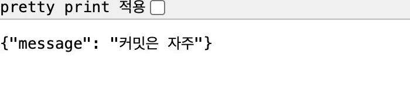

### 방명록이 이 함수를 부르게 하기

방명록 앱은 설정 파일의 `HELLO_API_URL=` 줄이 비어 있으면 앱 안 목록에서 한마디를 고릅니다. 이 줄에 주소가 적혀 있으면 한마디를 보여 줄 때마다 그 주소를 불러 받은 응답의 `message` 값을 보여 줍니다. 주소를 3초 안에 부르지 못하면 한마디 자리에 `(한마디 API 오류: 오류 이름)` 이 나옵니다. 지금 방명록은 로드 밸런서 뒤 서버 두 대에서 돌고 있으니 두 대 모두 고칩니다.

8. 함수 문장을 내 문장으로 바꿉니다. 앱 안 목록에도 같은 세 문장이 들어 있어서, 그대로 두면 한마디가 함수에서 왔는지 화면으로 구분되지 않습니다. 「코드」 탭 편집기에서 `MSGS` 의 따옴표 안 문장 세 개(①)를 내 문장으로 고치고 왼쪽 「DEPLOY」 구역의 「Deploy」(②)를 누릅니다. 위쪽에 초록 「업데이트되었습니다」가 보이면 됩니다.

   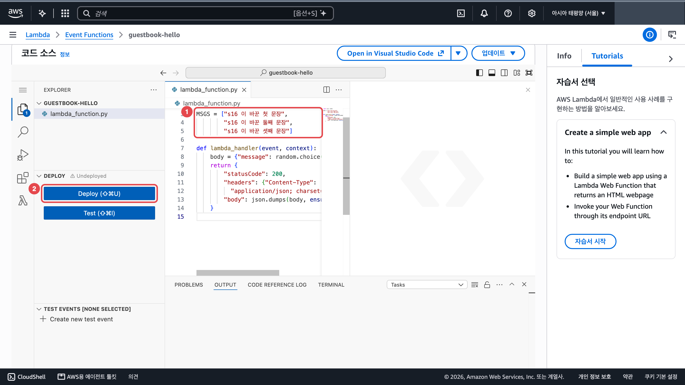

   새 탭에서 7번 주소를 다시 열어 `{"message": "내 문장"}` 이 나오는지 봅니다. 7번에서 연 「API 엔드포인트:」 주소 전체를 복사해 둡니다.

9. 로드 밸런서 뒤 서버 두 대를 찾아 첫 번째 서버에 접속합니다. 오토 스케일링이 만든 서버는 「Name」 칸이 비어 있어서 대상 그룹에서 인스턴스 ID 로 찾습니다. <a href="https://ap-northeast-2.console.aws.amazon.com/ec2/home?region=ap-northeast-2#TargetGroups:" target="_blank" rel="noopener">대상 그룹 ↗</a>
   1. 대상 그룹 목록에서 `guestbook-tg` 이름을 누릅니다.

      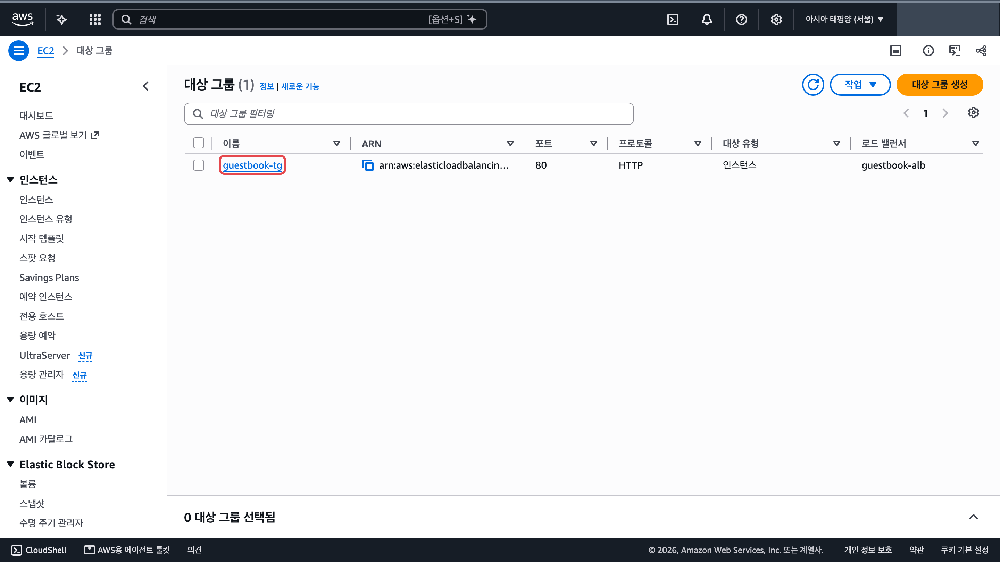

   2. 아래 「대상」 탭(①)에 인스턴스 ID 두 개(②)가 보입니다. 두 ID 의 끝 네 글자를 적어 둡니다.

      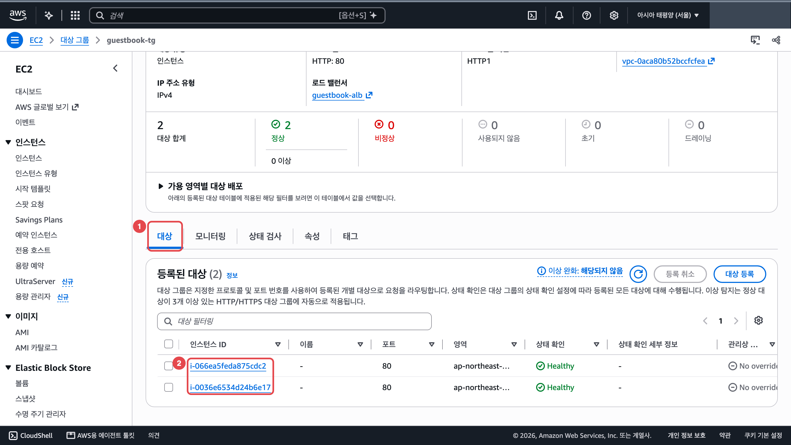

   3. 인스턴스 목록에서 첫 번째 ID 의 행을 체크(①)합니다. 「인스턴스 ID」(②)가 적어 둔 것과 같은지 보고 「연결」(③)을 누릅니다. 연결 화면에서 「SSM Session Manager」 카드 → 「연결」은 [9단원](/guestbook-lab/u9/) 4번과 같습니다. <a href="https://ap-northeast-2.console.aws.amazon.com/ec2/home?region=ap-northeast-2#Instances:" target="_blank" rel="noopener">인스턴스 ↗</a>

      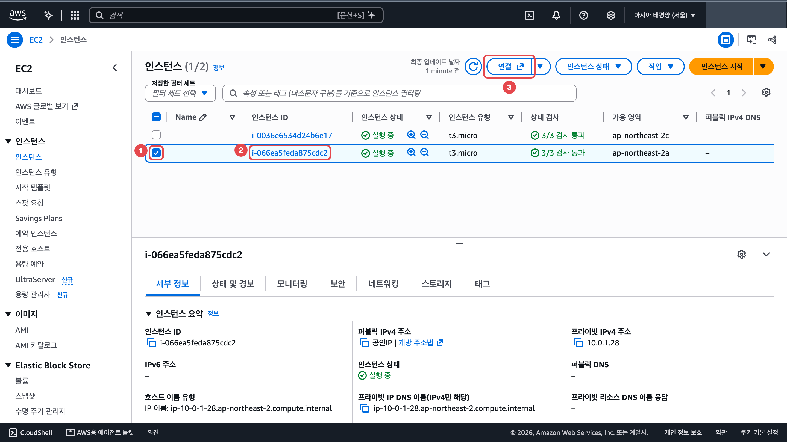

10. 첫 번째 서버에서 설정 파일을 고칩니다. 설정 파일 맨 아래에 `HELLO_API_URL=` 줄이 미리 비어 있습니다. 새 줄을 더하면 같은 이름이 두 줄이 되고 아래쪽 줄 값이 쓰여서 헷갈리니 이미 있는 줄에 이어 씁니다.
    1. 설정 파일을 엽니다. 맨 아래 빈 `HELLO_API_URL=` 줄이 보입니다.

       ```bash
       # 앱 설정 파일을 nano 편집기로 엽니다
       sudo nano /opt/guestbook/config.env
       ```

       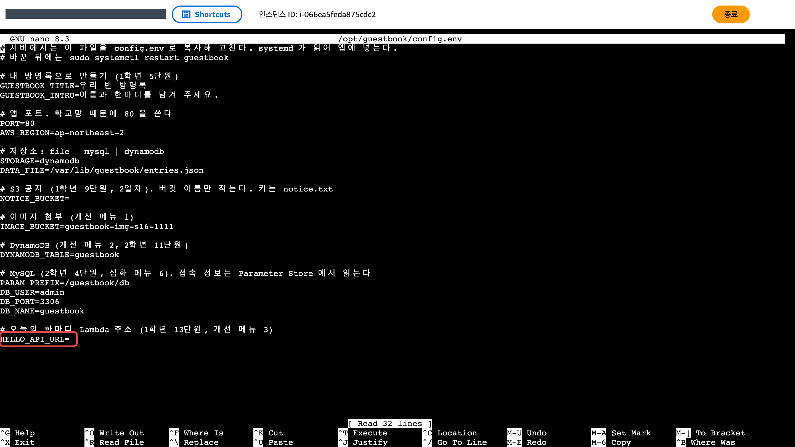

    2. 화살표 키로 `HELLO_API_URL=` 줄 끝까지 가서 `=` 바로 뒤에 8번에서 복사한 주소를 붙여 넣습니다(①). Mac 은 ⌘V 로 붙여 넣습니다. 붙여 넣은 뒤 `=` 바로 뒤가 `https://` 로 시작하는지 봅니다. 맨 앞 글자 `h` 가 빠질 때가 있으니 빠졌으면 `h` 를 쳐 넣습니다. 붙여 넣기가 안 되면 주소를 보고 그대로 칩니다. Ctrl+O(②)를 누르고 Enter 로 저장한 뒤 Ctrl+X(③)로 나옵니다.

       ```text
       HELLO_API_URL=https://(API 주소).execute-api.ap-northeast-2.amazonaws.com/default/guestbook-hello
       ```

       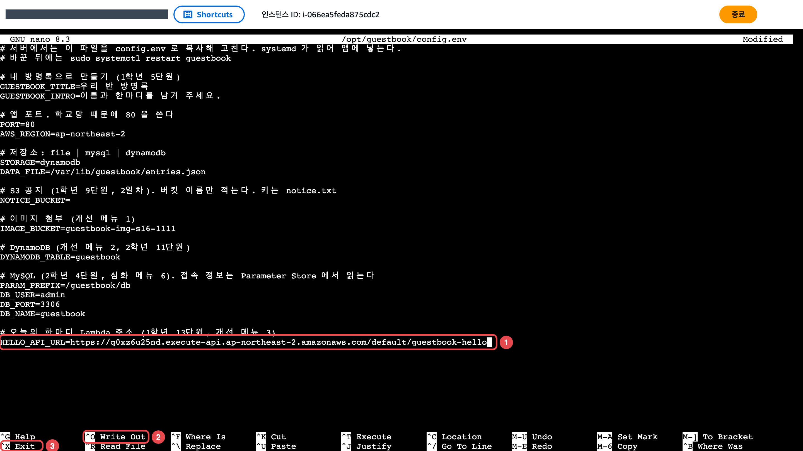

    3. 적은 줄을 다시 확인합니다. 주소 끝이 `/default/guestbook-hello` 인지 봅니다.

       ```bash
       # 설정 파일 내용을 화면에 출력해 고친 줄을 확인합니다
       cat /opt/guestbook/config.env
       ```

       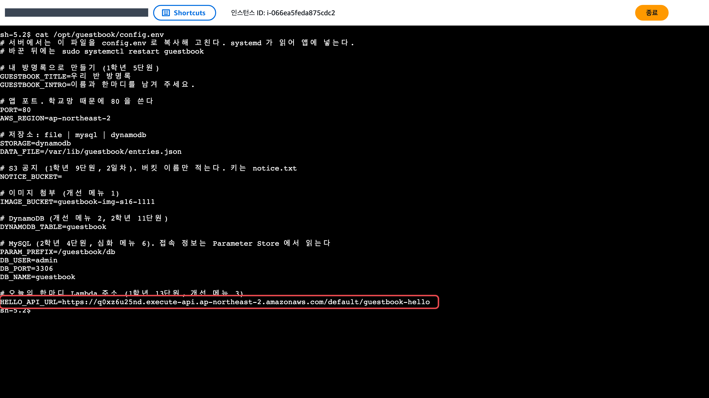

    4. 앱을 다시 켭니다. 앱은 켜질 때 설정 파일을 읽어서, 다시 켜야 새 주소를 씁니다.

       ```bash
       # 앱을 다시 켜서 바뀐 설정을 읽게 합니다
       sudo systemctl restart guestbook
       ```

11. 두 번째 서버에서도 9번 3과 10번을 똑같이 합니다. 한 대만 바꾸면 새로고침할 때마다 내 문장과 원래 문장이 번갈아 나옵니다.

**확인** 새 탭에 `http://로드 밸런서 DNS 이름` 을 엽니다. 「오늘의 한마디」에 8번에서 넣은 내 문장이 나옵니다. 몇 번 새로고침해서 서버가 바뀌어도 내 문장만 나와야 합니다. <a href="https://ap-northeast-2.console.aws.amazon.com/ec2/home?region=ap-northeast-2#LoadBalancers:" target="_blank" rel="noopener">로드 밸런서 ↗</a>

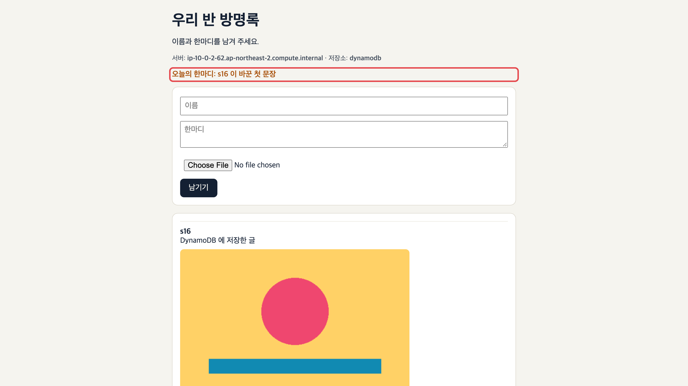

## 막혔을 때

### 「함수 생성」 버튼이 보이지 않습니다

:::caution[고칠 것]
콘솔 화면이 바뀌어 메뉴 이름이 「Event Functions」, 만들기 버튼이 「Create Event Function」입니다.

아래 순서로 고칩니다.

1. 「Create Event Function」을 누릅니다.
2. 「지속적인 실행」, 「EC2 용량 공급자」 토글은 끈 채 둡니다.
3. 만든 뒤 「Getting started」 창이 덮으면 「Dismiss」로 닫습니다.
:::

### 런타임이 Node.js 로 되어 있습니다

:::caution[고칠 것]
런타임 기본값이 Node.js 이고 Python 목록은 순서가 뒤섞여 있습니다.

목록에서 **Python 3.13** 을 찾아 고릅니다.
:::

### 코드 편집기에 붙여 넣기가 안 됩니다

:::caution[고칠 것]
Chrome 이 「클립보드를 공유하시겠습니까?」라고 물을 때 「차단」을 눌렀습니다.

아래 순서로 고칩니다.

1. 주소창 왼쪽의 사이트 정보 아이콘에서 클립보드를 「허용」으로 바꿉니다.
2. 새로고침하고 다시 붙여 넣습니다.

코드를 손으로 한 줄씩 치면 자동 들여쓰기가 겹쳐 코드가 망가지니 붙여 넣습니다.
:::

### Deploy 버튼이 사라졌습니다

:::caution[고칠 것]
편집기 왼쪽 「DEPLOY」 구역 제목을 눌러 구역이 접혔습니다.

「DEPLOY」 제목을 다시 눌러 펼칩니다.
:::

### Test 를 누르면 편집기 위에 고르기 창이 뜹니다

:::tip[정상입니다]{icon="approve-check-circle"}
> 「Choose the saved event that you want to use」

테스트 이벤트가 아직 없어서입니다. 「Create new test event」를 누르고 오른쪽 「Event name」에 이름을 넣은 뒤 「Test」를 누릅니다.
:::

### Event name 에 무엇을 넣을지 모르겠습니다

:::tip[정상입니다]{icon="approve-check-circle"}
> 「Maximum of 25 characters consisting of letters, numbers, dots, hyphens and underscores.」

이름은 아무거나 괜찮지만 영어, 숫자, 점, 하이픈, 밑줄만 쓸 수 있습니다. 한글 대신 `test1` 처럼 넣습니다.
:::

### API 주소가 `{"message":"Not Found"}` 를 냅니다

:::caution[고칠 것]
주소 앞부분만 열었습니다.

주소 끝에 `/default/guestbook-hello` 를 붙입니다. 트리거 화면에 나온 주소 전체를 엽니다.
:::

### 함수를 만들자 Accept 와 Ignore 가 있는 창이 떴습니다

:::caution[고칠 것]
> 「This function's code has been updated and deployed in another editor」

「Accept」를 누릅니다. 페이지가 다시 읽히고 Getting started 창이 한 번 더 뜨면 Dismiss 를 누릅니다.
:::

### 트리거 화면에서 아무것도 골라져 있지 않습니다

:::caution[고칠 것]
「새 API 생성」과 「기존 API 사용」이 처음에 둘 다 비어 있습니다.

「새 API 생성」 → 「HTTP API」 → 보안 「열기」를 고르고 「추가」를 누릅니다.
:::

### 런타임 목록 맨 위에 Python 3.14 가 있습니다

:::tip[정상입니다]{icon="approve-check-circle"}
1번대로 **Python 3.13** 을 고릅니다. 3.14 를 골라도 동작은 같지만 화면과 설명이 3.13 기준입니다.
:::

### Create Event Function 을 누른 뒤 한참 기다립니다

:::tip[정상입니다]{icon="approve-check-circle"}
함수와 함께 새 실행 역할이 만들어지는데, 역할이 준비될 때까지 콘솔이 함수 만들기를 몇 번 다시 시도합니다. 지난 수업에서는 모두 30초 안에 만들어졌습니다. 버튼을 다시 누르지 말고 기다립니다.
:::

### 문장을 고치다가 Accept 와 Ignore 가 있는 창이 떴습니다

:::caution[고칠 것]
다른 창에서 코드가 바뀌어 배포됐다는 안내입니다.

「Accept」를 누르고 문장을 다시 고친 뒤 「Deploy」 합니다.

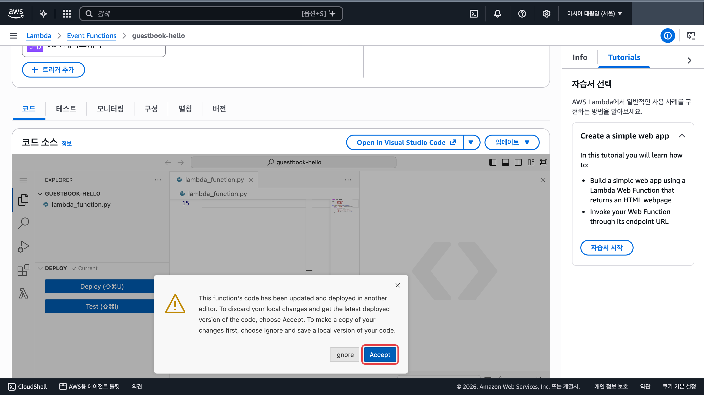
:::

### 한마디 자리에 `(한마디 API 오류: ...)` 가 나옵니다

:::caution[고칠 것]
> 「오늘의 한마디: (한마디 API 오류: HTTPError)」처럼 괄호 안에 오류 이름이 나옵니다.

앱이 `HELLO_API_URL=` 의 주소를 불렀지만 응답을 받지 못했습니다.

아래 순서로 고칩니다.

1. 서버에서 `cat /opt/guestbook/config.env` 로 `HELLO_API_URL=` 줄을 봅니다. `https://` 로 시작해 `/default/guestbook-hello` 로 끝나야 합니다.
2. 같은 주소를 브라우저 새 탭으로 열어 `{"message": ...}` 가 오는지 봅니다. `{"message":"Not Found"}` 면 주소 끝이 빠졌습니다.
3. 줄을 고쳤으면 `sudo systemctl restart guestbook` 으로 앱을 다시 켭니다.
:::

### 새로고침할 때마다 내 문장과 원래 문장이 번갈아 나옵니다

:::caution[고칠 것]
10번을 한 서버에만 했습니다.

9번 2에서 적어 둔 두 번째 인스턴스 ID 의 서버에 접속해 10번을 똑같이 합니다.
:::

### Deploy 했는데 방명록 문장이 그대로입니다

:::caution[고칠 것]
함수와 서버 설정 가운데 어느 쪽이 문제인지 먼저 가립니다.

1. 함수 주소를 브라우저로 열어 새 문장이 나오는지 봅니다.
2. 나오면 서버 설정 문제입니다. 두 서버의 `HELLO_API_URL=` 줄과 앱 재시작을 봅니다.
3. 안 나오면 「Deploy」 가 되지 않았습니다. 문장을 고친 뒤 「Deploy」를 다시 누르고 초록 알림을 봅니다.
:::

### 서버가 바뀐 뒤 원래 문장이 다시 나옵니다

:::caution[고칠 것]
오토 스케일링이 서버를 새로 만들면(교체, 늘리기) 새 서버의 설정 파일은 처음 상태라 `HELLO_API_URL=` 이 비어 있습니다.

대상 그룹 「대상」 탭에서 새 인스턴스 ID 를 찾아 그 서버도 10번 순서로 고칩니다.
:::

:::note[그래도 안 되면]
화면을 그대로 두고 손을 드세요. 좌석 번호, 단원 번호, 화면의 오류 문구를 말해 주세요.
:::
