:::note[이 단원에서 방명록이 얻는 것]
- **전:** 다 만든 자원이 켜져 있습니다.
- **후:** 모두 지웁니다.
- **그래서:** 클라우드는 켜 둔 만큼 돈이 나갑니다. 쓰지 않는 자원을 지우는 일도 운영입니다.
:::

막혔을 때: 이 단원 전체 흐름 영상 (2분 49초)

화면 위 띠의 번호가 아래 「따라 하기」 단계 번호와 같습니다. 누를 곳은 빨간 테두리로 보입니다. 막힌 단계 번호를 찾아 그 부분만 확인하는 용도입니다.

<video controls preload="none" width="100%" src="/guestbook-lab/video/u15.mp4"></video>

## 따라 하기

### 만든 순서의 반대로 지웁니다

삭제는 대부분 같은 순서입니다. 목록에서 행을 체크하고 「작업」에서 삭제 메뉴를 고릅니다. 뜨는 창에 확인 문구를 넣고 「삭제」를 누릅니다.

1. 오토 스케일링 그룹을 지웁니다. 서버도 함께 종료되고 5분쯤 걸리니 기다리지 말고 다음 줄로 넘어갑니다. <a href="https://ap-northeast-2.console.aws.amazon.com/ec2/home?region=ap-northeast-2#AutoScalingGroups:" target="_blank" rel="noopener">콘솔 열기 ↗</a>
   1. `guestbook-asg` 행을 체크(①)하고 「작업」(②) → 「삭제」(③)를 누릅니다.

      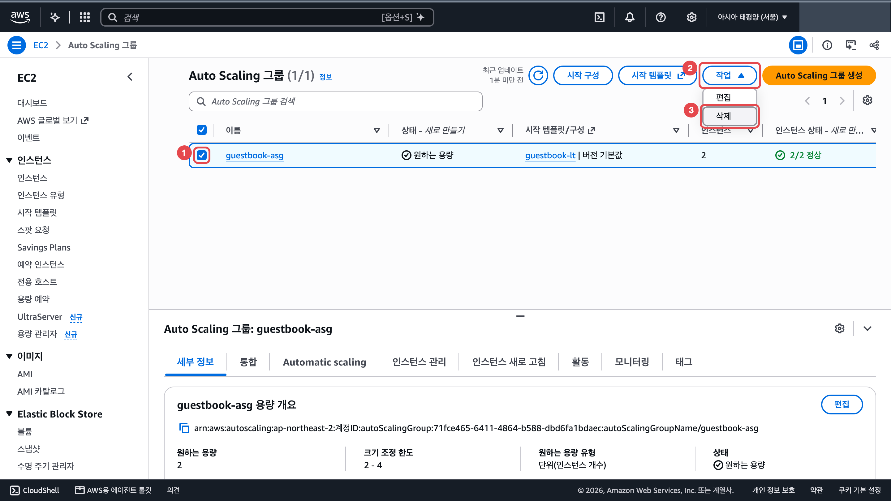

   2. 창의 입력란(①)에 `삭제` 를 넣고 「삭제」(②)를 누릅니다.

      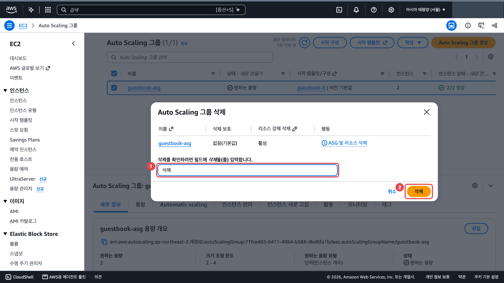

2. 로드 밸런서와 대상 그룹을 지웁니다. <a href="https://ap-northeast-2.console.aws.amazon.com/ec2/home?region=ap-northeast-2#LoadBalancers:" target="_blank" rel="noopener">콘솔 열기 ↗</a> <a href="https://ap-northeast-2.console.aws.amazon.com/ec2/home?region=ap-northeast-2#TargetGroups:" target="_blank" rel="noopener">대상 그룹 ↗</a>
   1. 로드 밸런서 목록에서 `guestbook-alb` 행을 체크(①)하고 「작업」(②) → 「로드 밸런서 삭제」(③)를 누릅니다.

      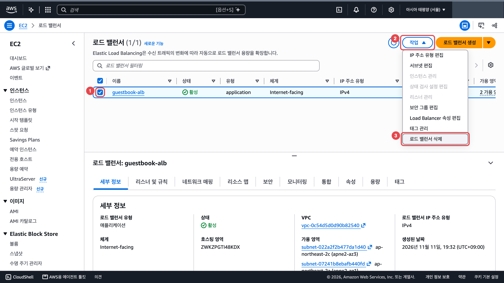

   2. 입력란(①)에 `확인` 을 넣고 「삭제」(②)를 누릅니다.

      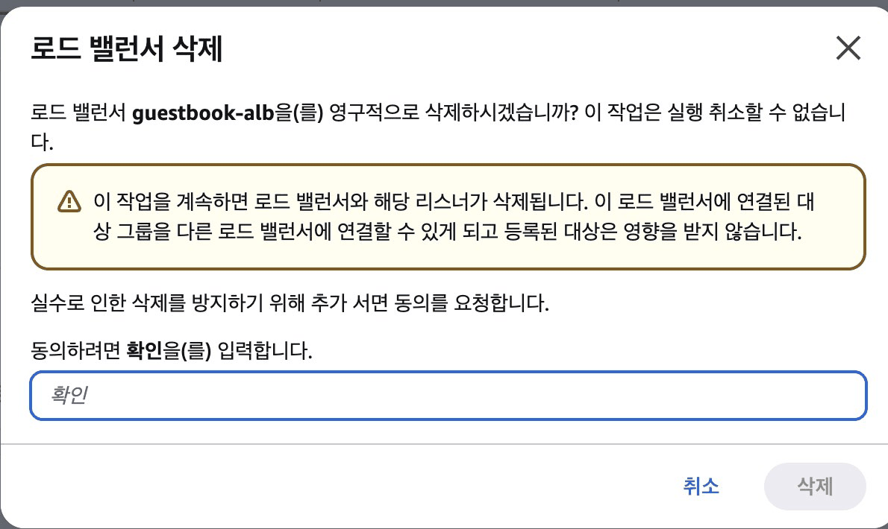

   3. 대상 그룹 목록에서 `guestbook-tg` 행을 체크(①)하고 「작업」(②) → 「삭제」(③)를 누릅니다.

      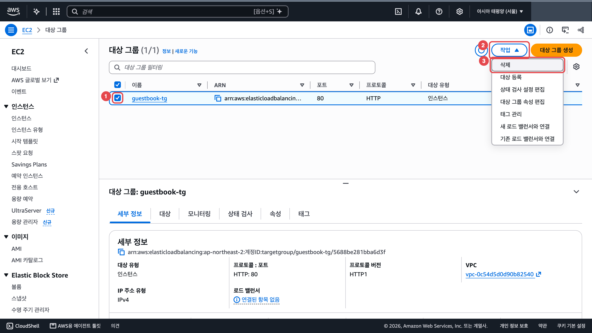

   4. 창에서 「삭제」를 누릅니다. 입력할 문구는 없습니다.

      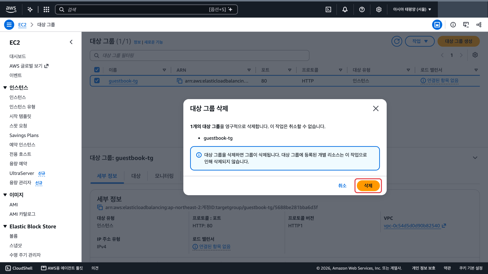

3. 남은 서버, 시작 템플릿, 4단원 보안 그룹을 지웁니다. <a href="https://ap-northeast-2.console.aws.amazon.com/ec2/home?region=ap-northeast-2#Instances:" target="_blank" rel="noopener">콘솔 열기 ↗</a> <a href="https://ap-northeast-2.console.aws.amazon.com/ec2/home?region=ap-northeast-2#LaunchTemplates:" target="_blank" rel="noopener">시작 템플릿 ↗</a> <a href="https://ap-northeast-2.console.aws.amazon.com/ec2/home?region=ap-northeast-2#SecurityGroups:" target="_blank" rel="noopener">보안 그룹 ↗</a>
   1. 인스턴스 목록에서 아직 「실행 중」이거나 「중지됨」인 서버(`guestbook-1`, `guestbook-2` 등)를 모두 체크(①)하고 「인스턴스 상태」(②) → 「인스턴스 종료(삭제)」(③)를 누릅니다.

      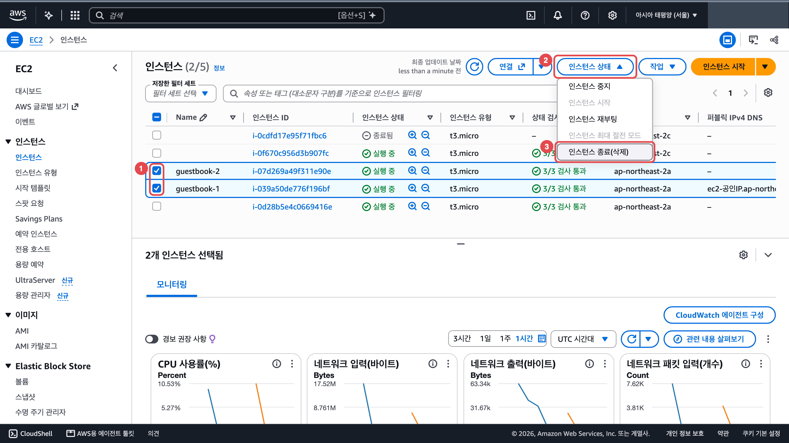

   2. 창 오른쪽 아래 「종료(삭제)」를 누릅니다.

      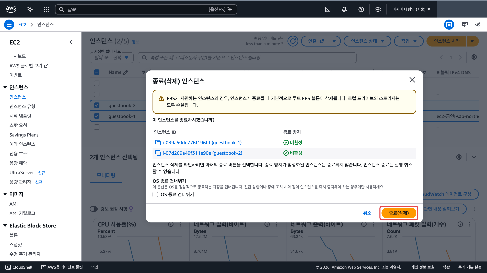

   3. 시작 템플릿 목록에서 `guestbook-lt` 행을 체크(①)하고 「작업」(②) → 「템플릿 삭제」(③)를 누릅니다.

      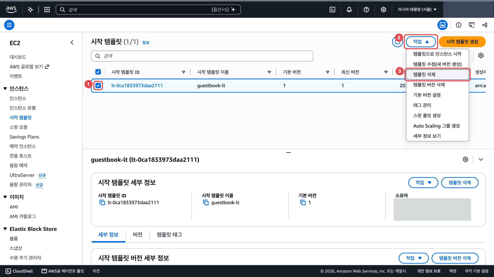

   4. 입력란(①)에 `삭제` 를 넣고 「삭제」(②)를 누릅니다.

      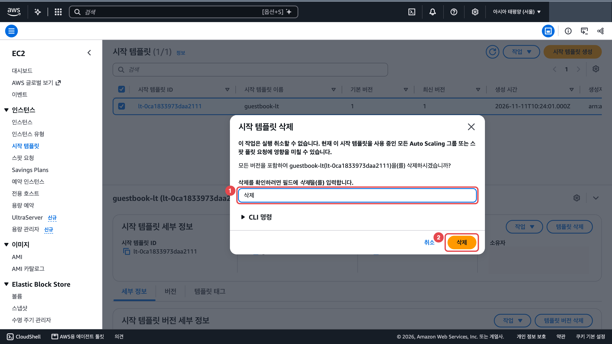

   5. 서버 종료가 끝나면(1~2분) 보안 그룹 목록에서 `launch-wizard-1` 행을 체크(①)하고 「작업」(②) → 「보안 그룹 삭제」(③)를 누릅니다.

      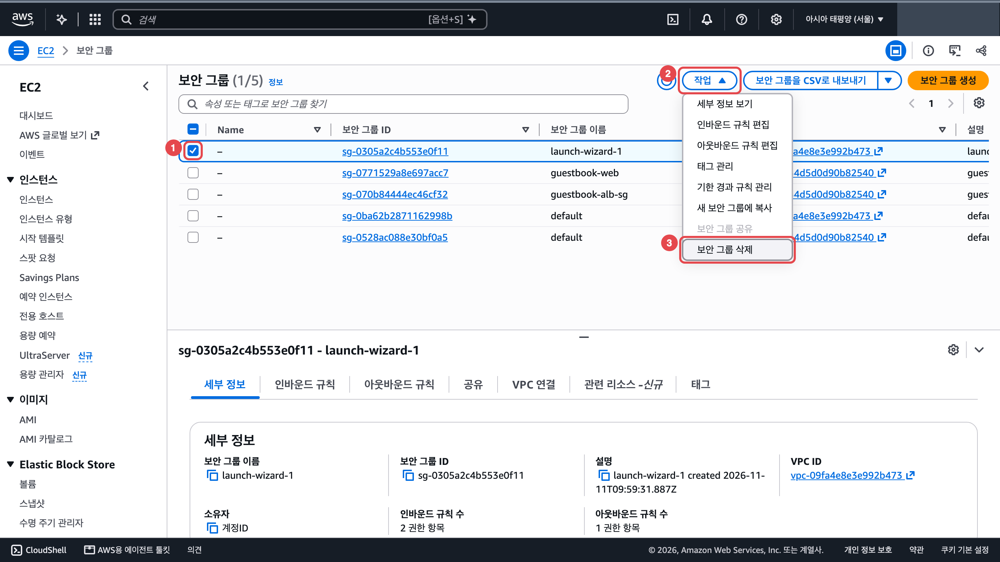

   6. 창에서 「삭제」를 누릅니다. 입력할 문구는 없습니다.

      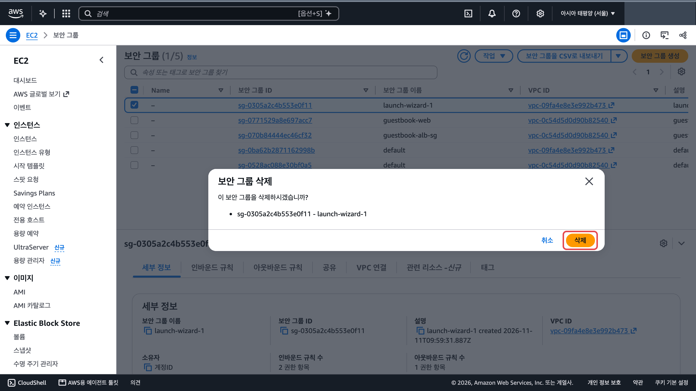

4. Lambda 함수와 API 를 지웁니다. <a href="https://ap-northeast-2.console.aws.amazon.com/lambda/home?region=ap-northeast-2#/functions" target="_blank" rel="noopener">콘솔 열기 ↗</a> <a href="https://ap-northeast-2.console.aws.amazon.com/apigateway/main/apis?region=ap-northeast-2" target="_blank" rel="noopener">API Gateway ↗</a>
   1. 「Event Functions」 목록에서 `guestbook-hello` 행을 체크(①)하고 「작업」(②) → 「삭제」(③)를 누릅니다.

      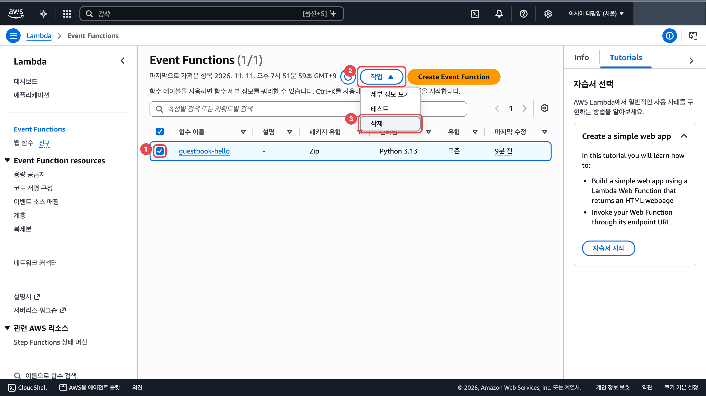

   2. 입력란(①)에 `확인` 을 넣고 「삭제」(②)를 누릅니다.

      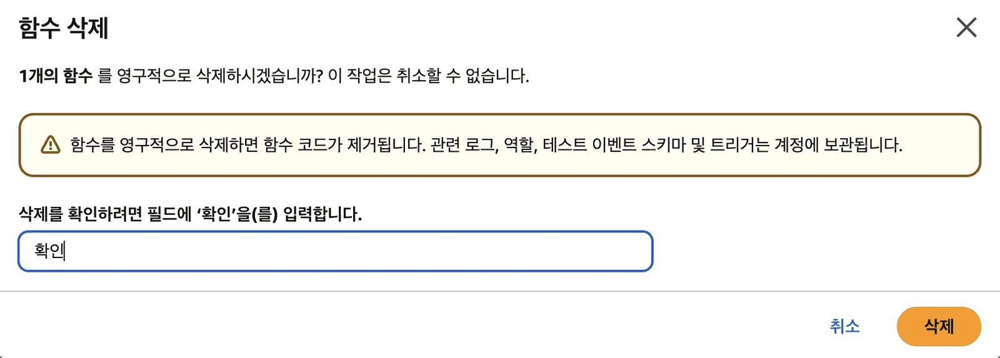

   3. API Gateway 의 API 목록에서 `guestbook-hello-API` 를 고르고(①) 「삭제」(②)를 누릅니다.

      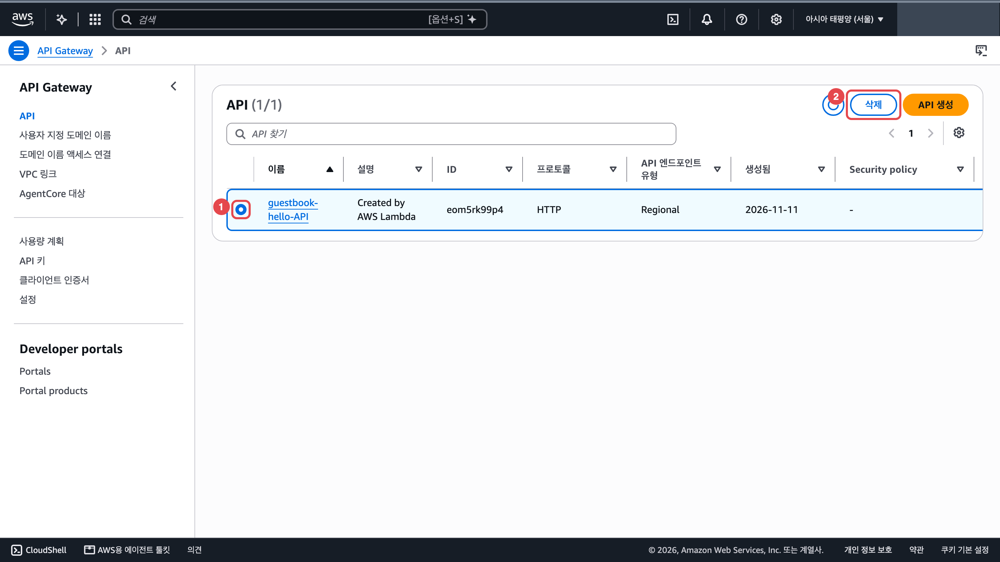

   4. 입력란(①)에 `확인` 을 넣고 「삭제」(②)를 누릅니다.

      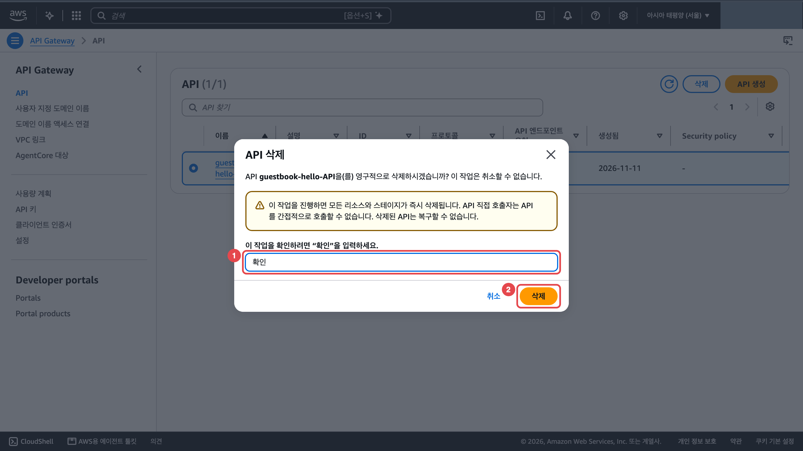

5. S3 버킷을 모두(웹사이트, 공지, 미니 프로젝트) 비우고 지웁니다. 버킷마다 1~4를 합니다. <a href="https://s3.console.aws.amazon.com/s3/buckets?region=ap-northeast-2" target="_blank" rel="noopener">콘솔 열기 ↗</a>
   1. 버킷 목록에서 버킷 하나를 고르고(①) 「비어 있음」(②)을 누릅니다. 비우기 단추 이름이 「비어 있음」으로 번역되어 있습니다.

      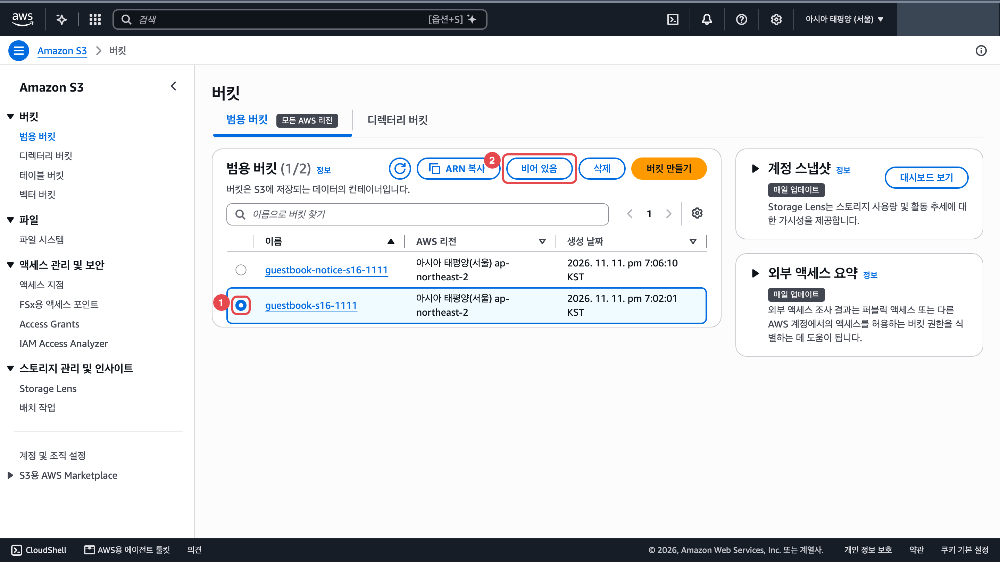

   2. 입력란(①)에 `영구적으로 삭제` 를 넣고 「비어 있음」(②)을 누릅니다.

      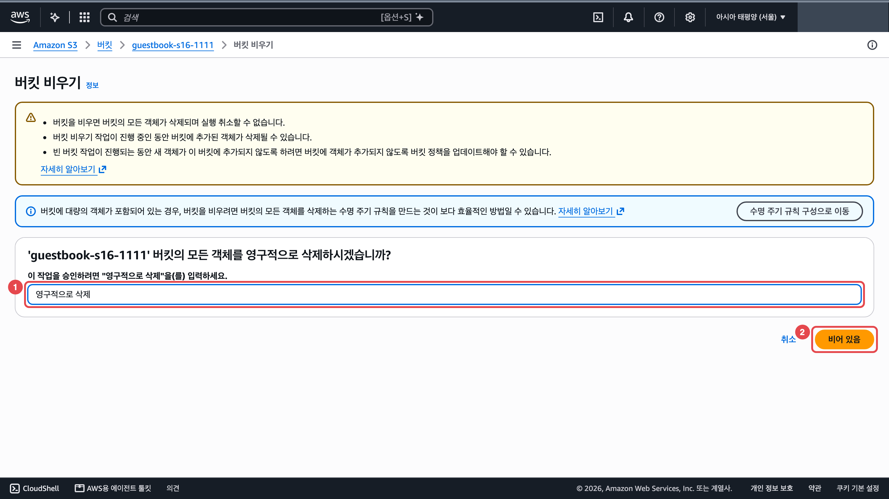

   3. 버킷 목록으로 돌아와 같은 버킷을 고르고(①) 「삭제」(②)를 누릅니다.

      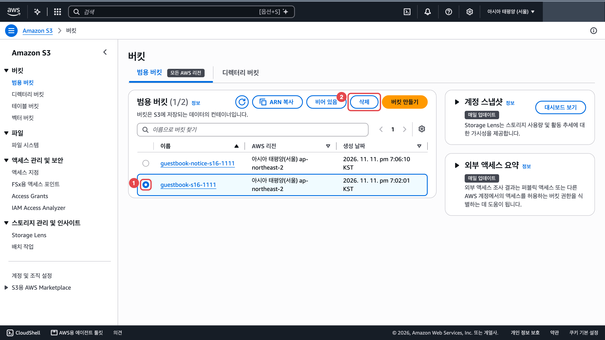

   4. 입력란(①)에 버킷 이름을 그대로 넣고 「버킷 삭제」(②)를 누릅니다.

      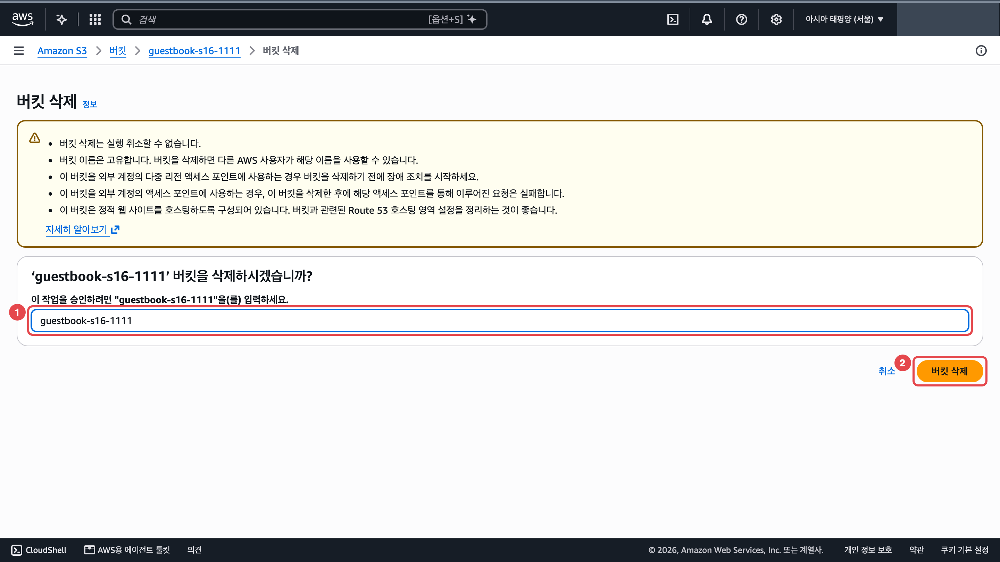

6. 미니 프로젝트 자원: DB(최종 스냅샷 체크 끄고 인정 체크), 테이블, 알람, 파라미터, `terraform destroy` <a href="https://ap-northeast-2.console.aws.amazon.com/rds/home?region=ap-northeast-2#databases:" target="_blank" rel="noopener">콘솔 열기 ↗</a> <a href="https://ap-northeast-2.console.aws.amazon.com/dynamodbv2/home?region=ap-northeast-2#tables" target="_blank" rel="noopener">DynamoDB 테이블 ↗</a> <a href="https://ap-northeast-2.console.aws.amazon.com/cloudwatch/home?region=ap-northeast-2#alarmsV2:" target="_blank" rel="noopener">CloudWatch 알람 ↗</a> <a href="https://ap-northeast-2.console.aws.amazon.com/systems-manager/parameters/?region=ap-northeast-2" target="_blank" rel="noopener">Parameter Store ↗</a> <a href="https://ap-northeast-2.console.aws.amazon.com/cloudshell/home?region=ap-northeast-2" target="_blank" rel="noopener">CloudShell ↗</a>

   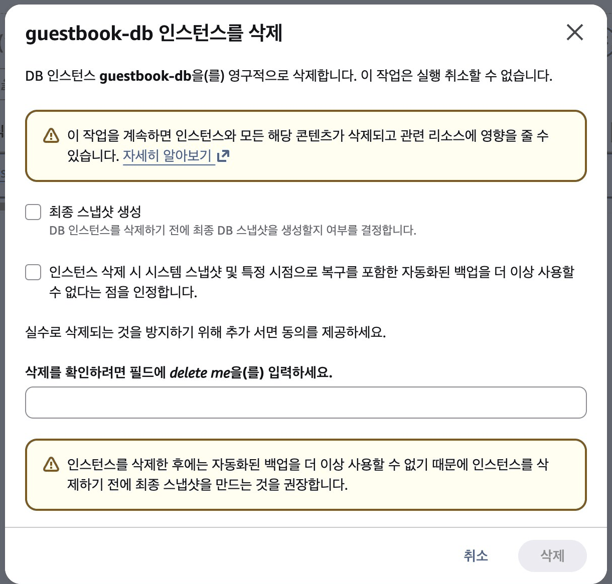

7. VPC 를 지웁니다. 서브넷, 인터넷 게이트웨이, 라우팅 테이블, 그 VPC 의 보안 그룹이 함께 지워집니다. <a href="https://ap-northeast-2.console.aws.amazon.com/vpcconsole/home?region=ap-northeast-2#vpcs:" target="_blank" rel="noopener">콘솔 열기 ↗</a>
   1. VPC 목록에서 `guestbook-vpc` 행을 체크(①)하고 「작업」(②) → 「VPC 삭제」(③)를 누릅니다.

      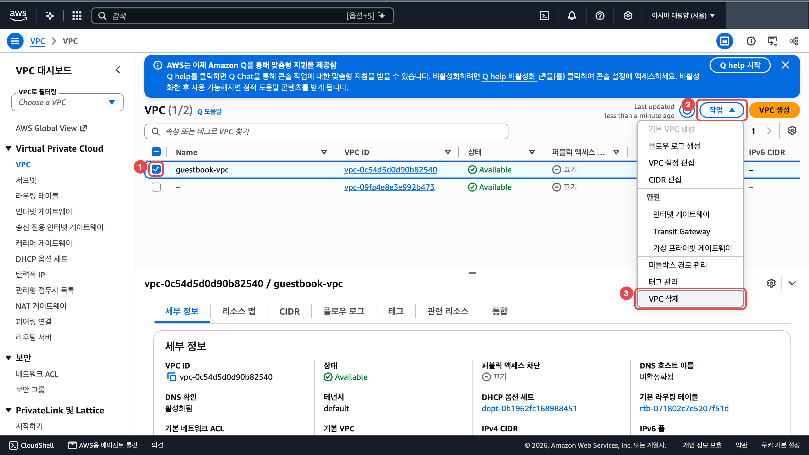

   2. 함께 지워지는 목록을 보고 입력란(①)에 `삭제` 를 넣은 뒤 「삭제」(②)를 누릅니다.

      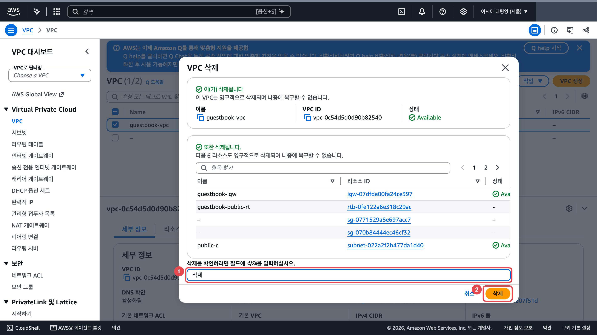

8. 내가 만든 IAM 역할을 지웁니다. CloudShell 을 썼으면 CloudShell 홈도 지웁니다(「작업」 메뉴). <a href="https://console.aws.amazon.com/iam/home#/roles" target="_blank" rel="noopener">콘솔 열기 ↗</a> <a href="https://ap-northeast-2.console.aws.amazon.com/cloudshell/home?region=ap-northeast-2" target="_blank" rel="noopener">CloudShell ↗</a>
   1. 역할 목록에서 `guestbook-ec2-role` 과 `guestbook-hello-role-` 로 시작하는 역할을 체크(①)하고 위쪽 「삭제」(②)를 누릅니다. `AWSServiceRoleFor` 로 시작하는 역할과 `AWSReservedSSO_` 로 시작하는 역할은 지우지 않습니다.

      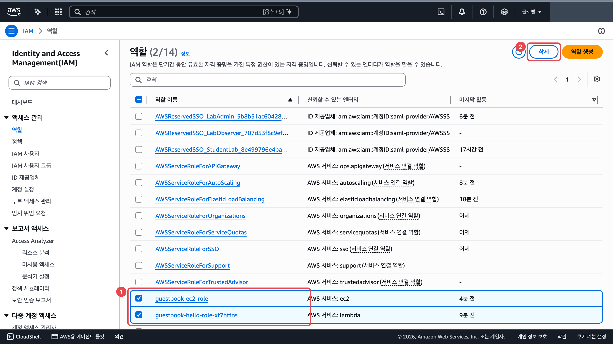

   2. 입력란(①)에 `삭제` 를 넣고 「삭제」(②)를 누릅니다.

      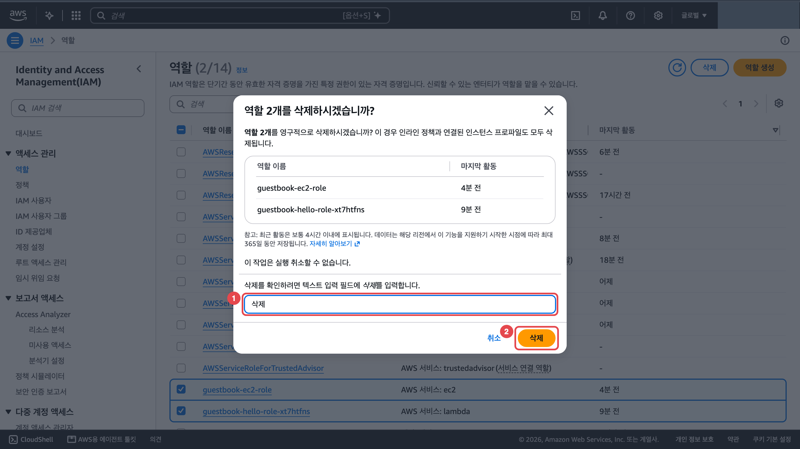

**왜 이 순서인가** 쓰이고 있는 것은 지워지지 않습니다. 서버가 남아 있으면 VPC가 안 지워집니다.

**언제 하나** 리뷰가 끝나면 지금 이 순서로 함께 지웁니다. 삭제 창마다 입력할 확인 문구가 다르니 창 안 문구를 읽고 입력하세요.

## 막혔을 때

만든 순서의 반대로 지웁니다. 쓰이고 있는 것은 지워지지 않습니다.

1. 오토 스케일링 그룹(서버도 함께 종료됩니다)
2. 로드 밸런서, 대상 그룹
3. 남은 EC2 인스턴스, 시작 템플릿, 보안 그룹 `launch-wizard-1`
4. Lambda 함수와 API
5. S3 버킷(비운 뒤 삭제)
6. 미니 프로젝트 자원(DB, 테이블, 알람, 파라미터, `terraform destroy`)
7. VPC(서브넷, 게이트웨이, 라우팅 테이블이 함께 지워집니다)
8. 내가 만든 IAM 역할, CloudShell 홈

### 오토 스케일링 그룹이 몇 분째 「삭제 중」입니다

:::tip[정상입니다]{icon="approve-check-circle"}
삭제에 5분쯤 걸리고 그동안 서버가 실행 중으로 보입니다. 기다리지 말고 다음 줄(로드 밸런서와 대상 그룹 삭제)로 넘어갑니다.
:::

### 삭제 버튼이 눌리지 않습니다

:::caution[고칠 것]
창마다 입력해야 하는 확인 문구가 다릅니다.

창 안의 문구를 그대로 입력합니다.

| 지우는 것 | 입력할 문구 |
|---|---|
| 오토 스케일링 그룹 | `삭제` |
| 로드 밸런서 | `확인` |
| 대상 그룹, 보안 그룹, 인스턴스 종료 | 없음(「삭제」나 「종료(삭제)」만 누름) |
| 시작 템플릿 | `삭제` |
| Lambda 함수, API | `확인` |
| S3 비우기 | `영구적으로 삭제` |
| S3 버킷 삭제 | 버킷 이름 |
| RDS | `delete me` |
| VPC | `삭제` |
| IAM 역할 | 두 개 이상 골랐으면 `삭제`, 하나만 골랐으면 그 역할 이름 |
| CloudShell 홈 | `delete` |
:::

### 삭제가 거부됩니다

:::caution[고칠 것]
다른 자원이 아직 쓰고 있는 것은 지워지지 않습니다. 서버가 남아 있으면 VPC 가 지워지지 않고, 버킷은 비워야 지워집니다.

오류 메시지가 알려 주는 자원부터 지웁니다. 위의 순서를 따릅니다.
:::

### 대상 그룹 삭제가 「리스너에서 사용 중」으로 거부됩니다

:::tip[정상입니다]{icon="approve-check-circle"}
로드 밸런서를 지운 직후에는 대상 그룹이 아직 연결된 것으로 보일 수 있습니다.

1~2분 기다린 뒤 대상 그룹 목록을 새로 고침하고 2-3 부터 다시 지웁니다. 그동안 3번(시작 템플릿과 서버)을 먼저 해도 됩니다.
:::

### RDS 삭제 창에 「최종 스냅샷 생성」이 켜져 있습니다

:::caution[고칠 것]
켜 둔 채 지우면 스냅샷이 남아 요금이 붙습니다.

아래 순서로 고칩니다.

1. 「최종 스냅샷 생성」 체크를 끕니다.
2. 새로 나오는 「자동화된 백업을 더 이상 사용할 수 없다는 점을 인정합니다」를 체크합니다.
3. `delete me` 를 입력합니다.
:::

### 「정품 인증이 성공적으로 삭제되었습니다.」가 뜹니다

:::tip[정상입니다]{icon="approve-check-circle"}
파라미터를 지운 뒤 뜨는 안내인데 번역이 틀렸습니다. 파라미터는 지워졌습니다.
:::

### Lambda 를 지웠는데 API 와 역할이 남아 있습니다

:::tip[정상입니다]{icon="approve-check-circle"}
함수를 지워도 API 와 실행 역할은 남습니다. API 는 API Gateway 에서, 역할은 IAM 역할 목록에서 따로 지웁니다. 4단원 보안 그룹 `launch-wizard-1` 도 EC2 → 보안 그룹에서 따로 지웁니다. <a href="https://ap-northeast-2.console.aws.amazon.com/apigateway/main/apis?region=ap-northeast-2" target="_blank" rel="noopener">API Gateway ↗</a> <a href="https://console.aws.amazon.com/iam/home#/roles" target="_blank" rel="noopener">IAM 역할 ↗</a> <a href="https://ap-northeast-2.console.aws.amazon.com/ec2/home?region=ap-northeast-2#SecurityGroups:" target="_blank" rel="noopener">보안 그룹 ↗</a>
:::

### S3 버킷이 여러 개입니다

:::tip[정상입니다]{icon="approve-check-circle"}
웹사이트(7단원), 공지(9단원), 미니 프로젝트 버킷이 있습니다. 모두 비우고 삭제합니다.
:::

### VPC 가 삭제되지 않습니다

:::caution[고칠 것]
DB 를 지운 직후에는 DB 네트워크 인터페이스가 아직 남아 있어 VPC 삭제가 막힙니다.

1~2분 기다렸다가 VPC 삭제를 다시 누릅니다.
:::

### S3 목록에 「비우기」 단추가 없습니다

:::tip[정상입니다]{icon="approve-check-circle"}
비우기 단추가 「비어 있음」이라는 이름으로 번역되어 있습니다. 버킷을 고르고 「비어 있음」을 누르면 버킷 비우기 화면이 열립니다.
:::

:::note[그래도 안 되면]
화면을 그대로 두고 손을 드세요. 좌석 번호, 단원 번호, 화면의 오류 문구를 말해 주세요.
:::
