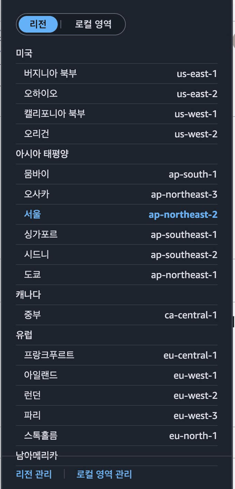
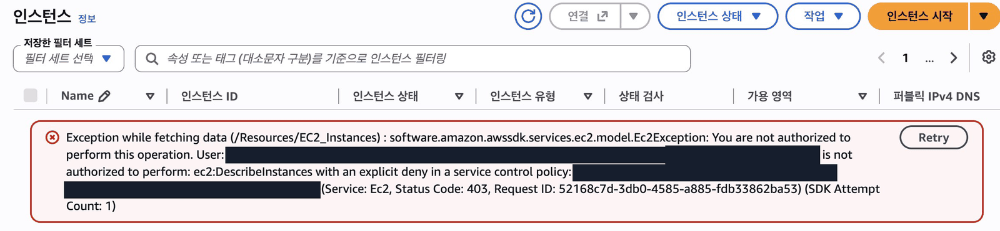
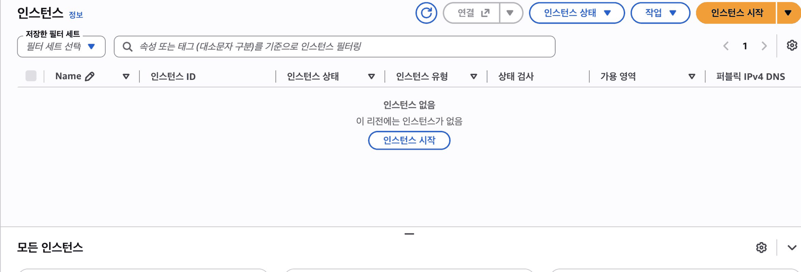
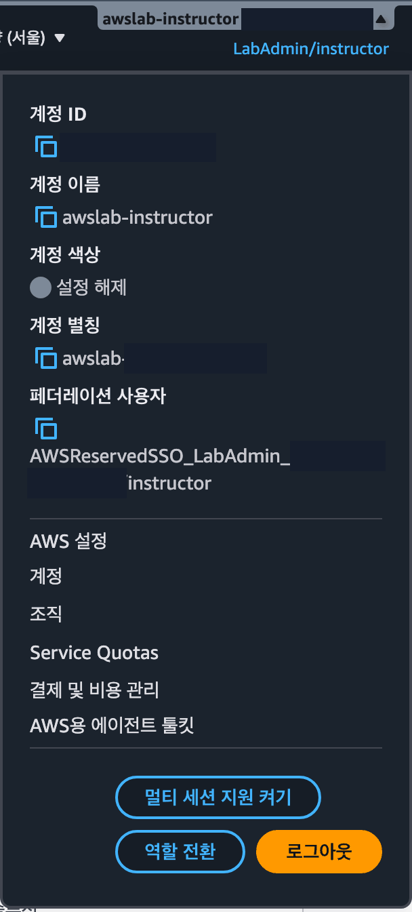
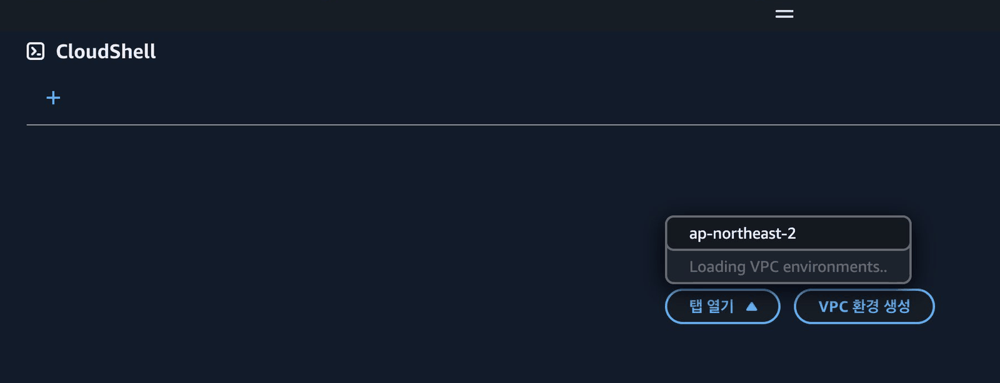

## 따라 하기

### 일부러 거부당하고, 오류로 원인 찾기

1. 리전을 도쿄로 바꾸고 EC2 → 왼쪽 「인스턴스」 열기 <a href="https://ap-northeast-1.console.aws.amazon.com/ec2/home?region=ap-northeast-1#Instances:" target="_blank" rel="noopener">콘솔 열기 ↗</a>

   

2. 빨간 오류 메시지를 그대로 읽기

   

3. 메시지에서 **not authorized**, **explicit deny**를 찾기
4. 서울로 돌아와 같은 화면을 열고 비교하기 <a href="https://ap-northeast-2.console.aws.amazon.com/ec2/home?region=ap-northeast-2#Instances:" target="_blank" rel="noopener">콘솔 열기 ↗</a>

   

**도전** 오른쪽 위 계정 메뉴에서 내 이름을 보고, 화면 아래 CloudShell → 「탭 열기」 → ap-northeast-2 에서 같은 질문을 명령으로 해 보세요. <a href="https://ap-northeast-2.console.aws.amazon.com/cloudshell/home?region=ap-northeast-2" target="_blank" rel="noopener">콘솔 열기 ↗</a>





```bash
aws sts get-caller-identity
```

이렇게 나오면 됩니다.

```text
{
    "UserId": "AROAEXAMPLEID:학생 사용자 이름",
    "Account": "123456789012",
    "Arn": "arn:aws:sts::123456789012:assumed-role/AWSReservedSSO_StudentLab_0123456789abcdef/학생 사용자 이름"
}
```

확인했으면 CloudShell 은 오른쪽 위 X 로 닫습니다. 열어 두면 다음 단원 내내 화면 아래를 덮습니다.

## 막혔을 때

이 단원은 거부를 일부러 보는 단원입니다. 빨간 오류가 나오면 실습이 맞게 된 것입니다. 오류 문구를 읽는 법은 [오류 읽는 법](/guestbook-lab/basics/errors/)에 있습니다.

### 도쿄에서 「인스턴스」를 열면 빨간 오류가 뜹니다

:::tip[정상입니다]{icon="approve-check-circle"}
> `You are not authorized to perform this operation. ... is not authorized to perform: ec2:DescribeInstances with an explicit deny in a service control policy`

이 오류를 읽는 것이 이 단원의 실습입니다. 메시지에서 `not authorized` 와 `explicit deny` 를 찾은 뒤 서울로 돌아옵니다.
:::

### 도쿄에서 시작 마법사를 열면 「AMI ID 가 유효하지 않습니다」가 뜹니다

:::tip[정상입니다]{icon="approve-check-circle"}
> 「AMI ID(…)가 유효하지 않습니다」, 「VPC를 찾을 수 없습니다」

도쿄에서는 조회가 막혀서 생긴 오류입니다. 원인 문구가 보이지 않으니 실습은 「인스턴스」 목록의 오류로 합니다.
:::

### 서울로 돌아오면 인스턴스 목록이 비어 있습니다

:::tip[정상입니다]{icon="approve-check-circle"}
아직 만든 서버가 없어서입니다. 빨간 오류가 없으면 됩니다.
:::

### CloudShell 결과에 `AWSReservedSSO_` 가 보입니다

:::tip[정상입니다]{icon="approve-check-circle"}
> `aws sts get-caller-identity` 결과의 `AWSReservedSSO_…`

로그인 포털이 만들어 준 역할로 들어와 있다는 뜻입니다.
:::

### CloudShell 을 열었는데 「No active tabs」만 보입니다

:::caution[고칠 것]
> 「No active tabs」 「탭 열기」 「VPC 환경 생성」

CloudShell 이 아직 셸을 열지 않은 첫 화면입니다.

아래 순서로 엽니다.
1. 「탭 열기」를 누릅니다.
2. 「ap-northeast-2」를 고릅니다.
3. 30초쯤 기다리면 `~ $` 가 보입니다.

「VPC 환경 생성」은 누르지 않습니다.
:::

:::note[그래도 안 되면]
화면을 그대로 두고 손을 드세요. 좌석 번호, 단원 번호, 화면의 오류 문구를 말해 주세요.
:::
