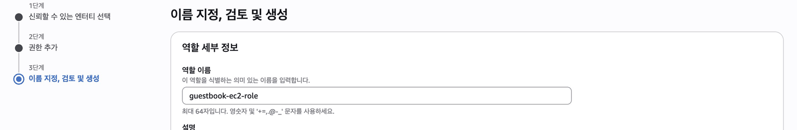
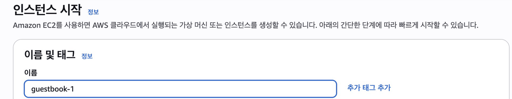
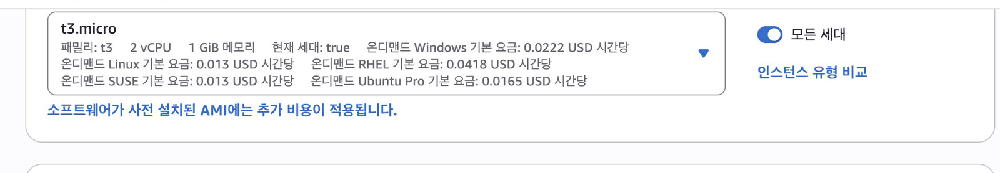
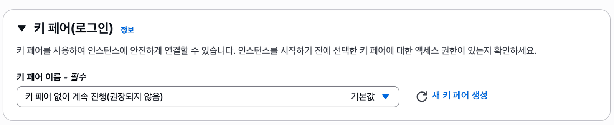
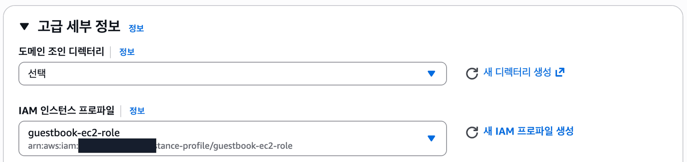
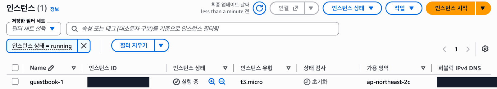
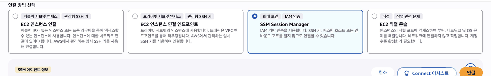

## 따라 하기

### 첫 서버를 켜고 브라우저로 들어가기

1. IAM → 역할 생성: 신뢰 대상 EC2, 정책 `AmazonSSMManagedInstanceCore`(표 위 검색칸에서), 이름 **guestbook-ec2-role** <a href="https://console.aws.amazon.com/iam/home#/roles/create" target="_blank" rel="noopener">콘솔 열기 ↗</a>

   

2. EC2 → 인스턴스 시작, 이름은 **guestbook-1** <a href="https://ap-northeast-2.console.aws.amazon.com/ec2/home?region=ap-northeast-2#LaunchInstances:" target="_blank" rel="noopener">콘솔 열기 ↗</a>

   

3. AMI: Amazon Linux 2023, 타입: **t3.micro**로 바꾸기(기본값은 t2.micro)

   

4. 키 페어: **키 페어 없이 계속 진행**

   

5. 고급 세부 정보 → IAM 인스턴스 프로파일: guestbook-ec2-role

   

6. 시작 후 상태가 **실행 중**이 될 때까지 기다리기

   

7. 연결 → **SSM Session Manager** 카드 → 연결

   

**확인** 까만 화면에 아래가 보이면 성공

```text
sh-5.2$
```

**연결 버튼이 회색이면** 1~2분 더 기다리고 새로고침. 그래도 안 되면 5번 역할을 확인

## 막혔을 때

### 정책 이름을 검색했는데 문서 검색 결과만 나옵니다

:::caution[고칠 것]
화면 맨 위의 콘솔 검색창에 넣었습니다.

역할 만들기의 권한 단계에서 **권한 정책 표 바로 위의 검색칸**에 아래 이름을 넣습니다. <a href="https://console.aws.amazon.com/iam/home#/roles/create" target="_blank" rel="noopener">콘솔 열기 ↗</a>

```text
AmazonSSMManagedInstanceCore
```
:::

### 인스턴스 시작이 권한 오류로 실패합니다

:::caution[고칠 것]
> `You are not authorized to perform this operation` (뒤에 `Encoded authorization failure message` 가 붙을 수 있습니다)

인스턴스 유형이 서울의 기본값 `t2.micro` 그대로이거나 리전이 서울이 아닙니다. 수업 계정은 `t3.micro` 와 `t3.small` 만 엽니다.

아래 순서로 고칩니다.

1. 오른쪽 위 리전이 서울인지 봅니다.
2. 인스턴스 유형을 `t3.micro` 로 바꿉니다.
3. 다시 「인스턴스 시작」을 누릅니다.
:::

### 「연결」을 눌렀는데 실패합니다

:::caution[고칠 것]
> 「퍼블릭 서브넷 액세스」 「프라이빗 서브넷 액세스」 「SSM Session Manager」 「EC2 직렬 콘솔」

첫 카드 「퍼블릭 서브넷 액세스」는 SSH 22 포트가 필요한 방식이라 우리 서버에는 연결되지 않습니다.

카드 네 개 가운데 **「SSM Session Manager」** 카드를 고르고 「연결」을 누릅니다.
:::

### SSM 카드에 「Systems Manager 기본 역할이 활성화되지 않음」이 보입니다

:::tip[정상입니다]{icon="approve-check-circle"}
> 「Systems Manager 기본 역할이 활성화되지 않음」

우리 서버는 직접 붙인 역할(`guestbook-ec2-role`)로 연결하므로 이 안내와 상관없이 연결됩니다.
:::

### 「SSM Session Manager」의 「연결」 버튼이 회색입니다

:::caution[고칠 것]
서버가 막 켜졌으면 등록까지 1~2분 걸립니다. 그보다 오래 회색이면 서버에 역할이 없거나 퍼블릭 IP 가 없는 경우가 많습니다.

아래 순서로 고칩니다.

1. 1~2분 기다리고 새로고침합니다.
2. 그래도 회색이면 인스턴스 → 작업 → 보안 → **IAM 역할 수정**에서 `guestbook-ec2-role` 을 붙이고 몇 분 기다립니다. <a href="https://ap-northeast-2.console.aws.amazon.com/ec2/home?region=ap-northeast-2#Instances:" target="_blank" rel="noopener">콘솔 열기 ↗</a>
3. 인스턴스에 퍼블릭 IPv4 주소가 있는지도 봅니다.
:::

### 까만 화면에 `sh-5.2$` 가 보입니다

:::tip[정상입니다]{icon="approve-check-circle"}
접속에 성공했습니다. `bash` 를 한 번 입력하면 익숙한 셸이 됩니다. 접속한 사용자는 `ssm-user` 입니다.
:::

:::note[그래도 안 되면]
화면을 그대로 두고 손을 드세요. 좌석 번호, 단원 번호, 화면의 오류 문구를 말해 주세요.
:::
