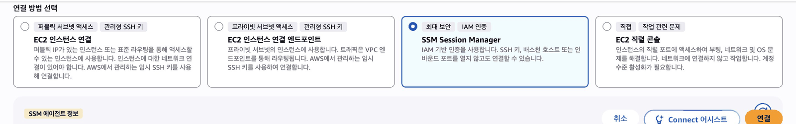
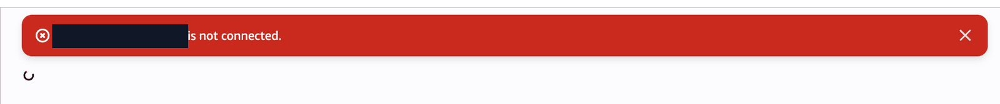

## 따라 하기

### 빌린 서버를 점검해 봅시다

나는 누구로, 어느 서버에 들어왔나

```bash
# 내가 누구로 들어왔는지와 이 서버의 이름을 봅니다
whoami; hostname
```

이렇게 나오면 됩니다.

```text
ssm-user
ip-172-31-35-223.ap-northeast-2.compute.internal
```

CPU 개수, 메모리, 디스크

```bash
# CPU 개수, 메모리, 디스크 크기를 차례로 봅니다
nproc; free -h; df -h
```

이렇게 나오면 됩니다.

```text
2
               total        used        free      shared  buff/cache   available
Mem:           913Mi       195Mi       431Mi       0.0Ki       285Mi       585Mi
Swap:             0B          0B          0B
Filesystem        Size  Used Avail Use% Mounted on
devtmpfs          4.0M     0  4.0M   0% /dev
tmpfs             457M     0  457M   0% /dev/shm
tmpfs             183M  420K  183M   1% /run
efivarfs          128K  2.7K  121K   3% /sys/firmware/efi/efivars
/dev/nvme0n1p1    8.0G  1.6G  6.4G  20% /
tmpfs             457M     0  457M   0% /tmp
/dev/nvme0n1p128   10M  1.3M  8.7M  13% /boot/efi
```

어떤 프로그램이 어느 포트를 열고 있나

```bash
# 어떤 프로그램이 어느 포트를 열고 기다리는지 봅니다
sudo ss -tlnp
```

이렇게 나오면 됩니다.

```text
State   Recv-Q  Send-Q  Local Address:Port  Peer Address:Port  Process
LISTEN  0       128           0.0.0.0:22         0.0.0.0:*      users:(("sshd",pid=1911,fd=7))
LISTEN  0       128              [::]:22            [::]:*      users:(("sshd",pid=1911,fd=8))
```

도전: [4단원](/guestbook-lab/u4/)에서 고른 t3.micro의 사양과 위 결과가 맞는지 확인하세요.

### 앱을 받아서 직접 실행하기

```bash
# git, 파이썬 3.11, nano 편집기를 설치합니다
sudo dnf install -y git python3.11 nano
```

이렇게 나오면 됩니다.

```text
Amazon Linux 2023 Kernel Livepatch repository   791 kB/s |  93 kB     00:00
Package nano-8.3-1.amzn2023.x86_64 is already installed.
Dependencies resolved.
…(생략)
Install  14 Packages
…(생략)
Installed:
  git-2.50.1-1.amzn2023.0.1.x86_64   git-core-2.50.1-1.amzn2023.0.1.x86_64   git-core-doc-2.50.1-1.amzn2023.0.1.noarch
…(생략)
  python3.11-pip-wheel-22.3.1-2.amzn2023.0.15.noarch   python3.11-setuptools-wheel-65.5.1-2.amzn2023.0.7.noarch

Complete!
```

```bash
# 방명록 앱 저장소를 /opt/guestbook 폴더로 받습니다
sudo git clone https://github.com/pghoya2956/guestbook-lab.git /opt/guestbook
```

이렇게 나오면 됩니다.

```text
Cloning into '/opt/guestbook'...
remote: Enumerating objects: 202, done.
remote: Counting objects: 100% (202/202), done.
remote: Compressing objects: 100% (126/126), done.
remote: Total 202 (delta 81), reused 171 (delta 50), pack-reused 0 (from 0)
Receiving objects: 100% (202/202), 118.70 KiB | 8.48 MiB/s, done.
Resolving deltas: 100% (81/81), done.
```

```bash
# 앱 폴더로 들어갑니다
cd /opt/guestbook
```

```bash
# 이 앱 전용 파이썬 도구 상자(.venv)를 만듭니다
sudo python3.11 -m venv .venv
```

```bash
# 도구 상자(.venv)에 앱에 필요한 라이브러리를 넣습니다
sudo .venv/bin/pip install -r requirements.txt
```

이렇게 나오면 됩니다.

```text
Collecting flask<4,>=3.0
  Downloading flask-3.1.3-py3-none-any.whl (103 kB)
     ━━━━━━━━━━━━━━━━━━━━━━━━━━━━━━━━━━━━━━━━ 103.4/103.4 kB 10.1 MB/s eta 0:00:00
Collecting boto3>=1.35
…(생략)
Installing collected packages: urllib3, six, pymysql, markupsafe, jmespath, itsdangerous, click, blinker, werkzeug, python-dateutil, jinja2, flask, botocore, s3transfer, boto3
Successfully installed blinker-1.9.0 boto3-1.43.127 botocore-1.43.127 click-8.5.1 flask-3.1.3 itsdangerous-2.2.0 jinja2-3.1.6 jmespath-1.1.0 markupsafe-3.0.4 pymysql-1.2.4 python-dateutil-2.9.0.post0 s3transfer-0.19.3 six-1.17.0 urllib3-2.8.0 werkzeug-3.1.9

[notice] A new release of pip available: 22.3.1 -> 26.3
[notice] To update, run: python3.11 -m pip install --upgrade pip
```

```bash
# 앱을 직접 실행합니다. 80 포트를 쓰려면 sudo 가 필요합니다
sudo .venv/bin/python app.py
```

이렇게 나오면 됩니다.

```text
* Serving Flask app 'app'
 * Debug mode: off
WARNING: This is a development server. Do not use it in a production deployment. Use a production WSGI server instead.
 * Running on all addresses (0.0.0.0)
 * Running on http://127.0.0.1:80
 * Running on http://172.31.35.223:80
Press CTRL+C to quit
```

**확인** 새 탭에서 EC2 → 연결을 한 번 더 해 세션 창을 하나 더 열고 실행 <a href="https://ap-northeast-2.console.aws.amazon.com/ec2/home?region=ap-northeast-2#Instances:" target="_blank" rel="noopener">콘솔 열기 ↗</a>



```bash
# 이 서버 안에서 방명록 첫 화면을 불러 봅니다
curl localhost
```

이렇게 나오면 됩니다.

```text
<!doctype html>
<html lang="ko">
<head>
<meta charset="utf-8">
<meta name="viewport" content="width=device-width,initial-scale=1">
<title>우리 반 방명록</title>
…(생략)
  </div>
</body>
</html>
```

**문제** 첫 창에서 Ctrl+C를 누르거나 창을 닫으면? 앱이 같이 죽습니다. 다음 장에서 고칩니다.

### 재부팅해도 살아 있는 앱으로 만들기

systemd 는 서버가 켜질 때 앱을 자동으로 켜 주는 관리자입니다. 아래 파일을 관리자(systemd)에게 넘겨 앱을 등록합니다.

저장소의 guestbook.service (복사만 합니다) <a href="https://github.com/pghoya2956/guestbook-lab/blob/main/guestbook.service" target="_blank" rel="noopener">저장소에서 보기 ↗</a>

```ini
[Service]
WorkingDirectory=/opt/guestbook
EnvironmentFile=-/opt/guestbook/config.env
ExecStart=/opt/guestbook/.venv/bin/python app.py
Restart=always

[Install]
WantedBy=multi-user.target
```

등록하고 확인

```bash
# 앱 폴더로 들어갑니다
cd /opt/guestbook
```

```bash
# 관리자(systemd)에게 앱 등록 파일을 넘깁니다
sudo cp guestbook.service /etc/systemd/system/
```

```bash
# 설정 파일 견본을 config.env 로 복사합니다
sudo cp config.env.example config.env
```

```bash
# 글을 저장할 폴더를 만듭니다
sudo mkdir -p /var/lib/guestbook
```

```bash
# 관리자(systemd)가 새 등록 파일을 읽게 합니다
sudo systemctl daemon-reload
```

```bash
# 관리자(systemd)가 앱을 지금 켜고, 서버가 켜질 때마다 저절로 켜게 합니다
sudo systemctl enable --now guestbook
```

이렇게 나오면 됩니다.

```text
Created symlink /etc/systemd/system/multi-user.target.wants/guestbook.service → /etc/systemd/system/guestbook.service.
```

```bash
# 앱 서비스가 잘 돌고 있는지 상태를 봅니다
systemctl status guestbook --no-pager
```

이렇게 나오면 됩니다.

```text
● guestbook.service - Guestbook
     Loaded: loaded (/etc/systemd/system/guestbook.service; enabled; preset: disabled)
     Active: active (running) since Tue 2026-11-10 07:14:33 UTC; 99ms ago
   Main PID: 27159 (python)
      Tasks: 1 (limit: 1059)
     Memory: 8.8M
        CPU: 72ms
     CGroup: /system.slice/guestbook.service
             └─27159 /opt/guestbook/.venv/bin/python app.py
```

```bash
# 서버를 다시 시작합니다. 접속이 끊기니 1~2분 뒤 다시 연결합니다
sudo reboot
```

재부팅하면 세션 창이 끊깁니다. 30초쯤 뒤 다시 연결해서 curl로 앱이 살아 있는지 확인합니다. <a href="https://ap-northeast-2.console.aws.amazon.com/ec2/home?region=ap-northeast-2#Instances:" target="_blank" rel="noopener">콘솔 열기 ↗</a>



```bash
# 이 서버 안에서 방명록 첫 화면을 불러 봅니다
curl localhost
```

이렇게 나오면 됩니다.

```text
<!doctype html>
<html lang="ko">
<head>
<meta charset="utf-8">
<meta name="viewport" content="width=device-width,initial-scale=1">
<title>우리 반 방명록</title>
…(생략)
  </div>
</body>
</html>
```

**systemd** 리눅스에서 서비스의 시작, 중지, 재시작을 관리하는 프로그램

## 막혔을 때

### 첫 창에서 Ctrl+C 를 누르면 앱이 꺼집니다

:::tip[정상입니다]{icon="approve-check-circle"}
창을 닫아도 같습니다. 다음 장에서 서비스로 등록해 고칩니다.
:::

### `systemctl status` 가 `active (running)` 이 아닙니다

:::caution[고칠 것]
앞에서 직접 띄운 앱이 아직 80 포트를 잡고 있으면 서비스가 뜨지 못합니다.

아래 순서로 고칩니다.

1. 앱을 띄운 첫 창에서 Ctrl+C 로 앱을 끕니다.
2. 아래 명령으로 서비스를 다시 시작하고 상태를 봅니다.

```bash
# 앱을 다시 켜서 바뀐 설정을 읽게 합니다
sudo systemctl restart guestbook
# 앱 서비스가 잘 돌고 있는지 상태를 봅니다
systemctl status guestbook --no-pager
```
:::

### `systemctl status` 화면에서 명령을 칠 수 없습니다

:::tip[정상입니다]{icon="approve-check-circle"}
내용을 넘겨 보는 화면입니다. `q` 를 누르면 나옵니다. `--no-pager` 를 붙이면 바로 끝납니다.
:::

### `sudo reboot` 뒤 세션 창이 끊깁니다

:::tip[정상입니다]{icon="approve-check-circle"}
30초쯤 뒤 연결 화면에서 다시 「연결」합니다. <a href="https://ap-northeast-2.console.aws.amazon.com/ec2/home?region=ap-northeast-2#Instances:" target="_blank" rel="noopener">콘솔 열기 ↗</a>
:::

### 브라우저로 서버 주소를 열면 안 열립니다

:::tip[정상입니다]{icon="approve-check-circle"}
6단원에서 보안 그룹을 열기 전에는 정상입니다. 서버 안에서 아래 명령으로 확인합니다.

```bash
# 이 서버 안에서 방명록 첫 화면을 불러 봅니다
curl localhost
```
:::

### 세션 창을 하나 더 여는 방법을 모르겠습니다

:::caution[고칠 것]
「연결」을 누르면 지금 탭이 세션 창으로 바뀝니다. 앱을 띄운 첫 창은 그대로 둬야 합니다.

아래 순서로 하나 더 엽니다.
1. 주소창 옆 「+」로 새 탭을 엽니다.
2. EC2 → 인스턴스 → `guestbook-1` 을 고릅니다. <a href="https://ap-northeast-2.console.aws.amazon.com/ec2/home?region=ap-northeast-2#Instances:" target="_blank" rel="noopener">콘솔 열기 ↗</a>
3. 「연결」 → 「SSM Session Manager」 카드 → 「연결」을 누릅니다.
4. 새 창에서 명령을 실행합니다.
:::

:::note[그래도 안 되면]
화면을 그대로 두고 손을 드세요. 좌석 번호, 단원 번호, 화면의 오류 문구를 말해 주세요.
:::
