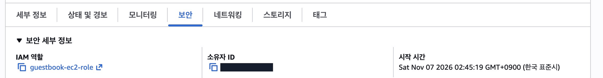
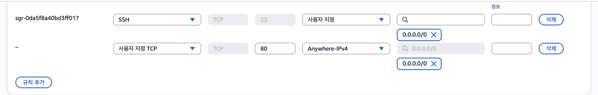
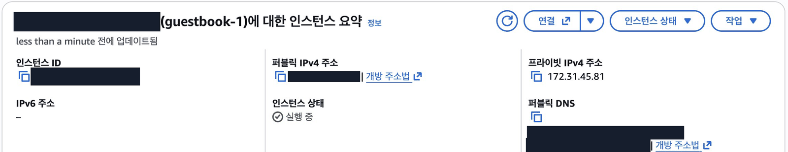
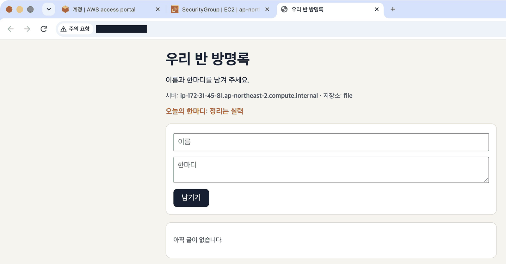
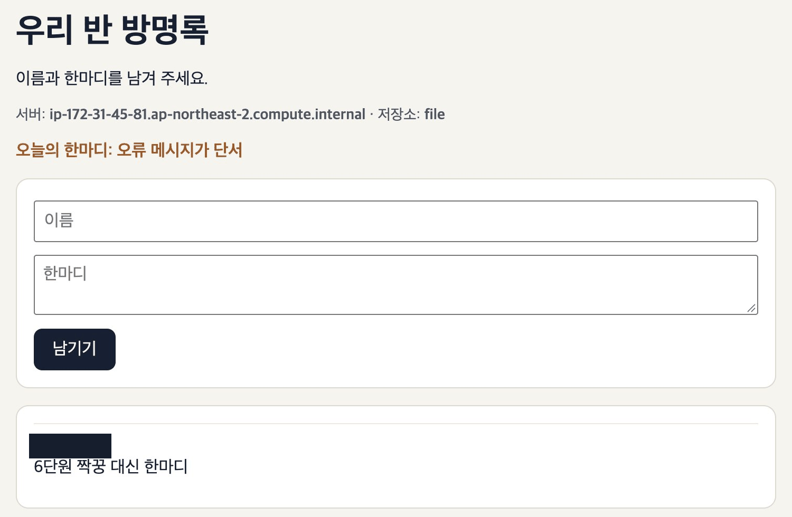

## 따라 하기

### 내 방명록을 세상에 공개하기

1. 인스턴스 → 보안 탭 → 보안 그룹 클릭 <a href="https://ap-northeast-2.console.aws.amazon.com/ec2/home?region=ap-northeast-2#Instances:" target="_blank" rel="noopener">콘솔 열기 ↗</a>

   

2. 인바운드 규칙 편집 → 사용자 지정 TCP, 포트 80, 소스 0.0.0.0/0

   

3. 인스턴스의 퍼블릭 IPv4 주소 복사(숫자 옆 복사 아이콘) <a href="https://ap-northeast-2.console.aws.amazon.com/ec2/home?region=ap-northeast-2#Instances:" target="_blank" rel="noopener">콘솔 열기 ↗</a>

   

4. 새 탭에서 http://주소 접속

   

5. 주소를 짝꿍에게 주고, 짝꿍 방명록에 한마디 남기기

   

**안 열리면** 우리 앱은 http입니다. 그 탭은 닫고 새 탭에 http://주소를 입력하세요. 「보안 연결을 지원하지 않습니다」 경고가 뜨면 「사이트로 이동」을 누릅니다.

**도전** 소스를 「내 IP」로 바꾸면 짝꿍이 들어올 수 있을까요? 해 보고 이유를 추측하세요.

## 막혔을 때

### 「사이트에 연결할 수 없음」이 뜹니다

:::caution[고칠 것]
> 「사이트에 연결할 수 없음」「응답하는 데 시간이 너무 오래 걸립니다」 `ERR_TIMED_OUT` `ERR_CONNECTION_TIMED_OUT`

Chrome 이 주소를 https 로 바꿔 열었습니다. 우리 앱은 http 로만 열려 있습니다.

아래 순서로 고칩니다.

1. 그 탭은 닫습니다.
2. 새 탭에 `http://주소` 를 직접 입력합니다.
3. 「이 사이트는 보안 연결을 지원하지 않습니다」가 뜨면 「사이트로 이동」을 누릅니다.
:::

### 새 탭에서 `http://` 로 열어도 안 열립니다

:::caution[고칠 것]
인바운드 규칙이 없거나 앱이 꺼져 있습니다.

아래 순서로 고칩니다.

1. 보안 그룹 인바운드 규칙에 사용자 지정 TCP, 포트 `80`, 소스 `0.0.0.0/0` 이 있는지 봅니다. <a href="https://ap-northeast-2.console.aws.amazon.com/ec2/home?region=ap-northeast-2#SecurityGroups:" target="_blank" rel="noopener">콘솔 열기 ↗</a>
2. 서버에서 앱이 켜져 있는지 봅니다.

```bash
# 앱 서비스가 잘 돌고 있는지 상태를 봅니다
systemctl status guestbook --no-pager
```
:::

### 인바운드 규칙에 SSH 22 규칙이 이미 있습니다

:::tip[정상입니다]{icon="approve-check-circle"}
4단원 시작 마법사가 만든 규칙입니다. 80 규칙만 더하면 됩니다.
:::

### 퍼블릭 IP 옆에 「개방 주소법」 링크가 있습니다

:::tip[정상입니다]{icon="approve-check-circle"}
> 「개방 주소법」

「Open address」를 기계로 옮긴 링크 이름입니다. 주소는 숫자 옆 복사 아이콘으로 복사하고, 새 탭에 `http://` 를 붙여 엽니다.
:::

:::note[그래도 안 되면]
화면을 그대로 두고 손을 드세요. 좌석 번호, 단원 번호, 화면의 오류 문구를 말해 주세요.
:::
