## 따라 하기

### 버킷 하나로 웹사이트 공개하기

방명록 앱은 EC2 에 그대로 두고 S3 에는 소개 페이지를 따로 올립니다. S3 정적 웹사이트는 파일을 그대로 내주기만 해서 글을 등록하는 앱은 돌릴 수 없습니다. 올리는 것은 저장소 `static` 폴더의 `index.html`, `style.css` 두 파일입니다. <a href="https://github.com/pghoya2956/guestbook-lab/tree/main/static" target="_blank" rel="noopener">static 폴더 보기 ↗</a>

1. 버킷 만들기: 이름 guestbook-[좌석 번호]-[아무 숫자], 나머지는 기본값으로 두고 맨 아래 「버킷 만들기」를 누릅니다. <a href="https://s3.console.aws.amazon.com/s3/bucket/create?region=ap-northeast-2" target="_blank" rel="noopener">콘솔 열기 ↗</a>

2. 올릴 파일을 준비합니다. 저장소 ZIP 을 받아 압축을 풉니다. 풀린 폴더 안 `static` 폴더에 `index.html`, `style.css`, `notice.txt` 세 파일이 있습니다. 이 단원에서는 `index.html`, `style.css` 두 파일만 올립니다. <a href="https://github.com/pghoya2956/guestbook-lab" target="_blank" rel="noopener">저장소 열기 ↗</a> <a href="https://github.com/pghoya2956/guestbook-lab/archive/refs/heads/main.zip" target="_blank" rel="noopener">ZIP 바로 받기 ↗</a>

   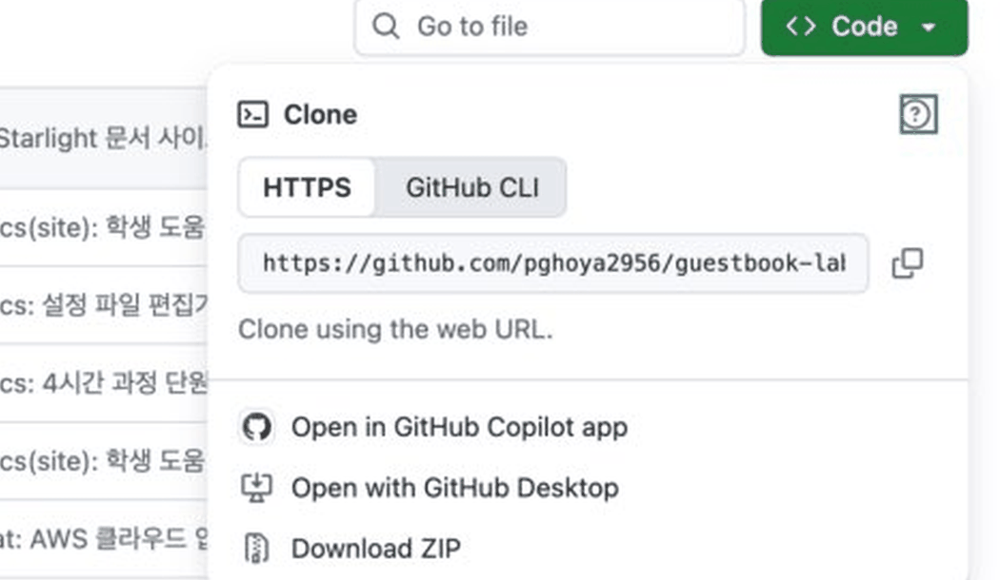

3. 버킷에 두 파일을 올립니다.
   1. 버킷을 만들면 바로 그 버킷의 「객체」 탭이 열립니다. 오른쪽 위 「업로드」를 누릅니다.

      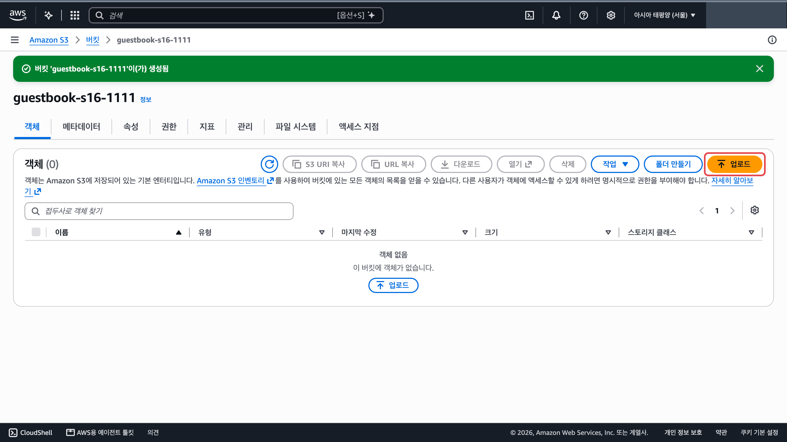

   2. 「파일 추가」를 눌러 `static` 폴더 안의 `index.html`, `style.css` 를 고릅니다. 폴더째 끌어 놓거나 「폴더 추가」로 올리면 주소가 `static/index.html` 이 되어 웹사이트가 404 를 냅니다.

      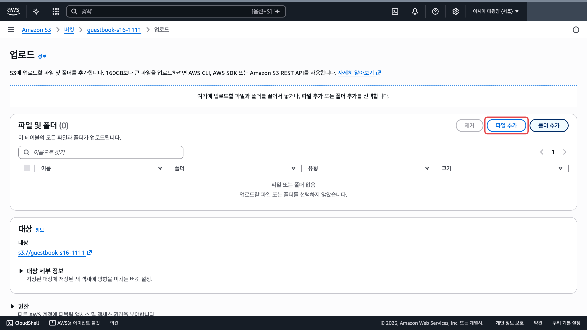

   3. 표에 두 파일이 보이면 맨 아래 「업로드」를 누릅니다.

      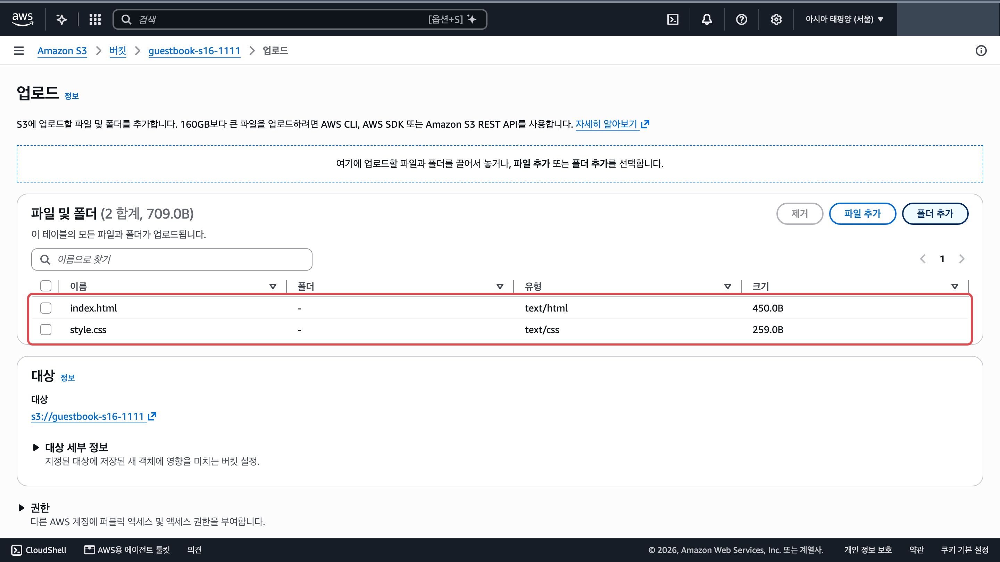

4. 정적 웹 사이트 호스팅을 켭니다.
   1. 버킷 목록에서 내 버킷 이름을 누릅니다. 이미 버킷 안에 있으면 이 단계는 건너뜁니다. <a href="https://s3.console.aws.amazon.com/s3/buckets?region=ap-northeast-2" target="_blank" rel="noopener">버킷 목록 ↗</a>

      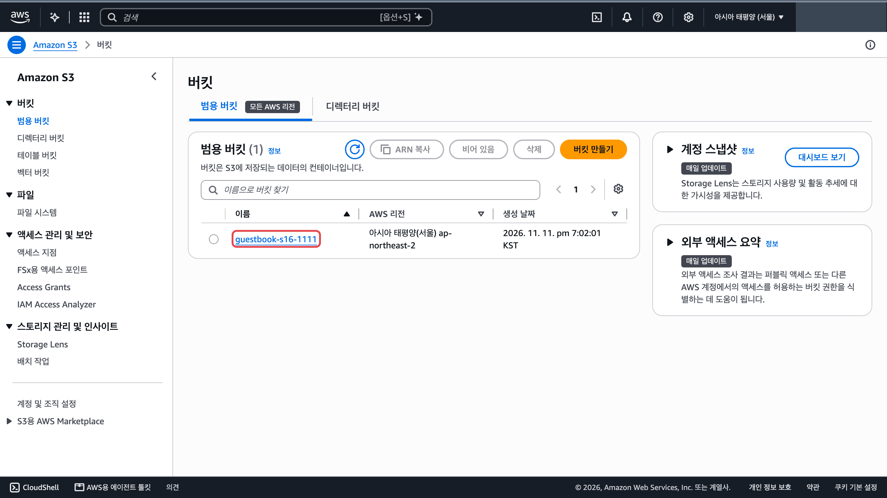

   2. 버킷 이름 아래 탭 줄에서 「속성」을 누릅니다.

      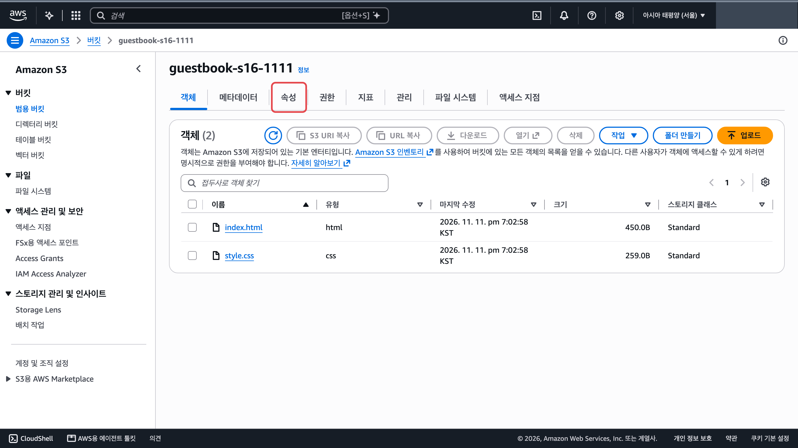

   3. 속성 탭을 맨 아래까지 내립니다. 「정적 웹 사이트 호스팅」 칸(①)의 「편집」(②)을 누릅니다.

      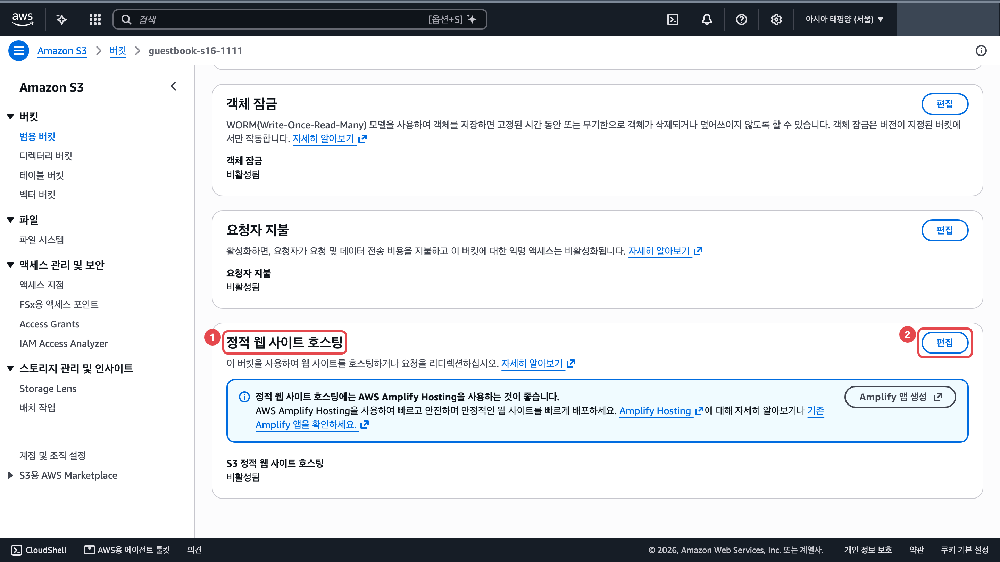

   4. 「활성화」(①)를 고르고 「인덱스 문서」 칸(②)에 `index.html` 을 직접 입력합니다.

      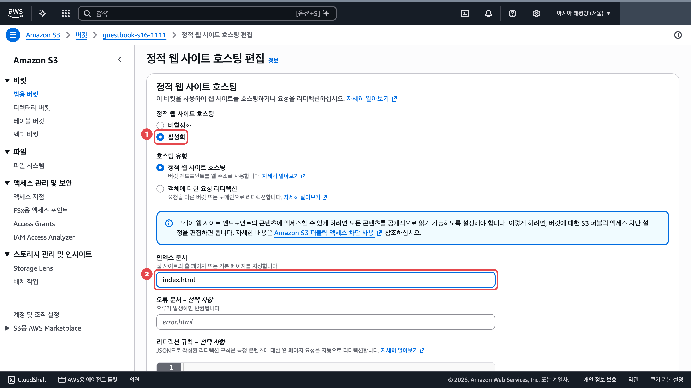

   5. 맨 아래 「변경 사항 저장」을 누릅니다.

      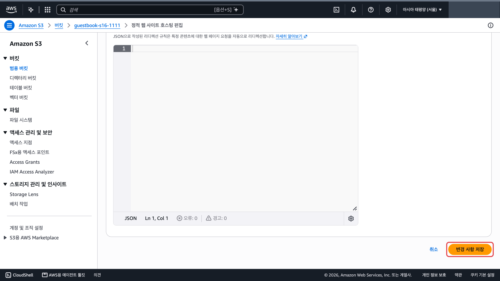

5. 권한 → 퍼블릭 액세스 차단 끄기(입력란에 「확인」)

   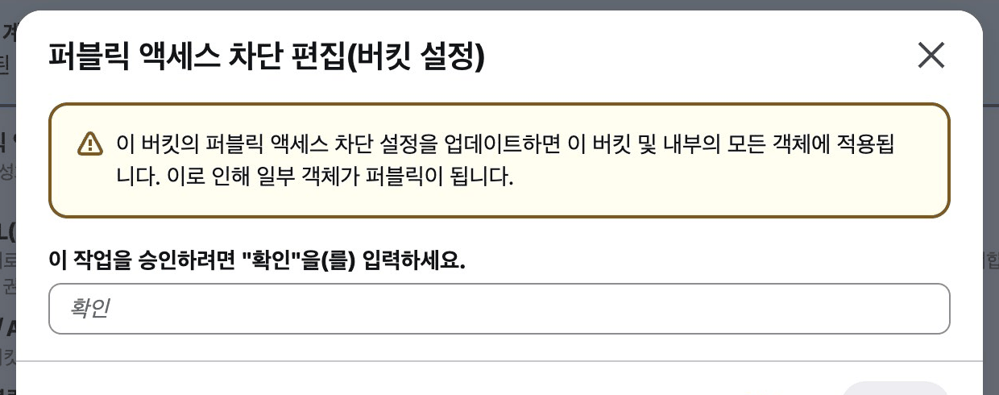

6. 권한 → 버킷 정책에 아래 내용 붙여 넣기

   ```json
   {
     "Version": "2012-10-17",
     "Statement": [{
       "Effect": "Allow",
       "Principal": "*",
       "Action": "s3:GetObject",
       "Resource":
         "arn:aws:s3:::버킷이름/*"
     }]
   }
   ```

   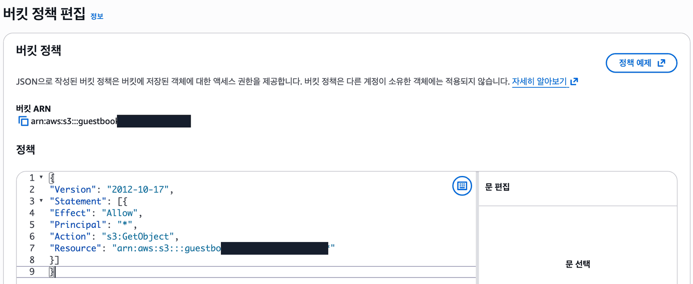

7. 속성 맨 아래 웹사이트 주소를 새 탭에서 열기

   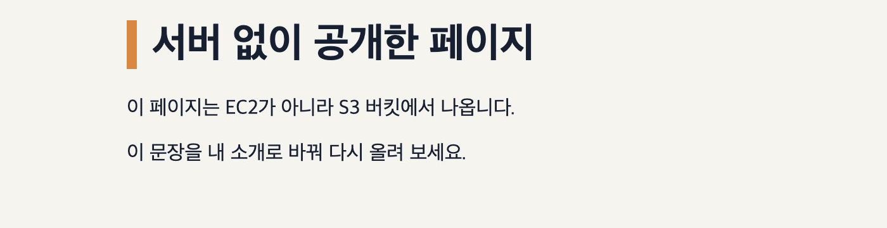

## 막혔을 때

### 버킷 정책 저장이 거부됩니다

:::caution[고칠 것]
> 「버킷 정책 변경 사항을 저장할 수 없습니다. 버킷 정책을 편집할 권한이 없거나 버킷 정책이 퍼블릭 액세스 차단 설정과 충돌하는 퍼블릭 액세스 수준을 부여합니다.」

권한 문제처럼 보이지만 버킷의 퍼블릭 액세스 차단이 아직 켜져 있습니다.

아래 순서로 고칩니다.

1. 권한 탭의 퍼블릭 액세스 차단에서 「편집」을 누릅니다.
2. 「모든 퍼블릭 액세스 차단」 체크를 끄고 저장합니다.
3. 입력란에 `확인` 을 넣습니다.
4. 버킷 정책을 다시 저장합니다.
:::

### 권한 탭에 계정 차단 안내가 보입니다

:::tip[정상입니다]{icon="approve-check-circle"}
> 「현재 이 계정의 퍼블릭 액세스 차단 설정이 활성화됨」

계정의 ACL 차단 안내입니다. 버킷 설정만 끄면 됩니다.
:::

### 정적 웹사이트 호스팅이 저장되지 않습니다

:::caution[고칠 것]
인덱스 문서 칸의 `index.html` 은 흐린 예시일 뿐 값이 비어 있습니다.

칸에 `index.html` 을 직접 입력하고 저장합니다.
:::

### 버킷 이름이 받아들여지지 않습니다

:::caution[고칠 것]
버킷 이름에는 소문자, 숫자, 하이픈만 쓸 수 있습니다.

`guestbook-s01-1104` 처럼 짓습니다. 「버킷 네임스페이스」는 기본값(글로벌) 그대로 둡니다.
:::

### 웹사이트 주소에서 보안 연결 경고가 뜹니다

:::tip[정상입니다]{icon="approve-check-circle"}
> 「이 사이트는 보안 연결을 지원하지 않습니다」

웹사이트 주소도 http 입니다. 「사이트로 이동」을 누릅니다.
:::

### 속성 탭에 「편집」이 여러 개 있습니다

:::caution[고칠 것]
버전 관리 같은 다른 설정에도 「편집」이 있습니다.

속성 탭을 맨 아래까지 내려 「정적 웹사이트 호스팅」 칸의 「편집」을 누릅니다.
:::

### static 폴더에 notice.txt 가 같이 있습니다

:::caution[고칠 것]
notice.txt 는 9단원에서 공개하지 않는 버킷에 올리는 파일입니다.

이 버킷에는 `index.html` 과 `style.css` 두 개만 올립니다. 이미 올렸으면 notice.txt 를 골라 삭제합니다.
:::

### 웹사이트 주소가 `404 Not Found` 를 냅니다

:::caution[고칠 것]
> 「404 Not Found」, 「Code: NoSuchKey」

버킷 맨 위에 `index.html` 이 없습니다. `static` 폴더째 올렸으면 객체 탭에 `static/` 폴더 하나만 보입니다.

아래 순서로 고칩니다.

1. 버킷의 「객체」 탭에서 `static/` 폴더 행을 체크하고 「삭제」를 누릅니다.
2. 「업로드」 → 「파일 추가」로 `static` 폴더 안의 `index.html`, `style.css` 두 파일을 골라 다시 올립니다.
3. 객체 탭에 `index.html`, `style.css` 가 폴더 없이 바로 보이는지 봅니다.
4. 「속성」 탭 맨 아래 「정적 웹 사이트 호스팅」의 「인덱스 문서」가 `index.html` 인지 봅니다.
:::

### 받은 ZIP 이름이 `guestbook-lab-main (1).zip` 입니다

:::tip[정상입니다]{icon="approve-check-circle"}
같은 파일을 전에 받은 적이 있어 이름 뒤에 번호가 붙었습니다. 그 파일을 풀어 쓰면 됩니다.
:::

:::note[그래도 안 되면]
화면을 그대로 두고 손을 드세요. 좌석 번호, 단원 번호, 화면의 오류 문구를 말해 주세요.
:::
