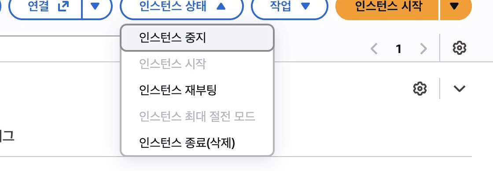

---
# 생성물. lms build 가 courses/aws-intro/units/u08 에서 만든다. 손으로 고치지 않는다. 원본 해시 0fe7b68379b0
title: 8단원 퇴실 전 서버 중지
description: 하루 회고, 서버 중지. 실습 순서, 복사할 명령, 막혔을 때 고치는 법
---

막혔을 때: 이 단원 전체 흐름 영상 (24초)

화면 위 띠의 번호가 아래 「따라 하기」 단계 번호와 같습니다. 누를 곳은 빨간 테두리로 보입니다. 막힌 단계 번호를 찾아 그 부분만 확인하는 용도입니다.

<video controls preload="none" width="100%" src="/guestbook-lab/video/u8.mp4"></video>

## 따라 하기

### 오늘 만든 구조를 직접 그려 보세요

브라우저 → 보안 그룹 → EC2(급식 리뷰 앱과 IAM 역할)

EC2 → S3 공지 버킷(IAM 역할로 notice.txt 읽기)

**한 줄 회고** 가장 어려웠던 것 하나, 내일 더 알고 싶은 것 하나

**퇴실 전 할 일** 서버를 **중지**합니다. 종료가 아닙니다. 중지는 끄기, 종료는 버리기입니다.

1. 인스턴스 목록에서 `guestbook-1` 행을 체크하고 「인스턴스 상태」 → 「인스턴스 중지」를 누릅니다. 바로 아래 「인스턴스 종료(삭제)」는 누르지 않습니다. <a href="https://ap-northeast-2.console.aws.amazon.com/ec2/home?region=ap-northeast-2#Instances:" target="_blank" rel="noopener">콘솔 열기 ↗</a>

   

2. 확인 창의 「중지」를 누릅니다. 「인스턴스 상태」 칸이 「중지됨」이 되면 됩니다.

## 막혔을 때

### 중지와 종료 중 무엇을 누를지 헷갈립니다

:::caution[고칠 것]
중지는 끄기, 종료는 버리기입니다. 종료한 서버는 다시 켤 수 없습니다.

아래 순서로 고칩니다.

1. 인스턴스 행을 체크합니다.
2. 인스턴스 상태 → **인스턴스 중지**를 누릅니다.
3. 확인 창의 「중지」를 누릅니다.
:::

### 확인 창에 요금이 계속 청구된다고 나옵니다

:::tip[정상입니다]{icon="approve-check-circle"}
> 「연결된 Elastic IP 주소와 EBS 볼륨에 대한 요금은 계속 청구됩니다」

중지해도 디스크 요금은 남는다는 안내입니다. 그대로 「중지」를 누릅니다.
:::

### 실수로 종료했습니다

:::caution[고칠 것]
손을 드세요. 강사가 다음 단원에 필요한 상태로 맞춰 줍니다.
:::

:::note[그래도 안 되면]
화면을 그대로 두고 손을 드세요. 좌석 번호, 단원 번호, 화면의 오류 문구를 말해 주세요.
:::
