<details class="walkthrough">
<summary>막혔을 때: 이 단원 전체 흐름 영상 (2분 28초)</summary>

화면 위 띠의 번호가 아래 「따라 하기」 단계 번호와 같습니다. 누를 곳은 빨간 테두리로 보입니다. 막힌 단계 번호를 찾아 그 부분만 확인하는 용도입니다.

<video controls preload="none" width="100%" src="/guestbook-lab/video/u9.mp4"></video>

</details>

## 따라 하기

### 키 없이 S3를 읽는 서버

**앱에 연결** 공개하지 않는 새 버킷 `guestbook-notice-[좌석 번호]-[숫자]` 에 `notice.txt` 를 올리고(퍼블릭 액세스 차단은 켜 둔 채) 어제 서버가 키 없이 그 파일을 읽게 합니다.

1. 어제 서버를 다시 켭니다. 인스턴스 목록에서 `guestbook-1` 행을 체크(①)하고 「인스턴스 상태」(②) → 「인스턴스 시작」(③)을 누릅니다. 오른쪽 위 주황 「인스턴스 시작」은 새 서버를 만드는 단추라 누르지 않습니다. 「인스턴스 상태」 칸이 「실행 중」이 되면 다음으로 넘어갑니다. <a href="https://ap-northeast-2.console.aws.amazon.com/ec2/home?region=ap-northeast-2#Instances:" target="_blank" rel="noopener">콘솔 열기 ↗</a>

   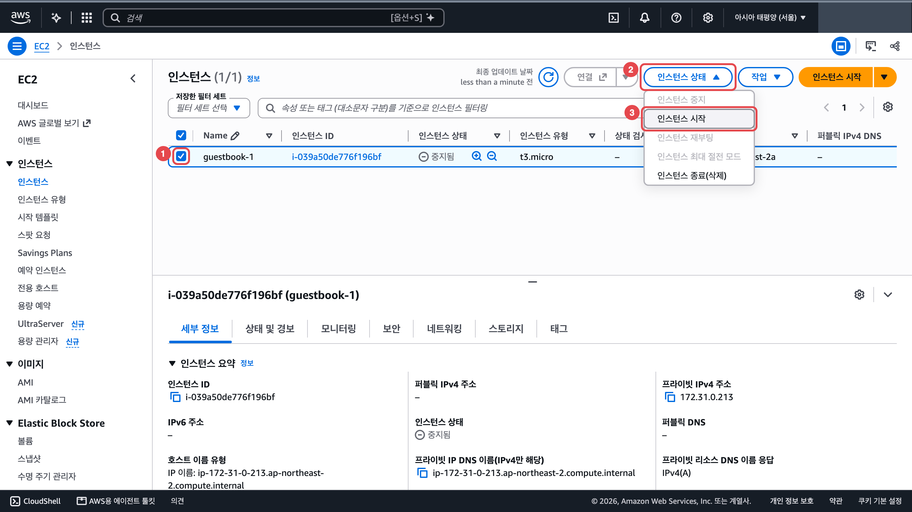

2. 공지 버킷을 만듭니다. <a href="https://s3.console.aws.amazon.com/s3/bucket/create?region=ap-northeast-2" target="_blank" rel="noopener">콘솔 열기 ↗</a>
   1. 버킷 만들기 화면의 「버킷 이름」 칸에 `guestbook-notice-[좌석 번호]-[숫자]` 를 넣습니다. 예: `guestbook-notice-s01-1112`

      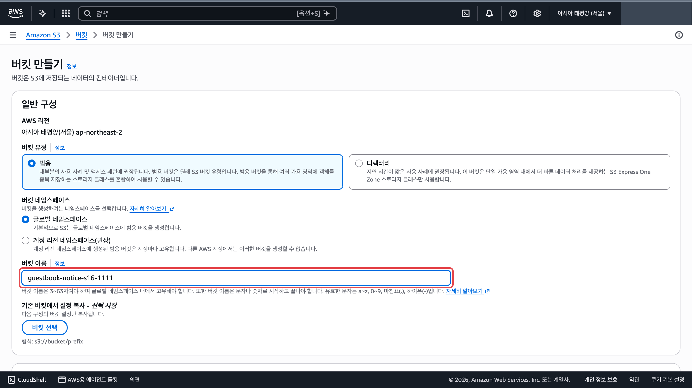

   2. 아래로 내려 「모든 퍼블릭 액세스 차단」 체크가 켜져 있는지 봅니다. 켜진 그대로 두고 맨 아래 「버킷 만들기」를 누릅니다.

      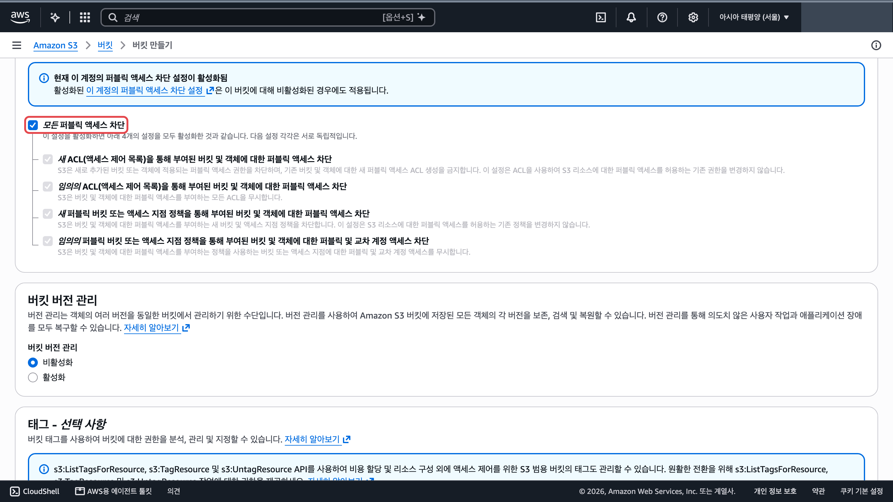

3. 공지 버킷에 `notice.txt` 를 올립니다. 파일은 [7단원](/guestbook-lab/u7/)에서 받은 ZIP 을 푼 폴더의 `static` 폴더 안에 있습니다. <a href="https://github.com/pghoya2956/guestbook-lab/archive/refs/heads/main.zip" target="_blank" rel="noopener">ZIP 바로 받기 ↗</a>
   1. 버킷을 만들면 그 버킷의 「객체」 탭이 열립니다. 오른쪽 위 주황 「업로드」를 누릅니다. 다른 화면에 있으면 버킷 목록에서 공지 버킷 이름을 눌러 들어옵니다. <a href="https://s3.console.aws.amazon.com/s3/buckets?region=ap-northeast-2" target="_blank" rel="noopener">버킷 목록 ↗</a>

      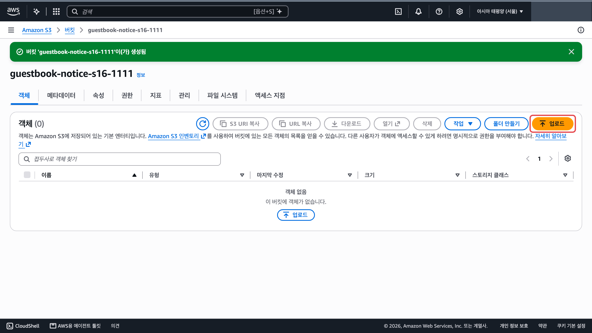

   2. 「파일 추가」(①)로 `notice.txt` 를 고릅니다. 표에 `notice.txt` 한 줄(②)이 보이면 맨 아래 주황 「업로드」를 누릅니다.

      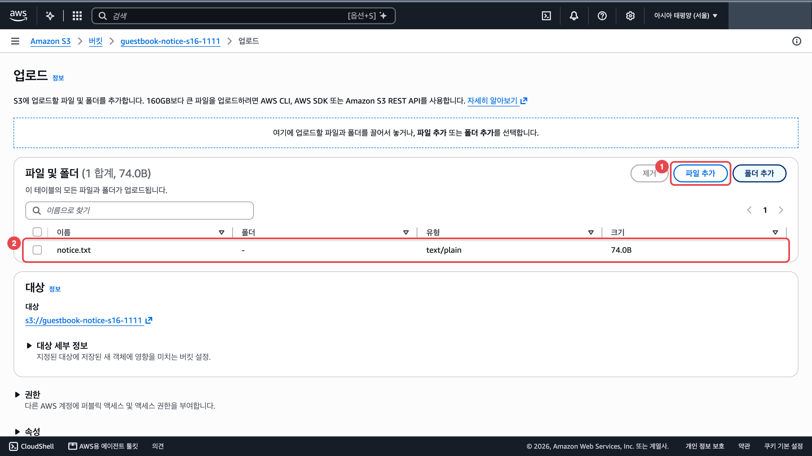

   3. 초록 「업로드 성공」이 보이면 됩니다.

      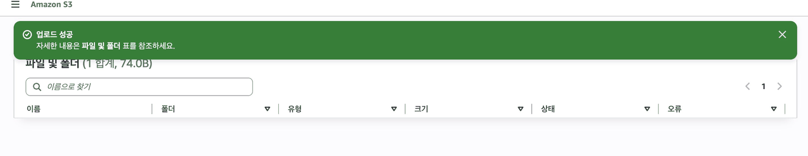

4. 서버에 접속합니다.
   1. 인스턴스 목록에서 `guestbook-1` 행을 체크(①)하고 위쪽 「연결」(②)을 누릅니다. 연결 화면이 새 탭으로 열립니다. <a href="https://ap-northeast-2.console.aws.amazon.com/ec2/home?region=ap-northeast-2#Instances:" target="_blank" rel="noopener">콘솔 열기 ↗</a>

      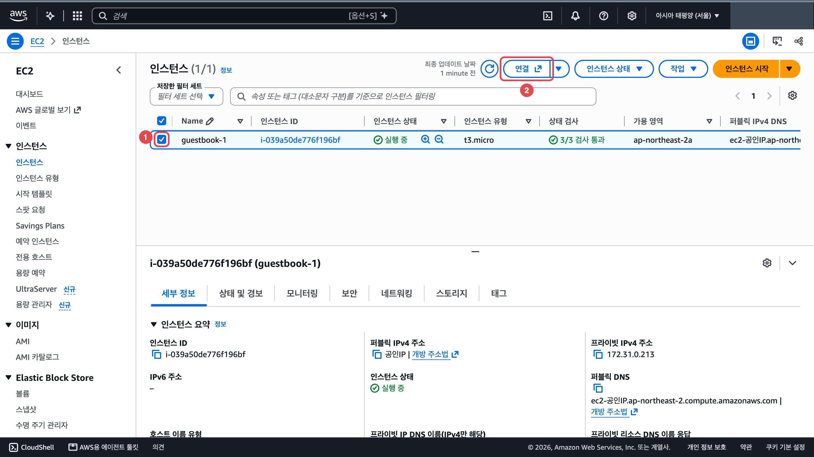

   2. 「연결 방법 선택」의 카드 네 개 가운데 「SSM Session Manager」(①)를 누르고 오른쪽 아래 주황 「연결」(②)을 누릅니다. 까만 화면에 `sh-5.2$` 가 보이면 됩니다.

      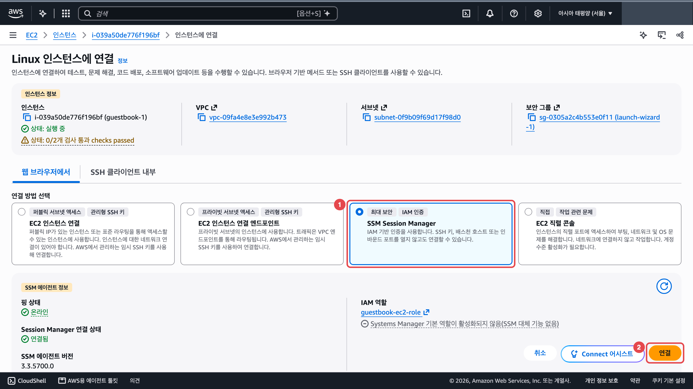

5. 까만 화면에 아래 명령을 하나씩 칩니다. `공지버킷` 자리에는 내 공지 버킷 이름을 넣습니다.

   ```bash
   # 이 서버에 AWS 키 파일이 있는지 봅니다. 없는 것이 정상입니다
   ls ~/.aws
   ```

   이렇게 나오면 됩니다.

   ```text
   ls: cannot access '/home/ssm-user/.aws': No such file or directory
   ```

   ```bash
   # 키 파일이 없는데도 이 서버가 AWS 에 누구로 보이는지 봅니다
   aws sts get-caller-identity
   ```

   이렇게 나오면 됩니다.

   ```text
   {
       "UserId": "AROAEXAMPLEID:i-0123456789abcdef0",
       "Account": "123456789012",
       "Arn": "arn:aws:sts::123456789012:assumed-role/guestbook-ec2-role/i-0123456789abcdef0"
   }
   ```

   ```bash
   # 공지 버킷 안의 파일 목록을 봅니다
   aws s3 ls s3://공지버킷/
   ```

   이렇게 나오면 됩니다.

   ```text
   aws: [ERROR]: An error occurred (AccessDenied) when calling the ListObjectsV2 operation: User: arn:aws:sts::123456789012:assumed-role/guestbook-ec2-role/i-0123456789abcdef0 is not authorized to perform: s3:ListBucket on resource: "arn:aws:s3:::공지버킷" because no identity-based policy allows the s3:ListBucket action
   ```

   ```bash
   # notice.txt 내용을 내려받아 화면에 바로 출력합니다
   aws s3 cp s3://공지버킷/notice.txt -
   ```

   이렇게 나오면 됩니다.

   ```text
   download failed: s3://공지버킷/notice.txt to - An error occurred (403) when calling the HeadObject operation: Forbidden
   ```

6. 거부되는 것을 봤으면 서버 역할 `guestbook-ec2-role` 에 `AmazonS3ReadOnlyAccess` 를 붙입니다. 콘솔 탭으로 돌아가 아래 순서로 합니다.
   1. IAM 역할 목록에서 `guestbook-ec2-role` 이름을 누릅니다. <a href="https://console.aws.amazon.com/iam/home#/roles" target="_blank" rel="noopener">콘솔 열기 ↗</a>

      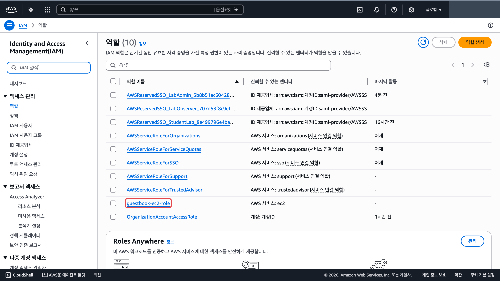

   2. 「권한」 탭의 「권한 정책」 표 오른쪽 위 「권한 추가」(①)를 누르고 「정책 연결」(②)을 고릅니다.

      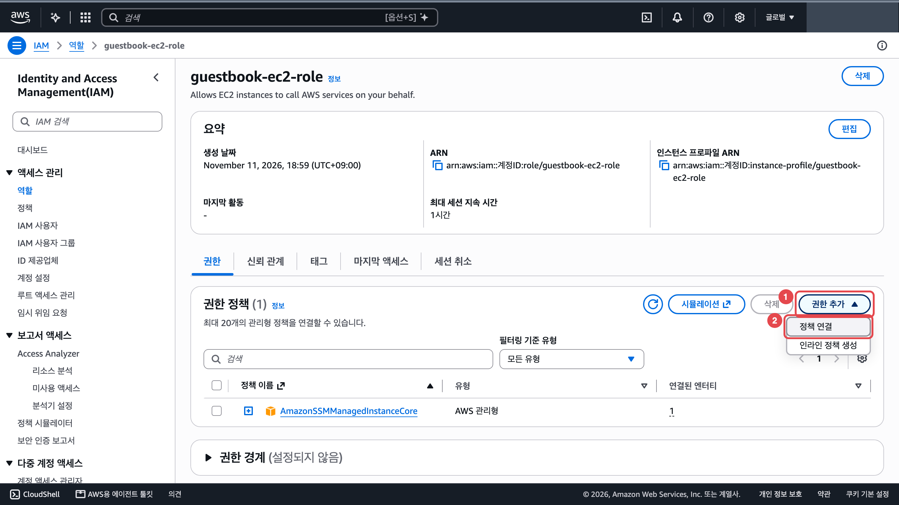

   3. 검색칸(①)에 `AmazonS3ReadOnlyAccess` 를 넣고 Enter 를 누릅니다. 나온 행을 체크(②)하고 오른쪽 아래 주황 「권한 추가」(③)를 누릅니다.

      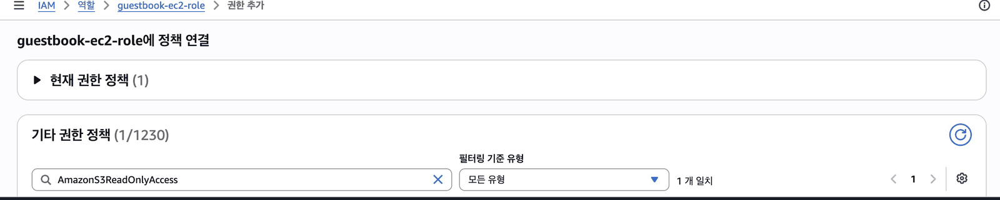

7. 15초쯤 뒤 까만 화면으로 돌아가 같은 명령을 다시 칩니다. 재접속이나 재부팅은 필요 없습니다.

   ```bash
   # 공지 버킷 안의 파일 목록을 봅니다
   aws s3 ls s3://공지버킷/
   ```

   이렇게 나오면 됩니다.

   ```text
   2026-11-10 07:18:43         74 notice.txt
   ```

   ```bash
   # notice.txt 내용을 내려받아 화면에 바로 출력합니다
   aws s3 cp s3://공지버킷/notice.txt -
   ```

   이렇게 나오면 됩니다.

   ```text
   공지: 이 문장은 S3 버킷의 notice.txt 에서 읽어 왔습니다.
   ```

8. 앱이 어느 버킷을 읽을지 설정 파일에 적습니다.
   1. 설정 파일을 엽니다.

      ```bash
      # 앱 설정 파일을 nano 편집기로 엽니다
      sudo nano /opt/guestbook/config.env
      ```

   2. 파일 안에는 이미 빈 `NOTICE_BUCKET=` 줄이 있습니다. 화살표 키로 그 줄(①)까지 내려가 `=` 바로 뒤에 내 공지 버킷 이름을 이어 씁니다. 새 줄을 따로 더하지 않습니다.

      ```text
      NOTICE_BUCKET=공지버킷
      ```

   3. Ctrl+O(②)를 누르고 Enter 를 눌러 저장합니다. Ctrl+X(③)로 나옵니다.

      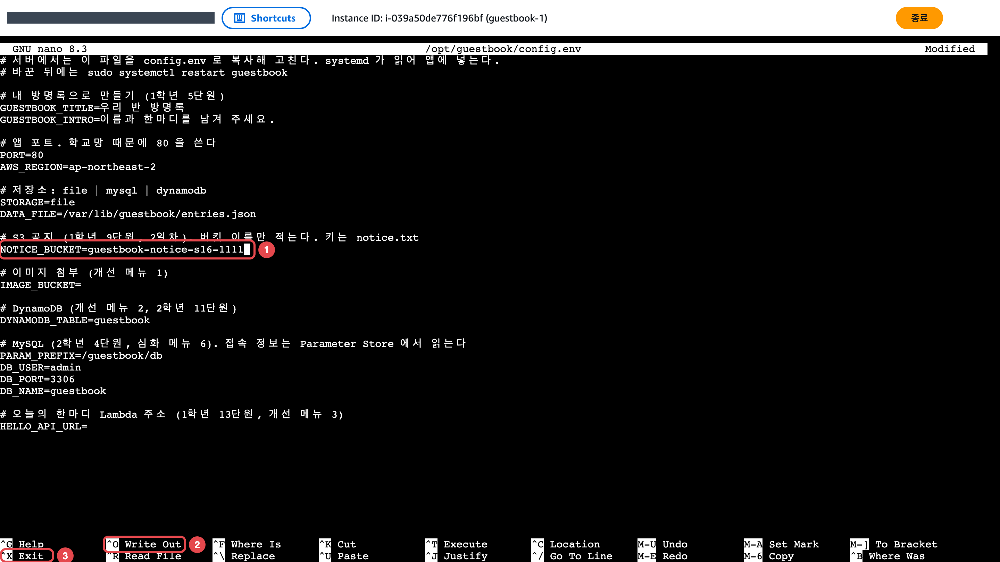

   4. 앱을 다시 시작합니다.

      ```bash
      # 앱을 다시 켜서 바뀐 설정을 읽게 합니다
      sudo systemctl restart guestbook
      ```

9. 방명록을 엽니다. 인스턴스 목록에서 `guestbook-1` 행을 체크(①)하면 아래 「세부 정보」 탭에 「퍼블릭 IPv4 주소」(②)가 보입니다. 그 값을 복사해 새 탭에 `http://공인IP` 로 엽니다. 사진의 실제 주소는 가렸습니다. <a href="https://ap-northeast-2.console.aws.amazon.com/ec2/home?region=ap-northeast-2#Instances:" target="_blank" rel="noopener">콘솔 열기 ↗</a>

   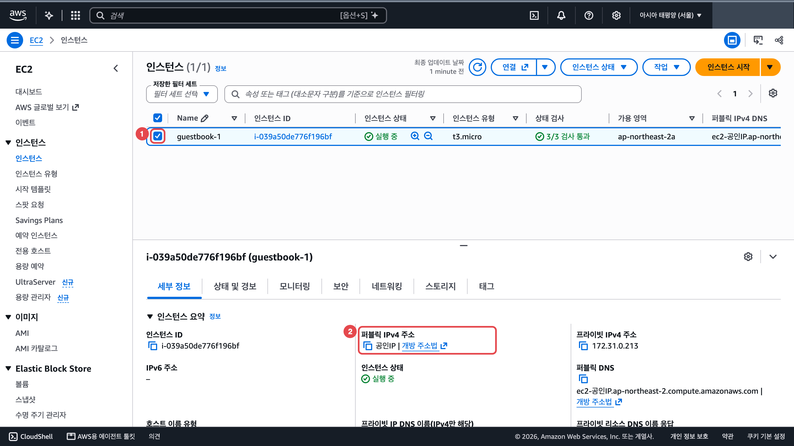

   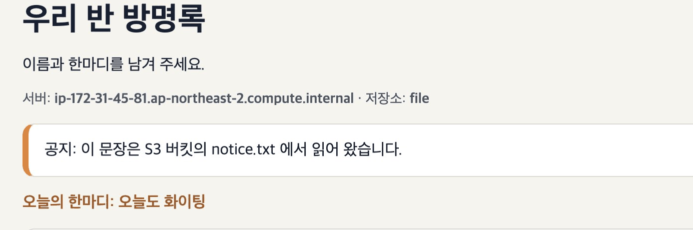

**도전** notice.txt 내용을 바꿔 다시 올리면 앱을 재시작하지 않아도 바뀌나요?

## 막혔을 때

### 어제 서버를 켜려는데 새 서버 만들기 화면이 열립니다

:::caution[고칠 것]
오른쪽 위 주황 「인스턴스 시작」은 새 서버를 만드는 버튼입니다. 목록을 새로 열면 행 체크도 풀려서 「인스턴스 상태」 메뉴가 회색이 됩니다.

아래 순서로 고칩니다.

1. `guestbook-1` 행을 체크합니다. <a href="https://ap-northeast-2.console.aws.amazon.com/ec2/home?region=ap-northeast-2#Instances:" target="_blank" rel="noopener">콘솔 열기 ↗</a>
2. **인스턴스 상태 → 인스턴스 시작**을 누릅니다.
:::

### 다시 켠 서버의 퍼블릭 IP 가 어제와 다릅니다

:::tip[정상입니다]{icon="approve-check-circle"}
중지했다가 켜면 공인 IP 가 바뀝니다. 12단원에서 로드 밸런서 주소를 쓰는 이유입니다.
:::

### `aws s3 ls` 가 거부됩니다

:::tip[정상입니다]{icon="approve-check-circle"}
> `An error occurred (AccessDenied) when calling the ListObjectsV2 operation: ... because no identity-based policy allows the s3:ListBucket action`

서버 역할에 아직 S3 권한이 없어서입니다. 이 거부를 읽고 권한을 붙이는 것이 이 단원의 실습입니다. `aws s3 cp` 는 `An error occurred (403) when calling the HeadObject operation: Forbidden` 만 냅니다. 원인은 같습니다.

권한은 아래 순서로 붙입니다.

1. IAM → 역할 → `guestbook-ec2-role` 을 엽니다. <a href="https://console.aws.amazon.com/iam/home#/roles" target="_blank" rel="noopener">콘솔 열기 ↗</a>
2. 권한 추가 → 정책 연결에서 `AmazonS3ReadOnlyAccess` 를 붙입니다.
3. 15초쯤 뒤 같은 명령을 다시 칩니다. 재접속이나 재부팅은 필요 없습니다.
:::

### 정책을 붙였는데 방명록에 공지가 안 보입니다

:::caution[고칠 것]
앱이 어느 버킷을 읽을지 아직 모르거나 빈 `NOTICE_BUCKET=` 줄이 남아 있습니다. 설정 파일에 같은 이름이 두 줄 있으면 아래쪽 줄 값이 쓰입니다.

아래 순서로 고칩니다.

1. 설정 파일을 엽니다.

   ```bash
   # 앱 설정 파일을 nano 편집기로 엽니다
   sudo nano /opt/guestbook/config.env
   ```

2. `NOTICE_BUCKET=` 로 시작하는 줄이 하나만 있고 그 줄에 버킷 이름이 붙어 있는지 봅니다. 빈 줄이 따로 있으면 그 줄을 지웁니다(줄 위에서 Ctrl+K). `공지버킷이름` 자리에 내 공지 버킷 이름을 넣습니다.

   ```text
   NOTICE_BUCKET=공지버킷이름
   ```

3. Ctrl+O 를 누르고 Enter 로 저장한 뒤 Ctrl+X 로 나옵니다.
4. 앱을 다시 시작합니다.

   ```bash
   # 앱을 다시 켜서 바뀐 설정을 읽게 합니다
   sudo systemctl restart guestbook
   ```
:::

### 권한을 주기 전인데도 공지가 읽힙니다

:::caution[고칠 것]
7단원의 공개 버킷에 올렸습니다. 공개 버킷은 역할 없이도 읽혀서 거부 장면이 나오지 않습니다.

퍼블릭 액세스 차단을 켠 채로 새 버킷 `guestbook-notice-좌석번호-숫자` 를 만들어 `notice.txt` 를 올립니다.
:::

### notice.txt 를 어디서 가져오나요

:::tip[정상입니다]{icon="approve-check-circle"}
[7단원](/guestbook-lab/u7/)에서 받은 ZIP 을 푼 폴더의 `static` 폴더에 있습니다. 그 파일을 공개하지 않는 공지 버킷에 올립니다. <a href="https://github.com/pghoya2956/guestbook-lab/archive/refs/heads/main.zip" target="_blank" rel="noopener">ZIP 바로 받기 ↗</a> <a href="https://github.com/pghoya2956/guestbook-lab/blob/main/static/notice.txt" target="_blank" rel="noopener">notice.txt 보기 ↗</a>
:::

### 역할에 정책을 붙이는 메뉴를 모르겠습니다

:::caution[고칠 것]
아래 순서로 붙입니다.
1. IAM → 역할 → `guestbook-ec2-role` 을 엽니다. <a href="https://console.aws.amazon.com/iam/home#/roles" target="_blank" rel="noopener">콘솔 열기 ↗</a>
2. 「권한 추가」 → 「정책 연결」을 누릅니다.
3. `AmazonS3ReadOnlyAccess` 를 검색해 체크하고 「권한 추가」를 누릅니다.
:::

:::note[그래도 안 되면]
화면을 그대로 두고 손을 드세요. 좌석 번호, 단원 번호, 화면의 오류 문구를 말해 주세요.
:::
